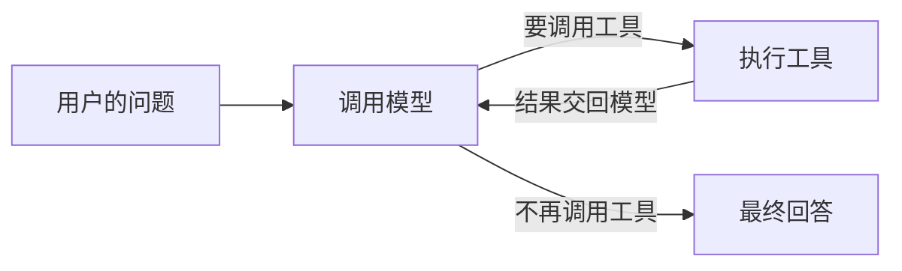

# 第 1 天：60 行写出第一个 Agent

> 最后核对：2026-11-01

今天你会写出第一个 Agent：问它一个术语，它会自己决定要不要查术语表、查哪个词、查几次，拿到结果后再回答你。全部代码 60 行左右，不用任何框架和 SDK，只用 Node.js 自带的 `fetch`。

学完今天，你会：

- 说清楚 Agent 和一次普通的模型调用有什么区别
- 看懂一次工具调用从请求到结果的完整过程
- 亲手写出 Agent 的核心循环，并用测试验证它

写完你会发现，Agent 并不神秘，核心就是一个循环。后面 59 天做的事情，都是让这个循环更有用、更可靠、更安全。

## 准备环境

**Node.js 22.18 及以上。** 先用 `node -v` 看一下版本。从 22.18 开始，Node.js 能直接运行 `.ts` 文件：运行前把类型标注去掉，不做类型检查，也不用编译。类型检查交给编辑器和 `npm run typecheck`。这种方式只支持去掉类型就能运行的语法，所以课程里不用 `enum` 这类需要转换的写法。

**下载课程代码：**

```bash
git clone https://github.com/crisweb1994/60-days-agent.git
cd 60-days-agent
npm install
```

装好以后，先用参考答案跑一遍第 1 天的测试，确认环境没问题：

```bash
npm run check 1 -- --solution
```

应该全部通过。如果报错，多半是 Node.js 版本太低，或者依赖没有装好。

**一个模型的 API Key。** 任选一家提供 OpenAI 兼容接口的模型服务，比如 DeepSeek、通义千问、智谱 GLM、Kimi、MiniMax，注册后创建一个 API Key。然后复制配置文件：

```bash
cp .env.example .env
```

在 `.env` 里填三项：接口地址 `OPENAI_BASE_URL`、API Key `OPENAI_API_KEY` 和模型名 `OPENAI_MODEL`。各家的接口地址写在 `.env.example` 的注释里，模型名见 [docs/models.md](../../docs/models.md)。

今天建议选普通的对话模型，先不要用推理模型（回答前会先输出一段思考过程的那种）。推理模型的回复里会多出思考内容，各家的处理规则也不一样，第 2 天和第 8 天再讲。

也可以用 [Ollama](https://ollama.com) 在本地跑模型，不花钱。记得从[支持工具调用的模型](https://ollama.com/search?c=tools)里挑，太小的模型往往用不好工具。

只做练习的话，API Key 可以先不填：`npm run check` 用的是本地的 mock 模型，不联网，也不花钱。想真正和你的 Agent 对话，才需要真实的模型。

## Agent 是什么

### 先看一次普通的模型调用

普通的聊天程序是这样的：把问题发给模型，模型回一段话，结束。模型只能凭训练时学到的知识回答。问它你们团队内部的术语，比如「潮汐窗口」，它要么说不知道，要么一本正经地编一个。

要让模型答对，就得把它不知道的信息交给它。常见的做法有三种。

**做法一：把术语表直接写进提示词。** 今天的术语表只有 6 条，全部塞进 system prompt 完全可行，而且最简单。但术语表一旦变成几千条就不行了：每次请求都要带上全部内容，费钱、变慢，还可能超出模型的上下文窗口。更麻烦的是，很多信息根本没法提前写进去，比如实时的天气、数据库里的订单、刚搜到的网页。

**做法二：写死流程，先查表再回答。** 程序先从问题里找出术语，查到定义后，连同问题一起交给模型。难点在于「从问题里找出术语」本身就不好做：用户可能一次问两个词，可能问的根本不是术语（比如「你好」），也可能写错字。规则越写越多，还是覆盖不全。

**做法三：把查表做成工具，让模型自己决定。** 模型读懂问题以后，自己判断要不要查、查哪个词、查几次；程序只负责执行它的请求，再把结果交回去。这就是 Agent。

### Agent = 模型 + 工具 + 循环

做法三比普通的模型调用多了两样东西：

- **工具**：程序提供给模型的能力，比如查术语表、搜网页、读文件
- **循环**：模型可以先调用工具、看看结果，再决定下一步，直到它认为可以回答了为止

合起来就是一个好记的公式：**Agent = 模型 + 工具 + 循环**。



关键在于，「决定」这件事交给了模型。查不查、查什么、查完够不够、要不要再查一次，都由模型判断，程序只负责执行。这是 Agent 和普通程序最大的区别：你写的不是固定的步骤，而是准备好工具，让模型自己安排。

Claude Code、Cursor 这类编程 Agent，核心也是同样的循环：模型决定读哪个文件、改哪几行、运行什么命令，程序执行后把结果交回给模型。它们比今天的 60 行多出来的，是更多的工具，以及让循环可靠运行的大量工程，比如评估、错误处理、权限和成本控制。这些正是这门课后面要讲的内容。

做法三也不是总比前两种好。数据少、流程固定的时候，做法一和做法二更简单、更便宜，结果也更好预测。第 21 天会专门讨论什么时候该用 Agent，什么时候固定流程就够了。

### 一点历史

让模型边想边做的思路，2022 年的 [ReAct](https://arxiv.org/abs/2210.03629) 论文把它系统地提了出来：模型先写下推理，再选择一个动作（比如搜索），看到结果后继续推理，如此循环。那时只能靠提示词约定输出格式，再由程序从模型生成的文字里解析出动作，很容易出错。

2023 年 6 月，OpenAI 在接口里加入了函数调用（function calling），同年 11 月改成现在的 `tools` 和 `tool_calls`，并支持一次返回多个调用。模型经过专门训练，会按固定格式输出调用请求，接口直接把它解析成结构化的数据。之后各家模型服务基本都兼容了这种格式，这也是今天的代码换一家模型照样能运行的原因。

## 模型是怎么用工具的

在我们用的这种接口里，模型自己不执行任何东西，它只负责生成回复。所谓「调用工具」，其实是模型在回复里说：我想调用 `lookup_term`，参数是 `{"term":"MCP"}`。真正去查术语表的是你的程序，查完再把结果发回给模型。

### 一次完整的往返

下面是用户问「什么是 MCP？」时，程序和模型之间的两次往返。

**第 1 次请求**：发送系统提示、用户的问题，以及有哪些工具可用。

```json
{
  "model": "…",
  "messages": [
    { "role": "system", "content": "你是一个术语助手……" },
    { "role": "user", "content": "什么是 MCP？" }
  ],
  "tools": [{ "type": "function", "function": { "name": "lookup_term", "…": "…" } }]
}
```

**模型回复**：它没有直接回答，而是要求调用工具。

```json
{
  "role": "assistant",
  "content": null,
  "tool_calls": [
    {
      "id": "call_1",
      "type": "function",
      "function": { "name": "lookup_term", "arguments": "{\"term\":\"MCP\"}" }
    }
  ]
}
```

这时回复的 `finish_reason` 是 `tool_calls`，意思是「我先停在这里，等你执行工具」。`finish_reason` 还有别的取值，第 6 天再细讲，今天的代码只看回复里有没有 `tool_calls`。另外有两点要注意：

- `arguments` 是 JSON **字符串**，不是对象，用之前要先 `JSON.parse`
- 有的模型在调用工具的同时还会说一句话，比如「我来查一下术语表」，这时 `content` 不是 null。这句话会随消息留在历史里，但它不是最终回答

**程序执行工具**：调用 `lookupTerm('MCP')`，拿到 MCP 的定义。

**第 2 次请求**：把模型刚才的回复和工具结果都追加到 `messages`，再发一次。

```json
{
  "messages": [
    { "role": "system", "content": "你是一个术语助手……" },
    { "role": "user", "content": "什么是 MCP？" },
    { "role": "assistant", "content": null, "tool_calls": [{ "id": "call_1", "…": "…" }] },
    { "role": "tool", "tool_call_id": "call_1", "content": "MCP（Model Context Protocol）：一个开放协议……" }
  ]
}
```

**模型回复**：有了定义，模型给出最终回答，`finish_reason` 是 `stop`。

```json
{ "role": "assistant", "content": "MCP 是一个开放协议，让 Agent 用统一的方式接入外部的工具和数据……" }
```

从这两次往返里能看出三条规则，写代码时都要用到：

1. **模型不记得上一次请求。** 每次都要把完整的对话历史发过去，`messages` 数组就是 Agent 的记忆。
2. **工具结果放在 `role` 为 `tool` 的消息里**，用 `tool_call_id` 说明它回应的是哪一次调用。
3. **顺序不能乱。** 先是带 `tool_calls` 的 assistant 消息，紧跟着每个调用对应的 tool 消息。漏了前者，或者有调用没交回结果，接口都会直接报错。

### 模型是怎么「决定」的

模型并没有一个专门「做决定」的模块。工具说明会被转换成一段特殊格式的文字，和对话历史一起放进模型的输入。以开源模型为例，它们的对话模板是公开的，能看到工具说明被插在提示词的什么位置、用什么标记包起来。模型在训练中见过大量调用工具的例子，学会了在合适的时候输出一段特定格式的调用请求；模型服务再把这段输出解析成你看到的 `tool_calls`。

明白了这一点，有几件事就好理解了：

- **工具说明要花钱。** 它是输入的一部分，每次请求都按输入 token 计费。工具越多、说明越长，花费越高。
- **说明写得好不好，直接影响效果。** 模型靠阅读 `description` 判断该不该用、怎么用这个工具，写工具说明和写提示词是一回事。第 11 天会专门讲工具设计。
- **模型会犯错。** 它可能该查的时候没查，可能调用一个不存在的工具，也可能生成不合法的 JSON。今天的代码先不处理这些情况，第 5、6 天会补上。
- **提示词能左右它的决定。** 今天的 system prompt 要求「先用 lookup_term 查术语表」。去掉这句话，再问一个模型本来就懂的词（比如 MCP），它很可能直接凭记忆回答，不再查表。

### 一个问题，可能要好几轮

问「Agent 和 MCP 有什么关系？」时，模型需要查两个词。它可能这样做，也可能那样做：

| 做法 | 过程 | 调用模型的次数 |
|---|---|---|
| 一次查两个 | 第 1 轮返回两个工具调用；程序都执行完后，第 2 轮给出回答 | 2 次 |
| 一个一个查 | 第 1 轮查 Agent，第 2 轮查 MCP，第 3 轮给出回答 | 3 次 |

选哪种由模型自己决定。你的代码不能假设模型只调用一个工具，也不能假设只有一轮，所以要写成循环：只要模型还在调用工具，就继续执行、继续问，直到它不再调用为止。

每一轮都要把完整的对话历史重新发一遍，所以轮数越多，输入的 token 越多，花费和等待时间也跟着增加。第 2 天你会亲手算出每次调用花了多少钱。

## 读懂练习代码

打开 [exercise/agent.ts](exercise/agent.ts)。除了两个 TODO，其他部分都已经写好了，先把它们读懂。整个文件正好分成三块，对应公式里的三样东西：模型、工具、循环。

### 消息的类型

```ts
type ToolCall = { id: string; type: 'function'; function: { name: string; arguments: string } };
type AssistantMessage = { role: 'assistant'; content: string | null; tool_calls?: ToolCall[] };
type Message =
  | { role: 'system' | 'user'; content: string }
  | AssistantMessage
  | { role: 'tool'; tool_call_id: string; content: string };
```

`Message` 是一个联合类型，用 `role` 区分四种消息，每种消息该有哪些字段写得清清楚楚。好处是 TypeScript 会替你检查格式：比如往 `messages` 里放一条 tool 消息，却忘了写 `tool_call_id`，编辑器会直接标红。

要注意，`node` 运行 `.ts` 文件时只去掉类型，不做检查，类型写错了也照样运行。写完代码后跑一下 `npm run typecheck`，很多错误在运行之前就能发现。

### 模型：`chat()`

`chat()` 负责一次请求：

- 地址是 `${OPENAI_BASE_URL}/chat/completions`，各家的 OpenAI 兼容接口都用这个路径
- 请求头用 `Authorization: Bearer <API Key>` 证明身份
- 请求体里有三样东西：`model`、`messages` 和 `tools`
- 状态码不是 2xx 时直接抛出错误，并带上接口返回的错误信息，方便排查
- 成功时取出 `choices[0].message`，也就是模型这一轮的回复

调用哪家的哪个模型完全由三个环境变量决定，所以换模型不用改代码。

为什么不用官方 SDK？SDK 很方便，但会把请求的细节藏起来。这门课会先手写 Agent 的每一层，弄懂之后，第 41 天起再用框架，到时你就知道框架替你做了什么。今天先把 `chat()` 当成黑盒用，第 2 天会把请求和响应的每个字段拆开细讲。

### 工具：`tools`（TODO 1）

模型看不到你的 `lookupTerm` 函数，只能看到你写的工具说明。一份工具说明有三部分：

- `name`：工具名，模型调用时用它指明要调哪个工具
- `description`：工具是干什么的，模型主要靠它判断什么时候该用
- `parameters`：参数的格式，用 [JSON Schema](https://json-schema.org/) 描述

比如一个查天气的工具这样写：

```ts
{
  type: 'function',
  function: {
    name: 'get_weather',
    description: '查询某个城市现在的天气',
    parameters: {
      type: 'object',
      properties: {
        city: { type: 'string', description: '城市名，比如杭州' },
      },
      required: ['city'],
    },
  },
}
```

外面那层 `type: 'function'` 不能省。`lookup_term` 的结构完全一样，只有一个必填的字符串参数 `term`。

写 `description` 时，想象你在给一个新同事介绍这个工具：它能做什么、什么时候该用、参数该怎么填。参数的 `description` 一样有用，比如写明「要查的术语，比如 MCP」，模型就知道该填术语本身，而不是用户的整句话。

### 循环：`runAgent()`（TODO 2）

用文字写出来，循环是这样的：

```text
最多重复 maxSteps 次：
  1. 把 messages 发给模型，拿到回复
  2. 把回复追加到 messages
  3. 回复里没有工具调用：这就是最终回答，返回它的 content
  4. 否则逐个执行工具调用：解析参数，调用 lookupTerm，
     把结果作为 tool 消息追加到 messages，再回到第 1 步
```

第 1、2 步已经写好了，你要补的是第 3、4 步。有两个细节：

- 模型一次可能返回**多个**工具调用，比如同时查两个词。所以第 4 步要遍历整个 `tool_calls`，每个调用都要交回结果。
- `maxSteps` 是一道保险：万一模型一直调用工具停不下来，循环也会在有限的步数内结束。第 6 天会专门讲 Agent 循环的各种护栏。

### 直接运行

文件最后几行，让它可以直接在命令行里运行：

```ts
if (import.meta.main) {
  try {
    process.loadEnvFile();
  } catch {
    // 没有 .env 文件时，就用终端里已经设置的环境变量
  }
  console.log(await runAgent(process.argv[2] ?? '什么是 Agent？'));
}
```

- `import.meta.main` 只有在这个文件被 `node` 直接运行时才是 `true`，被其他代码 import 时不是，所以跑测试时不会执行这段代码
- `process.loadEnvFile()` 是 Node.js 自带的，读取当前目录下的 `.env`，不需要再装 dotenv
- `process.argv[2]` 是命令行里的第一个参数，也就是你的问题

## 常见误解

| 误解 | 实际上 |
|---|---|
| 模型会自己执行函数 | 模型只生成调用请求，执行的是你的程序 |
| 模型记得之前说过的话 | 我们用的这种接口不保存对话，每次都要发送完整的历史 |
| 有了工具，模型就一定会用 | 用不用由模型决定，提示词和工具说明都会影响它 |
| 工具越多，Agent 越强 | 工具越多，说明越长、越贵，模型也越容易选错（第 11 天） |
| Agent 一定比固定流程好 | 简单、固定的任务，固定流程更便宜、更可控（第 21 天） |

## 常见错误

测试失败时，先看报错。mock 模型会像真实接口一样检查请求，并用中文说明哪里不对。最常见的几种：

| 报错 | 原因 |
|---|---|
| tool 消息的 `tool_call_id` 对不上任何工具调用 | 没有先把模型的回复（带 `tool_calls` 的那条）追加到 `messages`，或者 `tool_call_id` 填错了 |
| `Cannot read properties of undefined (reading 'trim')` | 把 `arguments` 当成了对象。它是 JSON 字符串，要先 `JSON.parse` |
| 还有工具调用没交回结果 | 模型返回了多个工具调用，只处理了第一个 |
| mock 脚本已用完 | 多调用了一次模型，比如拿到最终回答后没有 `return`，循环接着往下走了 |

想看清每一轮到底发生了什么，可以在循环里临时加一行，把整个对话历史打印出来：

```ts
console.dir(messages, { depth: null });
```

## 动手：写一个会查术语表的 Agent

打开 [exercise/agent.ts](exercise/agent.ts)，完成两个 TODO：

1. 在 `tools` 里定义 `lookup_term` 工具
2. 补全 `runAgent()` 里的循环

术语表在 [glossary.ts](glossary.ts) 里，已经写好了，直接调用 `lookupTerm(term)` 就行。

建议一小步一小步来，每做完一步就跑一次 `npm run check 1`，看通过的测试是不是变多了：

1. 先处理最简单的情况：回复里没有 `tool_calls` 时，直接返回 `content`。「模型直接回答」的测试会先通过。
2. 再写 `lookup_term` 的工具说明（TODO 1），检查工具定义的测试会通过。
3. 最后处理工具调用：解析参数、调用 `lookupTerm`、追加 tool 消息。剩下的测试全部通过，就完成了。

想在保存文件时自动重跑测试，可以用 vitest 的监听模式，按 `q` 退出：

```bash
npx vitest days/day01
```

## 检查

```bash
npm run check 1
```

这条命令用 mock 模型离线运行，测试全部通过就算完成。

通过以后，填好 `.env`，再用真实模型验证一次：

```bash
npm run check 1 -- --e2e
```

## 和你的 Agent 聊聊

```bash
node days/day01/exercise/agent.ts "「潮汐窗口」是什么？"
```

「潮汐窗口」是术语表里虚构的词，模型不可能事先知道。如果它答出了内部代号 TW-42，说明它确实查了术语表。

再做几个小实验，看看模型每次怎么决定：

- 问「你好」：不需要查表，模型应该直接回答
- 问「Agent 和 MCP 有什么关系？」：在循环里加上 `console.dir(messages, { depth: null })`，看看你用的模型是一次查两个，还是一个一个查
- 问「什么是量子纠缠？」：术语表里没有这个词。模型会说查不到，还是用自己的知识回答？
- 把 `SYSTEM_PROMPT` 里「先用 lookup_term 查术语表」那句删掉，再问「什么是 MCP？」，看它还查不查表
- 在 [glossary.ts](glossary.ts) 里加一个你们团队的黑话，再问问它

实在卡住了，再看 [solution/agent.ts](solution/agent.ts)。

## 小结

- **Agent = 模型 + 工具 + 循环。** 模型决定做什么，程序负责执行。
- 模型通过回复里的 `tool_calls` 请求调用工具，参数是 JSON 字符串。
- 工具结果放进 `role` 为 `tool` 的消息，用 `tool_call_id` 对应到具体的那次调用。
- 接口不记得对话，`messages` 就是 Agent 的全部记忆，每一轮都要完整发送。
- 只要模型还在调用工具，循环就继续；`maxSteps` 防止它停不下来。

## 想一想

今天的 Agent 能用，但离可靠还很远。下面这些问题，后面几天会一个个解决：

- 一次对话用了多少 token、花了多少钱？（第 2 天）
- 为什么要等模型全部说完才显示？能不能边生成边显示？（第 3 天）
- 模型生成的参数不是合法 JSON，或者工具执行出错了，怎么办？（第 5、6 天）
- 接口超时或者被限流了怎么办？（第 9 天）

## 延伸阅读

- [Building effective agents](https://www.anthropic.com/engineering/building-effective-agents)：Anthropic 怎么区分 Agent 和工作流，以及它们各自适合什么场景
- [ReAct: Synergizing Reasoning and Acting in Language Models](https://arxiv.org/abs/2210.03629)：「推理 + 行动」循环的出处
- [DeepSeek 的 Function Calling 指南](https://api-docs.deepseek.com/zh-cn/guides/function_calling)：也可以换成你所用模型的文档，看看它和今天讲的格式有没有差别
