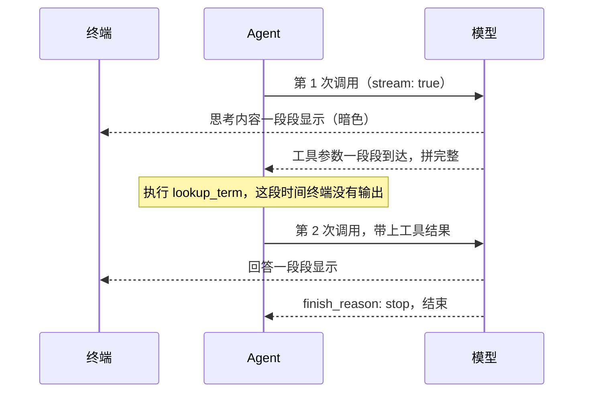

# 第 3 天：流式输出

> 最后核对：2026-11-01

到目前为止，我们的 Agent 都要等模型把整段回答生成完，才一次性显示出来。一段几百字的回答，模型可能要生成十几秒，这段时间用户只能盯着空白的终端。

用过任何一个聊天产品的人都知道，正常的体验是回答一个字一个字地冒出来。今天就来实现它：请求时加上 `stream: true`，服务器会边生成边推送，你的程序边收边显示。看起来只是加了一个参数，背后却有不少细节：怎么从字节流里切出一个个事件，怎么把分散在几十块里的工具参数拼回去，用户不想等了怎么中途取消。

学完今天，你会：

- 说清楚 SSE 协议的格式，自己写出一个解析器
- 把流式返回的增量拼成完整的回复，包括分散在好几块里的工具参数
- 在终端里边生成边显示，按 Ctrl+C 随时中断

## 为什么要流式

流式输出不会让模型生成得更快，总时间几乎一样。变化的是**第一个字出现的时间**（time to first token，常缩写成 TTFT）：非流式要等全部生成完，流式在模型生成出第一个 token 后很快就能看到。

对用户来说，「等 10 秒后看到完整回答」和「0.5 秒后开始看到回答，10 秒后看完」，感受完全不同。后者能边看边读，发现方向不对还能马上打断，不用干等到最后。

对 Agent 来说，流式还有一个好处：长任务里，用户能实时看到它在想什么、准备调用什么工具，而不是面对一个不知道还要转多久的进度圈。第 44 天做 Web 界面时，会把调研的每一步都实时展示出来。

代价是代码更复杂：要自己解析事件流、拼接增量；用量要到最后才知道；还可能出现「已经显示了一半，连接断了」这种非流式不会遇到的情况。

### 什么时候不用流式

流式是为「有人在等」准备的。没有人盯着屏幕的时候，它的好处就没了，只剩下复杂：

- **后台任务**：夜里批量处理一千份文档，没人在看，非流式更简单。很多模型服务还为离线任务提供更便宜的批处理接口（第 36 天）。
- **需要完整结果才能用的输出**：比如让模型返回一个 JSON，半个 JSON 什么也做不了，等全部生成完再解析就行（第 4 天）。
- **调用链的中间步骤**：一个步骤的输出只是下一个步骤的输入，用户看不到它，也就不必流式。

所以 `openai.ts` 里 `chat()` 和 `chatStream()` 两个都留着，按场景选。

## SSE：服务器怎么一点点推过来

请求体里加上 `"stream": true`，响应的 `Content-Type` 就会变成 `text/event-stream`。这是 SSE（Server-Sent Events）的格式：服务器保持连接不断开，有新内容就写一段文字过来。原始的响应长这样：

```text
data: {"choices":[{"index":0,"delta":{"role":"assistant","content":""},"finish_reason":null}]}

data: {"choices":[{"index":0,"delta":{"content":"杭州是"},"finish_reason":null}]}

data: {"choices":[{"index":0,"delta":{"content":"浙江省会。"},"finish_reason":null}]}

data: {"choices":[{"index":0,"delta":{},"finish_reason":"stop"}]}

data: {"choices":[],"usage":{"prompt_tokens":21,"completion_tokens":7,"total_tokens":28}}

data: [DONE]

```

规则很简单：

- 每个事件由若干行组成，**事件之间用一个空行分隔**
- `data:` 后面是事件的内容。一个事件可以有多行 `data:`，按换行连起来
- `event:` 是事件的类型。OpenAI 兼容接口不用它，第 8 天的 Anthropic 协议靠它区分事件
- 以冒号开头的行是注释，服务器常用它定时发一下，免得连接因为长时间没数据被中间的代理断掉
- 还有 `id:` 和 `retry:` 两个字段，用于断线重连，调用模型时用不到

OpenAI 兼容接口在最后发一个 `data: [DONE]`，表示结束。它不是 JSON，解析之前要先判断。

浏览器有个现成的 `EventSource`，专门接收 SSE。但它只能发 GET 请求，没法带上请求体，调用模型用不了。所以不管在 Node.js 里还是在浏览器里，都要自己用 `fetch` 读取响应，再解析事件。

### 为什么是 SSE，而不是 WebSocket

说到「服务器实时推送」，很多人先想到 WebSocket。模型接口选 SSE，是因为这个场景只需要单向推送：客户端发一次请求，服务器持续往回写，写完就结束。SSE 就是一个普通的 HTTP 响应，只不过来得慢一点。认证、负载均衡、日志、代理这些现成的 HTTP 基础设施都能直接用，出错了也能用 curl 直接查看。WebSocket 是双向的长连接，要先升级协议，还要自己处理心跳和重连，适合语音对话这类双方都要不断发消息的场景。

## 每一块里有什么

每个事件的 `data` 是一个 JSON，叫作一个 chunk（块）。和非流式的响应相比，有三点不同：

- **`message` 换成了 `delta`**：只放这一块新增的内容。第一块通常只有 `role`，之后每块带一小段 `content`
- **`finish_reason` 前面一直是 `null`**，到最后一块才有值
- **`usage` 默认没有。** 请求里加上 `"stream_options": { "include_usage": true }`，才会在最后交回用量

最后一点，各家的做法又不太一样：OpenAI、Kimi、通义千问把 usage 放在单独的最后一块里，这一块的 `choices` 是空数组（上面的例子就是这样）；DeepSeek 和 GLM 则把 usage 挂在带 `finish_reason` 的那一块上。所以代码里不能假设 usage 在哪一块，**哪一块带了 usage，就记下来**。

推理模型还会在 `content` 之前，先用 `delta.reasoning_content` 一段段推送思考内容。

## 从字节到事件

`fetch` 返回的 `res.body` 是一个字节流，可以用 `for await` 一块块读：

```ts
for await (const chunk of res.body!) {
  // chunk 是一个 Uint8Array，可能是任意长度的一段字节
}
```

关键在于：**网络传输不会按事件来切块。** 一块数据可能正好是一个事件，也可能只有半个，也可能有好几个。要正确解析，得避开三个坑。

**坑一：一个事件被拆进好几块。** 比如第一块是 `data: {"choices":[{"del`，第二块才是剩下的部分。拿到一块就解析，JSON 必然出错。正确的做法是先攒着：把解码出的文字接到缓冲区后面，切出完整的行来处理，最后那半行留在缓冲区里，等下一块来了再接上。

**坑二：一个汉字被拆开。** 一个汉字在 UTF-8 里占 3 个字节，完全可能前 1 个字节在这一块、后 2 个在下一块。如果每块单独解码，前后两半都会变成乱码 `�`。`TextDecoder` 早就考虑到了这一点：

```ts
const decoder = new TextDecoder();
decoder.decode(chunk, { stream: true }); // 结尾不完整的字节先留着，和下一块一起解码
```

**坑三：一块里有好几个事件。** 服务器生成得快、网络又有缓冲时，好几个事件会挤在同一块里到达。所以切出行以后要逐行处理，遇到空行就交出一个事件，而不是一块只交一个。

把这些合起来，解析器的逻辑是：

```text
对每一块字节：
  解码（stream: true），接到缓冲区后面
  按换行切开，最后一段留在缓冲区
  逐行处理：
    data: 开头 → 记下内容
    event: 开头 → 记下事件名
    空行 → 一个事件结束，记下过 data 就交出去
    其他 → 忽略
流结束时：还有没交出去的 data，也交出去
```

用 async generator（`async function*`）写这种「边读边交出」的逻辑最自然：每凑齐一个事件就 `yield`，调用方用 `for await` 一个个取。

## 从增量到完整回复

拿到一个个 chunk 以后，要把它们拼成和非流式一样的完整回复。文字最简单，按顺序接起来就行。麻烦的是工具调用。

### 工具参数是一点点到的

模型调用工具时，参数也是流式生成的，会分散在很多块里：

```json
{"delta":{"tool_calls":[{"index":0,"id":"call_a","type":"function","function":{"name":"lookup_term","arguments":""}}]}}
{"delta":{"tool_calls":[{"index":0,"function":{"arguments":"{\"term\":"}}]}}
{"delta":{"tool_calls":[{"index":0,"function":{"arguments":"\"MCP\"}"}}]}}
```

- **第一块**带着 `id` 和 `name`，`arguments` 是空的
- **后面的块**只有 `index` 和一小段 `arguments`，要按顺序拼起来
- **`index` 说明是哪一个工具调用。** 模型一次调用多个工具时，各自的参数靠 `index` 区分。协议并没有规定一个调用的参数发完才能发下一个，所以要按 `index` 找到对应的那个，不能简单地拼到「最后一个」上

还有两个细节。第一，有的兼容实现会在后面的块里重复带上 `id` 和 `name`，所以这两个字段要**赋值**，只有 `arguments` 是**拼接**。第二，有的模型服务默认不分块发送工具参数，而是在一块里给出完整的调用，比如 GLM 要加上 `tool_stream` 参数才会分块。按上面的规则写，两种情况都能处理。

拼接过程中，`arguments` 是一段不完整的 JSON，比如 `{"term":`，没法解析。要等全部收完，再交给工具去 `JSON.parse`。（第 44 天做界面时，会用能解析半截 JSON 的库，提前显示工具参数。）

### 怎么知道收完整了

正常情况下，最后会收到带 `finish_reason` 的一块，然后是 `[DONE]`。如果连接中途断了，`res.body` 会抛出错误，这种情况容易发现。不容易发现的是：服务器干净地关闭了连接，却没发完。这时 `for await` 正常结束，你手里是半截回复。所以要检查有没有收到过 `finish_reason`，没收到就报错，不能把半截回复当成完整的交出去。

另外，有的模型服务在输出过程中出错时，不会改 HTTP 状态码（已经是 200 了），而是在流里发一个带 `error` 字段的 JSON。解析每一块时，顺便检查一下。

## 取消：AbortController

用户看了两行，发现模型理解错了，想马上停下来。`fetch` 支持用 `AbortController` 取消请求：

```ts
const controller = new AbortController();
const res = await fetch(url, { ...options, signal: controller.signal });

// 在任何时候调用，正在进行的 fetch 或者正在读取的 res.body 都会抛出 AbortError
controller.abort();
```

取消以后，`fetch` 或者正在读取的 `res.body` 会抛出一个 `name` 为 `AbortError` 的错误。所以 `chatStream()` 只要把 `signal` 一路传给 `fetch`，就自动支持取消了。

在终端里，取消对应的是 Ctrl+C。按下 Ctrl+C 时，进程会收到 `SIGINT` 信号，默认行为是立即退出。我们注册一个处理函数，改成取消请求：

```ts
const controller = new AbortController();
process.once('SIGINT', () => controller.abort());
```

注册以后，Node.js 就不会再因为 SIGINT 自动退出了，由你的代码决定怎么收尾：打印「已中断」，把退出码设为 130（128 加上 SIGINT 的编号 2，这是 shell 的惯例）。这里用 `once` 而不是 `on`：处理函数只生效一次，再按一次 Ctrl+C 就恢复默认行为直接退出。万一程序卡在别的地方，用户还有办法退出。

`AbortSignal` 不只用来响应用户。`AbortSignal.timeout(30_000)` 会在 30 秒后自动触发，用来做超时；`AbortSignal.any([a, b])` 能把用户取消和超时合并成一个信号。第 9 天写重试时会用到它们。

## 在终端里显示

`console.log` 每次都会换行，流式显示要用 `process.stdout.write`，原样写出这一段文字。

推理模型的思考内容和回答混在一起不好读。终端支持用 ANSI 转义码改变文字样式，`\x1b[2m` 开始暗色，`\x1b[0m` 恢复正常。练习代码用暗色显示思考内容，从思考切换到回答时空一行。

### Agent 的一次运行，用户看到了什么

Agent 会调用好几次模型，流式只发生在每一次调用的内部。以查术语表为例：



注意中间那段：模型在生成工具参数、程序在执行工具的时候，用户什么也看不到。今天的工具很快，感觉不出来；等到第 12 天加上搜索、读网页这类要好几秒的工具，就得告诉用户「正在搜索……」。第 5 天会先把每次工具调用打印出来。

## 读懂练习代码

| 文件 | 内容 | 今天要做的 |
|---|---|---|
| [sse.ts](exercise/sse.ts) | `parseSSE()`：把字节流切成事件 | TODO 1 |
| [openai.ts](exercise/openai.ts) | 第 2 天的 `chat()`，加上 `createAccumulator()` 和 `chatStream()` | TODO 2、3 |
| [agent.ts](exercise/agent.ts) | Agent 改用 `chatStream()`，直接运行时边生成边打印 | TODO 4 |
| [types.ts](exercise/types.ts) | 新增 `ChatOptions`：`onText`、`onReasoning` 和 `signal` | 读懂即可 |
| errors.ts、usage.ts | 和第 2 天的参考答案一样 | 不用改 |

### parseSSE()（TODO 1）

```ts
export async function* parseSSE(stream: AsyncIterable<Uint8Array>): AsyncGenerator<SSEEvent>
```

参数类型写成 `AsyncIterable<Uint8Array>`，而不是 `ReadableStream`：`res.body` 可以传进来，测试里用一个 async generator 模拟「一个字节一个字节地到达」也可以传进来。把输入类型放宽一点，函数就更好测。

### createAccumulator()（TODO 2）

它返回一个对象，有两个方法：`push(chunk)` 合并一块，并返回这一块新增的文字和思考内容；`result()` 在全部合并完以后，交出和 `chat()` 一样的 `ChatResult`。

把「拼接」单独拿出来，不和网络请求写在一起，是为了好测：测试可以直接喂给它各种构造好的 chunk，比如交错到达的两个工具调用、每块都重复带 `name` 的写法、usage 在不同位置的写法，不用起服务器。

### chatStream()（TODO 3）

```ts
export async function chatStream(request: ChatRequest, options: ChatOptions = {}): Promise<ChatResult>
```

它把前两个 TODO 串起来：发请求（带上 `stream: true`、`stream_options` 和 `signal`），用 `parseSSE` 逐个读事件，遇到 `[DONE]` 结束，其余的 `JSON.parse` 后交给 accumulator，有新文字就回调 `onText`。返回值和 `chat()` 完全一样，所以 Agent 只要把 `chat` 换成 `chatStream`，其他代码一行都不用改。

### agent.ts（TODO 4）

`runAgent()` 已经改好了：多了 `onText`、`onReasoning` 和 `signal` 三个选项，原样传给 `chatStream()`。你要补的是直接运行时的 Ctrl+C 处理。

## 常见误解

| 误解 | 实际上 |
|---|---|
| 流式让模型生成得更快 | 总时间差不多，只是第一个字出现得早得多 |
| 收到一块就能 `JSON.parse` 一块 | 一块可能只有半个事件，也可能有好几个事件 |
| 每块单独 `decode` 就行 | 汉字的字节可能被拆在两块里，要用 `{ stream: true }` |
| 工具参数到了就能解析 | 拼完整之前，`arguments` 是半截 JSON |
| 流正常结束，回复就是完整的 | 要确认收到过 `finish_reason` |

## 常见错误

| 报错 | 原因 |
|---|---|
| `SyntaxError: Unexpected token 'D', "[DONE]" is not valid JSON` | 没有先判断 `[DONE]`，直接拿去 `JSON.parse` 了 |
| 测试说「把没凑成完整一行的部分留到下一块再处理」 | 每块单独切行，最后那半行被丢掉了 |
| 解析出来的汉字是 `�` | `decode` 时没传 `{ stream: true }` |
| 测试说两个工具调用的参数要靠 index 区分 | 新的参数总是拼到最后一个工具调用上，没有看 `index` |
| 工具名变成了 `lookup_termlookup_term` | `name` 用了拼接。只有 `arguments` 要拼接 |
| 测试说「要把 signal 传给 fetch」 | `options.signal` 没有传给 `post()`，取消不起作用 |

想看看原始的事件流，可以在 `chatStream()` 的循环里临时加一行 `console.log(data)`。

## 动手：在终端里流式打印回答

按顺序做，每做完一步就运行一次 `npm run check 3`：

1. **TODO 1**：实现 `parseSSE()`。`sse.test.ts` 里的 8 个测试会通过。
2. **TODO 2**：实现 `push()`。`accumulator.test.ts` 会通过。
3. **TODO 3**：实现 `chatStream()`。`stream.test.ts` 和 Agent 的前两个测试会通过。
4. **TODO 4**：处理 Ctrl+C。最后一个测试会真的启动你的程序，在它开始输出后发送 SIGINT，检查它有没有打印「已中断」并以 130 退出。（Windows 上没法这样模拟 Ctrl+C，这个测试会自动跳过，你可以在终端里手动试。）

## 检查

```bash
npm run check 3
```

通过以后，用真实模型验证：

```bash
npm run check 3 -- --e2e
```

## 小实验

- 运行 `node days/day03/exercise/agent.ts "详细介绍一下 MCP 协议的设计"`，回答输出到一半时按 Ctrl+C
- 在 `chatStream()` 里记下发出请求和收到第一段文字的时间，算一算你用的模型的 TTFT 是多少；再和 `chat()` 的总耗时比一比
- 临时打印每个原始的 `data`，看看你用的模型服务把 usage 放在了哪一块，工具参数是一块给完还是分好几块给
- 如果你用的是推理模型，看看思考内容是怎么用暗色先显示出来的
- 用 curl 加上 `-N`（不缓冲输出）发一个 `"stream": true` 的请求，直接看原始的事件流

## 小结

- 流式输出缩短的是第一个字出现的时间，不是总时间。
- SSE 是一行行的文字，事件之间用空行分隔，内容在 `data:` 里。OpenAI 兼容接口以 `[DONE]` 结束。
- 网络不会按事件切块：要缓冲半行，解码要用 `{ stream: true }`，一块里可能有多个事件。
- 文字直接拼接；工具调用按 `index` 归位，`id`、`name` 赋值，`arguments` 拼接，收完再解析。
- usage 在哪一块各家不同，哪一块带了就记下来；没收到 `finish_reason` 就结束，说明回复不完整。
- `AbortController` 加 `SIGINT` 处理，实现 Ctrl+C 中断。

## 想一想

- 模型要是没按要求输出合法的 JSON，或者少了某个字段，程序该怎么办？（第 4 天）
- 已经流式显示了一半，连接断了，要不要自动重试？重试的话，已经显示的那一半怎么办？（第 9 天）
- 在网页上流式显示回答，前后端要怎么配合？（第 44 天）

## 延伸阅读

- [MDN：使用服务器发送事件](https://developer.mozilla.org/zh-CN/docs/Web/API/Server-sent_events/Using_server-sent_events)：SSE 的格式和各个字段
- [HTML 标准：Server-sent events](https://html.spec.whatwg.org/multipage/server-sent-events.html)：解析规则的权威定义，可以对照一下你的 `parseSSE()` 省略了哪些情况
- [MDN：AbortController](https://developer.mozilla.org/zh-CN/docs/Web/API/AbortController)：取消请求，以及 `AbortSignal.timeout()`、`AbortSignal.any()`
- [Node.js 文档：信号事件](https://nodejs.org/api/process.html#signal-events)：SIGINT 的默认行为，以及 Windows 上的差异
