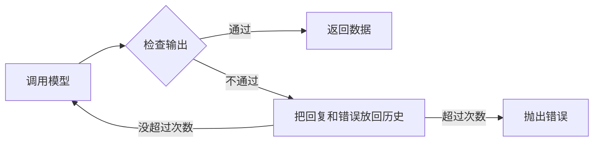

# 第 4 天：结构化输出

> 最后核对：2026-11-01

到目前为止，模型的输出都是给人看的：一段话，显示在终端里就完事了。可很多时候，模型的输出是给程序用的：从一封邮件里提取订单号，把用户的问题分到某个类别，给一个回答打分。程序要的不是一段话，而是字段齐全、类型正确的数据。

今天的任务是从一则写得乱七八糟的招聘启事里，提取出职位、城市、薪资、学历要求这些字段：

```text
【急招】杭州·前端工程师（React 方向）
公司：潮汐科技
薪资：25-40K·14薪，base 杭州滨江，每周可远程两天
要求：本科及以上，3 年以上经验，熟悉 TypeScript 和 React，有 Node.js 经验优先
```

```json
{
  "title": "前端工程师",
  "city": "杭州",
  "salary": { "min": 25, "max": 40, "months": 14 },
  "minYears": 3,
  "education": "本科",
  "skills": ["TypeScript", "React", "Node.js"],
  "remote": true
}
```

学完今天，你会：

- 用 zod 描述数据结构，一份定义同时得到 JSON Schema、校验规则和 TypeScript 类型
- 用三种方式让模型输出 JSON，并且知道各家模型服务分别支持到什么程度
- 校验失败时把错误交回模型，让它自己修正

## 为什么不能只说「请输出 JSON」

最直接的办法，是在提示词里写「请用 JSON 格式输出」。大多数时候它能用，但你会不断遇到这些情况：

- JSON 外面包了一层 Markdown 代码块：` ```json … ``` `
- JSON 前面多了一句「好的，以下是提取结果：」
- 少了某个字段，或者多出一个你没要的字段
- 类型不对：薪资写成了字符串 `"25-40K"`，学历写成了「本科及以上」
- 输出太长被截断，JSON 只有前半截

一次调用里出现这些问题的概率也许只有百分之几，但程序每天要调用成千上万次，这个比例就意味着每天有成百上千次失败。结构化输出要解决的，就是让模型的输出稳定地符合你定义的格式。没能做到的时候，程序要能发现，并且能修正。

其实你已经用过结构化输出了：第 1 天模型调用 `lookup_term` 时生成的参数 `{"term":"MCP"}`，就是一段按 JSON Schema 生成的 JSON。今天把这件事单独拿出来，讲透。

在 Agent 里，结构化输出无处不在：

- **工具参数**：模型每调用一次工具，就是输出一段结构化数据（第 5 天会在执行工具之前先校验它）
- **路由和分类**：判断用户的问题属于哪一类，交给哪个模型处理（第 22 天）
- **计划**：把一个大任务拆成带编号、带状态的待办清单（第 23 天）
- **评分**：让模型当评委，按评分细则给回答打分，输出分数和理由（第 32 天）

这些场景的共同点是：模型的输出不是终点，后面还有代码要接着用它。

## JSON Schema：描述数据长什么样

JSON Schema 用一个 JSON 对象，描述另一个 JSON 应该长什么样：

```json
{
  "type": "object",
  "properties": {
    "title": { "type": "string", "description": "职位名称" },
    "education": { "type": "string", "enum": ["不限", "大专", "本科", "硕士", "博士"] },
    "skills": { "type": "array", "items": { "type": "string" } }
  },
  "required": ["title", "education", "skills"],
  "additionalProperties": false
}
```

常用的就这几个关键字：`type` 说明类型，`properties` 列出对象的字段，`required` 说明哪些字段必须有，`enum` 限定只能取哪几个值，`items` 说明数组元素的类型，`additionalProperties: false` 表示不允许出现没列出来的字段，`description` 是写给模型看的说明。

模型服务都认 JSON Schema：工具的 `parameters` 是它，今天要讲的 `json_schema` 输出格式也是它。

## zod：一份定义，三种用途

手写 JSON Schema 很啰嗦，而且你还得另外写校验代码、另外定义 TypeScript 类型，三份东西要时刻保持一致。[zod](https://zod.dev) 让你只写一份：

```ts
import { z } from 'zod';

const JobPosting = z.object({
  title: z.string().describe('职位名称，比如「前端工程师」'),
  city: z.string().nullable().describe('工作城市；没写就填 null'),
  education: z.enum(['不限', '大专', '本科', '硕士', '博士']),
  skills: z.array(z.string()),
});

type JobPosting = z.infer<typeof JobPosting>; // 1. TypeScript 类型
const jsonSchema = z.toJSONSchema(JobPosting); // 2. 交给模型的 JSON Schema
const result = JobPosting.safeParse(data);     // 3. 校验模型的输出
```

几个要点：

**`.describe()` 写给模型看。** 它会变成 JSON Schema 里的 `description`。模型怎么理解一个字段、怎么填，很大程度上取决于这句话。「月薪下限，单位是千元，比如 25K 填 25」比单单一个 `min` 清楚得多。

**可以没有的字段，用 `.nullable()`，不要用 `.optional()`。** 两者的区别在 JSON Schema 里看得很清楚：`.optional()` 的字段不在 `required` 里，模型可以不输出它；`.nullable()` 的字段仍然必须出现，只是值可以是 `null`。后面会讲到，严格模式要求**每个字段都在 `required` 里**，所以统一用 `.nullable()`。让模型明确地写出 `null`，也比让它自己决定写不写更可控。

**有些规则 JSON Schema 表达不了。** 比如「月薪下限不能高于上限」，这是两个字段之间的关系。zod 用 `.refine()` 写这种规则：

```ts
.refine((job) => !job.salary || job.salary.min <= job.salary.max, {
  message: '月薪下限不能高于上限',
  path: ['salary', 'min'],
});
```

`refine` 不会出现在转换出的 JSON Schema 里，模型看不到它，只在本地校验时生效。所以就算模型服务保证输出符合 JSON Schema，你也仍然需要自己的校验。

**错误信息可以是中文。** zod 自带多种语言的错误信息，`z.config(z.locales.zhCN())` 之后，`z.prettifyError()` 整理出的错误是这样的：

```text
✖ 无效选项：期望以下之一 "不限"|"大专"|"本科"|"硕士"|"博士"
  → at education
✖ 月薪下限不能高于上限
  → at salary.min
```

这段文字待会儿要原样交给模型，让它照着改。

## 三种做法

### 做法一：JSON 模式

在请求里加上 `response_format: { "type": "json_object" }`，模型服务保证输出是一个合法的 JSON 对象。

注意，它**只保证语法合法，不保证字段对**。要哪些字段、什么类型，得在提示词里说清楚。练习代码直接把 JSON Schema 写进 system prompt。另外有两条规矩：

- **提示词里必须出现 json 这个词。** OpenAI 和 DeepSeek 都有这条规定，没有就直接报错；通义千问也要求在提示词里说明输出 JSON。OpenAI 的文档还提醒，如果不明确要求输出 JSON，模型可能会一直输出空白字符，直到达到 token 上限。
- **当心空白和截断。** DeepSeek 的文档说，JSON 模式下模型输出的非 JSON 内容会被替换成空格，所以 `content` 可能是一串空白，`finish_reason` 却是 `stop`；`max_tokens` 太小时，JSON 会被截断。这两种情况都要当成失败处理。

### 做法二：工具调用

定义一个工具，把你的 schema 写进它的 `parameters`，告诉模型「提取完调用这个工具提交结果」。模型「调用」工具时生成的参数，就是你要的数据。工具根本不需要真的存在，你只是借用了工具调用这个机制。

它的好处是支持面广：能调用工具的模型都能用。而且模型专门为调用工具训练过，按 schema 生成参数通常比按提示词输出 JSON 更守规矩。

能不能**强制**模型调用这个工具？接口里有 `tool_choice` 参数：`required` 表示必须调用某个工具，`{ "type": "function", "function": { "name": "save_result" } }` 表示必须调用指定的工具。可惜各家支持得很不一样：

| 模型服务 | `tool_choice` 的限制 |
|---|---|
| DeepSeek | 支持四种取值，但思考模式（默认开启）下指定工具或 `required` 会返回 400 |
| 通义千问 | 不支持 `required`；思考模式下不支持强制调用某个工具 |
| 智谱 GLM | 只支持 `auto` |
| Kimi | 部分模型不支持 `required`；指定工具和思考模式不兼容 |
| Ollama | OpenAI 兼容接口不支持 `tool_choice` |

所以练习代码不强制，只在提示词里要求它调用。万一模型没调用工具、直接回了一段话，就当成一次失败，提醒它调用，下一节会讲怎么做。

### 做法三：JSON Schema 约束

最彻底的做法，是把 schema 直接交给接口：

```json
"response_format": {
  "type": "json_schema",
  "json_schema": { "name": "extraction", "schema": { … }, "strict": true }
}
```

开启 `strict` 后，模型服务在生成每一个 token 时，都只允许模型从「接下来符合 schema 的 token」里选，这叫约束解码（constrained decoding）。比如刚输出完 `{"education": "`，下一个 token 就只能是那五个枚举值之一的开头。这样生成的 JSON，从结构上保证符合 schema。

代价是 schema 要满足一些限制。以 OpenAI 为例：

- 每个字段都必须在 `required` 里，可以没有的字段用和 `null` 的联合类型表示
- 每个对象都要写 `additionalProperties: false`
- 最外层必须是对象，不能是 `anyOf`
- 只支持一部分关键字，`allOf`、`not`、`if`/`then`/`else` 这些不支持
- 最多 5000 个字段、10 层嵌套

zod 的 `z.object()` 转换出来默认就带 `additionalProperties: false`，再配合 `.nullable()`，基本就满足了。

支持情况就更参差了：

| 模型服务 | `json_schema` 输出格式 |
|---|---|
| OpenAI | 支持 |
| Kimi | 支持，`strict` 默认开启，schema 要符合它的规范 |
| 通义千问 | 部分模型支持 |
| DeepSeek | `response_format` 只支持 `text` 和 `json_object`；工具参数的 `strict` 模式还在 Beta，要用单独的 base URL |
| 智谱 GLM | `response_format` 只支持 `text` 和 `json_object` |

就算用了 `strict`，本地也要再校验一遍：`refine` 这类规则它管不到，而且不同模型服务对 `strict` 的实现也未必一样可靠。

### 怎么选

| 做法 | 保证什么 | 支持面 | 提示词要做的事 |
|---|---|---|---|
| JSON 模式 | 语法合法 | 广 | 说明所有字段，还要提到 json |
| 工具调用 | 参数按 schema 生成，多数实现不严格保证 | 广 | 要求它调用工具 |
| JSON Schema 约束 | 结构符合 schema | 窄 | 说明任务即可 |

经验是：你的模型服务支持 `json_schema` 就用它；不支持就用工具调用；JSON 模式作为兜底。**不管用哪种，都要在本地校验。**

### 提取类的提示词怎么写

不管用哪种做法，提示词都决定了提取的质量。几条经验：

- **说清楚缺失的信息怎么填。** 原文没写薪资，是填 `null`，还是让模型「猜一个合理的数」？一定要明确写「没有提到就填 null，不要编造」，否则模型很乐意帮你编。
- **统一单位和格式。** 「25-40K」「2.5 万到 4 万」「40k RMB/month」说的是同一类信息，要在字段说明里规定统一成什么，比如「单位是千元」。
- **说明模糊情况的判断标准。** 「每周可远程两天」算不算支持远程？写进字段说明：「部分时间远程也算」。这些判断标准，就是你对这个任务的定义。
- **指令放 system，原文放 user。** 原文可能很长、很乱，甚至夹带着「忽略上面的要求」这种话。把它和指令分开，模型更容易分清哪些是要执行的，哪些是要处理的数据（第 37 天会专门讲提示注入）。
- **遇到难例，就加例子。** 某类写法总是提取错，就在提示词里加一两个「原文 → 结果」的例子，这比反复改措辞有效。

提取这类任务要的是稳定，不是创意。如果你的模型服务允许，可以把 temperature 调低；练习代码没有设置，因为第 2 天说过，有的模型不让改它。

## 校验失败了怎么办

模型输出不合格时，最有效的办法往往不是从头再问一遍，而是把错误告诉它，让它改：



检查分三步，任何一步没过，都生成一段说明交给模型：

1. **有没有输出**：工具调用的做法里，模型没调用工具；另外两种做法里，回复是空的
2. **是不是合法的 JSON**：先去掉可能包在外面的代码块，再 `JSON.parse`
3. **符不符合 schema**：`safeParse` 不通过时，用 `prettifyError` 整理出哪个字段、错在哪里

然后把模型这一次的回复、连同这段说明一起放回历史，再调用一次。模型看得到自己上一次输出了什么、错在哪里，通常一次就能改对。说明要具体：「education 只能是这五个值之一」远比「格式不对，请重试」有用。

比如模型第一次把薪资的上下限填反了，第二次请求的最后两条消息是这样的：

```json
{ "role": "assistant", "content": null, "tool_calls": [{ "id": "call_1", "function": { "name": "save_result", "arguments": "{…\"salary\":{\"min\":40,\"max\":25,\"months\":14}…}" } }] },
{ "role": "tool", "tool_call_id": "call_1", "content": "输出没有通过校验，请修正后重新输出：\n✖ 月薪下限不能高于上限\n  → at salary.min" }
```

有两个细节。第一，**说明要用对消息类型**：JSON 模式和 JSON Schema 约束用 `user` 消息；工具调用的做法里，模型上一条回复里有工具调用，必须先用 `tool` 消息回应每一个调用，否则接口会报错（第 1 天讲过的规则）。第二，**要限制次数**：每多一次，就要把越来越长的历史再发一遍，花费成倍增加。练习默认最多 3 次，超过就抛出错误，交给上层决定怎么办。

还要清楚校验的边界：它只能发现格式上的错误。如果原文写的是杭州，模型填了北京，格式完全正确，校验发现不了。这类错误要靠评估来发现，第 31、32 天会讲。

## 读懂练习代码

今天的代码不涉及 Agent，只有提取这一件事：

| 文件 | 内容 | 今天要做的 |
|---|---|---|
| [samples.ts](samples.ts) | 三则样例招聘启事 | 读一读，想想难点在哪 |
| [job.ts](exercise/job.ts) | 用 zod 定义的 `JobPosting` | TODO 1 |
| [extract.ts](exercise/extract.ts) | 三种做法、检查和修复循环，直接运行时提取一则样例 | TODO 2–5 |
| [types.ts](exercise/types.ts)、[openai.ts](exercise/openai.ts) | `ChatRequest` 新增 `responseFormat` 和 `toolChoice`，`toRequestBody` 把它们发出去 | 读懂即可 |
| errors.ts、usage.ts、sse.ts | 和第 3 天的参考答案一样 | 不用改 |

`extract()` 是一个通用的函数，schema 作为参数传进来：

```ts
const { data } = await extract(JobPosting, text, { mode: 'tool' });
// data 的类型是 JobPosting，由 schema 推导出来
```

换一个 schema，它就能提取别的东西，比如从会议纪要里提取待办事项。

几个 TODO 的分工：

- **TODO 1**：按注释里的说明补全 `JobPosting`
- **TODO 2**：`buildRequest()`，按三种做法拼出第一次请求
- **TODO 3**：`readOutput()` 从回复里取出 JSON 文本，`parseJSON()` 去掉代码块后解析
- **TODO 4**：`check()`，按上面说的三步检查
- **TODO 5**：`feedback()` 生成交给模型的说明，`extract()` 把整个循环串起来

## 常见误解

| 误解 | 实际上 |
|---|---|
| JSON 模式保证字段都对 | 只保证是合法的 JSON，字段要靠提示词和校验 |
| 用了 `strict` 就不用校验了 | `refine` 这类规则它管不到，各家的实现也不一样 |
| 可以没有的字段用 `.optional()` | 严格模式要求所有字段都必填，用 `.nullable()` |
| 校验通过，数据就是对的 | 校验只管格式。原文写杭州、模型填北京，格式完全正确 |
| 出错了就从头再问一遍 | 把错误交回模型让它改，通常更快、更准 |

## 常见错误

| 报错 | 原因 |
|---|---|
| 测试说「不要用 .optional()」 | 某个字段用了 `.optional()`，转成 JSON Schema 后不在 `required` 里了 |
| `之前还有工具调用没交回结果` | 工具调用的做法里，用 `user` 消息反馈了错误。要用 `tool` 消息回应每个工具调用 |
| `tool 消息……对不上前面任何一个等待结果的工具调用` | 反馈之前，没有先把模型这一次的回复放回历史 |
| 测试说错误要挂在 `salary.min` 上，实际是 `''` | `refine` 没写 `path`，错误挂在了整个对象上 |
| `必须出现「json」这个词` | JSON 模式的提示词里没提到 json |

## 动手：从招聘启事里提取结构化信息

按顺序做，每做完一步就运行一次 `npm run check 4`：

1. **TODO 1**：补全 schema。`job.test.ts` 会通过。
2. **TODO 2、3**：拼请求、读输出。「三种做法的请求」和「读出模型的输出」两组测试会通过。
3. **TODO 4、5**：检查和修复循环。剩下的测试全部通过，就完成了。

## 检查

```bash
npm run check 4
```

通过以后，用真实模型验证。e2e 测试只覆盖 JSON 模式和工具调用这两种支持面最广的做法：

```bash
npm run check 4 -- --e2e
```

## 小实验

- 用三种做法分别跑一遍：`node days/day04/exercise/extract.ts json_schema 0`。你的模型服务支持 `json_schema` 吗？不支持的话，报错长什么样？
- 换成样例 1（薪资面议、经验不限）和样例 2（英文），看看 null 和单位换算处理得对不对
- 把 `job.ts` 里所有的 `.describe()` 删掉再跑，结果有没有变差？
- 在 `buildRequest()` 的工具调用做法里加上 `toolChoice`，强制调用 `save_result`。你的模型服务接受吗？
- 在 `extract()` 里打印每次调用的输出，故意把 `maxAttempts` 设成 1，看看哪种做法最常一次就成功

## 小结

- 程序要的是数据：字段齐全、类型正确。只在提示词里要求 JSON 不够可靠。
- zod 一份定义，同时得到类型、JSON Schema 和校验。`.describe()` 写给模型看，可以没有的字段用 `.nullable()`，字段间的关系用 `.refine()`。
- 三种做法：JSON 模式保证语法，工具调用支持面广，JSON Schema 约束最严格但支持最少。
- 不管哪种做法，都要在本地校验；不合格就把具体的错误交回模型修正，并限制次数。
- 工具调用的做法里，反馈要用 `tool` 消息。

## 想一想

- 模型调用工具时生成的参数，也可能缺字段、类型不对。工具执行之前，是不是也该用 zod 校验一下？（第 5 天）
- 校验发现不了「杭州填成了北京」这种错误。怎么才能知道提取的准确率是多少？（第 31、32 天）
- 招聘启事要是有几万字，超出了上下文窗口，该怎么提取？（第 15、16 天）

## 延伸阅读

- [zod：JSON Schema](https://zod.dev/json-schema)：`z.toJSONSchema()` 的选项，以及哪些 zod 类型没法转换
- [OpenAI：Structured Outputs](https://developers.openai.com/api/docs/guides/structured-outputs)：严格模式支持的关键字和限制，以及和 JSON 模式的区别
- [DeepSeek：JSON Output](https://api-docs.deepseek.com/zh-cn/guides/json_mode)：JSON 模式的要求和注意事项
- [JSON Schema 入门](https://json-schema.org/learn/getting-started-step-by-step)：从零写一份 JSON Schema
