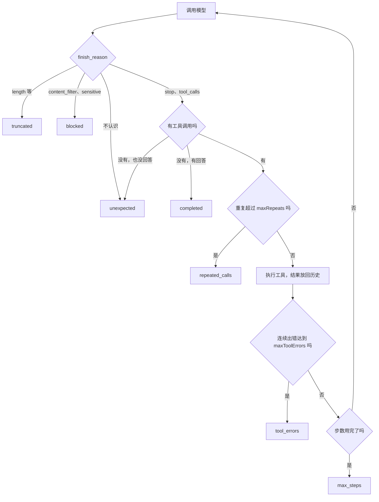

# 第 6 天：Agent 循环

> 最后核对：2026-11-01

第 1 天的 Agent 循环只有十来行：调用模型，有工具调用就执行，没有就返回回答。演示的时候它工作得很好，可一旦放到真实的场景里，各种意外都会冒出来：

- 模型一遍又一遍地用同样的参数调用同一个工具，停不下来
- 模型想写一个文件，内容写到一半达到了输出上限，参数只有前半截
- 回答被内容审核拦截了，返回的是一段空文字，程序却把它当成了最终回答
- 模型服务返回了一个你没见过的 `finish_reason`
- 工具依赖的服务挂了，模型换着花样重试了十几次，白白烧掉一堆 token

今天给循环加上三道护栏，把这些情况一个个接住。不管 Agent 因为什么停下，都交回一个说得清原因的结果。

学完今天，你会：

- 说清楚 `finish_reason` 的各种取值，以及各家模型服务额外的取值
- 给 Agent 循环加上三道护栏：防止死循环、处理异常停止、应对工具异常
- 让循环无论在哪里停下，都交回带原因的结果，并且保持对话历史完整

## 第 1 天的循环错在哪

回顾一下第 1 天的循环：

```ts
for (let step = 0; step < maxSteps; step++) {
  const reply = await chat(messages);
  messages.push(reply);
  if (!reply.tool_calls?.length) return reply.content ?? '';
  // 执行工具调用……
}
throw new Error(`走了 ${maxSteps} 步还没有给出最终回答`);
```

它只看一件事：回复里有没有工具调用。没有，就把 `content` 当成最终回答。问题在于，「没有工具调用」可能是因为模型说完了，也可能是因为回答被截断了、被拦截了，或者出了别的什么问题。这些情况下的 `content` 可能是半截话，甚至是空的，却都被当成了正常的回答交给用户。

反过来，「有工具调用」也不一定就该执行：输出被截断时，工具参数可能只有一半。

所以循环要先看模型**为什么**停下，再决定下一步。答案就在 `finish_reason` 里。

## finish_reason 全家

第 2 天介绍过三个最常见的取值。完整地看，各家还有不少自己的取值：

| 取值 | 含义 | 谁在用 | 怎么处理 |
|---|---|---|---|
| `stop` | 正常说完，或者遇到了 stop 序列 | 各家都有 | 有工具调用就执行，没有就是最终回答 |
| `tool_calls` | 要调用工具 | 各家都有 | 执行工具 |
| `length` | 达到 `max_tokens` 或上下文上限 | 各家都有 | 输出被截断 |
| `content_filter` | 被内容审核过滤 | OpenAI、DeepSeek | 被拦截 |
| `sensitive` | 被安全审核拦截 | 智谱 GLM | 被拦截 |
| `model_context_window_exceeded` | 超出了上下文窗口 | 智谱 GLM | 输出被截断 |
| `network_error` | 模型推理异常 | 智谱 GLM | 异常停止 |
| `insufficient_system_resource` | 后端资源不足，生成被打断 | DeepSeek | 异常停止 |
| `aborted` | 生成被中断 | DeepSeek | 异常停止 |

还有两点要注意。一是各家的取值随时可能增加，今天没见过的，明天就可能出现。二是同一件事，各家的报告方式不一样：同样是内容审核，GLM 用 `finish_reason: "sensitive"`，Kimi 却直接返回 HTTP 400 错误。HTTP 错误是第 9 天的事，今天只处理 `finish_reason`。

所以处理 `finish_reason` 要用**白名单**：只有 `stop` 和 `tool_calls` 算正常，认识的异常（截断、拦截）分别处理，**其他一律当作异常**。千万不要反过来，把不认识的取值都当成 `stop`：那样一个出了故障的回复，就会被悄悄当成正常的回答交给用户。

另外，第 1 天的做法有一点是对的：有的兼容接口在返回工具调用时，`finish_reason` 仍然是 `stop`。所以判断要不要执行工具，还是看回复里有没有 `tool_calls`，`finish_reason` 只用来排除异常情况。

## 停下的原因要说得清

第 1 天的循环，结果要么是一个字符串，要么抛出异常。今天改成交回一个带状态的结果：

```ts
export interface AgentResult {
  status: AgentStatus;  // 为什么停下
  answer: string;       // 最后一条回复的文字，没有正常完成时可能是半截的
  finishReason: string; // 最后一次调用的原始 finish_reason，排查问题用
  steps: number;        // 调用了几次模型
  usage: Usage;
  messages: Message[];  // 完整的对话历史
}
```

`status` 有七种取值：

| status | 什么时候 |
|---|---|
| `completed` | 模型给出了最终回答 |
| `max_steps` | 步数用完了，模型还在调用工具 |
| `repeated_calls` | 模型反复用同样的参数调用同一个工具 |
| `tool_errors` | 工具连续出错 |
| `truncated` | 输出被截断 |
| `blocked` | 被内容审核拦截 |
| `unexpected` | 不认识的 `finish_reason`，或者模型什么都没说 |

为什么不直接抛出异常？因为没有正常完成的运行，往往也有价值：截断的回答有前半部分，达到步数上限时，前面的工具已经查到了不少信息。把结果和原因一起交回去，由调用方决定怎么办：命令行显示一句说明，第 10 天的多轮对话让用户接着聊，第 30 天的研究流程可以换个模型重试。

真正的异常，比如网络断了、API Key 错了，仍然照常抛出，那是第 9 天的事。

## 护栏一：防止死循环

### 最大步数

最简单的护栏：最多调用 `maxSteps` 次模型，用完了就停下，状态是 `max_steps`。

上限设多少，取决于任务的复杂度。查个术语、算个数，几步就够了；Claude Code 这类编程 Agent 改一个功能，可能要几十上百步。练习默认 10 步。设得太小，复杂的任务做不完；设得太大，出问题时要烧掉很多 token 才停下来。第 2 天算过，每一步都要把越来越长的历史重发一遍，所以**步数上限也是成本上限**。

### 原地打转

步数上限只能兜底。更常见的情况是模型陷入了重复：同样的参数，同一个工具，调了一遍又一遍。比如搜索没找到想要的结果，它就用同样的关键词再搜一次。对大多数工具来说，同样的输入只会得到同样的输出，再调一百次也没用。

办法是记下每种调用执行过几次。名称和参数都相同，就算同一种调用。比较参数之前，先解析再重新序列化，`{"expression":"1+1"}` 和 `{ "expression" : "1+1" }` 只差几个空格，应该算作同一个：

```ts
function callKey(call: ToolCall): string {
  let args = call.function.arguments;
  try {
    args = JSON.stringify(JSON.parse(args));
  } catch {
    // 不是合法的 JSON，就按原样比较
  }
  return `${call.function.name} ${args}`;
}
```

同一种调用最多执行 `maxRepeats` 次（默认 2 次：失败了原样重试一次，是合理的），再出现就停下，状态是 `repeated_calls`。注意要在**执行之前**检查，超过次数的那一次不应该再执行。

这个规则也有误伤的时候：有的工具同样的输入会得到不同的输出，比如查询任务进度、获取当前时间。真遇到这类工具，可以把它们排除在检查之外。另一种更温和的做法是，在停下之前先提醒模型一次，比如在工具结果里加一句「这个调用和之前的一模一样，结果不会变」，给它一次改正的机会。

## 护栏二：处理异常停止

每次调用之后，先检查 `finish_reason`，再看要不要执行工具。顺序很重要：

```ts
if (TRUNCATED.has(finishReason)) return finish('truncated');
if (BLOCKED.has(finishReason)) return finish('blocked');
if (!NORMAL.has(finishReason)) return finish('unexpected');
if (calls.length === 0) return finish(answer.trim() ? 'completed' : 'unexpected');
// 走到这里，才去执行工具调用
```

**截断。** 文字被截断时，把已经生成的部分交回去，状态是 `truncated`。后续可以调大 `max_tokens`，也可以让模型接着写（发一句「继续」，它会接着上次的地方往下写）。工具调用被截断时，**一定不要执行**。参数不完整时，多数情况下是不合法的 JSON，执行时会报错；危险的是参数恰好在一个完整的位置被截断，JSON 是合法的，内容却只写了一半。比如 `write_file` 的内容只有前三行，执行它，就会用半截内容覆盖掉原来的文件。测试里专门有这个用例。

**拦截。** 被内容审核拦截时，状态是 `blocked`。不要自动重试：同样的内容再发一遍，大概率还是被拦截。告诉用户发生了什么，必要时记录下来人工检查。智谱的文档还特别提醒，遇到 `sensitive` 时，由你判断要不要撤回已经公开的内容，比如流式输出时已经显示给用户的那部分。

**其他异常。** 不认识的 `finish_reason`，以及 GLM 的 `network_error`、DeepSeek 的 `insufficient_system_resource` 这类服务端的问题，状态都是 `unexpected`，并且记下原始的取值，方便排查。其中有些是临时性的问题，重试也许就好了，第 9 天再讨论怎么重试。

**空回复。** 没有工具调用，`content` 又是空的（或者只有空白），模型等于什么也没说，状态也是 `unexpected`。有的实现会在这时提醒模型「请继续」，再给它一次机会，这也是一种合理的做法。

## 护栏三：工具异常

第 5 天说过，工具出错要写成结果交回模型，让它有机会改正：参数写错了就改，文件不存在就换一个。所以单次的工具错误，不应该让循环停下。

但如果是工具依赖的服务挂了，模型怎么改都没用。它可能会换着参数一遍遍地试，每一轮都把越来越长的历史重发一遍。所以要数一数**连续**出错的次数：出错加一，成功清零，达到 `maxToolErrors`（默认 3）就停下，状态是 `tool_errors`。

为什么是「连续」？因为偶尔出错很正常。模型试了两个错误的路径，第三次找对了，接着做别的事，这是在正常推进，不该停。只有一直失败、没有任何进展的时候，才说明它被卡住了。

## 护栏的数值怎么定

`maxSteps`、`maxRepeats`、`maxToolErrors` 没有标准答案，练习里的 10、2、3 只是起点。定这些数的思路是：

- **先看正常的任务要几步。** 跑一批典型的任务，看看完成它们一般要调用几次模型，上限设在这个数的两三倍。设得太紧，正常的任务会被误伤；太松，出问题时要烧很久的钱才停。
- **按任务调整，而不是全局一个数。** 一个查术语的 Agent 和一个改代码的 Agent，合理的步数相差几十倍。把它们做成参数，由调用方根据任务决定，而不是写死在循环里。
- **护栏被触发，本身就是信号。** 正常的运行几乎不会撞上护栏。一旦撞上了，说明提示词、工具或者任务本身有问题。把每次触发都记下来，包括状态、步数和完整的历史，回头翻一翻，往往能找到改进的方向。第 31 天的评估和第 34 天的可观测性，都会用到这些记录。

## 停下时，历史要完整

还有一个容易忽略的细节。假设模型发起了一个工具调用，循环因为截断或原地打转在执行之前停下了，那么历史的最后一条是一个**没有结果**的工具调用。第 1 天讲过的规则 3：每个工具调用后面都要跟一条对应的 tool 消息，否则接口会报错。现在不继续对话还没关系，第 10 天做多轮对话时，用户再说一句话，下一次请求就会失败。

所以停下的时候，给还没执行的调用补上结果：

```ts
for (const call of pending) {
  messages.push({ role: 'tool', tool_call_id: call.id, content: '没有执行：Agent 已经停止' });
}
```

## 读懂练习代码

整个循环的检查顺序是这样的：



[agent.ts](exercise/agent.ts) 里已经准备好了：

- 三个集合 `NORMAL`、`TRUNCATED`、`BLOCKED`，以及 `callKey()`
- 循环要用到的状态：`seen`（每种调用执行过几次）、`toolErrors`（连续出错的次数）、`pending`（还没交回结果的工具调用）
- `finish(status)`：组装结果，所有出口都用它返回
- `describeStatus()`：把状态翻译成给用户看的一句话，直接运行时会打印出来

你要补的是四个 TODO：

- **TODO 1**：最大步数和重复调用检查
- **TODO 2**：检查 `finish_reason` 和空回复
- **TODO 3**：数连续出错的次数
- **TODO 4**：在 `finish()` 里给没执行的工具调用补上结果

其他文件和第 5 天的参考答案一样。

## 常见误解

| 误解 | 实际上 |
|---|---|
| 没有工具调用，就是最终回答 | 也可能是被截断、被拦截，或者出了故障 |
| 不认识的 `finish_reason` 当成 `stop` 就行 | 要用白名单，不认识的一律当作异常 |
| 截断的工具调用，参数能解析就能执行 | 内容可能只有一半，执行了反而有害 |
| 工具一出错就该停下 | 单次出错要交回模型；连续出错才说明被卡住了 |
| 停下就停下，历史怎样无所谓 | 没有结果的工具调用会让下一轮对话报错 |

## 常见错误

| 报错 | 原因 |
|---|---|
| `mock 脚本已用完……是不是陷入了循环？` | 循环没有步数上限，或者该停下的时候没停下 |
| `截断的工具调用不能执行：先检查 finish_reason` | 先执行了工具调用，才检查 `finish_reason` |
| 测试说执行了 3 次，应该是 2 次 | 重复检查放在了执行之后，或者比较时差了一 |
| `expected 'tool_errors' to be 'completed'` | 连续出错的计数在成功时没有清零 |
| `截断的工具调用没有结果` | `finish()` 里没有给 `pending` 补上 tool 消息 |

## 动手：给循环加上三道护栏

按顺序做，每做完一步就运行一次 `npm run check 6`：

1. **TODO 2**：先处理 `finish_reason`，这一步最直观。「护栏二」的测试会通过。
2. **TODO 1**：步数上限和重复检查。「护栏一」的测试会通过。
3. **TODO 3**：连续出错的计数。
4. **TODO 4**：补上没执行的工具调用的结果。全部测试通过，就完成了。

## 检查

```bash
npm run check 6
```

通过以后，用真实模型验证：

```bash
npm run check 6 -- --e2e
```

## 小实验

真实的模型很少会自己触发这些护栏，可以人为地制造条件：

- 在 `chatStream()` 的请求里加上 `maxTokens: 30`，再让它「写一篇 300 字的短文保存到 essay.md」，看看截断时发生了什么、文件有没有被写入
- 把 `maxSteps` 改成 2，问一个需要好几步的问题，看看 `max_steps` 的提示
- 让它「读取 a.txt、b.txt、c.txt 三个文件」（都不存在），把 `maxToolErrors` 设成 2，看看它在第几次失败后停下
- 在 `tools/math.ts` 里让 `evaluate()` 总是抛出错误，问一道算术题，看看模型会怎么换着法子重试

## 小结

- 先看 `finish_reason`，再决定要不要执行工具。`stop` 和 `tool_calls` 之外，一律按异常处理。
- 结果带上 `status`，说清楚为什么停下；半截的回答和对话历史都交回去，由调用方决定怎么办。
- 护栏一：步数上限兜底，重复调用检查发现原地打转，都在执行之前检查。
- 护栏二：截断、拦截、未知原因、空回复分别处理；截断的工具调用绝不执行。
- 护栏三：单次的工具错误交回模型，连续出错才停下。
- 停下时给没执行的工具调用补上结果，保持历史完整。

## 想一想

- 这么多分支，靠真实模型很难一一触发。怎么为它们写出稳定、不花钱的测试？（第 7 天）
- 模型服务返回 429、网络超时，这些 HTTP 层面的错误该怎么处理？哪些可以重试？（第 9 天）
- 被截断的回答，能不能自动让模型接着写完？什么时候该这么做？

## 延伸阅读

- [Anthropic：Handling stop reasons](https://platform.claude.com/docs/en/build-with-claude/handling-stop-reasons)：Anthropic 协议的停止原因和处理建议，第 8 天会用到
- [DeepSeek：对话补全](https://api-docs.deepseek.com/zh-cn/api/create-chat-completion)和[智谱：对话补全](https://docs.bigmodel.cn/api-reference/%E6%A8%A1%E5%9E%8B-api/%E5%AF%B9%E8%AF%9D%E8%A1%A5%E5%85%A8)：在 `finish_reason` 的说明里，找找今天表格里那些各家自己的取值
- [Building effective agents](https://www.anthropic.com/engineering/building-effective-agents)：第 1 天读过，再看看它对「停止条件」和「护栏」的建议
