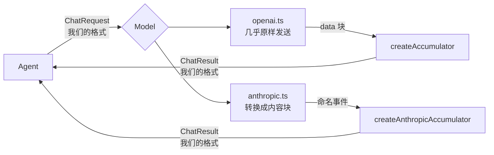

# 第 8 天：模型无关层

> 最后核对：2026-11-01

到目前为止，我们只用了一种接口：OpenAI 兼容接口。今天加上另一种：Anthropic 的 Messages API，也就是 Anthropic 协议。

为什么要支持第二种？Claude 用的是它，Claude Code 也是。为了让开发者能用 Claude Code 接自家的模型，DeepSeek、通义千问、智谱 GLM、Kimi、MiniMax 都提供了 Anthropic 兼容接口，本地的 Ollama 也支持。第 43 天用 Claude Agent SDK 配合国产模型，走的也是这种协议。更重要的是，一个只能跑在一种接口上的 Agent，换模型、做故障转移（第 35 天）都会很被动。

今天的目标是：写一个 Anthropic 协议的 `Model` 实现，让同一个 Agent、同一组测试，在两种协议上都能通过。第 7 天的依赖注入在这里派上了用场，`agent.ts` 一行都不用改。

学完今天，你会：

- 说清楚两种协议在消息、工具、停止原因、用量、流式事件和思考内容上的差异
- 写一个适配器，在自己的消息格式和 Anthropic 协议之间来回转换
- 让同一组测试同时跑在两种协议上
- 知道「兼容」到底兼容了什么，哪些地方必须单独验证

## 两种协议，逐项对比

先看全貌：

| 方面 | OpenAI 兼容接口 | Anthropic 协议 |
|---|---|---|
| 地址 | `{base}/chat/completions` | `{base}/v1/messages` |
| 认证 | `Authorization: Bearer` | `Authorization: Bearer` 或 `x-api-key`，还要带 `anthropic-version` |
| system prompt | 一条 `role` 为 `system` 的消息 | 顶层的 `system` 字段 |
| `max_tokens` | 可选 | 必填 |
| 消息的内容 | 一个字符串 | 一组内容块 |
| 工具定义 | `{ type: "function", function: { name, description, parameters } }` | `{ name, description, input_schema }` |
| 工具调用 | `tool_calls`，参数是 JSON 字符串 | `tool_use` 块，参数 `input` 是对象 |
| 工具结果 | `role` 为 `tool` 的消息 | user 消息里的 `tool_result` 块 |
| 停止原因 | `finish_reason` | `stop_reason`，取值也不一样 |
| 用量 | `prompt_tokens` 包括缓存命中的部分 | `input_tokens` 不包括缓存 |
| 流式 | 一个个 `data:` 块，最后是 `[DONE]` | 有名字的事件，以 `message_stop` 结束 |
| 思考内容 | `reasoning_content`，不是标准字段，各家规则不同 | 带签名的 `thinking` 块，必须原样传回 |

下面挑几个最容易出错的地方细说。

### 消息由内容块组成

同一段对话，两种协议的写法差别很大。OpenAI 兼容接口：

```json
[
  { "role": "system", "content": "你是一个能使用工具的助手。" },
  { "role": "user", "content": "算一下 1+1 和 2+2" },
  { "role": "assistant", "content": "我来算一下。", "tool_calls": [
      { "id": "call_a", "type": "function", "function": { "name": "calculator", "arguments": "{\"expression\":\"1+1\"}" } },
      { "id": "call_b", "type": "function", "function": { "name": "calculator", "arguments": "{\"expression\":\"2+2\"}" } }
  ] },
  { "role": "tool", "tool_call_id": "call_a", "content": "2" },
  { "role": "tool", "tool_call_id": "call_b", "content": "4" }
]
```

Anthropic 协议：

```json
{
  "system": "你是一个能使用工具的助手。",
  "messages": [
    { "role": "user", "content": [{ "type": "text", "text": "算一下 1+1 和 2+2" }] },
    { "role": "assistant", "content": [
        { "type": "text", "text": "我来算一下。" },
        { "type": "tool_use", "id": "call_a", "name": "calculator", "input": { "expression": "1+1" } },
        { "type": "tool_use", "id": "call_b", "name": "calculator", "input": { "expression": "2+2" } }
    ] },
    { "role": "user", "content": [
        { "type": "tool_result", "tool_use_id": "call_a", "content": "2" },
        { "type": "tool_result", "tool_use_id": "call_b", "content": "4" }
    ] }
  ]
}
```

几个关键的变化：

- system prompt 从 messages 里拿出来，放到顶层
- 每条消息的 `content` 都是一组块：文字是 `text` 块，工具调用是 `tool_use` 块
- 工具参数从 JSON **字符串**变成了**对象**
- 消息只有 `user` 和 `assistant` 两种角色。工具结果是 `tool_result` 块，放在 **user** 消息里
- **一轮的所有工具结果放在同一条 user 消息里**，`tool_result` 块要排在最前面，用户接着说的话放在它们后面

最后一条最容易写错：如果每条 tool 消息各自变成一条 user 消息，第一条里只有 `call_a` 的结果，接口会认为 `call_b` 没有交回结果，直接报错。Anthropic 的原话是 `tool_use ids were found without tool_result blocks immediately after`。

### 停止原因对照

Agent 的护栏（第 6 天）认的是 OpenAI 的叫法，所以适配器要把 `stop_reason` 换算过来：

| Anthropic 的 stop_reason | 含义 | 换算成 |
|---|---|---|
| `end_turn` | 正常说完 | `stop` |
| `stop_sequence` | 遇到了 stop 序列 | `stop` |
| `tool_use` | 要调用工具 | `tool_calls` |
| `max_tokens` | 达到 `max_tokens` | `length` |
| `refusal` | 安全机制拒绝回答（HTTP 状态码仍是 200） | `content_filter` |
| `model_context_window_exceeded` | 塞满了上下文窗口 | 原样交回，第 6 天的护栏把它当作截断 |
| `pause_turn` | 服务端工具（比如联网搜索）跑到了次数上限 | 原样交回，按异常停止处理 |

不认识的取值原样交回，由 Agent 当作 `unexpected` 处理。第 6 天说过，处理停止原因要用白名单。

### 用量：input_tokens 不包括缓存

OpenAI 兼容接口的 `prompt_tokens` 是全部的输入，命中缓存的部分**包含在内**。Anthropic 的 `input_tokens` 只是**没有命中缓存、也没有写入缓存的那部分**：

```json
{ "input_tokens": 50, "cache_read_input_tokens": 1000, "cache_creation_input_tokens": 200, "output_tokens": 30 }
```

这次请求的输入其实是 1250 个 token。如果直接把 `input_tokens` 当成输入，算出来的输入就只有 50，花费也就算少了一大截。所以换算时要把三个字段加起来：

```ts
inputTokens = input_tokens + cache_read_input_tokens + cache_creation_input_tokens
cachedTokens = cache_read_input_tokens
```

同一个词，在两种协议里含义不同。这类差别最隐蔽：不会报错，只是数字悄悄地不对。

### 流式：有名字的事件

Anthropic 的流式响应用 SSE 的 `event:` 字段区分事件。第 3 天的 `parseSSE()` 已经会读这个字段了，今天终于用上：

```text
event: message_start
data: {"type":"message_start","message":{"usage":{"input_tokens":50,…}}}

event: content_block_start
data: {"type":"content_block_start","index":0,"content_block":{"type":"text","text":""}}

event: content_block_delta
data: {"type":"content_block_delta","index":0,"delta":{"type":"text_delta","text":"你好"}}

event: content_block_stop
data: {"type":"content_block_stop","index":0}

event: message_delta
data: {"type":"message_delta","delta":{"stop_reason":"end_turn"},"usage":{"output_tokens":12}}

event: message_stop
data: {"type":"message_stop"}
```

顺序是：`message_start`（带输入的用量）→ 每个内容块的 `content_block_start`、若干个 `content_block_delta`、`content_block_stop` → `message_delta`（带 `stop_reason` 和累计的输出用量）→ `message_stop`。中间随时可能插进来 `ping`。

每种块的增量类型不同：文字是 `text_delta`，工具参数是 `input_json_delta`（一段段的 `partial_json`，和 OpenAI 一样要拼接），思考是 `thinking_delta`，思考块结束前还有一个 `signature_delta` 带来签名。

和 OpenAI 相比，有两点不同：块是按 `index` 一个个来的，不会交错；没有 `[DONE]`，以 `message_stop` 结束。所以「收到 `message_stop` 了吗」就是判断回复是否完整的依据。流里还可能出现 `error` 事件，比如 `overloaded_error`，它对应非流式时的 HTTP 529。官方文档还特别提醒：要能容忍不认识的事件类型，以后可能会新增。

### 思考内容的回传规则

第 2 天说过，OpenAI 兼容接口的 `reasoning_content` 不是标准字段，各家规则不同。Anthropic 协议的规则则统一而且严格：

- 思考内容是 `thinking` 块，附带一个 `signature`（签名），用来证明这段思考确实是模型生成的
- **在工具调用的过程中，最近一条 assistant 消息里的思考块，必须完整、不加修改地传回去**，排在内容的最前面。改了、删了、调换了顺序，都会返回 400
- 更早的轮次里的思考块，可以不传，接口会自动过滤掉
- 有时还会出现 `redacted_thinking` 块，内容是加密的，同样原样传回

所以 Anthropic 适配器把思考块原样存进消息的 `thinking_blocks` 字段，下一次请求时原样放回去。从 OpenAI 兼容接口得到的 `reasoning_content` 没有签名，Anthropic 不认，转换时要跳过。反过来，发给 OpenAI 兼容接口时，要去掉它不认识的 `thinking_blocks`。

## 统一接口：我们的做法

要同时支持两种协议，常见的做法有两种：

- **定义一套中立的内部格式**，两种协议各写一个适配器去转换。Vercel AI SDK 就是这样做的，第 42 天会用到它
- **以其中一种协议的格式作为内部格式**，只给另一种写转换。LiteLLM 就以 OpenAI 的格式为准

课程选第二种：前 7 天的代码都是 OpenAI 的写法，继续沿用，改动最小。代价是内部格式里要多一个 OpenAI 本来没有的字段 `thinking_blocks`，用来携带 Anthropic 的思考块。



Agent 只和 `ChatRequest`、`ChatResult` 打交道：发出去的是自己的格式，收回来的也是自己的格式，`finish_reason` 也统一成 OpenAI 的叫法。所有协议之间的差异，都关在 `anthropic.ts` 一个文件里。

### 用同一组测试验证两个实现

适配器写完了，怎么确认它和 OpenAI 那边的行为一致？最直接的办法，是让**同一组测试**在两个实现上各跑一遍：

```ts
describe.each(PROVIDERS)('同一个 Agent 跑在 %s 协议上', (provider) => {
  test('调用工具、拿到结果、给出回答', async () => {
    llm.reply({ toolCalls: [{ name: 'calculator', arguments: { expression: '6 * 7' } }] }).reply({ content: '42。' });
    const result = await runAgent('6 乘 7 是多少？', { model: createModel(provider), tools });
    expect(result.status).toBe('completed');
  });
});
```

课程的 mock 模型同时实现了两种协议，而且两种协议共用同一份脚本：`llm.reply()` 写一次，请求打到 `/chat/completions` 就按 OpenAI 的格式回复，打到 `/v1/messages` 就按 Anthropic 的格式回复，`finishReason: 'length'` 也会自动换成 `max_tokens`。这样，两个实现面对的是「同一个模型」，测试结果有任何不同，问题就一定出在适配器里。

这种做法有个名字，叫契约测试（contract test）：先用测试写下接口的「契约」，也就是 `Model` 应该有什么行为，再让每个实现都去满足它。以后要支持第三种协议，先让它通过这组测试。

## 接入国产模型的 Anthropic 兼容接口

在 `.env` 里填好 Anthropic 兼容接口的三项配置：

| 模型服务 | ANTHROPIC_BASE_URL |
|---|---|
| DeepSeek | `https://api.deepseek.com/anthropic` |
| 通义千问 | `https://dashscope.aliyuncs.com/apps/anthropic` |
| 智谱 GLM | `https://open.bigmodel.cn/api/anthropic` |
| Kimi | `https://api.moonshot.cn/anthropic` |
| MiniMax | `https://api.minimaxi.com/anthropic` |
| 本地 Ollama | `http://localhost:11434` |

地址不带 `/v1`，适配器会在后面加上 `/v1/messages`。API Key 通常和 OpenAI 兼容接口用的是同一个（编程套餐的 Key 和地址是另外的）。模型名要写模型服务自己的名字：有的服务会把 Claude 的模型名映射成自家的模型，但明确写上更不容易出错。

然后用 `MODEL_PROVIDER` 选择协议：

```bash
MODEL_PROVIDER=anthropic node days/day08/exercise/agent.ts "算一下 (1234 + 5678) * 9"
```

### Ollama（选读）

Ollama 能在本地跑开源模型，两种协议它都支持：OpenAI 兼容接口在 `http://localhost:11434/v1`，Anthropic 兼容接口在 `http://localhost:11434`。API Key 本地不校验，随便填一个非空的值。记得选支持工具调用的模型。它的兼容也有缺口：两种接口都不支持 `tool_choice`，Anthropic 兼容接口不支持缓存控制，出错时直接返回 HTTP 错误，不会在流里发 `error` 事件。

## 兼容不等于等价

「兼容」只意味着请求和响应的格式大体一样。细节上，各家的差别远比你想的多。

举个例子。用不带 API Key 的请求，探测五家的 Anthropic 兼容接口，得到的是五种不同的错误：

| 模型服务 | 状态码 | 错误体 |
|---|---|---|
| DeepSeek | 401 | 纯文本 `Authentication Fails (governor)` |
| 通义千问 | 403 | `{"message": "api-key is required", "type": "authentication_error", …}`，信息在最外层 |
| 智谱 GLM | 401 | `{"error": {"message": "Header中未收到Authorization参数……", "type": "1001"}}`，OpenAI 的写法 |
| Kimi | 401 | `{"error": {"message": "Incorrect API key provided", "type": "incorrect_api_key_error"}}`，OpenAI 的写法 |
| MiniMax | 401 | `{"type": "error", "error": {"type": "authentication_error", …}}`，Anthropic 的写法 |

连认证方式都不统一：MiniMax 只认 `x-api-key`，只带 `Authorization: Bearer` 会被拒绝；Kimi 的文档用的是 Bearer。所以适配器把两个请求头都带上。第 2 天写的 `toModelError()` 在 JSON 解析失败时退回到原文，在这里也派上了用场。

从各家文档里还能找到更多差异：DeepSeek 的 Anthropic 兼容接口会忽略 `anthropic-version`、缓存控制和 `disable_parallel_tool_use`，把 `tool_choice: any` 当作 `auto`，不支持 `redacted_thinking`；Kimi 的文档只列了四种 `stop_reason`；智谱的文档也坦言「某些场景下智谱与 Claude 接口仍存在差异」。

应对的办法只有一个：**别假设，去验证。** 用同一组 e2e 测试，在你要用的每一家、每一种协议上都跑一遍；遇到差异，记下来。课程把已经发现的差异整理在 [docs/models.md](../../docs/models.md) 里，你遇到新的，也可以提 issue 补充。

## 读懂练习代码

| 文件 | 内容 | 今天要做的 |
|---|---|---|
| [anthropic.ts](exercise/anthropic.ts) | Anthropic 协议的 `Model` 实现 | TODO 1–3 |
| [providers.ts](exercise/providers.ts) | `createModel(provider)`：按协议创建模型 | 读懂即可 |
| [types.ts](exercise/types.ts) | `AssistantMessage` 新增 `thinking_blocks` | 读懂即可 |
| [openai.ts](exercise/openai.ts) | 发送前去掉 `thinking_blocks` | 读懂即可 |
| [agent.ts](exercise/agent.ts) | 循环一行没改；直接运行时按 `MODEL_PROVIDER` 选择协议 | 读懂即可 |
| 其余文件 | 和第 7 天的参考答案一样 | 不用改 |

`anthropic.ts` 的结构和 `openai.ts` 对称：

- **TODO 1**：`toBlocks()` 和 `toAnthropicRequest()`，把我们的请求转换成 Anthropic 的请求体
- **TODO 2**：`createAnthropicAccumulator()` 的 `push()`，按事件类型拼出完整的回复。`result()` 已经写好了，它把内容块转换回我们的 `AssistantMessage`
- **TODO 3**：`toFinishReason()` 和 `toUsage()`，换算停止原因和用量

`createAnthropicModel()` 已经写好了：发请求、逐个读事件、检查有没有收到 `message_stop`，和 `createOpenAIModel()` 的结构一样。

测试分三部分：转换请求（`anthropic.test.ts`）、解析流式事件（`anthropic-stream.test.ts`），以及同一组 Agent 测试在两种协议上各跑一遍（`agent.test.ts`）。课程的 mock 模型也实现了 Anthropic 协议，会像真实接口一样检查请求：工具结果没合并、思考块没传回、工具定义用了 OpenAI 的写法，都会返回 400，并用中文说明原因。

## 常见误解

| 误解 | 实际上 |
|---|---|
| Anthropic 兼容接口就是把字段名换一换 | 消息结构、工具结果的位置、思考内容的规则都不一样 |
| 每条 tool 消息对应一条 user 消息 | 一轮的所有工具结果要放进同一条 user 消息 |
| `input_tokens` 就是全部的输入 | 不包括缓存命中和写入缓存的部分 |
| 思考内容可以随意传回或删掉 | 工具调用过程中，最近一轮的思考块必须原样传回 |
| 标着「兼容」，就和原版一样 | 认证、错误格式、支持的参数都可能不同，要逐家验证 |

## 常见错误

| 报错 | 原因 |
|---|---|
| `messages[2] 没有交回这些工具调用的结果：…` | 每条 tool 消息各自变成了一条 user 消息，没有合并 |
| `Anthropic 协议没有 system 消息` | system 消息留在了 messages 里，要放到顶层的 `system` 字段 |
| `要把 thinking 块原样传回来（包括 signature）` | 转换 assistant 消息时漏了 `thinking_blocks`，或者没排在最前面 |
| `tools[0] 是 OpenAI 的写法` | 工具定义还包着 `type: "function"`，要换成 `{ name, description, input_schema }` |
| 工具参数总是 `{}` | 用了 `content_block_start` 里的 `input`，没有拼接 `input_json_delta` |
| 测试说缓存命中的部分要加回来 | `toUsage()` 直接用了 `input_tokens` |

## 动手：让同一个 Agent 跑在两种协议上

按顺序做，每做完一步就运行一次 `npm run check 8`：

1. **TODO 1**：转换请求。`anthropic.test.ts` 会通过。
2. **TODO 3**：换算停止原因和用量。这两个函数最短，先做它们，下一步的测试结果才看得清。
3. **TODO 2**：解析流式事件。`anthropic-stream.test.ts` 和 Agent 在 anthropic 协议上的测试会通过。全部通过，就完成了。

## 检查

```bash
npm run check 8
```

用真实模型验证，要在 `.env` 里同时填好 `OPENAI_*` 和 `ANTHROPIC_*`。e2e 测试会在两种协议上各跑一遍：

```bash
npm run check 8 -- --e2e
```

## 小实验

- 用两种协议问同一个问题：`MODEL_PROVIDER=anthropic node days/day08/exercise/agent.ts "……"`，比较回答、步数和用量
- 在 `createAnthropicModel()` 里临时打印每个事件的 `event.type`，看看你用的模型服务的事件顺序，中间有没有 `ping`
- 如果你的模型默认开启思考，看看 `thinking_blocks` 里的签名长什么样
- 把 `toBlocks()` 里传回思考块的那一行注释掉，用 Anthropic 协议跑一个需要调用工具的问题，看看你的模型服务会不会报错
- 用 Ollama 在本地跑一个支持工具调用的模型，分别用两种协议连上它

## 小结

- 两种主流协议：OpenAI 兼容接口和 Anthropic 协议。消息结构、工具调用、停止原因、用量、流式事件、思考内容都不一样。
- Anthropic 协议的要点：system 放顶层、`max_tokens` 必填、内容是块、一轮的工具结果放进同一条 user 消息、`input_tokens` 不含缓存、以 `message_stop` 结束、思考块原样传回。
- 统一接口：内部沿用一种格式，差异全部关在适配器里；`finish_reason` 统一成一套叫法，Agent 的护栏对两种协议都有效。
- 依赖注入让换协议只是换一个 `Model`，Agent 和它的测试一行都不用改。
- 兼容不等于等价：认证、错误格式、支持的参数各家都可能不同，要逐家验证、记录。

## 想一想

- 请求失败了，返回 429 或 529，或者网络超时，该不该重试？两种协议的错误要怎么统一判断？（第 9 天）
- 第 10 天的 mini-agent 要支持在对话中途切换模型。前几轮是 OpenAI 兼容接口生成的历史，切到 Anthropic 协议后，哪些内容能保留，哪些会丢掉？
- 如果要支持第三种协议，比如 OpenAI 新的 Responses API，需要改哪些文件？

## 延伸阅读

- [Anthropic：Messages API](https://platform.claude.com/docs/en/api/messages)、[Streaming](https://platform.claude.com/docs/en/build-with-claude/streaming)、[Extended thinking](https://platform.claude.com/docs/en/build-with-claude/extended-thinking)：协议本身、流式事件和思考内容的规则
- [DeepSeek：Anthropic API](https://api-docs.deepseek.com/zh-cn/guides/anthropic_api)：一份写得很细的兼容说明，逐个列出了支持和忽略的字段
- [智谱：Claude API 兼容](https://docs.bigmodel.cn/cn/guide/develop/claude/introduction)和 [Kimi：Messages API](https://platform.kimi.com/docs/api/messages)：对比一下各家的兼容范围
- [Ollama：Anthropic 兼容](https://docs.ollama.com/api/anthropic-compatibility)和 [OpenAI 兼容](https://docs.ollama.com/api/openai-compatibility)：本地模型的两种接入方式
