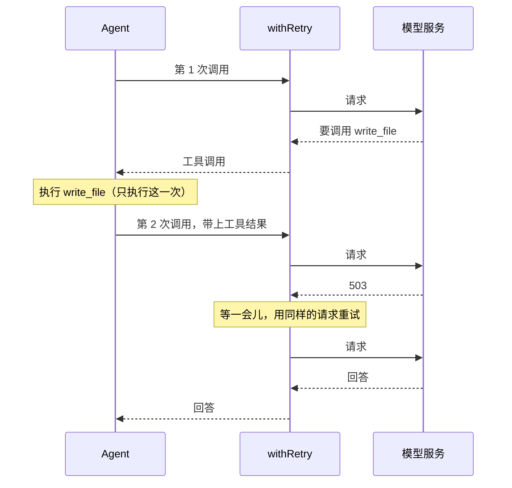

# 第 9 天：错误处理与重试

> 最后核对：2026-11-01

真实的模型服务一定会出错：晚高峰请求太多被限流，服务端过载返回 503，网络抖了一下连接被重置，一个推理模型想了三分钟还没回音。第 6 天处理的是模型「说完了」之后的各种停止原因；今天处理的是请求本身失败了怎么办。

最省事的做法是「出错就重试」，但这恰恰是最容易出问题的地方：额度用完了，重试一万次也没用；请求格式错了，重试只是把同一个错误再犯一遍；所有客户端在同一时刻一起重试，刚恢复的服务又被冲垮；Agent 因为重试把一个写文件的操作执行了两遍……

学完今天，你会：

- 把模型调用的错误分成几类，判断哪些值得重试、哪些不值得
- 用指数退避加抖动安排重试，并且尊重服务器给的 Retry-After
- 给每次调用加上超时，并且区分超时和用户主动取消
- 让重试只重复调用模型，不重复执行有副作用的操作

## 会出什么错

模型调用失败，大致有这几类：

| 种类 | 典型的样子 | 值得重试吗 |
|---|---|---|
| 限流 | 429，请求太快 | 值得，等一会儿 |
| 服务端出错或过载 | 500、502、503、504，Anthropic 的 529 | 值得，等一会儿 |
| 超时 | 迟迟没有响应 | 值得 |
| 网络错误 | 连接被重置、读到一半断了 | 值得 |
| 额度不足 | 余额不足、欠费、额度用完 | 不值得，要去充值 |
| 上下文超长 | 输入超出了上下文窗口 | 不值得，要缩短输入 |
| 认证失败 | 401、403，Key 不对或者没有权限 | 不值得，要检查配置 |
| 请求错误 | 400、404、422，参数不对、模型名写错 | 不值得，要改代码 |
| 用户取消 | 按了 Ctrl+C | 绝对不能重试 |

规律很清楚：**临时性的问题值得重试，确定性的问题不值得。** 限流、过载、网络抖动，过一会儿可能就好了；而 Key 写错了、请求格式不对，再试多少次结果都一样，重试只会浪费时间，还会把真正的问题藏起来。

### 429 不一定是「太快了」

第 2 天提过这个坑，今天要正面解决它。同样是 429，各家的含义各不相同：

| 模型服务 | 429 的几种情况 |
|---|---|
| OpenAI | 请求太快；或者额度、账单出了问题，错误类型是 `insufficient_quota`，重试没用 |
| Kimi | `engine_overloaded_error`，服务器过载；`rate_limit_reached_error`，你的请求太快；`exceeded_current_quota_error`，欠费或额度用完，重试没用 |
| 智谱 GLM | 业务码 1302 是请求太快，1305 是模型访问量过大，1113 是账户欠费，重试没用 |
| Anthropic | 速率限制，或者达到了你设的月度花费上限。后者不带 Retry-After，在额度恢复之前重试都会失败 |

另外，DeepSeek 的余额不足用的是 402，不是 429。所以光看状态码不够，还要看错误码、错误类型和错误信息。

### 网络层面的错误

还有一些错误根本没有状态码。用 Node.js 的 `fetch` 实际试一下，各种情况抛出的错误是这样的：

| 情况 | 抛出的错误 |
|---|---|
| 连不上服务器、连接被重置 | `TypeError: fetch failed` |
| 读响应读到一半，连接断了 | `TypeError: terminated` |
| `AbortSignal.timeout()` 到时间了 | `name` 为 `TimeoutError` |
| `controller.abort()` 被调用 | `name` 为 `AbortError` |

还有一种：流式响应的连接被干净地关闭了，却没收到结束标记。第 3 天和第 8 天的代码会在这时抛出错误；今天把它改成专门的 `NetworkError`，好和其他错误区分开。

## 分类：先看状态码，再看错误码

`classifyError()` 按这个顺序判断：

1. **用户取消**（`AbortError`）：绝不重试
2. **超时**（`TimeoutError`）和**网络错误**（`NetworkError`，以及消息是 `fetch failed`、`terminated` 的 `TypeError`）：重试
3. **不是 `ModelError`**：不认识，不重试
4. **`ModelError`**：402，或者看得出是额度问题的 429，是额度不足；其他 429 是限流；408 是超时；409 和 5xx 是服务端出错；401、403 是认证失败；看得出是输入太长的，是上下文超长；其余都是请求错误

几个设计上的取舍：

- **认识的才重试，不认识的不重试。** 这和第 6 天处理 `finish_reason` 的白名单是同一个思路。一个程序的 bug，比如 `Cannot read properties of undefined`，也是一个 `TypeError`；把它当成网络错误去重试，只会让 bug 变得更难发现。所以只有那两种特定消息的 `TypeError` 才算网络错误。
- **错误码比错误信息可靠，但错误信息不可或缺。** 「上下文超长」各家的说法五花八门：OpenAI 风格的错误码是 `context_length_exceeded`，Kimi 说 `Input token length too long`，Anthropic 说 `prompt is too long`，GLM 用业务码 1261。只能把常见的写法收集起来，用关键词匹配。遇到新的写法，就补进去。
- **上下文超长要单独分出来。** 它不值得重试，但值得处理：把历史压缩一下，再发一次就好了。第 16 天会接上这一步。

## 等多久再试

### 服务器说了算：Retry-After

服务器限流时，常常会在响应头里告诉你要等多久：

```http
HTTP/1.1 429 Too Many Requests
Retry-After: 20
```

`Retry-After` 可以是秒数，也可以是一个 HTTP 日期，比如 `Sun, 01 Nov 2026 08:00:30 GMT`。OpenAI 还会发一个非标准的 `retry-after-ms`，它的官方 SDK 会优先读这个。服务器给了，就照着等；没给，再用自己的退避策略。

不过，服务器要求等的时间太长也不行。等一分钟以上，用户早就不耐烦了。OpenAI 的 SDK 只在要求的时间不超过 60 秒时才照办；练习里也设了 `maxRetryAfterMs`（默认 60 秒），超过了就不等，直接报错，让用户知道发生了什么。

### 指数退避

服务器没说等多久，就自己定。最朴素的做法是固定等 1 秒，但服务如果真的挂了一阵，每秒都去敲门只会雪上加霜。**指数退避**让等待时间翻倍增长：

```text
第 1 次重试前等 0.5 秒，第 2 次 1 秒，第 3 次 2 秒，第 4 次 4 秒……直到一个上限
```

问题越持续，等得越久，给服务恢复的时间也越多。

### 加上抖动

只有指数退避还不够。设想一个服务短暂故障，一千个客户端在同一秒收到 503，它们都按「等 0.5 秒」重试，于是在同一个时刻一起冲过来，刚恢复的服务又被冲垮；再一起等 1 秒，再一起冲……这叫惊群效应（thundering herd）。

办法是**加一点随机**：不是正好等 2 秒，而是在 0 到 2 秒之间随机等一段。AWS 的一篇经典文章用模拟比较过几种做法：加了抖动的都远好于不加；其中这种「全抖动」（full jitter）写起来最简单，产生的请求也最少，代价是总耗时稍长一点：

```ts
const cap = Math.min(maxDelayMs, baseDelayMs * 2 ** attempt); // 上限翻倍增长
const delay = Math.round(random() * cap);                      // 实际等待在 0 到上限之间随机
```

`random` 作为参数传进来，测试时固定成 `() => 1`，等待时间就是确定的，好断言。这又是一次依赖注入：第 7 天注入的是模型，今天注入的是随机数和等待函数。

### 重试几次

练习默认最多重试 3 次，加上第一次，一共调用 4 次。官方 SDK 的默认值可以作为参考：

| | 默认重试次数 | 重试哪些错误 | 退避 |
|---|---|---|---|
| OpenAI 的 Node.js SDK | 2 次 | 连接错误、408、409、429、5xx | 0.5 秒起翻倍，最多 8 秒，再乘以 0.75 到 1 的随机数 |
| Anthropic 的 SDK | 2 次 | 连接错误、限流、5xx | 尊重 retry-after |

OpenAI 的 SDK 还认一个非标准的响应头 `x-should-retry`：服务器可以直接告诉客户端该不该重试，这时以服务器的意见为准。

## 超时

没有超时的请求，可能永远等下去：连接卡住了，服务器不响应也不断开。所以每次调用都要有一个时间上限。

第 3 天学过的 `AbortSignal` 正好用上：

```ts
const timeout = AbortSignal.timeout(timeoutMs);                              // 到时间自动触发
const signal = userSignal ? AbortSignal.any([userSignal, timeout]) : timeout; // 用户取消也要生效
```

合并后的信号，不管是超时还是用户取消触发的，`fetch` 都会停下，而且抛出的错误能区分是谁：超时是 `TimeoutError`，用户取消是 `AbortError`。前者值得重试，后者绝对不能。

注意每一次尝试都要**重新创建**超时信号。如果所有尝试共用一个，第一次超时以后，这个信号就一直处于触发状态，后面的每一次尝试都会立刻失败。

超时设多长？要给慢的情况留足余地：推理模型可能先想上一两分钟，长回答的流式输出也要不少时间。练习默认 120 秒。另外要知道，Node.js 的 `fetch` 自己也有超时：等响应头、等数据，各自默认大约 5 分钟。更精细的做法是分开计时：等第一个字节用一个较短的超时，之后改为「多久没有新数据」的空闲超时。

## 流式输出到一半断了

流式输出时，可能已经显示了半句话，连接才断开。这时重试，模型会从头重新生成，用户就会看到开头出现两遍。

练习的做法是照样重试，但通过 `onRetry` 告诉调用方「这次失败之前已经有输出了」（`partial: true`），由界面决定怎么处理。直接运行 Agent 时，会提示「回答会从头重新生成」。对话历史里只会有最后那次完整的回复，半截的那次不会留下来。

另一种做法是**接着写**：把已经收到的半截内容交给模型，让它从断开的地方继续。Anthropic 的文档就介绍了这种做法。它省 token，但实现更复杂，工具调用和思考内容也没法只接上一半。

## 重试会不会重复执行

重试最大的风险，是把**有副作用的操作**做了两遍：写了两次文件，发了两封邮件，扣了两次款。

`withRetry` 包装的是 `Model`，它重试的只有「调用模型」这一步。调用模型本身没有副作用，失败了再来一次是安全的。Agent 执行工具发生在调用模型之后，工具结果已经放进了历史；之后调用模型失败、重试，用的是同一份历史，工具不会再执行一遍：



如果把重试放在更外层，比如整个 Agent 失败了就重跑一遍，那 `write_file` 就真的会执行两次。所以**重试的范围要尽量小**，只包住会出错、又没有副作用的那一步。

还有两点要注意：

- **重试也要花钱。** 超时的那次请求，服务端可能已经生成完了，你却没收到；流式传到一半断开的那次，已经生成的部分也可能计费。这些失败的尝试拿不到 usage，所以统计出的用量会比实际花费少一点。
- **工具调用不要自动重试。** 一个 HTTP POST 超时了，你并不知道对方有没有处理。要重试有副作用的操作，需要对方支持幂等，比如带上一个幂等键，同一个键只处理一次。第 35 天讲可靠性时再展开。

## withRetry：给模型套一层

`withRetry` 接收一个 `Model`，返回一个新的 `Model`：

```ts
const model = withRetry(createModel('anthropic'), { maxRetries: 3, onRetry: (info) => showRetry(info) });
await runAgent(question, { model, tools });
```

Agent 完全察觉不到区别，它拿到的仍然是一个有 `chat()` 方法的对象。这种「包一层、接口不变、增加功能」的写法叫装饰器模式。以后要加缓存、限速、记录日志、统计成本，都可以照着这个样子再套一层，一层管一件事。

## 读懂练习代码

| 文件 | 内容 | 今天要做的 |
|---|---|---|
| [retry.ts](exercise/retry.ts) | 错误分类、Retry-After、退避和 `withRetry` | TODO 1–4 |
| [errors.ts](exercise/errors.ts) | 新增 `NetworkError` | 读懂即可 |
| [openai.ts](exercise/openai.ts)、[anthropic.ts](exercise/anthropic.ts) | 流没有正常结束时，改为抛出 `NetworkError` | 读懂即可 |
| [agent.ts](exercise/agent.ts) | 循环没改；直接运行时用 `withRetry` 包装模型，重试时打印提示 | 读懂即可 |
| 其余文件 | 和第 8 天的参考答案一样 | 不用改 |

四个 TODO：

- **TODO 1**：`classifyError()`，按上面的顺序判断错误的种类
- **TODO 2**：`parseRetryAfter()`，读出要等多久
- **TODO 3**：`backoffDelay()`，指数退避加全抖动
- **TODO 4**：`withRetry()`，把它们串起来

测试里的等待都是假的：传入一个只记录时长、不真正等待的 `sleep`，随机数固定为 1。这样测试一眨眼就跑完了，还能精确断言每次等了多久。只有超时的测试是真的计时，因为它测的就是计时本身。

## 常见误解

| 误解 | 实际上 |
|---|---|
| 出错就重试 | 只有临时性的问题值得重试，确定性的问题重试只会浪费时间 |
| 429 就是请求太快 | 额度用完、欠费也可能是 429，重试没用 |
| 固定等 1 秒再试就行 | 要指数退避，还要加抖动，否则大家一起冲上去 |
| 重试整个 Agent 最省事 | 已经执行过的工具会再执行一遍，重试的范围要尽量小 |
| 超时和取消是一回事 | 超时值得重试，用户取消绝对不能 |

## 常见错误

| 报错 | 原因 |
|---|---|
| 测试说额度用完的 429 不能重试 | 所有 429 都当成限流了，没看错误码和错误信息 |
| 超时的测试报 `TimeoutError` | 所有尝试共用了一个超时信号。每次尝试都要重新创建 |
| 测试说应该调用 4 次，实际是 5 次 | 判断次数用了 `>`，应该是 `>=`：第一次加上 maxRetries 次重试 |
| 测试说 Retry-After: 2 就该等 2000 毫秒 | 忘了读 Retry-After，或者忘了乘以 1000 |
| 测试说普通的 `TypeError` 不是网络错误 | 把所有 `TypeError` 都当成了网络错误 |

## 动手：给模型加上重试

按顺序做，每做完一步就运行一次 `npm run check 9`：

1. **TODO 2**：先写 `parseRetryAfter()`，它最简单，`classifyError()` 也要用到它。
2. **TODO 1**：错误分类。`classify.test.ts` 会通过。
3. **TODO 3**：退避。
4. **TODO 4**：`withRetry()`。`retry.test.ts` 会通过，就完成了。

## 检查

```bash
npm run check 9
```

用真实模型验证。e2e 测试故意用错误的 API Key 和不存在的模型名发请求，检查你的分类在真实的错误上对不对。这两种请求都会被直接拒绝，不消耗 token：

```bash
npm run check 9 -- --e2e
```

## 小实验

- 把 `.env` 里的模型名改错，运行 Agent，看看报错是什么、有没有重试
- 短时间内连续运行几次 Agent，看看你用的模型服务会不会限流，返回的错误和响应头是什么样的
- 把 `withRetry` 的 `timeoutMs` 设成 1000，问一个需要长篇回答的问题，看看超时和重试是怎么发生的
- 运行 Agent 时，在它重试等待的时候按 Ctrl+C，确认它马上停下，没有再发请求
- 在 `classifyError()` 里加上你的模型服务特有的错误码

## 小结

- 临时性的问题（限流、过载、超时、网络）值得重试，确定性的问题（额度、认证、请求错误、上下文超长）不值得，用户取消绝不重试。
- 先看状态码，再看错误码和错误信息；429 也可能是额度用完了。不认识的错误不重试。
- 服务器给了 Retry-After 就照着等，但要设上限；没给就用指数退避加全抖动。
- 每次尝试单独设超时，用 `AbortSignal.any` 和用户的取消信号合并，`TimeoutError` 和 `AbortError` 能区分开。
- 重试的范围要小：只重试调用模型，不重试执行工具。重试本身也要花钱。
- `withRetry` 是一个装饰器：包一层，接口不变，Agent 察觉不到。

## 想一想

- 一个 Agent 有了流式输出、工具、护栏、两种协议和重试，怎么把它们组装成一个能多轮对话的命令行程序？（第 10 天）
- 上下文超长的错误不值得重试，但值得处理。怎么在不丢失关键信息的前提下把历史压缩下来？（第 16 天）
- 一家模型服务挂了半小时，重试也救不回来。能不能自动切换到另一家？（第 35 天）

## 延伸阅读

- [Exponential Backoff And Jitter](https://aws.amazon.com/blogs/architecture/exponential-backoff-and-jitter/)：AWS 的经典文章，用模拟数据比较几种抖动策略
- [OpenAI：Error codes](https://developers.openai.com/api/docs/guides/error-codes) 和 [Anthropic：Errors](https://platform.claude.com/docs/en/api/errors)：各种错误的含义和建议的处理方式
- [Kimi：错误说明](https://platform.kimi.com/docs/api/errors) 和 [智谱：错误码](https://docs.bigmodel.cn/cn/faq/api-code)：国产模型服务的错误码，对照一下 `classifyError()` 还漏了哪些
- [MDN：Retry-After](https://developer.mozilla.org/zh-CN/docs/Web/HTTP/Reference/Headers/Retry-After)：两种取值格式
