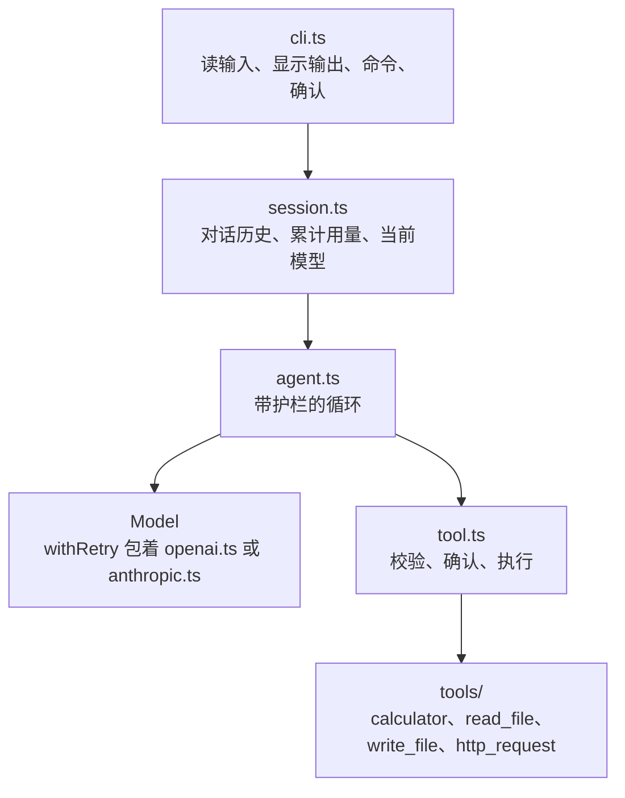

# 第 10 天：里程碑：mini-agent

> 最后核对：2026-11-01

前 9 天，你一块一块地造出了 Agent 的各个部件：模型调用、流式输出、结构化输出、工具、带护栏的循环、可测试的设计、两种协议、重试。今天把它们组装起来，做成第一阶段的成果：**mini-agent**，一个不依赖任何框架、能多轮对话的命令行 Agent。

它用起来是这样的：

```text
mini-agent · openai:my-model · 工作目录 /Users/you/workspace
输入 /help 查看命令

你 > 算一下 (1234 + 5678) * 9，结果写进 result.txt
先算，再写文件。
要执行 write_file {"path":"result.txt","content":"(1234 + 5678) * 9 = 62208"}
允许吗？(y/N) y

✓ calculator {"expression":"(1234 + 5678) * 9"}
  62208
✓ write_file {"path":"result.txt","content":"(1234 + 5678) * 9 = 62208"}
  已写入 result.txt（25 字节）

算好了：62208，已经写进 result.txt。

本轮：输入 1080 tokens（缓存命中 448） · 输出 80 tokens · 0.0020 元

你 > /model anthropic
已切换到 anthropic:my-model，对话历史保留

你 > 你还记得结果吗？
记得，(1234 + 5678) × 9 = 62208。
```

学完今天，你会：

- 把前 9 天的模块组装成一个完整的命令行程序
- 让 Agent 支持多轮对话，出错时对话历史保持完整
- 在执行有副作用的操作之前征得用户同意
- 在对话中途切换模型和协议，并显示累计的用量和花费
- （可选）把它编译、打包，发布到 npm

## 前 9 天各自交出了什么

| 天 | 交出的部件 | 在 mini-agent 里的作用 |
|---|---|---|
| 1 | Agent 循环 | 模型 + 工具 + 循环，一切的骨架 |
| 2 | `chat()`、`usage.ts`、`errors.ts` | 每一轮显示 token 和花费；出错时说清楚原因 |
| 3 | `sse.ts`、流式调用 | 边生成边显示，Ctrl+C 中断 |
| 4 | zod 和结构化输出 | 工具参数的 schema 和校验 |
| 5 | `tool.ts`、四个工具 | 计算、读写文件、HTTP 请求，同一轮的调用并行执行 |
| 6 | 三道护栏 | 死循环、截断、拦截、工具连续出错，都能停下来并说明原因 |
| 7 | `Model` 接口、假模型、录制回放 | 模型可以替换；今天的测试也受益于它 |
| 8 | `anthropic.ts`、`providers.ts` | 两种协议，可以中途切换 |
| 9 | `retry.ts` | 限流、超时、网络错误自动重试 |
| 10 | `session.ts`、`cli.ts`、确认 | 多轮对话、命令、危险操作前先问 |

组装起来的结构是这样的：



每一层只做一件事，彼此通过很小的接口连接：`cli.ts` 不知道协议的细节，`agent.ts` 不知道界面长什么样，工具不知道是谁在调用它。这正是前 9 天一直坚持的做法带来的好处：今天的新代码只有三百多行，大部分都是「把已有的东西接起来」。

## 多轮对话

第 1 天说过，接口不保存对话，`messages` 就是 Agent 的全部记忆。多轮对话无非是把这份记忆留下来，下一轮接着用。

`runAgent()` 新增了一个 `history` 选项：传入上一轮返回的 `messages`，它就在后面追加新的问题，接着往下跑；不传，就从 system prompt 开始。它不修改传进来的数组，而是复制一份再追加。

`session.ts` 负责保管这份历史：

```ts
const session = createSession({ model, tools });
await session.send('记住数字 42');
await session.send('我让你记住的数字是多少？'); // 第二轮带着第一轮的问答
```

关键的规则是：**只有跑完的一轮才记进历史。** 这一轮正常完成，或者因为步数用完之类的原因停下（第 6 天保证了这时的历史是完整的），都会记进去，用户可以接着说「继续」。如果这一轮抛出了异常，比如重试也没救回来的网络错误，或者被用户按 Ctrl+C 取消了，历史就保持原样，用户可以原封不动地再试一次。

这个规则也有代价：如果出错之前已经执行了工具，比如文件已经写了，可是这一轮没记进历史，模型下一轮就不知道这件事。要做得更细，可以把执行过的工具调用和结果也保留下来。这类「执行到一半」的状态怎么持久化、怎么恢复，第 29 天会专门讲。

用量的统计也有类似的考虑。会话的累计用量是每调用一次模型就累加一次，而不是等一轮结束再加。出错的那一轮里，已经完成的调用也是花了钱的，应该算进去。

还要记住第 2 天算过的账：每一轮都要把完整的历史重新发一遍，对话越长，每一轮越贵，最后会超出上下文窗口。mini-agent 目前的办法很朴素：遇到上下文超长的错误，提示用户用 `/clear` 开始新的对话。第 15、16 天会讲怎么自动压缩历史。

## 危险操作前先确认

有的工具只是读取信息，比如计算器、读文件；有的会改变外面的世界，比如写文件会覆盖已有的内容，发 POST 请求可能修改别人系统里的数据，也可能把你的数据发出去。后一类执行之前，应该先问一句。

工具用 `requiresApproval` 声明自己要不要确认，可以是固定的，也可以按参数判断：

```ts
// write_file：会覆盖已有的文件，每次都要问
requiresApproval: true,

// http_request：GET 只是读取，POST 才要问
requiresApproval: (input) => input.method === 'POST',
```

检查放在 `runToolCall()` 里，**校验参数之后、执行之前**。放在校验之后有两个原因：参数不合法的调用本来就不会执行，没必要打扰用户；按参数判断要不要问（比如看 `method`），参数必须先是合法的。

几个设计上的选择：

- **默认不同意。** 没有提供 `confirm` 函数时，需要确认的工具一律不执行。比如在后台跑的脚本没人能点「同意」，那就不该写文件。宁可多拒绝，也不要在没人知情的时候做了不可挽回的事。
- **拒绝也是一种结果。** 用户不同意时，把「用户没有同意执行这个操作」作为工具结果交回模型，并提醒它不要换个参数再试同样的操作。模型可以换个办法，或者问问用户为什么。
- **只有明确的 y 才算同意。** 直接回车、输入别的，都算不同意。提示里写成 `(y/N)`，大写的 N 表示默认选项，这是命令行程序的惯例。
- **排队确认。** 模型可能在一轮里同时发起两个写文件的调用，它们是并行执行的，确认请求也会同时到来。`confirm` 让它们排成队，一个一个问，免得两个问题同时显示在屏幕上，用户分不清在回答哪一个。

这是「人在回路」最简单的形式。真实的产品还要考虑更多：工具要按风险分级；用户点多了「同意」会变得麻木，不再看清楚就同意；被暂停的任务要能持久化、过几个小时再恢复。这些都放在第 29 天讲。第 37 天讲提示注入时你会看到，确认这一步有多重要：网页里藏着的一句话，就可能让模型去写文件、发请求。

## 命令行界面

### 读取输入

Node.js 自带的 `readline` 模块负责按行读取输入。它有一个方便的 `rl.question()`，但有个坑：通过管道一次输入好几行时（比如测试，或者 `cat commands.txt | node cli.ts`），在没人调用 `question()` 的那一刻到达的行会直接丢掉。

所以 `cli.ts` 自己维护了一个队列：收到的每一行先排队，谁来要就给谁。读用户的问题和读确认的回答，都从这同一个队列里取，顺序就不会乱。等待的时候还可以用 `signal` 取消：确认的时候用户按了 Ctrl+C，这一轮被中断，那个还在等回答的提问也跟着撤销。

### 命令

| 命令 | 作用 |
|---|---|
| `/model [openai\|anthropic]` | 查看当前模型，或者切换协议，对话历史保留 |
| `/cost` | 这次会话的轮数、累计用量和花费 |
| `/clear` | 清空对话历史，开始新的话题 |
| `/help` | 显示命令说明 |
| `/exit` | 退出，按 Ctrl+D 也可以 |

### Ctrl+C 和 Ctrl+D

在终端里，`readline` 会接管 Ctrl+C，触发它自己的 `SIGINT` 事件，而不是第 3 天那样的进程信号。mini-agent 的处理是：正在回答，就中断这一轮；正在等你输入，就退出。Ctrl+D 表示输入结束，同样会退出。

### 显示

流式的文字、暗色的思考内容、工具调用的结果、每一轮的用量、重试的提示，都写到同一个输出里。不同种类的输出之间空一行，读起来才不乱。

`runCLI()` 的输入和输出都是参数：直接运行时传入 `process.stdin` 和 `process.stdout`，测试时传入两个内存里的流。这样测试可以在同一个进程里驱动整个界面：把几行输入一次写进去，再检查输出里有没有该有的内容。这又是一次依赖注入：第 7 天注入模型，第 9 天注入等待函数，今天注入输入和输出。

## 中途切换模型

`/model anthropic` 只是把会话的 `model` 换成一个新的 `Model`，对话历史原封不动。能这么简单，是因为历史始终是我们自己的格式（第 8 天），由各个适配器在发送时转换。

不过切换也有代价，要心里有数：

- **思考内容会丢一部分。** OpenAI 兼容接口返回的 `reasoning_content` 没有签名，发给 Anthropic 协议时会被跳过；Anthropic 的思考块发给 OpenAI 兼容接口时也会去掉。模型看不到之前的思考过程，只看得到结论。
- **提示缓存失效。** 换了一家模型服务，之前的缓存就用不上了，切换后的第一轮，整段历史都按未命中缓存计费。
- **单价不同。** 两种协议可能是不同的模型服务，单价也不同。mini-agent 分别读取 `OPENAI_PRICE` 和 `ANTHROPIC_PRICE`，每调用一次模型，就按当时所用协议的单价计算花费，再累加起来。

## 可选：发布到 npm

想让别人用 `npx` 运行你的 mini-agent，要先解决一个问题：Node.js 能直接运行 `.ts` 文件，但**不处理 `node_modules` 里的 `.ts` 文件**。这是故意的，为的是不鼓励直接发布 TypeScript 源码。装到别人电脑上的包，在 `node_modules` 里，会直接报 `ERR_UNSUPPORTED_NODE_MODULES_TYPE_STRIPPING`。所以发布之前要先编译成 JavaScript。

大致的步骤：

1. 把 `days/day10/exercise/` 复制到一个新的项目里，安装 `zod`
2. 在 `cli.ts` 的第一行加上 `#!/usr/bin/env node`，让它能作为命令运行
3. 写一份用于编译的 tsconfig。关键是 `rewriteRelativeImportExtensions`：源码里的 `import './agent.ts'` 在输出中会改写成 `'./agent.js'`

   ```json
   {
     "compilerOptions": {
       "target": "es2024",
       "module": "nodenext",
       "moduleResolution": "nodenext",
       "strict": true,
       "rewriteRelativeImportExtensions": true,
       "outDir": "dist"
     },
     "include": ["src"]
   }
   ```

4. 在 `package.json` 里写上 `"bin": { "mini-agent": "dist/cli.js" }`、`"files": ["dist"]` 和 `"type": "module"`
5. 运行 `npx tsc` 编译，用 `npm pack` 看看打包了哪些文件，确认里面没有 `.env`，再 `npm publish`

还要想清楚配置从哪里读：别人运行你的命令时，当前目录不一定有 `.env`。常见的做法是同时支持环境变量和用户目录下的一个配置文件。**API Key 绝对不能打包进去。**

## 读懂练习代码

| 文件 | 内容 | 今天要做的 |
|---|---|---|
| [agent.ts](exercise/agent.ts) | 循环加上 `history` 和 `confirm` 两个选项；直接运行的代码移到了 `cli.ts` | TODO 1 |
| [tool.ts](exercise/tool.ts) | `requiresApproval` 和执行前的确认 | TODO 2 |
| [session.ts](exercise/session.ts) | 多轮对话的会话 | TODO 3 |
| [cli.ts](exercise/cli.ts) | 命令行界面：读输入、显示、命令、确认 | TODO 4、5 |
| [tools/files.ts](exercise/tools/files.ts)、[tools/http.ts](exercise/tools/http.ts) | `write_file` 和 POST 请求声明了要确认 | 读懂即可 |
| 其余文件 | 和第 9 天的参考答案一样 | 不用改 |

`cli.ts` 的框架已经搭好了：按行读取的队列、显示、每一轮的执行和出错处理、主循环。你要补的是命令（TODO 4）和确认（TODO 5）。

## 常见误解

| 误解 | 实际上 |
|---|---|
| 多轮对话要靠模型记住 | 接口什么都不记，是你每一轮都把历史发过去 |
| 出错的一轮也该记进历史 | 抛出异常的一轮不记，用户可以原样再试一次 |
| 没人确认时，执行了再说 | 默认不同意，没人知情时不做不可挽回的事 |
| 先问用户，再校验参数 | 先校验：不合法的调用不用打扰用户，按参数判断也需要合法的参数 |
| 切换模型不会损失什么 | 思考内容会丢一部分，提示缓存也会失效 |

## 常见错误

| 报错 | 原因 |
|---|---|
| 测试说「不要修改传进来的 history」 | 直接往 `options.history` 里 push 了。要先复制一份 |
| 测试说「出错的那一轮不能记进历史」 | 在 `runAgent` 跑完之前就更新了 `messages`，或者出错时也更新了 |
| 测试说「先校验参数，再问用户」 | 确认放在了校验之前 |
| 测试说「只有明确回答 y 才执行」 | 把直接回车当成了同意，或者没有判断大小写 |
| `TODO 4：还没有实现命令 /help` | 命令还没写完 |

## 动手：组装 mini-agent

按顺序做，每做完一步就运行一次 `npm run check 10`：

1. **TODO 1**：多轮对话的 `history`。
2. **TODO 2**：执行前的确认。`approval.test.ts` 会通过。
3. **TODO 3**：会话。`session.test.ts` 会通过，`cli.test.ts` 里的对话也开始能跑了。
4. **TODO 4、5**：命令和确认。全部测试通过，就完成了。

## 检查

```bash
npm run check 10
```

用真实模型验证：e2e 测试会在两种协议上各进行一次两轮的对话，检查模型记不记得上一轮说过的话。

```bash
npm run check 10 -- --e2e
```

然后，真正用起来：

```bash
node days/day10/exercise/cli.ts
```

## 小实验

- 让它帮你做点真事：「把这句话翻译成英文写进 notes/en.txt」「读一下 notes/en.txt，数数有多少个单词」
- 对话进行到一半，`/model anthropic` 切换协议，再问它之前聊过的内容
- 让它写文件时回答 n，看看模型收到拒绝以后怎么回应
- 回答到一半按 Ctrl+C，再问一遍同样的问题，确认刚才那一轮没有留在历史里
- 用 `/cost` 看看一段十几轮的对话花了多少钱，每一轮的输入是怎么增长的
- 把 `.env` 里的模型名改错再启动，看看出错时的提示

## 第一阶段小结

十天前，你的 Agent 只有 60 行，问一个术语，查一下术语表。现在它能：

- 边生成边显示，随时中断
- 计算、读写文件、访问网络，工具出错时自己想办法
- 遇到死循环、截断、拦截、工具故障，都能停下来并说清楚原因
- 在两种协议、多家模型服务之间切换，限流和网络抖动时自动重试
- 记住对话，危险操作前先问你
- 每一个部分都有测试，大部分不用联网就能跑

更重要的是，你知道它的每一行代码在做什么。第 41 天开始用框架时，你会清楚地看到框架替你做了哪些事，又藏起了哪些细节。

mini-agent 现在还缺什么？它只能读本地的文件，查不了网上的资料；对话一长就超出上下文窗口；不会记住你上周告诉它的事。第二阶段（第 11–20 天）就来解决这些：设计好用的工具、联网搜索、接入 MCP、上下文工程、RAG 和记忆，把它变成一个研究助手。

## 想一想

- 工具越来越多以后，模型开始选错工具、填错参数。工具的名称、说明和返回结果，怎么设计才能让模型用得好？（第 11 天）
- 怎么让 mini-agent 能搜索网页、读取网页的内容，回答时附上来源？（第 12 天）
- 别人已经写好了大量的工具服务器，能不能直接接进来用，而不是自己一个个写？（第 13 天）

## 延伸阅读

- [Node.js：Modules: TypeScript](https://nodejs.org/api/typescript.html)：直接运行 `.ts` 的规则和限制，包括为什么不处理 `node_modules` 里的 TypeScript
- [Node.js：Readline](https://nodejs.org/api/readline.html)：按行读取输入、`SIGINT` 事件
- [npm：package.json](https://docs.npmjs.com/cli/v11/configuring-npm/package-json)：`bin`、`files` 这些字段的含义
- [TypeScript：rewriteRelativeImportExtensions](https://www.typescriptlang.org/tsconfig/#rewriteRelativeImportExtensions)：编译时把 `.ts` 的导入改写成 `.js`
- [Gemini CLI](https://github.com/google-gemini/gemini-cli) 和 [OpenCode](https://github.com/sst/opencode)：两个开源的、用 TypeScript 写的命令行 Agent。读读它们的代码，找找和 mini-agent 对应的部分
