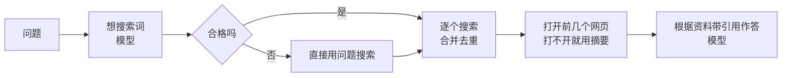

# 第 21 天：Workflow 还是 Agent

> 最后核对：2026-11-04

第三阶段从一个看起来不像技术的问题开始：**这件事真的需要 Agent 吗？**

第 20 天的研究助手是一个 Agent：每一步做什么，由模型自己决定。今天换一种做法，写一个**固定流程**（workflow）版本：先让模型想搜索词，代码去搜索、打开网页，再让模型根据资料作答。然后用同一组任务把两种做法各跑一遍，比较答对的比例、花了多少钱、等了多久。

```text
$ node days/day21/exercise/compare.ts tasks.json
| 做法 | 次数 | 答对 | 引用合格 | 模型调用 | tokens | 花费 | 耗时中位数 | 最慢 |
|---|---|---|---|---|---|---|---|---|
| workflow | 4 | … | … | 2.0 | … | … | … | … |
| agent | 4 | … | … | … | … | … | … | … |
```

表里的数字要你自己跑出来：它取决于你用的模型和任务。今天的重点不是「哪个更好」，而是学会**用数据做这个决定**。

学完今天，你会：

- 说清楚从单次调用、固定流程到自主 Agent 的光谱，以及每一档的代价
- 写一个固定流程的研究助手，在代码里做中间检查和容错
- 写一个对比框架，在同一组任务上度量效果、成本、延迟
- 根据数据，而不是直觉，决定一个功能用 Workflow 还是 Agent

## 从单次调用到自主 Agent

做一个 LLM 应用，可以有很多种「自主」程度：

| 档位 | 谁决定下一步 | 例子 |
|---|---|---|
| 单次调用 | 没有下一步 | 翻译一段话、提取结构化信息（第 4 天） |
| 固定流程 | 代码 | 想搜索词 → 搜索 → 读网页 → 作答（今天） |
| 路由 | 代码按模型的分类结果选一条路 | 简单问题给便宜模型，复杂的给研究流程（第 22 天） |
| Agent | 模型 | 第 20 天的研究助手：搜几次、读哪个网页、要不要查本地文档，都由它决定 |
| 多 Agent | 好几个模型互相分工 | 主 Agent 派出子 Agent 并行调研（第 25、26 天） |

Anthropic 在《Building effective agents》里给了一个很实用的区分：**工作流**是「模型和工具按预先写好的代码路径编排」，**Agent** 是「模型动态地决定自己的流程和工具的使用」。两者没有高下之分，只有合不合适。

往右走，能处理的问题越开放，但代价也越来越高：

| | 固定流程 | Agent |
|---|---|---|
| 可预测性 | 步骤固定，每次都一样，好调试 | 每次走的路可能不同，出了问题要看完整的轨迹 |
| 成本 | 模型调用次数固定（今天是 2 次） | 不固定，难的问题可能调十几次，历史越来越长，每次都更贵 |
| 延迟 | 固定的几步，能并行的地方可以并行 | 一步接一步，每步都要等模型 |
| 容错 | 要在代码里写好：搜不到怎么办、网页打不开怎么办 | 模型看到错误，常常能自己换个办法 |
| 上限 | 只能处理设计时想到的情况 | 能应付没想到的情况：搜不到就换个说法，读到一半发现要查别的就去查 |

一条朴素的原则：**能用简单方案解决的，就别上 Agent。** 先试单次调用；不够，再试固定流程；流程里的分支多到写不完，或者下一步做什么真的取决于上一步看到了什么，再交给 Agent。

## 固定流程的研究助手

[workflow.ts](exercise/workflow.ts) 的 `researchWorkflow()` 分四步：



只有第一步和最后一步调用模型，中间全是代码。模型看不到工具，也不用决定什么，它只做两件它最擅长的事：把问题变成搜索词，把资料变成回答。

### 中间检查

固定流程最怕的是一步出错、后面全错。第一步让模型输出 JSON：

```json
{"queries": ["潮汐协议 3.0 性能", "潮汐协议 2.x 延迟"]}
```

模型不总是听话：它可能包上一层 ```` ```json ````，可能说一句「好的，我来想几个搜索词」，可能给一个空数组。`parseQueries()` 就是这一步和下一步之间的**检查点**（gate）：合格就用，不合格就退回到最保守的做法，直接用问题本身去搜。流程照样走完，只是效果差一点。

注意这里没有用第 4 天的 `json_object` 模式：Anthropic 协议的适配器还不支持它，不少模型服务的支持也不完整。提示词要求 JSON，代码宽容地解析，解析不了就退回，这种「宽进严出」的写法在固定流程里很常见。

### 容错写在代码里

Agent 遇到网页打不开，会看到错误信息，自己换一个网址。固定流程里没有人做这个决定，所以 `gatherMaterials()` 要把每一种失败都想到：

- 一个搜索词出错（超时、限流），跳过它，接着搜下一个
- 几个搜索词搜到同一个网页，只留一份，免得同样的内容占两份上下文
- 网页打不开，就用搜索结果的摘要代替，并在资料里注明「只有搜索摘要」
- 每份资料截到 `maxChars`，总的上下文大小是可以算出来的

这正是固定流程的代价：**Agent 交给模型的随机应变，在这里要你一条一条写成代码。** 想到的情况越多，代码越长；想不到的情况，它就处理不了。

### 资料放在问题前面

最后一步把资料和问题拼成一条消息：先放资料，再提问题。长文档放在前面、问题放在最后，模型通常答得更好；而且同样的资料换个问题时，前面的部分不变，也更容易命中提示缓存（第 15 天）。资料照样包上第 12 天的「这是资料、不是指令」的边界。

## 对比：用数据做决定

两种做法哪个好，不能凭感觉。[compare.ts](exercise/compare.ts) 是一个很小的对比框架：

- `measure()` 跑一次，记下答对没有、引用合不合格、调用了几次模型、用了多少 token、花了多少钱、等了多久。出错不抛出，记成一次失败：**出错率本身就是对比的一部分**
- `summarize()` 按做法分组汇总。耗时用**中位数**而不是平均数：偶尔一次网络慢，不该把整体拉得很高；另外单独列出最慢的一次，因为用户记得住的往往是最慢的那次
- 「答对」用最简单的办法判断：答案里有没有出现应该出现的事实。几种写法都算对的，就都列上，比如「12 月 31」「12-31」

任务在 [data/compare-tasks.ts](data/compare-tasks.ts) 里，答案只在测试用的假网页上。前两个只要查一处，后两个要查两处：

```ts
{ question: '从潮汐协议 2.x 迁移到 3.0，配置文件里哪个配置项要改名？2.x 什么时候停止维护？',
  expected: ['handshake.attempts', ['12 月 31', '12-31', '12/31']] },
```

跑完以后，这样读这张表：

- **模型调用和 tokens**：固定流程总是 2 次；Agent 的次数取决于问题难度和模型的习惯。看平均数，也看最多的一次
- **答对**：只要查一处的问题，两种做法通常都能答对。要查好几处的问题，看固定流程想的搜索词有没有覆盖每个方面，Agent 有没有一直查到每个方面都有答案
- **耗时**：固定流程的步骤少，但每一步都等着；Agent 的每一步都要等模型。哪个快，要看实际的数字

四个任务、每种跑一次，样本太小，只能看个大概。真正做决定前，要像第 31 天那样建一个几十条的评估集，每条多跑几次。

## 读懂练习代码

| 文件 | 内容 | 今天要做的 |
|---|---|---|
| [workflow.ts](exercise/workflow.ts) | 固定流程：解析搜索词、收集资料、串起四步 | TODO 1、2、3 |
| [compare.ts](exercise/compare.ts) | 记录一次运行、汇总、排成表格 | TODO 4、5 |
| [data/compare-tasks.ts](data/compare-tasks.ts) | 对比用的四个任务 | 读懂即可 |
| 其余文件 | 和第 20 天的参考答案一样 | 不用改 |

`countCalls()` 已经写好：它给模型包一层，数调用次数、累加用量。Agent 和固定流程都只认 `Model` 接口（第 7 天），套上这一层它们分不出区别。

## 常见误解

| 误解 | 实际上 |
|---|---|
| Agent 比固定流程高级，能用就用 | 两者各有适合的场景。能用简单方案解决的，就别上 Agent |
| 固定流程一定更便宜 | 调用次数少，但每次塞进去的资料可能更多。要实际算 token |
| 固定流程不需要处理错误 | 恰恰相反：没有模型帮你随机应变，每种失败都要在代码里写好 |
| 跑一次就能比出好坏 | 模型每次的输出不一样。要在一组任务上、多跑几次再比 |
| 平均耗时最能代表体验 | 一次特别慢的请求会拉高平均数。看中位数，再看最慢的一次 |
| 二选一，整个产品只能用一种 | 可以组合：固定的骨架里，某一步交给 Agent；或者 Agent 的某个工具内部是固定流程 |

## 常见错误

| 报错 | 原因 |
|---|---|
| 测试说期望 `fallback: true`，实际是 `false` | 只处理了 JSON 解析失败，没处理 `queries` 是空数组或者全是空白 |
| 测试说「发布说明搜到了两次，只能留一份」 | 没有按网址去重 |
| 一个搜索词出错，整个 `gatherMaterials` 都失败了 | 搜索没有放进 `try`，出错时没有跳过 |
| 测试说「两次调用的用量都要算上」 | 只累加了一次调用的 usage |
| 测试说「先给资料，再提问题」 | 把问题放在了资料前面 |
| `measure` 的测试抛出了「模型超时」 | `run()` 出错时没有接住，要记成一次失败 |
| 测试说 `medianMs` 不对 | 用了平均数，没有用中位数 |

## 动手：两种做法，一组任务

按顺序做，每做完一步就运行一次 `npm run check 21`：

1. **TODO 1**：解析搜索词，不合格就退回用问题搜索。
2. **TODO 2**：收集资料：逐个搜索、去重、打开网页，打不开就用摘要。
3. **TODO 3**：把四步串成固定流程。`workflow.test.ts` 全部通过。
4. **TODO 4**：记录一次运行。
5. **TODO 5**：按做法汇总。全部测试通过。

## 检查

```bash
npm run check 21
```

然后用真实模型把四个任务各跑一遍（需真实模型；网页和搜索仍然用本地的假服务）：

```bash
npm run check 21 -- --e2e
```

测试会打印对比表和每个没答对的任务。想用真实的搜索服务对比你自己的问题，在 `.env` 里配好搜索的 Key，写一个 `tasks.json`：

```bash
node days/day21/exercise/compare.ts tasks.json
```

## 小实验

- 把 `maxPages` 从 3 改成 1，再跑一次对比：固定流程的成本降了多少，答对的比例变了没有？
- 在任务里加一个故意搜不到答案的问题。两种做法分别怎么回答？谁更容易编造？
- 把固定流程的第一步换成不调用模型、直接用问题搜索，只调用一次模型。效果差多少？
- 给 Agent 的 `maxSteps` 设成 4，看看它在多方面的问题上会不会提前停下
- 把四个任务各跑三次，看看两种做法的方差：哪个更稳定？

## 小结

- 从单次调用到多 Agent 是一条光谱，越往右越能处理开放的问题，也越贵、越慢、越难预测
- 固定流程由代码决定每一步，模型只做它最擅长的几件事。中间检查和容错都要写在代码里
- Agent 把随机应变交给模型，上限更高，但成本和延迟不固定
- 用数据做决定：同一组任务，度量答对的比例、引用、调用次数、token、花费、耗时的中位数和最慢的一次

## 想一想

- 固定流程四步都是一步接一步的。哪些步骤其实可以同时做？（第 22 天）
- 「你好」和「对比三家搜索 API」走同一条流程，显然很浪费。能不能先判断问题的类型，再决定走哪条路、用哪个模型？（第 22 天）
- 有的研究问题要好几个阶段：先查 A，根据 A 的结果再决定查 B 还是 C。固定流程写不出来，纯 Agent 又容易走偏。中间有没有别的办法？（第 23 天）

## 延伸阅读

- [Anthropic：Building effective agents](https://www.anthropic.com/engineering/building-effective-agents)：工作流和 Agent 的区分，以及五种常见的工作流模式，第 21–22 天的主线
- [OpenAI：A practical guide to building agents](https://openai.com/business/guides-and-resources/a-practical-guide-to-building-ai-agents/)：什么时候该做 Agent，怎么一步步加复杂度
- [12-Factor Agents](https://github.com/humanlayer/12-factor-agents)：把 Agent 当作普通软件来写：大部分是确定的代码，只在需要的地方用模型
- [Hamel Husain：Your AI Product Needs Evals](https://hamel.dev/blog/posts/evals/)：用数据而不是感觉做决定
