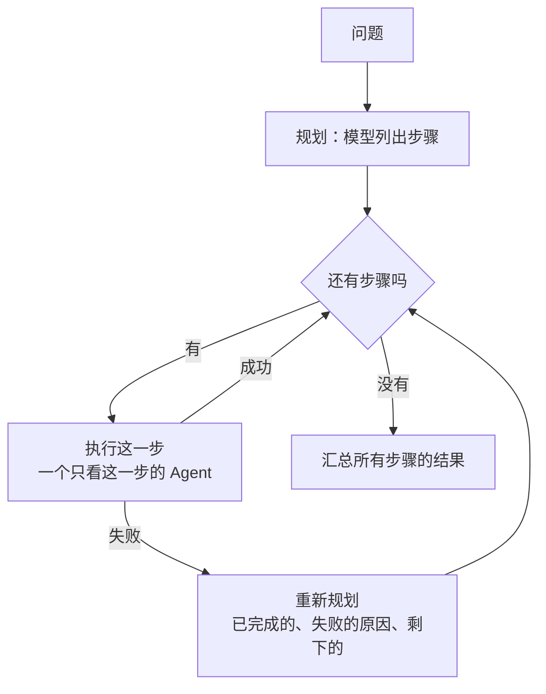

# 第 23 天：规划与任务分解

> 最后核对：2026-11-04

「潮汐协议 3.0 有什么变化？性能提升了多少？从 2.x 迁移要改什么？」这个问题要查三件事。第 20 天的研究助手会一步一步摸索：搜一下，读一个网页，再搜一下……常常查到第二件就忘了第三件，或者在第一件上反复打转。

人遇到这种问题会先列个清单，做完一件勾一件。今天让研究助手也这样做，并且试两种不同的分工：

```text
你 > 潮汐协议 3.0 有什么变化？性能提升了多少？从 2.x 迁移要改什么？
✓ 计划
  [>] 查 3.0 的发布说明，列出主要变化
  [ ] 查性能测试的数据
  [ ] 查迁移指南，找出要改的配置项
  进度：0/3
✓ web_search {"query":"潮汐协议 3.0 发布说明"}
✓ fetch_page {"url":"https://tide.example/news/3.0.html"}
✓ 计划
  [x] 查 3.0 的发布说明，列出主要变化
  [>] 查性能测试的数据
  [ ] 查迁移指南，找出要改的配置项
  进度：1/3
……
```

学完今天，你会：

- 把计划做成一个工具，让 Agent 自己列计划、更新进度，用户随时看得到
- 写一个「先规划后执行」的流程：代码按计划逐步执行，失败了让模型重新规划
- 知道两种做法各自适合什么情况
- 测试重新规划：失败的原因、已有的结果，有没有正确地交给模型

## 为什么要先列计划

模型一步一步地做，每一步都只看眼前：上一个工具结果是什么，下一步就做什么。问题简单时这没问题；问题有好几个方面时，就容易出现三种情况：

- **漏掉**：查完前两件，觉得够了，直接写回答，第三件没查
- **打转**：在一件事上反复搜索，步数用完了还没开始第二件
- **走偏**：读到一个有意思的网页，顺着它查下去，离问题越来越远

先列计划，相当于在开始之前把「要做完哪些事」写下来。之后每一步都对照着它，做完一件勾一件，还剩什么一目了然。对用户来说，计划还是一个**进度条**：一个要跑几分钟的研究任务，能看到它在做第几步、卡在哪里，等待就不那么难熬。

## 做法一：把计划做成工具

最轻量的做法是给 Agent 一个工具，让它自己维护计划。Claude Code 的待办清单就是这样做的。[plan.ts](exercise/plan.ts) 的 `update_plan` 接受一份完整的计划：

```json
{"steps": [
  {"content": "查 3.0 的发布说明", "status": "completed"},
  {"content": "查性能测试的数据", "status": "in_progress"},
  {"content": "查官方定价", "status": "failed", "note": "定价页打不开"},
  {"content": "搜索第三方的价格信息", "status": "pending"}
]}
```

几个设计上的选择：

**每次传完整的计划**，而不是「把第 2 步标成完成」。整份替换不会有编号对不上的问题；模型每次重写一遍，也是在提醒自己还剩什么。代价是多花一点输出 token，计划不长时可以忽略。

**有规则，而且会检查**。`validatePlan()` 要求：至少 1 步，最多 10 步；每一步都写了内容；**同时最多一步在进行**；失败的步骤要写原因。不合格就返回错误，计划保持原样，模型照着错误信息改（第 11 天的思路）。「一次只做一件事」这条看起来像是限制，其实是让模型专注，也让用户知道它此刻在做什么。

**工具结果里给出下一步**。更新成功后，结果是整份计划加上一句提示：「接下来：查性能测试的数据」；都做完了，就提示「可以写最终的回答了」；有失败的步骤又没有替代的步骤，就提醒它想别的办法或者说明没查到。工具结果是模型下一步最先看到的东西，在这里提醒最有效。

最后在 system prompt 里加一节「计划」：三件以上的事才列计划，简单的问题不用。不加这一句，模型可能连「你好」都要先列个计划。

命令行在每次计划更新时显示整份计划，`/plan` 随时查看。

## 做法二：先规划，后执行

做法一里，计划只是一个「建议」：模型可以不列，列了也可以不照着做。另一种做法把控制权交给代码：



`planAndExecute()` 是这个流程的骨架，执行和汇总都通过参数传进来，所以可以单独测试。[research.ts](exercise/research.ts) 的 `planResearch()` 把它和研究助手的工具接在一起：

- **执行者只看一步**：每一步交给一个新的 Agent，它只知道问题、前面步骤的结果、这一步要做什么。它的上下文很干净，不会被别的步骤的工具输出干扰。这是第 25 天「子 Agent」的雏形
- **失败要说出来**：执行者的 prompt 要求，做不成就在第一行写「失败：原因」，不要编造结果。Agent 没有正常结束（比如步数用完了）也算失败
- **汇总只用成功的结果**：每一步的结果都带着 `[编号]`，所有步骤共用一个来源登记，汇总时的编号才对得上

### 重新规划

重新规划是这一套里最关键、也最容易写错的部分。模型要做出好的调整，需要知道三件事：

```text
已经完成的步骤：
1. 查端口
结果：端口是 7443

失败的步骤：查官方定价
原因：官网的定价页打不开

原来剩下的步骤：
1. 对比价格
```

少了任何一件都会出问题：不知道完成了什么，它会让你重做；不知道为什么失败，它会原样再试一次；不知道剩下什么，它可能把后面的步骤也丢了。`describeProgress()` 把这三件事写清楚，`REPLANNER_PROMPT` 要求它不要原样重复失败的步骤，换个办法；实在没有办法，就返回空的计划。

和第 21 天一样，每一步都要考虑模型不听话的情况：

| 情况 | 怎么办 |
|---|---|
| 一开始的计划解析不了 | 把问题本身当作唯一的一步，退化成普通的 Agent |
| 重新规划的结果解析不了 | 保留原来剩下的步骤，接着做 |
| 重新规划返回空的计划 | 不再往下做，用已有的结果汇总 |
| 一直失败、一直重新规划 | 次数到了 `maxReplans` 就停下，注明 `stopped` |
| 计划越改越长 | 执行的步数到了 `maxSteps` 就停下 |

最后两条和第 6 天的护栏是一个道理：**任何循环都要有上限**。

## 两种做法怎么选

| | 计划工具 | 先规划后执行 |
|---|---|---|
| 谁说了算 | 模型 | 代码 |
| 适合 | 交互式的会话，问题有简单有复杂 | 后台跑的研究任务，问题本身就复杂 |
| 上下文 | 一个 Agent，历史越来越长 | 每一步一个新的 Agent，上下文干净 |
| 灵活性 | 高：做到一半可以随时改计划 | 中：只在失败时重新规划 |
| 可预测性 | 低：可能不列计划，也可能不照着做 | 高：每一步都在代码的掌控之中 |
| 成本 | 低：只多了几次工具调用 | 高：规划、每一步、汇总都是单独的调用 |

研究助手 v2（第 30 天）会用做法二当骨架：计划要先给用户确认，各个步骤并行执行，这些都需要代码说了算。

## 读懂练习代码

| 文件 | 内容 | 今天要做的 |
|---|---|---|
| [plan.ts](exercise/plan.ts) | 检查、显示计划，计划工具，先规划后执行 | TODO 1–4 |
| [research.ts](exercise/research.ts) | `createResearchTools` 可以带上计划工具；新增 `planResearch()` | 读懂即可 |
| [prompts.ts](exercise/prompts.ts) | system prompt 多了「计划」一节 | 读懂即可 |
| [cli.ts](exercise/cli.ts) | 显示计划，`/plan` 命令 | 读懂即可 |
| 其余文件 | 和第 22 天的参考答案一样 | 不用改 |

`createStepExecutor()` 和 `createSynthesizer()` 已经写好，它们把「执行一步」和「汇总」接到研究助手上。

## 常见误解

| 误解 | 实际上 |
|---|---|
| 每个问题都该先列计划 | 简单的问题列计划只是浪费。prompt 里要写清楚什么时候才列 |
| 计划越细越好 | 太细的计划维护起来比做事还贵。2 到 5 步，最多 10 步 |
| 列了计划，模型就会照着做 | 计划工具只是建议。要保证照着做，用代码来执行 |
| 失败了就从头再规划一遍 | 已经完成的不用重做。只调整剩下的步骤 |
| 重新规划时告诉模型「失败了」就够了 | 要告诉它为什么失败，否则它会原样再试一次 |
| 计划只是给模型看的 | 它也是给用户看的进度条 |

## 常见错误

| 报错 | 原因 |
|---|---|
| 测试说期望 `进度：1/4`，实际是 `2/4` | 把失败的步骤也算成了完成 |
| 测试说「计划保持原样」，或者不合格的计划没有报错 | `update_plan` 没有检查 `board.update` 返回的问题，没有抛出错误 |
| 测试说「重新规划时要告诉模型：完成了什么、哪一步为什么失败、原来还剩什么」 | 交给 `describeProgress` 的 `pending` 不对，比如把失败的那一步也放进了剩下的步骤 |
| 测试说期望执行 `['a', 'b']`，实际只执行了 `['a']` | 重新规划的结果解析不了时，把剩下的步骤清空了，应该保留 |
| 测试说「失败的步骤不进汇总」 | 失败的原因也放进了 `done` |
| 测试说期望 `stopped` 是 `max_replans`，实际是 `undefined` | 重新规划的次数用完时没有停下，或者停下时没有记原因 |

## 动手：给研究助手加上计划

按顺序做，每做完一步就运行一次 `npm run check 23`：

1. **TODO 1**：检查计划。
2. **TODO 2**：显示计划。
3. **TODO 3**：计划工具。`plan.test.ts` 和 `cli.test.ts` 全部通过。
4. **TODO 4**：先规划后执行、失败后重新规划。全部测试通过。

## 检查

```bash
npm run check 23
```

用真实模型跑一次先规划后执行的研究，测试会打印每一次计划的变化：

```bash
npm run check 23 -- --e2e
```

再在命令行里问一个要查好几件事的问题，看看它会不会主动列计划：

```bash
node days/day23/exercise/cli.ts
```

## 小实验

- 问一个简单的问题（「潮汐协议 3.0 的默认端口是多少？」），看它会不会多余地列计划。如果会，改 prompt 里「计划」一节
- 把 `MAX_PLAN_STEPS` 改成 3，问一个要查五件事的问题，看它怎么应对「计划最多 3 步」的错误
- 在 `planResearch` 里故意让第二步总是失败，看 `REPLANNER_PROMPT` 会给出什么样的替代步骤
- 删掉 `describeProgress` 里「原因」那一行，再失败一次：它会不会原样重试？
- 对同一个问题，分别用计划工具和 `planResearch` 各跑一次，比较调用次数、token 和回答的完整度（第 21 天的 `compare.ts` 可以直接用）

## 小结

- 复杂的问题先列计划，避免漏掉、打转、走偏；计划也是给用户看的进度条
- 计划工具：模型自己列、自己更新。每次传完整的计划，有规则、会检查，工具结果里给出下一步
- 先规划后执行：代码按计划执行，每一步一个干净的 Agent，失败了带着「完成了什么、为什么失败、还剩什么」重新规划
- 所有的循环都要有上限：重新规划的次数、执行的步数

## 想一想

- 执行者说「完成了」，就一定完成了吗？它查到的结论真的出自它引用的那个来源吗？（第 24 天）
- 先规划后执行时，几个互不依赖的步骤是一个接一个地做的。能不能让它们同时做？（第 25 天）
- 计划列出来以后，能不能先给用户看一眼，用户点头了再执行？（第 29 天）

## 延伸阅读

- [Plan-and-Solve Prompting](https://arxiv.org/abs/2305.04091)：先规划再求解，比一步一步摸索更少漏步骤
- [LangChain：Plan-and-Execute Agents](https://blog.langchain.com/planning-agents/)：先规划后执行的几种变体，以及它们在成本和速度上的取舍
- [Anthropic：How we built our multi-agent research system](https://www.anthropic.com/engineering/multi-agent-research-system)：主 Agent 先制定研究计划并保存下来，上下文被截断时还能找回
- [Claude Code 文档：Common workflows](https://code.claude.com/docs/en/common-workflows)：看看一个成熟的编程 Agent 怎么用待办清单
