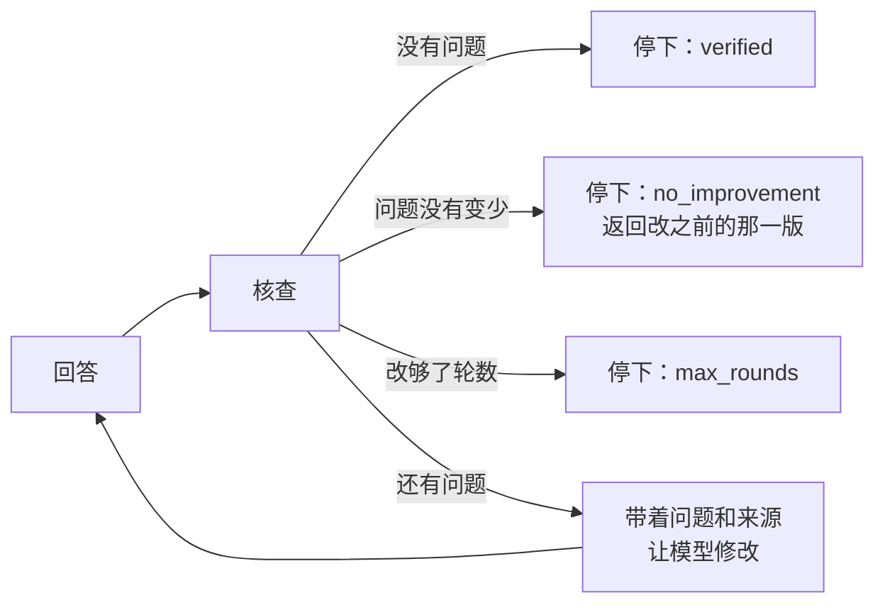

# 第 24 天：反思与自检

> 最后核对：2026-11-04

第 20 天的引用检查只看格式：有没有标引用、编号是不是登记过的。它抓不住这种回答：

```text
潮汐协议 3.0 建立连接的平均延迟是 15 毫秒 [2]。
```

格式完美，可是 [2] 里写的是 18 毫秒。今天给研究助手加上**引用核查**：写完回答以后，逐句对照它引用的来源，看看是不是真的出自那里；发现问题，交回模型改一遍，再核查。

```text
你 > /verify
核查中……
✓ 潮汐协议 3.0 于 2026 年 3 月 14 日发布 [1]。
✗ 建立连接的平均延迟是 15 毫秒 [2]。（来源里没有这些数字：15）
~ 握手减少是 3.0 唯一的变化 [1]。（原文没有说这是唯一的变化）
核查了 3 句，1 句有来源支撑
```

学完今天，你会：

- 写一个「生成 → 评估 → 修改」的循环，并给它合适的停止条件
- 先用代码做客观的校验，判断不了的才交给模型
- 用代码校验模型评审的判断，防止评审自己编造
- 说清楚自我批评什么时候有用、什么时候只是在浪费 token

## 自我批评不一定有用

最朴素的「反思」是让模型检查自己的回答：「请检查你的回答有没有错误，有的话改正」。听起来很合理，但研究和实践都发现，**没有外部信息时，模型很难发现自己的错误**。它写下那个数字时就认为它是对的，再问一遍，多半还是认为它是对的；有时候反而把对的改错了。

反思有用，靠的是**新的信息**：

| 反思的依据 | 有没有用 |
|---|---|
| 只有自己的回答：「再检查一遍」 | 效果很有限，常常只是多花一倍的钱 |
| 客观的信号：测试结果、编译错误、计算器 | 很有用：错误是确定的，模型照着改就行 |
| 来源的原文：「这句话在 [2] 里吗」 | 有用：评审要对照的东西就在眼前 |
| 另一个更强的模型、或者人来评 | 有用，但更贵、更慢 |

今天的核查器属于第二、三种：先用代码对照数字，再让模型对照原文判断。

## 核查一句话

[verify.ts](exercise/verify.ts) 的 `verifyCitations()` 逐句处理回答里带引用的话。没有引用的句子不在这里管，「该有引用却没有」是第 20 天格式检查的事。

### 第一步：能用代码判断的，就不问模型

研究回答里最容易错、也最要紧的是**数字**：日期、版本、价格、百分比。而数字恰好可以用代码检查：句子里的每个数字，都应该在它引用的来源里出现过。

```text
建立连接的平均延迟是 15 毫秒 [2]。
来源 [2]：……3.0 是 18 毫秒，2.x 是 42 毫秒……
→ 来源里没有这些数字：15
```

这一步不调用模型，便宜、快、结果确定。数字对不上就直接判 `unsupported`，不用再花钱问模型。

要注意「完整的数」：找 `18` 时，`2018` 和 `18.5` 都不算；找 `3` 时，`3.0` 也不算。`containsNumber()` 用零宽断言做这件事：

```ts
new RegExp(`(?<![\\d.])${escaped}(?![\\d]|\\.\\d)`)
```

它也有局限：「三次」和「3 次」它认为不一样，「一半」这种说法它根本看不出来。所以它只是第一道关卡。

### 第二步：模型对照原文

数字没问题的句子，交给模型评审。`JUDGE_PROMPT` 让它输出三种判断之一：

| 判断 | 含义 |
|---|---|
| supported | 来源里明确写了这个意思，数字、日期、名称都对得上 |
| partial | 只支撑了一部分，或者说得比来源更绝对（「唯一的变化」「一定会」） |
| unsupported | 来源里没有，或者和来源矛盾 |

`partial` 很重要。模型写回答时常常不知不觉地把话说满：来源说「最大的变化是……」，回答写成「唯一的变化是……」。这种错误数字检查抓不到，只有对照原文才看得出来。

### 第三步：校验评审

评审也是模型，也会出错，也会编。所以要求它给出**支撑这句话的原文**，再用代码确认原文真的在来源里：

- 说支撑，却没给原文：改判 `unsupported`
- 给的原文在来源里找不到：改判 `unsupported`，这多半是它凭印象「复述」的
- 比较时忽略空白：模型复制原文时常常丢掉或者多出空格

这是今天的一条主线：**模型的每一个判断，只要能用代码验证，就验证一下。**

几句话互不相关，用第 22 天的 `mapLimit` 同时核查。评审出错（超时、限流）的那一句记成「没法核查」，不影响其他句。

## 生成 → 核查 → 修改

核查发现了问题，下一步是改。`reviseUntilSupported()` 是一个循环：



修改时交给模型的东西要具体：原来的回答、哪几句有问题、为什么、这几句引用的来源原文（`describeProblems()`）。只说「有问题，请修改」，它不知道改哪里，更不知道改成什么。

**停止条件**是这个循环最重要的部分。三个条件各管一种情况：

| 条件 | 为什么 |
|---|---|
| 没有问题了 | 目标达成 |
| 改了 `maxRounds` 轮 | 每一轮都要核查加修改，成本是线性增长的。默认 2 轮 |
| 改了以后问题没有变少 | 模型改不对，再改多半也是白花钱；而且可能越改越糟，这时**返回改之前的那一版** |

第三条容易被忽略。修改不保证变好：模型可能把对的句子也改了，或者为了「改正」而编出另一个数字。所以要一直记着问题最少的那一版，最后返回它，而不是最后一版。

核查可以用另一个模型：`judge` 参数。核查是「对照原文做判断」，比写回答简单，换一个便宜的模型往往就够；也可以反过来，用一个更强的模型来评，避免「自己评自己」的盲区。

## 接到研究助手里

- `research()` 多了一个选项 `verify`：回答以后核查，有问题就改。只有查过资料、正常完成的回答才核查，闲聊不用
- 来源登记现在会保存**读到的内容**：搜索摘要、网页正文、文档段落，读到一段记一段（[web.ts](exercise/web.ts)）。核查时就对照这些内容，不用重新抓网页
- 命令行多了 `/verify`，核查上一个回答，一句一行地显示结果

注意核查只能对照「读到过的内容」。模型只看了搜索摘要就引用 [1]，那核查也只能对照摘要。这也提醒了第 12 天的那条原则：要核实，就打开网页读全文。

## 读懂练习代码

| 文件 | 内容 | 今天要做的 |
|---|---|---|
| [verify.ts](exercise/verify.ts) | 数字校验、模型评审、核查整个回答、修改循环 | TODO 1–4 |
| [web.ts](exercise/web.ts) | 来源登记保存读到的内容 | 读懂即可 |
| [tools/docs.ts](exercise/tools/docs.ts)、[workflow.ts](exercise/workflow.ts) | 登记来源时带上内容 | 读懂即可 |
| [research.ts](exercise/research.ts) | `verify` 选项 | 读懂即可 |
| [cli.ts](exercise/cli.ts) | `/verify` 命令 | 读懂即可 |
| 其余文件 | 和第 23 天的参考答案一样 | 不用改 |

## 常见误解

| 误解 | 实际上 |
|---|---|
| 让模型「再检查一遍」就能提高准确率 | 没有新信息的自我批评效果很有限。要给它来源、测试结果这类客观的依据 |
| 格式检查通过了，引用就是对的 | 格式只说明编号存在，不说明内容对得上 |
| 评审是模型，它说支持就是支持 | 评审也会编。要它给出原文，再用代码确认原文在来源里 |
| 改的轮数越多，回答越好 | 修改可能越改越糟。问题没变少就停下，返回最好的那一版 |
| 每一句都要请模型核查 | 数字这种能用代码判断的，先用代码判断，又快又省钱 |
| 核查能发现所有错误 | 它只核查带引用的句子，而且只能对照读到过的内容 |

## 常见错误

| 报错 | 原因 |
|---|---|
| 测试说 `containsNumber('2018 年', '18')` 应该是 `false` | 用了 `includes`，没有检查前后是不是数字 |
| 测试说「原文确实在来源里（忽略空白）」却判成了 unsupported | 比较原文时没有去掉空白 |
| 测试说「数字对不上、没法核查的，都不用问模型」 | 先调用了评审，没有先做数字校验 |
| 测试说「要评审的两句同时核查」 | 用 `for` 循环一句一句地核查 |
| 测试说期望 `no_improvement`，实际又多改了一轮 | 比较问题个数时用了 `>`，问题一样多时没有停下 |
| 测试说返回的应该是改之前的那一版 | 停下时返回了最后一版，没有返回问题最少的那一版 |

## 动手：引用核查器

按顺序做，每做完一步就运行一次 `npm run check 24`：

1. **TODO 1**：数字校验：完整的数、来源里没有的数字。
2. **TODO 2**：校验评审给出的原文。
3. **TODO 3**：核查整个回答：先数字、再评审，几句同时核查。`verify.test.ts` 全部通过。
4. **TODO 4**：生成 → 核查 → 修改的循环。全部测试通过。

## 检查

```bash
npm run check 24
```

用真实模型核查一个故意写错的回答，再让它改：

```bash
npm run check 24 -- --e2e
```

然后在命令行里问一个研究问题，回答以后输入 `/verify`：

```bash
node days/day24/exercise/cli.ts
```

## 小实验

- 用 `/verify` 核查十个回答，统计有多少句是 `partial`。它们大多是哪种问题？
- 把 `JUDGE_PROMPT` 里「quote 要逐字复制」那句删掉，看看评审给的原文有多少能在来源里找到
- 让模型「检查一遍你的回答，有错就改」（不给来源），和 `reviseUntilSupported` 比一比，哪个改对的更多？
- 核查用一个便宜的模型，修改用默认的模型，比较成本和效果
- 给 `research()` 打开 `verify`，用第 21 天的 `compare.ts` 对比打开前后的答对率和成本

## 小结

- 没有新信息的自我批评效果有限；反思要有依据：来源、测试、计算结果
- 能用代码判断的先用代码判断（数字），判断不了的才交给模型
- 模型评审的判断也要用代码校验：给出原文，确认原文真的在来源里
- 生成 → 核查 → 修改的循环要有三个停止条件：没问题了、轮数用完、问题没有变少；最后返回最好的那一版，而不是最后一版

## 想一想

- 一个问题要查五件事，每一件的资料都塞进同一个 Agent 的上下文，到后面它还记得清第一件查到了什么吗？能不能让几个 Agent 各查一件，只交回结论？（第 25 天）
- 核查一个回答要调用好几次模型。研究助手的总成本里，核查占多少？什么时候值得？（第 36 天）
- 能不能把核查发现的问题记下来，变成评估集里的用例？（第 31 天）

## 延伸阅读

- [Large Language Models Cannot Self-Correct Reasoning Yet](https://arxiv.org/abs/2310.01798)：没有外部反馈时，自我纠正往往没有帮助
- [Self-Refine](https://arxiv.org/abs/2303.17651)：生成、反馈、修改的循环，以及它在哪些任务上有效
- [Anthropic：Building effective agents](https://www.anthropic.com/engineering/building-effective-agents)：evaluator-optimizer 模式，以及什么时候适合用
- [Anthropic：Reduce hallucinations](https://docs.anthropic.com/en/docs/test-and-evaluate/strengthen-guardrails/reduce-hallucinations)：让模型先引用原文再作答、找不到原文就撤回结论
