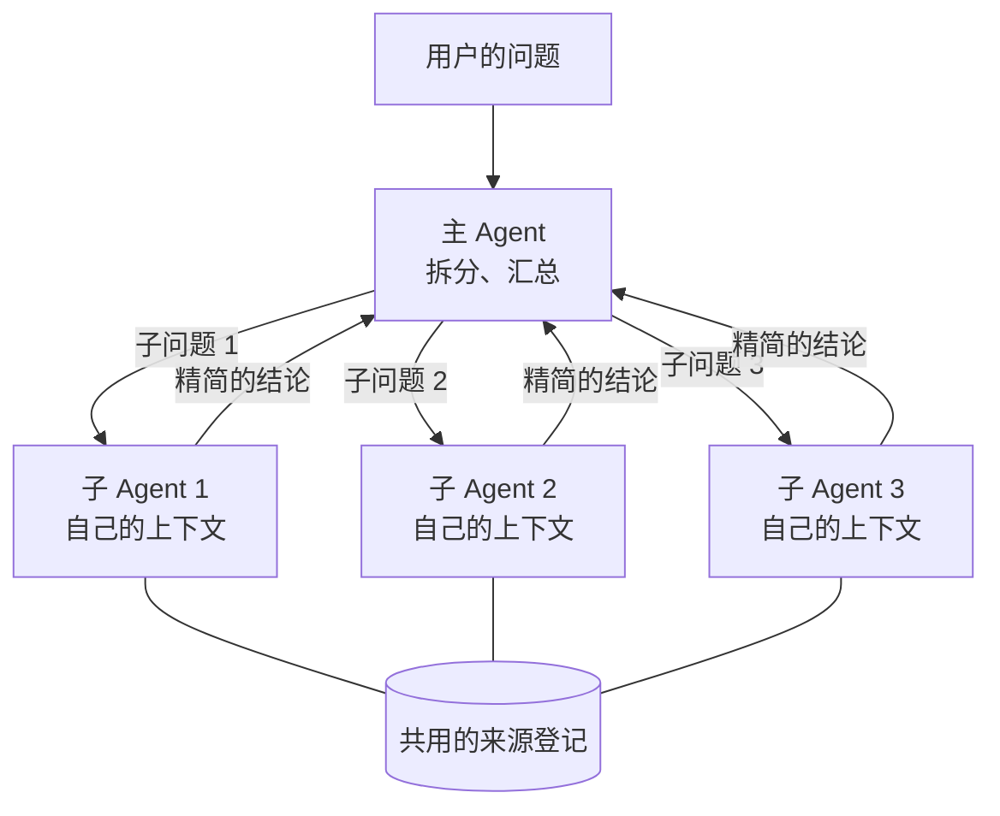

# 第 25 天：子 Agent

> 最后核对：2026-11-04

第 23 天的「先规划后执行」已经有了子 Agent 的影子：每一步交给一个只看这一步的 Agent。今天把它正式做出来：研究助手（主 Agent）遇到有好几个方面的问题，把它们拆成子问题，**同时**派出几个子 Agent 去查，每个子 Agent 只交回精简的结论，主 Agent 汇总。

```text
$ node days/day25/exercise/research.ts --subagents "潮汐协议 3.0 快了多少？迁移要改什么？托管多少钱？"
✓ delegate_research {"tasks":[{"question":"潮汐协议 3.0 比 2.x 快了多少"}, …]}
↳ 子 Agent 1：潮汐协议 3.0 比 2.x 快了多少
↳ 子 Agent 2：从潮汐协议 2.x 迁移到 3.0 要改哪些配置
↳ 子 Agent 3：潮汐云托管各版本的价格
↳ 子 Agent 2 完成（3 步，2 次工具调用）
……

主 Agent：输入 6120 tokens · 输出 310 tokens
子 Agent：输入 21480 tokens · 输出 520 tokens
```

注意最后两行：子 Agent 用的 token 是主 Agent 的好几倍。今天要弄清楚这笔钱换来了什么。

学完今天，你会：

- 用编排者-执行者模式拆分研究任务，让几个子 Agent 并行调研
- 理解上下文隔离：子 Agent 看不到什么、交回什么、为什么这样设计
- 决定子 Agent 能用哪些工具
- 分开统计主 Agent 和子 Agent 的用量，判断多 Agent 值不值

## 为什么要子 Agent

一个 Agent 查三件事，问题在于**上下文**。查第一件时读了三个网页，每个几千字；查第二件时，这些网页原文还在上下文里；到第三件时，上下文里堆满了和它无关的内容。后果是：

- **贵**：每一次调用模型都要带上全部历史，越往后每次越贵
- **乱**：模型要在一大堆资料里找当前需要的，容易张冠李戴，把 A 网页的数字安到 B 的头上
- **慢**：三件事明明互不相关，却只能一件接一件地查

第 16 天的压缩能缓解第一点，但治标不治本。子 Agent 的思路是**把上下文分开**：



每个子 Agent 只看到自己的子问题，读的网页留在它自己的上下文里；交回主 Agent 的只有几百字的结论。主 Agent 的上下文里只有「问题 + 三段结论」，干净、短，汇总起来不容易出错。三个子 Agent 互不依赖，可以同时跑。

## 上下文隔离

[subagent.ts](exercise/subagent.ts) 的 `runSubagent()` 每次都从一个全新的上下文开始：

```text
system：你是研究助手派出的子 Agent，只负责一个子问题……
user：子问题：潮汐协议 3.0 比 2.x 快了多少

背景：用户在评估要不要升级
```

隔离是双向的：

| | 看得到 | 看不到 |
|---|---|---|
| 子 Agent | 子问题、主 Agent 写的背景、自己的工具结果 | 用户和主 Agent 的对话、别的子 Agent 读了什么 |
| 主 Agent | 每个子 Agent 的结论（最多 `maxChars` 个字） | 子 Agent 读过的网页原文、它的中间步骤 |

这带来一个要求：**子问题要写得能独立理解**。主 Agent 心里知道「它」指的是潮汐协议，子 Agent 不知道。所以 `delegate_research` 的描述和 `ORCHESTRATOR_PROMPT` 都强调：子问题要具体，需要的背景写进 `context`。Anthropic 在介绍他们的研究系统时提到，早期的主 Agent 只给子 Agent 一句简短的指令，结果几个子 Agent 做了重复的工作，或者理解偏了。

另一个要求是**结论要精简**。子 Agent 的 prompt 要求只写事实和来源编号，`runSubagent` 再用 `truncate` 截到 `maxChars`。没有这一步，子 Agent 把整篇网页抄回来，隔离就白做了。

还有一件事没有隔离：**来源登记**。子 Agent 和主 Agent 共用一个，子 Agent 结论里的 `[3]`，主 Agent 汇总时可以直接用，最后附上的来源列表也是对的。

## 子 Agent 能用哪些工具

子 Agent 是同时跑的，这决定了有些工具不能给它：

| 工具 | 给不给 | 为什么 |
|---|---|---|
| `web_search`、`fetch_page`、文档检索、`calculator`、`recall` | 给 | 只读，同时跑也没问题 |
| `write_file`、`http_request` | 不给 | 有副作用，要用户确认；几个子 Agent 同时弹出确认，用户没法判断 |
| `remember`、`forget` | 不给 | 几个子 Agent 同时改记忆，会互相覆盖 |
| `update_plan` | 不给 | 计划是主 Agent 的事 |
| `delegate_research` | 不给 | 子 Agent 再派子 Agent，层层嵌套，成本失控 |

`subagentTools()` 按名单去掉这些。最后一条尤其重要：**递归派生是多 Agent 系统里成本失控最常见的原因**，最简单的防法就是不给。

## 并行和失败

`delegate_research` 用第 22 天的 `mapLimit` 同时运行子 Agent，同时最多 `concurrency` 个，结论按子问题的顺序交回，不管谁先查完。

一个子 Agent 出问题，不能拖垮整批：

- 没有查完（步数用完、工具连续出错）：结论后面注明「没有查完」和原因
- 调用模型出错：记成 `status: 'error'`，结论写「出错了」
- 被取消、没来得及开始：记成「没有执行」

主 Agent 看到这些，可以在回答里说明哪部分没查到，或者换个说法再派一次。

## 多 Agent 的成本

子 Agent 不是免费的。每个子 Agent 都要：

- 带上自己的 system prompt 和全部工具定义
- 自己搜索、自己读网页（几个子 Agent 可能读到同一个网页）
- 调用好几次模型，每次都带着自己越来越长的历史

所以总用量通常是单个 Agent 的好几倍。Anthropic 公布过他们的数据：Agent 的 token 用量大约是普通对话的 4 倍，多 Agent 系统大约是 15 倍。换来的是：更快（并行）、主 Agent 的上下文更干净、能处理单个 Agent 处理不了的大范围调研。

这就是为什么要**分开统计**。主 Agent 的 `result.usage` 里没有子 Agent 的用量，`orchestrate()` 把它们分别加起来：

```ts
usage: { main, subagents, total }
```

只看主 Agent 的用量，会严重低估成本。`ORCHESTRATOR_PROMPT` 里也写明：简单的、只要查一处的问题，自己查，不要派子 Agent。

什么时候值得用子 Agent？

| 适合 | 不适合 |
|---|---|
| 问题有几个互不依赖的方面，可以同时查 | 步骤之间环环相扣，后一步要用前一步的结果 |
| 每个方面都要读大量资料 | 一两次搜索就能答完 |
| 速度比成本重要 | 预算很紧 |

## 读懂练习代码

| 文件 | 内容 | 今天要做的 |
|---|---|---|
| [subagent.ts](exercise/subagent.ts) | 运行一个子 Agent、`delegate_research` 工具 | TODO 1、2 |
| [research.ts](exercise/research.ts) | `createResearchTools` 可以带上子 Agent；`orchestrate()` | TODO 3 |
| [prompts.ts](exercise/prompts.ts) | 新增 `ORCHESTRATOR_PROMPT` | 读懂即可 |
| [citations.ts](exercise/citations.ts) | `delegate_research` 也算查资料的工具 | 读懂即可 |
| 其余文件 | 和第 24 天的参考答案一样 | 不用改 |

## 常见误解

| 误解 | 实际上 |
|---|---|
| 子 Agent 越多越好 | 每多一个，成本多一份。只在问题真的能拆开时用 |
| 子 Agent 能看到主 Agent 的对话 | 看不到。子问题要写得能独立理解，背景要明确写进去 |
| 子 Agent 交回的越详细越好 | 详细就失去了隔离的意义。只交回结论和来源编号 |
| 主 Agent 的用量就是总用量 | 子 Agent 的用量要单独加上，通常比主 Agent 还多 |
| 子 Agent 能用的工具和主 Agent 一样 | 同时跑的子 Agent 不该用有副作用的工具，更不该再派子 Agent |
| 一个子 Agent 出错，整个任务就失败了 | 出错的记下来交回，其他的照常汇总 |

## 常见错误

| 报错 | 原因 |
|---|---|
| 测试说「全新的上下文」，消息对不上 | 把主 Agent 的历史传给了子 Agent，或者没有用 `SUBAGENT_PROMPT` |
| 测试说期望结论里有「只保留了前 50 个字符」 | 没有用 `truncate` 截短结论 |
| 测试说「三个子 Agent 要同时跑」 | 子 Agent 是一个接一个地运行的 |
| 测试说结论的顺序不对 | 按完成的顺序拼接，没有按子问题的顺序 |
| 测试说「子 Agent 不能再派子 Agent」 | `delegate_research` 没有从子 Agent 的工具里去掉 |
| 测试说 `total` 的用量对不上 | 只算了主 Agent 的用量，没有加上子 Agent 的 |

## 动手：派出子 Agent

按顺序做，每做完一步就运行一次 `npm run check 25`：

1. **TODO 1**：运行一个子 Agent：全新的上下文，精简的结论，出错不抛出。
2. **TODO 2**：`delegate_research`：同时运行，按顺序交回，记下结果。
3. **TODO 3**：`orchestrate()`：主 Agent 加子 Agent，用量分开算。全部测试通过。

## 检查

```bash
npm run check 25
```

用真实模型跑一个有三个方面的问题，看它会不会派出子 Agent，以及主 Agent 和子 Agent 各用了多少 token：

```bash
npm run check 25 -- --e2e
```

用真实的搜索服务试一试：

```bash
node days/day25/exercise/research.ts --subagents "对比 Tavily、博查、Brave 三家搜索 API 的价格和中文效果"
```

## 小实验

- 同一个问题，分别用 `research()` 和 `orchestrate()` 跑一次，比较总 token、耗时和回答的完整度（第 21 天的 `compare.ts`）
- 把 `maxChars` 改成 200，看看主 Agent 的汇总质量会不会下降
- 问一个简单的问题，看主 Agent 会不会多余地派出子 Agent。会的话，改 `ORCHESTRATOR_PROMPT`
- 问一个步骤之间有依赖的问题（「先查潮汐协议的最新版本，再查这个版本的迁移指南」），看它会不会分两次派
- 子 Agent 换成便宜的模型（`subModel`），主 Agent 用强模型，比较成本和效果

## 小结

- 子 Agent 的核心是上下文隔离：子 Agent 只看自己的子问题，主 Agent 只看精简的结论
- 子问题要写得能独立理解；结论要精简；来源登记共用
- 同时跑的子 Agent 只给只读的工具，不能再派子 Agent
- 一个子 Agent 出错不拖垮整批
- 多 Agent 的 token 是单个 Agent 的好几倍。分开统计，只在值得的时候用

## 想一想

- 今天的子 Agent 是主 Agent 派出去、做完交回来的。如果反过来：一个 Agent 判断问题不归自己管，把整个对话**交给**另一个专家 Agent 接着聊呢？（第 26 天）
- 两个 Agent 互相交来交去，谁也不回答，怎么办？（第 26 天）
- 有的网页要运行 JavaScript 才能看到内容，`fetch_page` 读不到。子 Agent 能不能用浏览器？（第 27 天）

## 延伸阅读

- [Anthropic：How we built our multi-agent research system](https://www.anthropic.com/engineering/multi-agent-research-system)：编排者-执行者、怎么写给子 Agent 的任务、token 成本，今天的主要参考
- [Claude Code 文档：Subagents](https://code.claude.com/docs/en/sub-agents)：一个编程 Agent 怎么用子 Agent 隔离上下文、限制工具
- [Cognition：Don't Build Multi-Agents](https://cognition.ai/blog/dont-build-multi-agents)：反方观点：上下文分开以后，子 Agent 之间的决定可能互相矛盾
- [Anthropic：Effective context engineering for AI agents](https://www.anthropic.com/engineering/effective-context-engineering-for-ai-agents)：子 Agent 是管理上下文的手段之一
