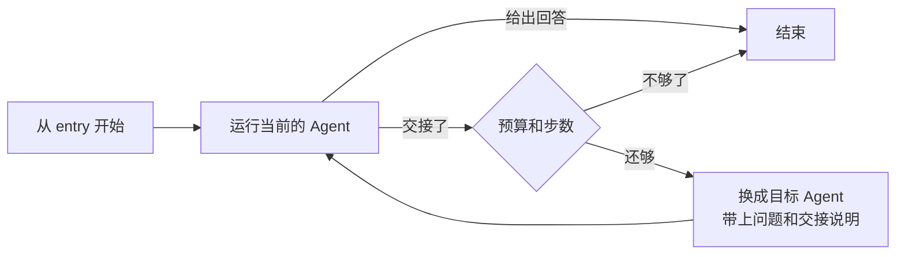

# 第 26 天：多 Agent 协作

> 最后核对：2026-11-04

第 25 天的子 Agent 是「派出去，做完交回来」：主 Agent 始终掌控全局。今天看另一种协作方式：**交接**（handoff）。一个分诊 Agent 判断问题归谁管，把它交给网页专家或者文档专家，由专家**直接**回答用户，分诊不再参与。

```text
$ node days/day26/exercise/handoff.ts "我们的网关怎么回滚？"
→ triage 交给 docs：问的是我们自己的潮汐网关
✓ grep_docs {"pattern":"rollback"}
✓ read_doc {"path":"ops/oncall.md"}

（docs 回答）

执行 tide rollback --to previous，大约 2 分钟完成 [1]。回滚以后在 #incident 频道里同步进展 [1]。

来源：
[1] 本地文档 ops/oncall.md
```

多 Agent 听起来很强大，实际上也很容易出问题：两个 Agent 互相推来推去，谁也不回答；交接时丢了关键信息；几个 Agent 加起来的成本没人管。今天的重点不只是让交接跑起来，更是给它装上**保护**。

学完今天，你会：

- 实现从分诊 Agent 到专家 Agent 的交接
- 决定交接时传递什么：完整的对话，还是一份交接说明
- 防住多 Agent 的常见失败：互相踢皮球、无休止地交接、成本失控
- 判断什么时候不该用多 Agent

## 协作的三种方式

| 方式 | 怎么协作 | 例子 |
|---|---|---|
| 委派 | 主 Agent 把任务交给别人，等结果回来自己接着做 | 第 25 天的子 Agent |
| 交接 | 把整个对话交给别人，由别人接着和用户打交道 | 客服：前台转给技术支持；今天的分诊 |
| 共享状态 | 几个 Agent 读写同一块「黑板」，各做各的 | 一个写代码、一个写测试，看同一个仓库 |

委派里，控制权一直在主 Agent 手上；交接里，控制权**转移**了。这是两者最大的区别：交接以后，分诊不知道专家怎么回答，也没有机会检查。

还有一种是 Agent 之间互发消息、跨进程甚至跨公司协作，Google 牵头的 [A2A 协议](https://a2a-protocol.org/)就是为这个设计的：每个 Agent 发布一张「名片」（Agent Card），说明自己能做什么、怎么调用。它解决的是**不同团队、不同框架写的 Agent** 怎么对话的问题，今天的交接都在一个进程里，用不上，但思路相通：每个 Agent 都要说清楚自己负责什么。

## 交接怎么实现

交接本质上是一个工具调用。[handoff.ts](exercise/handoff.ts) 给每个 Agent 生成它能交接的对象对应的工具：

```text
transfer_to_web   把这个问题交给 web：上网搜索、读网页，回答需要外部资料的问题
transfer_to_docs  把这个问题交给 docs：查我们团队潮汐网关的内部文档
```

模型调用 `transfer_to_docs`，就表示它决定交接。这时它所在的 Agent 循环要**停下**，把控制权交回 `runTeam()`，由它启动下一个 Agent。第 6 天写的循环只会在模型给出回答、或者出问题时停下，所以今天给它加一个选项：

```ts
runAgent(input, { ..., stopOn: ['transfer_to_web', 'transfer_to_docs'] })
```

成功执行了 `stopOn` 里的工具，循环就停下，`status` 是 `stopped`。注意「成功」两个字：交接被拒绝（下面会讲）时，工具返回的是错误，循环不能停，要把错误交回模型，让它自己想办法。

`runTeam()` 的主循环很简单：



### 交接时传什么

新的 Agent 收到什么，是交接最重要的设计决定。两种选择：

| | 完整的对话 | 问题加交接说明 |
|---|---|---|
| 信息 | 什么都不丢 | 只有前一个 Agent 写下来的部分 |
| 上下文 | 带着前一个 Agent 的工具结果，越交接越长 | 干净 |
| prompt 缓存 | 前缀变了（system prompt 换了），历史要重新计费 | 很短，无所谓 |
| 风险 | 新 Agent 会被前一个的推理带偏 | 前一个 Agent 写漏了，信息就丢了 |

今天选第二种：交接工具要求写 `summary`（用户要什么、已经知道什么），新的 Agent 收到的是：

```text
我们的网关怎么回滚？

（triage 把这个问题交给了你。交接说明：用户问我们网关的回滚命令）
```

分诊本来就不该查资料，它的「对话」只有一句判断，丢掉也不可惜。OpenAI Agents SDK 默认传完整的对话，同时提供了过滤器让你裁剪，可以参考它的做法。无论选哪种，都要想清楚：**新的 Agent 能看到什么，看不到什么**。

## 防住常见的失败

多 Agent 系统有几种典型的失败，单个 Agent 不会遇到：

| 失败 | 表现 | 怎么防 |
|---|---|---|
| 互相踢皮球 | web 觉得是文档的问题，交给 docs；docs 觉得文档里没有，交回 web…… | 不能交回已经经手过的 Agent |
| 无休止地交接 | 交接链越来越长，谁也不回答 | 交接次数有上限 |
| 每个 Agent 都在原地打转 | 单看每个都没超步数，加起来很多 | 所有 Agent 共享一个总步数 |
| 成本失控 | 每次交接都重新带上 prompt 和工具定义 | 所有 Agent 共享一个 token 预算 |

前两条做在交接工具里：`createTransferTool()` 发现对方已经经手过、或者次数用完，就抛出错误，告诉模型「请你自己回答；做不到，就告诉用户哪些没能查到」。这个错误信息很关键：只说「不能交接」，模型可能换个说法再试一次；告诉它**接下来该怎么做**，它才会收手。

后两条做在 `runTeam()` 里：每个 Agent 的 `maxSteps` 是总步数还剩多少；每次交接前检查累计的 token，超了就停下，`status` 是 `budget`。这里的预算检查是粗粒度的，只在交接时检查，一个 Agent 内部超了也要等它跑完。更精细的预算控制在第 36 天。

还有一种更隐蔽的失败：**互相等待**。两个 Agent 都在等对方的结果才能继续，谁也动不了。今天的交接是串行的，不会发生；一旦 Agent 之间可以并行地互发消息，就要设计超时和死锁检测。这也是为什么很多团队在实践中尽量避免让 Agent 之间自由对话。

## 研究助手的团队

`createResearchTeam()` 组了一个三人团队：

| Agent | 负责什么 | 工具 | 能交给 |
|---|---|---|---|
| triage | 判断问题归谁，回答闲聊 | 没有 | web、docs |
| web | 上网查资料 | `web_search`、`fetch_page`、`calculator` | docs |
| docs | 查内部文档 | `search_docs`、`grep_docs`、`read_doc` | web |

每个专家的工具少、prompt 短，专心做一件事。三个 Agent 共用一个来源登记，引用编号照常可用。

## 什么时候不该用多 Agent

今天的团队，换成第 22 天的路由器也能做到：分类，然后走不同的路。路由器更便宜（分类只是一次短的调用）、更可预测（代码决定走哪条路）、更好测试。那交接比路由多了什么？

- 专家发现自己判断错了，还可以再交出去（路由器做不到）
- 适合**多轮对话**：交接以后，用户接下来的话都由专家接着回答

如果这两点你都用不上，就用路由。更一般地说：

| 先考虑 | 再考虑 |
|---|---|
| 一个 Agent，多给几个工具 | 工具多到模型选不准了（第 28 天的按需加载工具也能缓解） |
| 路由 | 处理过程中还要改变方向 |
| 子 Agent（委派） | 需要把对话彻底交给别人 |

Cognition 在《Don't Build Multi-Agents》里提出：上下文分散在几个 Agent 里，它们各自做出的决定可能互相矛盾，而且很难调试。多 Agent 不是默认选项，是在单个 Agent 真的不够用时的工具。

## 读懂练习代码

| 文件 | 内容 | 今天要做的 |
|---|---|---|
| [agent.ts](exercise/agent.ts) | 新增 `stopOn` 选项和 `stopped` 状态 | TODO 1 |
| [handoff.ts](exercise/handoff.ts) | 交接工具、运行团队、研究助手的团队 | TODO 2、3 |
| 其余文件 | 和第 25 天的参考答案一样 | 不用改 |

## 常见误解

| 误解 | 实际上 |
|---|---|
| 多 Agent 一定比单个 Agent 强 | 更贵、更难调试，决定可能互相矛盾。先试单个 Agent 和路由 |
| 交接和子 Agent 是一回事 | 子 Agent 做完交回来，主 Agent 掌控全局；交接是把控制权交出去 |
| 交接时把完整的对话都传过去最保险 | 上下文变长、容易被带偏。要想清楚新 Agent 需要什么 |
| 每个 Agent 都有步数上限就够了 | 交接链上的每个 Agent 都没超，加起来可能很多。要有总步数和总预算 |
| 拒绝交接时说「不能交接」就行 | 要告诉它接下来该做什么，否则它会换个说法再试 |
| 交接工具一被调用，循环就该停 | 只有交接成功才停；被拒绝时要把错误交回模型 |

## 常见错误

| 报错 | 原因 |
|---|---|
| 测试说期望 `stopped`，实际又调用了一次模型 | 执行完交接工具没有停下 |
| 测试说交接被拒绝以后应该是 `completed`，实际是 `stopped` | 判断停下时没有检查工具的结果是不是错误 |
| 测试说「web 从一个新的上下文开始」，消息对不上 | 把前一个 Agent 的消息传了过去，或者没有用 `handoffInput` |
| 互相踢皮球的测试里，docs 成功交回了 web | 交接以后没有把新的 Agent 加进 `visited` |
| 测试说期望 `budget`，实际又交给了下一个 Agent | 交接前没有检查 token 预算 |
| 测试说期望 `max_steps`，实际 web 多跑了几步 | 每个 Agent 的 `maxSteps` 没有扣掉之前用掉的步数 |

## 动手：分诊和专家

按顺序做，每做完一步就运行一次 `npm run check 26`：

1. **TODO 1**：Agent 循环成功执行了 `stopOn` 里的工具就停下。
2. **TODO 2**：交接工具：不能交回经手过的，次数有上限。
3. **TODO 3**：运行团队：交接、预算、总步数。全部测试通过。

## 检查

```bash
npm run check 26
```

用真实模型试三个问题：网页的、文档的、闲聊的，看分诊有没有交对人：

```bash
npm run check 26 -- --e2e
```

## 小实验

- 问一个同时需要网页和文档的问题（「我们网关用的潮汐协议 3.0，官方说默认端口是多少？我们的部署文档写的是多少？」），看看团队怎么处理。单个研究助手处理得更好吗？
- 把交接说明改成传完整的对话（`history`），比较 token 和回答质量
- 去掉「不能交回经手过的 Agent」这条规则，设计一个会让它们互相踢皮球的问题
- 用第 22 天的路由器回答同样的问题，比较成本和准确率
- 给团队加一个 `calc` 专家，负责计算和换算。分诊的准确率会不会下降？

## 小结

- 协作有三种方式：委派（子 Agent）、交接、共享状态。交接把控制权交出去
- 交接是一个工具调用，Agent 循环成功执行它以后停下，由团队的循环接着启动下一个 Agent
- 交接时传什么要想清楚：今天传问题加交接说明，新的 Agent 有一个干净的上下文
- 多 Agent 的典型失败：互相踢皮球、无休止地交接、成本失控、互相等待。用经手记录、交接次数、总步数、总预算防住
- 能用单个 Agent 或路由解决的，就别用多 Agent

## 想一想

- 有的网页要运行 JavaScript 才能显示内容，`fetch_page` 读不到。要不要给研究助手一个浏览器？它和 `fetch_page` 有什么不同？（第 27 天）
- 专家 Agent 的工具少、prompt 短。能不能不拆成几个 Agent，而是让一个 Agent 需要的时候再加载某方面的说明和工具？（第 28 天）
- 交接以后，专家要发一封邮件、改一个配置，要不要先问问用户？（第 29 天）

## 延伸阅读

- [OpenAI Agents SDK：Handoffs](https://openai.github.io/openai-agents-js/guides/handoffs/)：TypeScript 版的交接，包括交接时的输入过滤
- [Cognition：Don't Build Multi-Agents](https://cognition.ai/blog/dont-build-multi-agents)：为什么上下文分散会让多 Agent 系统变得脆弱
- [Why Do Multi-Agent LLM Systems Fail?](https://arxiv.org/abs/2503.13657)：对多 Agent 系统失败原因的分类研究
- [A2A 协议](https://a2a-protocol.org/)（选读）：不同团队、不同框架写的 Agent 之间怎么协作
