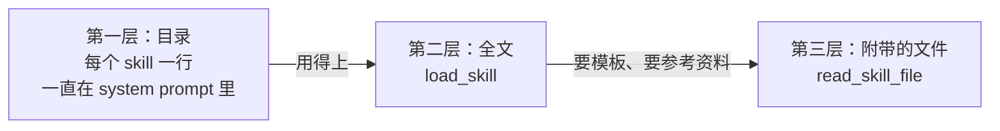

# 第 28 天：Skills 与渐进式披露

> 最后核对：2026-11-04

研究助手的本事越来越多：搜索、读网页、查文档、记忆、计划、子 Agent、浏览器……每多一样，system prompt 里就多一段说明，请求里就多几个工具定义。数一数现在每次请求固定要带的东西：

```text
/context
system prompt     1650 tokens
工具定义          3420 tokens
……
```

可大部分时候用不上它们。用户问「你好」，也要带着「怎么写对比报告」「怎么核实一个说法」的全套说明。今天学一个思路，**渐进式披露**（progressive disclosure）：上下文里只放「有什么」，用到时再加载「怎么做」。

学完今天，你会：

- 按 Agent Skills 开放标准写 skill，并实现一个 skill 加载器
- 理解渐进式披露的三层：目录、全文、附带的文件
- 在工具太多时按需检索工具，并且不破坏提示缓存
- 用 AGENTS.md 给 Agent 写项目说明

## 一个 skill 长什么样

skill 是一个目录，核心是一个 `SKILL.md`。今天写的 [vendor-comparison](skills/vendor-comparison/SKILL.md)：

```text
skills/vendor-comparison/
  SKILL.md                      做法说明
  references/
    report-template.md          对比报告的模板，用到时再读
```

```markdown
---
name: vendor-comparison
description: 对比几家产品、服务或者方案（价格、功能、限制、中文支持等）。用户要「对比」「选哪个」「A 和 B 有什么区别」时用，输出一张对比表和选择建议。
---

# 对比调研

## 步骤

1. **定下对比的对象和维度**……
2. **每一家按同样的维度查**……
```

开头两行 `---` 之间是 frontmatter，后面是给 Agent 看的做法说明，就像给一个新同事写的操作手册。这个格式是 [Agent Skills 开放标准](https://agentskills.io)，最早由 Anthropic 为 Claude 提出，现在已经有不少 Agent 产品支持，同一个 skill 可以在不同的 Agent 之间复用。

标准对 frontmatter 的要求：

| 字段 | 要求 |
|---|---|
| `name` | 必填。1 到 64 个字符，只有小写字母、数字和连字符；不能以连字符开头或结尾，不能有连续的连字符；要和目录名一样 |
| `description` | 必填。1 到 1024 个字符，写清楚它做什么、什么时候用 |
| `license`、`compatibility`、`metadata`、`allowed-tools` | 可选 |

目录里还可以有 `scripts/`（可以运行的脚本）、`references/`（参考资料）、`assets/`（模板、图片等）。

`description` 是整个 skill 最重要的一行。Agent 决定用不用一个 skill，**只看这一行**。「对比工具」太模糊；「对比几家产品……用户要『对比』『选哪个』时用」把触发的场景写出来了，模型才认得出「潮汐云托管的基础版和专业版选哪个」该用它。

## 三层渐进式披露



| 层 | 什么时候进上下文 | 大小 |
|---|---|---|
| 名字和描述 | 一直在 | 每个几十个 token |
| SKILL.md 的正文 | Agent 判断用得上时，调用 `load_skill` | 几百到几千个 token |
| `references/` 等文件 | 正文里说要用时，调用 `read_skill_file` | 不限 |

所以装几十个 skill，平时的成本也只是几十行目录。这和人用手册的方式一样：先看目录，找到相关的那一章再翻进去。

[skills.ts](exercise/skills.ts) 的几个部分：

- `parseFrontmatter()`、`validateSkill()`：解析、按标准检查。只支持单行的「键: 值」，够用了；完整的 YAML 要用专门的库
- `loadSkills(roots)`：从几个目录里找 skill。**只读 frontmatter，不保留正文**：正文要等用到时再读，这正是渐进式披露的意思。不合格的跳过并说明原因；名字重复的，排在前面的目录优先（比如项目的 skill 优先于用户的）
- `formatSkillCatalog()`：目录，放进 system prompt
- `load_skill`、`read_skill_file`：后两层。`read_skill_file` 用第 5 天的 `resolveInside()` 保证路径不跑出 skill 的目录

目录放进 **system prompt**，而不是每一轮的动态信息：一次会话里 skill 不会变，放在前面正好能命中提示缓存（第 15 天）。

### 脚本先不运行

标准允许 skill 带脚本，比如一个把 PDF 转成文字的 Python 脚本，Agent 读完说明以后直接运行它。这很强大，也很危险：运行一个脚本，等于让它拥有你的全部权限。今天的加载器只列出脚本、不运行；第 38 天有了沙箱以后再加上。

## 工具太多时：按需检索工具

工具定义也可以渐进式地披露。接上几个 MCP 服务器以后，工具很容易上百个，全放进请求里，一是贵（每次都要带），二是模型容易选错（几个名字相近的工具）。

[tool-search.ts](exercise/tool-search.ts) 的做法：一开始只给常用的几个工具，加上一个 `search_tools`；模型需要别的能力时先搜索，搜到的工具加进工具列表，下一步就能直接调用。

```text
第 1 次请求的工具：web_search、search_tools
模型：search_tools {"query":"计算"}
第 2 次请求的工具：web_search、search_tools、calculator
模型：calculator {...}
```

这要求 Agent 循环每一步都按**当前**的工具列表生成定义。第 6 天的循环在开始时生成一次就不管了，今天改成每一步重新生成（[agent.ts](exercise/agent.ts)）。

有一个细节很重要：**新工具追加在末尾**。工具定义在请求的最前面，是提示缓存的一部分。插在前面，整个前缀都变了，缓存全部失效；追加在末尾，前面的部分不变，还能命中。

打分用的是最简单的关键词匹配：查询里的词出现在工具名字里算 2 分，出现在描述里算 1 分。分词用第 18 天的 `tokenize()`，它按 `Intl.Segmenter` 的词典切中文，「浏览器」会切成「浏览」「器」，所以测试里的分数要按它的切法算。工具多了以后，可以换成第 17、18 天的向量或者混合检索。

## AGENTS.md：写给 Agent 的项目说明

README 是写给人看的，[AGENTS.md](https://agents.md/) 是写给 Agent 看的：这个项目怎么构建、怎么测试、有什么约定。它是一个开放的格式，很多编程 Agent 都会在开始时读它。

研究助手也可以有：工作目录里放一个 AGENTS.md，写上「回答一律用简体中文」「我们的内部系统叫潮汐网关」「对比类的问题要给出表格」，它就会放进 system prompt。

和第 19 天的记忆比一比：

| | AGENTS.md | 记忆 |
|---|---|---|
| 谁写 | 人 | Agent 自己（`remember`） |
| 什么时候用 | 每次都放进 system prompt | 每一轮作为动态信息 |
| 适合 | 稳定的项目约定 | 在对话中学到的偏好和事实 |

和 skill 也比一比：AGENTS.md 每次都在，所以要**短**，只写每次都用得上的；只在某类任务里用得上的长篇说明，写成 skill。

## 读懂练习代码

| 文件 | 内容 | 今天要做的 |
|---|---|---|
| [skills.ts](exercise/skills.ts) | 检查、加载 skill，读 skill 的工具，AGENTS.md | TODO 1、2、3 |
| [tool-search.ts](exercise/tool-search.ts) | 按需检索工具 | TODO 4 |
| [skills/](skills/) | 课程自带的两个 skill：`vendor-comparison`、`fact-check` | 读一读，照着写你自己的 |
| [agent.ts](exercise/agent.ts) | 每一步重新生成工具定义 | 读懂即可 |
| [research.ts](exercise/research.ts)、[cli.ts](exercise/cli.ts) | 带上 skill 的工具；system prompt 加上 AGENTS.md 和 skill 目录；`/skills` 命令 | 读懂即可 |
| 其余文件 | 和第 27 天的参考答案一样 | 不用改 |

## 常见误解

| 误解 | 实际上 |
|---|---|
| skill 就是把 prompt 存成文件 | 关键在于渐进式披露：平时只占一行，用到才加载全文和附带的文件 |
| description 写个名字就行 | 它是 Agent 决定用不用的唯一依据，要写清楚做什么、什么时候用 |
| 加载 skill 时把全文都读进来备用 | 那就失去了渐进式披露的意义。加载时只读 frontmatter |
| skill 里的脚本可以直接运行 | 运行脚本等于交出你的权限。要有沙箱（第 38 天） |
| 搜到的工具插在最前面更显眼 | 会让提示缓存全部失效。追加在末尾 |
| AGENTS.md 写得越全越好 | 它每次都在上下文里，要短。只在某类任务里用到的写成 skill |

## 常见错误

| 报错 | 原因 |
|---|---|
| 测试说 `-pdf` 应该报「不能以连字符开头或结尾」 | 只检查了字符的范围，连字符本身是合法字符 |
| 测试说重名时应该用前面目录的 | 后加载的覆盖了先加载的 |
| 测试说 `notes：SKILL.md 开头没有 frontmatter` 没有报出来 | 解析失败时直接跳过了，没有记下原因 |
| 测试说 `load_skill` 的结果里不该有 `description:` | 没有去掉 frontmatter |
| 测试说路径跑到 skill 目录外面应该报错 | 没有用 `resolveInside` |
| 测试说「前面的不变，提示缓存才能命中」 | 搜到的工具插在了前面 |

## 动手：skill 加载器

按顺序做，每做完一步就运行一次 `npm run check 28`：

1. **TODO 1**：按标准检查 skill。
2. **TODO 2**：从几个目录里加载 skill。
3. **TODO 3**：`load_skill` 和 `read_skill_file`。`skills.test.ts` 全部通过。
4. **TODO 4**：按需检索工具。全部测试通过。

然后写你自己的第三个 skill，放进 `skills/`，再跑一次测试，确认它是合格的。

## 检查

```bash
npm run check 28
```

用真实模型看它会不会在该用的时候读 skill、不该用的时候不读：

```bash
npm run check 28 -- --e2e
```

在命令行里用课程自带的 skill：

```bash
SKILLS_DIR=days/day28/skills node days/day28/exercise/cli.ts
```

## 小实验

- 把 `vendor-comparison` 的 description 改成「对比工具」，再问一个对比的问题，看它还会不会读这个 skill
- 用 `/context` 看看加上 skill 目录以后，system prompt 多了多少 token；再算一算如果把两个 skill 的全文都放进去会多多少
- 在工作目录里写一个 AGENTS.md，要求「每个回答最后加一句总结」，看看它照不照做
- 把所有内置工具都交给 `createToolSearch`，`core` 只留 `web_search`。问几个问题，看它能不能搜到需要的工具
- 写一个 skill，让它的 `SKILL.md` 里要求读一个很长的参考文件，看看 `read_skill_file` 的分页是不是够用

## 小结

- 渐进式披露：上下文里只放「有什么」，用到时再加载「怎么做」
- skill 是一个目录：SKILL.md 的 frontmatter 是目录里的一行，正文和附带的文件按需加载
- description 决定了 skill 会不会被用到，要写清楚做什么、什么时候用
- 工具也可以按需检索；新工具追加在末尾，不破坏提示缓存
- AGENTS.md 是写给 Agent 的项目说明，每次都在，所以要短

## 想一想

- skill 让 Agent 学会了「怎么做」，可有的事做了就收不回来：删文件、发邮件、付款。哪些工具可以放心让它用，哪些要先问用户？（第 29 天）
- 研究要跑好几分钟，中途要用户确认一下计划。用户去开会了，一个小时以后才回来，Agent 要一直等着吗？（第 29 天）
- skill 带的脚本怎么才能安全地运行？（第 38 天）

## 延伸阅读

- [Agent Skills 规范](https://agentskills.io/specification)：SKILL.md 的完整格式
- [Anthropic：Equipping agents for the real world with Agent Skills](https://www.anthropic.com/engineering/equipping-agents-for-the-real-world-with-agent-skills)：skill 的设计思路，以及渐进式披露为什么重要
- [AGENTS.md](https://agents.md/)：写给 Agent 的项目说明，格式和例子
- [Anthropic：Tool search tool](https://docs.anthropic.com/en/docs/agents-and-tools/tool-use/tool-search-tool)：模型服务端的按需检索工具，思路和今天一样
