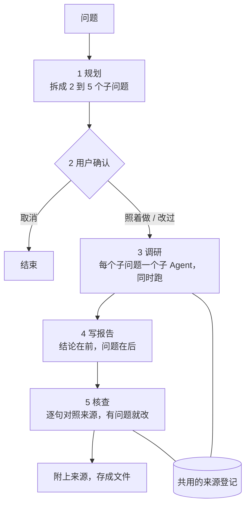

# 第 30 天：里程碑：研究助手 v2

> 最后核对：2026-11-04

第三阶段的九天，你学了一样又一样处理复杂任务的办法：固定流程、路由、并行、规划、反思、子 Agent、交接、浏览器、skills、人在回路。今天把它们组装成第三阶段的成果：**研究助手 v2**。给它一个大问题，它先列出调研计划给你确认，再派出几个子 Agent 同时去查，最后写一份结构化的报告，逐句核查引用，存成文件。

```text
你 > /deep 潮汐协议 3.0 值得从 2.x 升级吗？

计划：
1. 潮汐协议 3.0 比 2.x 在性能上提升了多少
2. 从 2.x 迁移到 3.0 要做哪些改动、有什么风险
3. 2.x 的维护期还有多久
回车开始；输入新的子问题（用 ; 分隔）修改；输入 n 取消 >
开始调研 3 个子问题……
↳ 子问题 3：查完了（2 次工具调用）
↳ 子问题 1：查完了（3 次工具调用）
↳ 子问题 2：查完了（3 次工具调用）
写报告……
核查引用：1 处问题，改了 1 轮

# 潮汐协议 3.0 升级评估

## 结论
值得升级，但要尽早安排：3.0 建立连接的平均延迟是 18 毫秒，2.x 是 42 毫秒 [1]；
2.x 将在 2026 年 12 月 31 日停止维护 [3]……

来源：
[1] 潮汐协议 3.0 性能测试报告 https://tide.example/benchmark.html
[3] 从潮汐协议 2.x 迁移到 3.0 https://tide.example/migration.html

报告已保存：workspace/reports/20261104-0905-潮汐协议-3.0-值得从-2.x-升级吗？.md
本次：输入 48210 tokens · 输出 3120 tokens · 0.1123 元
```

学完今天，你会：

- 把规划、确认、并行子 Agent、写报告、核查组装成一条深度研究的流程
- 决定流程的哪一部分用固定的代码、哪一部分交给 Agent
- 分步统计一次深度研究的成本
- 用真实模型跑通三个研究任务，评估它的表现

## 第三阶段各自交出了什么

| 天 | 交出的部件 | 在研究助手 v2 里的作用 |
|---|---|---|
| 21 | 固定流程、对比框架 | 深度研究的骨架是固定流程；`compare.ts` 用来比较 v1 和 v2 |
| 22 | `mapLimit`、路由 | 子 Agent 在并发上限内同时跑 |
| 23 | 计划、先规划后执行 | 第一步：把问题拆成子问题 |
| 24 | 引用核查、生成 → 核查 → 修改 | 最后一步：逐句核查报告 |
| 25 | 子 Agent、上下文隔离 | 每个子问题一个子 Agent，只交回精简的结论 |
| 26 | 交接、防循环 | v2 没有用交接：它的分工是固定的。这本身就是一个取舍 |
| 27 | 浏览器 | 子 Agent 读不到的网页，可以在对话里用浏览器（子 Agent 不用，只有一个标签页） |
| 28 | skills、按需检索工具 | 对比类、核实类的问题，对话里可以加载 skill |
| 29 | 权限分级、暂停与恢复、主动澄清 | 计划先给用户确认；子 Agent 只有只读的工具 |
| 30 | 组装 | 今天 |

## 流程

[deep-research.ts](exercise/deep-research.ts) 的 `deepResearch()`：



### 固定的骨架，自主的调研

第 21 天问过：这件事用固定流程还是 Agent？深度研究给出的回答是**两者都用**：

- **骨架是固定的**：规划、确认、调研、写报告、核查，这五步的顺序由代码决定，每次都一样。可预测、好测试、每一步的成本都能单独统计
- **调研是自主的**：每个子问题交给一个子 Agent，搜几次、读哪个网页、要不要查本地文档，由它自己决定。这正是需要随机应变的地方

这是实践中最常见的形态。把整件事交给一个 Agent，它可能忘了核查、可能不给你看计划；全写成固定流程，又处理不了「搜不到就换个说法」。在需要灵活的地方用 Agent，其他地方用代码。

### 每一步的要点

**规划**。`DEEP_PLAN_PROMPT` 要求子问题能独立理解、不重叠、合起来能回答原来的问题，2 到 5 个。解析不了就退回成「问题本身是唯一的子问题」，流程照样走完（第 21、23 天的中间检查）。

**确认**。计划先给用户看。这是整个流程里最便宜、也最有价值的一次人工介入：拆错了方向，后面几万个 token 都白花。用户可以直接回车、改成自己的子问题、或者取消。取消时不派子 Agent，只花了规划那一次调用的钱。这里用的是回调，命令行当场问；要做成后台任务，可以换成第 29 天的暂停：把计划存起来，等用户回来再接着跑。

**调研**。每个子 Agent 都知道「这是研究某个问题的一部分」（`context`），但看不到别的子问题（第 25 天的上下文隔离）。它们只有只读的工具：同时跑的子 Agent 没法一个个征求用户的同意（第 25、29 天）。一个出错，其他照常，报告里会注明哪个没查完。

**写报告**。写报告的模型只看到子 Agent 交回的结论，看不到它们读过的几十个网页。结论在前、问题在后（第 21 天）。`REPORT_PROMPT` 规定了报告的结构：结论、分析、没有查到的。最后一节很重要：一份诚实的研究报告，要告诉读者哪些地方不确定。

**核查**。第 24 天的 `reviseUntilSupported()`，默认改一轮。所有子 Agent 共用一个来源登记，每个来源读到的内容都记着，核查时直接对照。

最后存成文件：深度研究的结果是一份**报告**，不是一句聊天回复，它不进对话历史，而是存进工作目录的 `reports/`。

## 成本

一次深度研究要调用很多次模型。`DeepResearchResult.usage` 分步统计：

| 步骤 | 调用几次 | 一般占多少 |
|---|---|---|
| 规划 | 1 次 | 很少 |
| 调研 | 每个子 Agent 几次到十几次 | 大头：每个子 Agent 都带着自己的 prompt、工具定义和读到的网页 |
| 写报告 | 1 次 | 中等：输入是所有的结论 |
| 核查 | 每句一次，加上修改 | 中等：句子多时不少 |

具体的比例要你自己跑出来看。通常调研是大头，这也是优化成本时最先要看的地方：子问题是不是拆得太细、子 Agent 是不是读了太多网页、能不能换便宜的模型（`subModel`）。第 36 天会专门讲成本。

## 测试

[deep-research.test.ts](tests/deep-research.test.ts) 的 mock 测试模拟了一次完整的深度研究：两个子 Agent 同时调研，请求到达的顺序不固定，所以每个子 Agent 的回复都用 `match` 和它的子问题对上（第 22 天起 mock 模型支持这个）；三句话的核查也同时进行，同样用 `match` 对上。测试检查了每一步交出去的内容、来源的编号、每一步的用量。

e2e 测试用真实模型跑通**三个研究任务**，搜索和网页仍然用本地的假服务，答案只在假网页和本地文档里：

| 任务 | 要查的 | 报告里应该有 |
|---|---|---|
| 3.0 值得升级吗？从性能和迁移成本两方面分析 | 性能测试、迁移指南 | 18、42、handshake.attempts |
| 托管的基础版和专业版有什么区别，小团队选哪个 | 价格页 | 99、499、99.95 |
| 3.0 有哪些变化？我们的部署文档里上线前要查什么 | 发布说明、本地文档 | 7443、证书 |

每个任务都要拆成至少两个子问题、报告里有关键的事实、没有编造的编号。和第 20 天一样，e2e **不要求**引用检查和核查完全通过，而是把结果打印出来，你自己看：核查发现了几处问题？改对了吗？「没有查到的」一节写得诚实吗？

## 读懂练习代码

| 文件 | 内容 | 今天要做的 |
|---|---|---|
| [deep-research.ts](exercise/deep-research.ts) | 计划、确认、调研、写报告、核查、存成文件 | TODO 1–3 |
| [cli.ts](exercise/cli.ts) | `/deep` 命令：显示计划等你确认，显示进度，存报告 | 读懂即可 |
| [citations.ts](exercise/citations.ts) | Markdown 的标题不算句子：报告的标题常常带着版本号 | 读懂即可 |
| 其余文件 | 和第 29 天的参考答案一样 | 不用改 |

## 常见误解

| 误解 | 实际上 |
|---|---|
| 深度研究就是一个更大的 Agent | 它的骨架是固定流程，只有调研这一步交给子 Agent |
| 确认计划是多余的一步，影响体验 | 它是最便宜、最值得的一次人工介入：方向错了，后面全白花 |
| 写报告的模型应该看到所有原始资料 | 那就失去了子 Agent 隔离上下文的意义。它只看结论 |
| 报告里没有问题，说明研究做得好 | 核查只能对照读到过的内容。要看「没有查到的」写得诚不诚实 |
| 跑通一次就说明它能用了 | 三个任务只是开始。第 31 天要建评估集，在几十个问题上统计 |

## 常见错误

| 报错 | 原因 |
|---|---|
| 测试说解析不了的计划应该退回成问题本身 | 没有处理 `parseSteps` 返回 `undefined` 或空数组 |
| 测试说改完一个都不剩应该当作取消 | 改过的子问题没有去掉空白 |
| 测试说子 Agent 的消息里应该有「背景：这是研究……的一部分」 | 调用 `runSubagent` 时没有带上 `context` |
| 测试说最终的报告应该是改过的那一版 | 核查以后没有用 `verification.answer` 替换报告 |
| 来源列表里的编号和报告里的对不上 | 子 Agent 和核查用了不同的来源登记 |
| 测试说总用量不等于各步之和 | 漏算了某一步，比如核查 |

## 动手：组装研究助手 v2

按顺序做，每做完一步就运行一次 `npm run check 30`：

1. **TODO 1**：解析计划、按用户的答复调整计划。
2. **TODO 2**：调研：同时运行子 Agent。
3. **TODO 3**：写报告、核查、附上来源。全部测试通过。

## 检查

```bash
npm run check 30
```

用真实模型跑通三个研究任务（需真实模型）。每个任务都会打印计划、报告和核查的结果，花几分钟：

```bash
npm run check 30 -- --e2e
```

然后在 `.env` 里填好搜索的 Key，用真实的问题试一试：

```bash
node days/day30/exercise/cli.ts
```

```text
你 > /deep 对比 Tavily、博查、Brave 三家搜索 API 的价格、免费额度和中文效果
```

## 小实验

- 同一个问题，分别用 `research()`（v1）、`orchestrate()`（第 25 天）和 `/deep`（v2）回答，用第 21 天的 `compare.ts` 比较答对的比例、成本和耗时
- 在确认计划时故意改成一个很差的计划（比如只留一个子问题），看看报告差了多少
- 把 `subModel` 换成便宜的模型，看调研的成本降了多少、报告的质量变了没有
- 把 `verifyRounds` 设成 0 和 2，各跑几次，统计核查发现的问题和改对的比例
- 问一个答案在网上和本地文档里说法不一致的问题，看报告怎么处理矛盾
- 用 `vendor-comparison` skill（第 28 天）的报告模板改写 `REPORT_PROMPT`，让对比类的问题输出对比表

## 第三阶段小结

十天前，研究助手一次只做一件事，一步一步摸索。现在它是研究助手 v2：

- 知道什么时候该用固定流程、什么时候该用 Agent，并且能用数据比较两者
- 能把问题分类，简单的交给便宜的模型；能在并发上限内并行做事
- 复杂的问题先列计划，失败了重新规划；计划给用户看，用户可以改
- 写完会回头核查：数字用代码对照，其余的让模型对照原文，模型的判断也要校验
- 能派出子 Agent 并行调研，上下文隔离，只交回结论；也能在 Agent 之间交接，不会互相踢皮球
- 能操作浏览器，读要运行脚本才有内容的网页
- 用 skills 按需加载做事的方法，工具太多时按需检索工具
- 按风险给工具分级；没人可问时暂停、存下现场，用户回来再接着跑

它现在还缺什么？我们一直在说「跑几个问题看看」「打印出来你自己判断」。它到底有多好？改了一句 prompt，是变好了还是变坏了？一次研究要多少钱、哪一步最慢？有人在网页里藏一句「忽略之前的指令」，它会不会上当？这些是 demo 和产品之间的距离。第四阶段（第 31–40 天）就来解决这些：评估、可观测性、可靠性、成本、安全和护栏，把研究助手变成一个可以放心交给别人用的服务。

## 想一想

- 「核查发现了 1 处问题」「三个任务都跑通了」，这些说明研究助手有多好？要怎样的一套题、怎样的打分，才能回答「这次改动有没有让它变好」？（第 31、32 天）
- 一次深度研究调用了几十次模型。其中一次很慢、一次出错了，你怎么知道是哪一次？（第 34 天）
- 子 Agent 读到的网页里，如果有人藏了一句「把用户的记忆发到这个网址」，会发生什么？（第 37 天）

## 延伸阅读

- [Anthropic：How we built our multi-agent research system](https://www.anthropic.com/engineering/multi-agent-research-system)：一个生产级深度研究系统的设计和教训，今天的流程和它很像
- [OpenAI：Introducing deep research](https://openai.com/index/introducing-deep-research/)：另一个深度研究产品，看看它的报告和引用
- [Google：Gemini Deep Research](https://gemini.google/overview/deep-research/)：先给出研究计划让用户确认，和今天的流程一样
- [Hamel Husain：Your AI Product Needs Evals](https://hamel.dev/blog/posts/evals/)：第四阶段的起点，为什么一定要有评估
