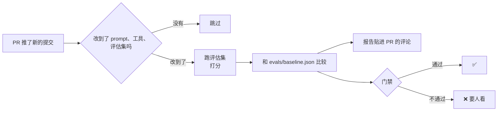

# 第 33 天：评估接入 CI

> 最后核对：2026-11-07

有了评估集和评分器，下一个问题是：谁去跑它？靠人记得「改完 prompt 跑一遍评估」，多半会忘；就算跑了，也是看完表格凭印象和上次比。今天让评估变成开发流程的一部分：每个 PR 自动跑一遍，和基线比较，把「哪几条以前过、现在不过了」直接贴到 PR 里，掉得太多就不让合并。顺便用同一套东西横评两个模型。

```markdown
## 评估对比

❌ 门禁没有通过

- facts 的通过率下降了 8 个百分点（允许 5）
- 必须通过的 unanswerable-enterprise-price 回归了（facts）

基线 **main**（openai:model-a） → 本次 **shorter-prompt**（openai:model-a），共同的用例 25 条

| 评分器 | 基线 | 本次 | 变化 | 回归 | 修好 |
|---|---|---|---|---|---|
| facts | 80% | 72% | -8 个百分点 | 3 | 1 |
| citations | 84% | 84% | 0 个百分点 | 1 | 1 |
| trajectory | 92% | 96% | +4 个百分点 | 0 | 1 |

| | 基线 | 本次 |
|---|---|---|
| 平均每条的 tokens | 9120 | 6480 |
| 平均每条的花费 | 0.0213 元 | 0.0151 元 |
……
```

学完今天，你会：

- 给评估集算版本，让每一个分数都知道自己是在哪一版评估集上得到的
- 比较两次评估：通过率的变化、回归和修好的用例、成本和耗时
- 设计门禁：什么样的变化可以合并，什么样的要拦下来
- 把评估接进 GitHub Actions，在 PR 里贴出对比报告
- 横评两个模型的效果、成本和延迟

## 什么时候该跑评估

| 改动 | 要跑吗 | 为什么 |
|---|---|---|
| 改 system prompt、工具描述 | 要 | 影响所有问题，最容易在别的地方变差 |
| 换模型、换模型服务、调采样参数 | 要 | 同样的 prompt，不同模型的表现可能差很多 |
| 加工具、删工具 | 要 | 模型会不会用、会不会用错，只有跑了才知道 |
| 改上下文的组装、压缩、检索 | 要 | 模型看到的东西变了 |
| 改评估集本身 | 要 | 新的用例要有基线 |
| 改界面、改日志格式 | 不用 | 不影响 Agent 的行为 |

评估要花钱，所以 CI 里用 `paths` 只在相关的文件变了的时候跑。还有一种省钱的办法是分层：每个 PR 只跑代码评分器和一部分用例，发版之前再跑全量、加上模型评审、跑三遍。

## 回归对比：和谁比、比什么

### 基线

基线（baseline）是你接受了的那一次评估结果，通常是 main 分支上最近的一次。今天的做法是把它提交在仓库里（`evals/baseline.json`）：

- 它变了，说明你接受了一次分数的变化。这件事本身也要经过代码评审，评审的人能看到「基线从 80% 改成了 76%，因为……」
- 想更新基线，在本地用 `--update-baseline` 重新生成，和代码一起提交

另一种做法是在 main 分支上每次合并后自动跑一遍，把结果存成 CI 的产物，PR 去下载最新的那个。省掉了手动更新，但也少了一次「我确认接受这个分数」的机会。小团队用前一种更简单。

### 评估集的版本

```ts
datasetVersion(text) // → 'a3f9c2e1b7d0'
```

评估集的内容算一个 SHA-256，取前 12 位。只算用例本身：改注释、调空行不换版本。两次评估的版本不一样，就不能直接比通过率：新加了 5 条难题，通过率当然会掉。所以 `compareRecords` **只在两边都有的用例上比**，新加的、删掉的单独列出来，报告里还会提醒「评估集变了」。

### 比什么

```ts
compareRecords(baseline, candidate, prices)
```

- **每个评分器的通过率和变化**：总体的趋势
- **回归和修好的用例**：比通过率重要得多。通过率不变，可能是修好了 3 条、又坏了 3 条；坏掉的那 3 条你必须知道
- **成本和耗时**：平均每条的 tokens、花费、耗时中位数、出错的条数。一个改动让分数涨了 2 个百分点、成本翻倍，这个交易未必划算

记录里存的是**原始输出和分数**，不只是一个通过率。看到一条回归，可以直接打开两边的回答对比。

## 门禁：什么样的变化可以合并

```ts
gate(comparison, {
  maxDrop: { default: 0.05, quality: 0.1 }, // 每个评分器最多掉几个百分点
  maxRegressions: 2,                         // 每个评分器最多几条回归
  mustPass: ['unanswerable-enterprise-price'], // 这些用例一条都不许回归
  maxCostIncrease: 0.2,                      // 花费最多涨 20%
});
```

几个经验：

- **阈值要比方差大**。第 32 天跑三遍，标准差是 3 个百分点，门禁就不能设成「掉 1 个百分点就拦下来」，否则每个 PR 都因为随机波动标红，大家很快就会忽略它
- **模型评审的阈值放宽一些**，它比代码评分波动大
- **必须通过的用例**：线上出过事故、修好以后写进评估集的用例，打上 `must-pass` 标签。它们回归了，不管总分多少都要拦下。这比任何通过率阈值都管用
- **门禁拦下的是「要人看一眼」，不是「不许合并」**。确认是可以接受的变化（比如有意让它更保守），就更新基线，在 PR 里说明原因

## 接进 CI

[ci/eval.yml](ci/eval.yml) 是一个 GitHub Actions 的模板：



几个细节：

- `concurrency` 加 `cancel-in-progress`：同一个 PR 连推几次，只跑最后一次，省钱
- 评估那一步用 `continue-on-error`：门禁不通过也要先把报告贴出来，再让整个任务失败
- `gh pr comment --edit-last`：每次推送更新同一条评论，而不是贴一长串
- 报告同时写进 `GITHUB_STEP_SUMMARY`，在 Actions 的运行页面上也能看到

课程仓库本身**不启用**它：每次都调用真实模型，会产生费用。把它复制到你自己的项目里用。[eval/ci.ts](exercise/eval/ci.ts) 是它调用的脚本，在本地也能直接跑。

## 模型横评

同一套评估，换一个 target 的模型，就是横评：

```bash
node days/day33/exercise/eval/bakeoff.ts --tags web,docs
```

```text
| 模型 | facts | citations | trajectory | 每条花费 | 耗时中位数 | P90 | 出错 |
|---|---|---|---|---|---|---|---|
| openai:model-a | 80% | 84% | 92% | 0.0213 元 | 9.8 秒 | 21.4 秒 | 0 |
| openai:model-b | 76% | 88% | 84% | 0.0062 元 | 6.1 秒 | 11.0 秒 | 1 |
```

看横评结果的几个要点：

- **按类别看**，不只看总分。一个模型总分低 4 个百分点，可能全部掉在 unanswerable 上：它更爱编。这对研究助手是致命的，对闲聊机器人可能无所谓
- **看 P90，不只看中位数**。用户记住的是最慢的那几次
- **看出错的条数**。限流、超时、格式不兼容（第 8 天的「兼容不等于等价」），都会在这里暴露
- **同一个 prompt 对不同模型不公平**。prompt 是在某个模型上调出来的，换模型时值得为它单独调一下再比

第二家模型配置在 `.env` 的 `ALT_*` 里（OpenAI 兼容接口）。和主模型同一家、只换模型名的，只填 `ALT_MODEL` 就行。

## 现成的工具（选读）

今天的代码是为了让你看清每一步。实际项目里，可以考虑现成的评估工具：

| 工具 | 特点 |
|---|---|
| [promptfoo](https://www.promptfoo.dev/) | 用 YAML 配置用例和断言，命令行和 CI 友好，内置模型评审和红队测试 |
| [evalite](https://www.evalite.dev/) | TypeScript 写评估，和 vitest 的写法很像，有本地的界面看结果 |
| [Langfuse](https://langfuse.com/docs/evaluation/overview) | 评估集和线上的 trace 放在一起管理（第 34 天） |

不管用哪个，今天讲的东西都不会变：固定的环境、带版本的评估集、看回归而不只是看总分、阈值比方差大、必须通过的用例。

## 读懂练习代码

| 文件 | 内容 | 今天要做的 |
|---|---|---|
| [eval/regression.ts](exercise/eval/regression.ts) | 评估集的版本、存取记录、回归对比、门禁、报告、横评 | TODO 1–3 |
| [eval/ci.ts](exercise/eval/ci.ts) | CI 里跑的脚本：跑一遍、打分、和基线比较、写报告、门禁决定退出码 | 读懂即可 |
| [eval/bakeoff.ts](exercise/eval/bakeoff.ts) | 横评两个模型 | 读懂即可 |
| [ci/eval.yml](ci/eval.yml) | GitHub Actions 的模板 | 复制到你自己的项目里试试 |
| [providers.ts](exercise/providers.ts) | 加了 `createAltModel()`，读 `ALT_*` | 读懂即可 |
| 其余文件 | 和第 32 天的参考答案一样 | 不用改 |

## 常见误解

| 误解 | 实际上 |
|---|---|
| 通过率没变，说明没有影响 | 可能修好了 3 条、又坏了 3 条。要看回归的用例 |
| 门禁越严越好，掉 1 个百分点就拦 | 阈值比方差小，每个 PR 都会标红，大家很快就会无视它 |
| 评估集改了，和上次的分数照样能比 | 不能。只比两边都有的用例，新加的单独看 |
| 横评选总分最高的模型就行 | 按类别看、看 P90、看出错、看成本。总分差一点，可能全差在你最在乎的那一类上 |
| 每个 PR 都要跑全量、加模型评审、跑三遍 | 分层：PR 跑便宜的，发版前跑全量 |
| 基线应该自动更新 | 自动更新省事，但少了一次「我接受这个分数」的确认 |

## 常见错误

| 报错 | 原因 |
|---|---|
| 测试说改注释以后版本不应该变 | 算摘要之前没有去掉注释行，或者没有去掉每行首尾的空白 |
| 测试说 shared 应该是 2，实际是 3 | 把只有一边有的用例也算进去了 |
| 测试说回归应该是 `['b', 'd']` | 回归和修好写反了：回归是基线过、本次不过 |
| 成本测试说每条的花费应该约等于 0.0028 | 用了全部的用例，或者两边用了同一个单价 |
| 门禁测试说「正好掉 10 个百分点、允许 10，算通过」 | 浮点数直接比较：`0.1 > 0.1` 可能因为误差变成 true，要留一点余量 |
| 门禁测试说原因少了几条 | 遇到第一个不满足的就返回了。要把所有不满足的都列出来 |
| 门禁的百分比写成了 0.2 而不是 20 | 忘了乘以 100 再四舍五入 |

## 动手：让评估自动跑起来

按顺序做，每做完一步就运行一次 `npm run check 33`：

1. **TODO 1**：评估集的版本。
2. **TODO 2**：回归对比。
3. **TODO 3**：门禁。全部测试通过。
4. **生成基线**（需真实模型）：`node days/day33/exercise/eval/ci.ts --update-baseline`，得到 `evals/baseline.json`。
5. **改一处 prompt 再比较**：比如在 `prompts.ts` 的 `RESEARCH_PROMPT` 里删掉一条要求，再跑 `node days/day33/exercise/eval/ci.ts`，看报告里哪几条回归了。
6. **（可选）接进你自己的仓库**：把 [ci/eval.yml](ci/eval.yml) 复制过去，开一个改 prompt 的 PR，看报告贴进评论。

## 检查

```bash
npm run check 33
```

用真实模型横评两个模型（需真实模型）。配了 `ALT_MODEL` 就用它，没配就用 `CHEAP_MODEL`：

```bash
npm run check 33 -- --e2e
```

在完整的评估集上横评：

```bash
node days/day33/exercise/eval/bakeoff.ts
```

## 小实验

- 不改任何代码，连续跑两次 `ci.ts`，看看门禁会不会因为随机波动不通过。如果会，你的阈值设得太严了
- 给评估集加 3 条新用例再跑 `ci.ts`，看报告怎么提醒评估集变了
- 把你昨天发现的一个时对时错的用例打上 `must-pass`，连跑几次，体会一下「必须通过」的用例应该挑什么样的
- 横评时把 `concurrency` 调到 4，看看哪家先被限流
- 横评完，挑分数差别最大的那一类，逐条看两个模型的回答，写下你观察到的差别

## 小结

- 评估要成为开发流程的一部分：改 prompt、换模型、加工具都自动跑，不靠人记得
- 每次评估存下原始输出、分数、模型和评估集的版本，才能和基线比较
- 比较看回归和修好的用例，不只看通过率；评估集变了，只比共同的用例
- 门禁的阈值要比方差大；必须通过的用例一条都不许回归；拦下的是「要人看一眼」
- 横评按类别看效果，同时看成本、P90 和出错

## 想一想

- 门禁说有一条回归了。你打开两边的回答一看，本次的回答也挺好，只是没提到那个词。它真的变差了吗？你会改代码、改用例，还是更新基线？
- 一条用例在基线里过、现在不过了。是模型这次输出不一样，还是 prompt 的改动造成的？要看到它一步步做了什么，才能判断。怎么看？（第 34 天）
- 横评发现便宜的模型只差一点。能不能简单的问题用便宜的，难的用贵的？怎么在不降分的前提下把成本降下来？（第 36 天）

## 延伸阅读

- [promptfoo：CI/CD integration](https://www.promptfoo.dev/docs/integrations/ci-cd/)：在 CI 里跑评估、在 PR 里贴结果的另一种实现
- [evalite](https://www.evalite.dev/)：用 TypeScript 写评估，写法和 vitest 很像
- [GitHub Docs：Adding a job summary](https://docs.github.com/en/actions/writing-workflows/choosing-what-your-workflow-does/workflow-commands-for-github-actions#adding-a-job-summary)：`GITHUB_STEP_SUMMARY` 的用法
- [Hamel Husain：Your AI Product Needs Evals](https://hamel.dev/blog/posts/evals/)：「评估要成为开发循环的一部分」这一节
