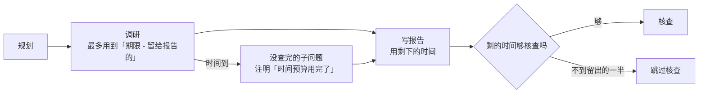

# 第 35 天：可靠性

> 最后核对：2026-11-07

第 9 天学了重试：429、503、超时，等一会儿再试，多半就好了。但有些故障等不好：模型服务挂了半小时、余额用完了、Key 被吊销了。还有些故障不是「失败」，而是「太慢」：每次调用都没超时，可一次深度研究跑了八分钟，用户早走了。

今天让研究助手在这些情况下也能交出东西：一家模型不行就换一家，连续出错的那家先冷却一会儿；整件事有一个总的时间预算，到点了就用已经查到的写报告；中途失败了，重新运行只做没做完的。最后，用故障注入证明这些代码真的管用。下面是一次降级了的深度研究大概的样子（示意，命令行的提示要你自己接上 `onFailover` 和 `degraded`）：

```text
你 > /deep 潮汐协议 3.0 值得从 2.x 升级吗？
……
↳ 子问题 1：查完了（3 次工具调用）
⚠ 换模型：openai:model-a → openai:model-b（model-a 冷却 30 秒）
↳ 子问题 2：查完了（2 次工具调用）
↳ 子问题 3：超时，没有查完
写报告……
时间不够，跳过了核查

# 潮汐协议 3.0 升级评估
……
## 没有查到的
2.x 的维护期这一项没有查完（时间预算用完了）。
```

学完今天，你会：

- 区分重试和故障转移，把模型组成一条降级链，用递增的冷却跳过连续出错的服务
- 给整件事设一个总的时间预算，到点了优雅降级：返回部分结果，而不是什么都不给
- 用检查点让长流程可以从中断的地方接着跑；用幂等键防止有副作用的操作做两次
- 用故障注入测试这些平时很少走到的代码

## 重试、故障转移、降级：三件不同的事

| | 解决什么 | 做法 | 第几天 |
|---|---|---|---|
| 重试 | 偶尔的、短暂的故障 | 同一家，等一会儿再试 | 9 |
| 故障转移 | 一家服务持续不可用 | 换下一家 | 今天 |
| 降级 | 资源不够了：时间、钱、可用的服务 | 少做一点，交出部分结果 | 今天 |

它们是叠在一起用的。一次模型调用的完整的保护：

```ts
withDeadline(                       // 3. 整件事有总的期限
  withFailover([                    // 2. 一家不行换下一家
    withRetry(modelA, { maxRetries: 1 }), // 1. 每家先快速重试一次
    withRetry(modelB, { maxRetries: 1 }),
  ]),
  deadline,
)
```

**顺序有讲究**：

- 重试在最里面，次数要少。有备用的时候，在一家上退避重试三次（可能等十几秒），不如重试一次就换
- 期限在最外面。期限一到，信号触发，`withRetry` 看到的是「调用方取消了」，不会再重试（第 9 天：用户取消绝不重试）

`createFailoverModel()`（[providers.ts](exercise/providers.ts)）就是这样组装的：主模型加上 `ALT_*` 配置的备用模型。

## 故障转移和递增冷却

### 什么错误值得换一家

| 错误 | 换吗 | 为什么 |
|---|---|---|
| 429 限流、5xx、529 过载 | 换 | 这家现在忙，别家不一定 |
| 超时、网络错误 | 换 | 可能是这家的线路问题 |
| 余额不足、欠费（402） | 换 | 这家短时间内好不了 |
| 401、403 | 换 | Key 失效了，同时要报警 |
| 400 参数不对 | 不换 | 请求本身有问题，换哪家都一样 |
| 输入太长 | 不换 | 要缩短输入（第 15、16 天） |
| 用户取消 | 不换 | 用户不要了 |

错误的分类直接用第 9 天的 `classifyError`。

### 为什么要冷却

没有冷却的故障转移是这样的：首选挂了，每一次调用都先撞它一下，等它超时（可能是 30 秒），再换备用。一次研究几十次调用，每次都多等 30 秒。

冷却的意思是：一家刚出过错，接下来一段时间直接跳过它。**递增**的意思是：

```text
第 1 次出错：冷却 30 秒
第 2 次出错：冷却 1 分钟
第 3 次出错：冷却 2 分钟
……最多 10 分钟
成功一次：清零
```

偶尔抖一下的服务，30 秒后就回来了；真的挂了的服务，不会每隔 30 秒被试一次。这和第 9 天的指数退避是同一个思路，只是对象从「一次请求」变成了「一家服务」。

几家搜索服务之间也是同样的问题：Tavily 额度用完了，换博查。`withSearchFailover` 用的是同一个 `runWithFailover`。搜索服务的错误都是普通的 `Error`，分不出种类，所以除了用户取消，出什么错都换。

### 都在冷却中怎么办

所有候选都在冷却中，不要直接报错：按冷却剩得最少的先试。冷却是为了少撞已知有问题的服务，不是为了在别无选择时放弃。

### 流式输出时不要换

模型已经输出了「潮汐协议」四个字，连接断了。这时候换一家从头生成，用户会看到「潮汐协议潮汐协议 3.0 于……」，或者两段完全不同的开头。`withFailover` 记着有没有输出过文字，输出过就不换，直接报错，交给界面去提示「重新生成」（第 9 天的 `partial` 也是这个意思）。

### 换模型不是免费的

备用模型不是首选模型的复制品。prompt 是在首选上调出来的，备用模型的表现可能差一截（第 33 天的横评会告诉你差多少）。在 trace 里记下每一次换模型（第 34 天），评估时也要单独跑一遍备用模型。

## 总时间预算和优雅降级

[deadline.ts](exercise/deadline.ts)：

```ts
const deadline = createDeadline(60_000);   // 从现在起 60 秒
deadline.remaining();                       // 还剩多少毫秒
deadline.within(30_000);                    // 划出一段：最多 30 秒，也不超过剩下的
withDeadline(model, deadline);              // 每次调用都带上期限的信号；过了期限不再发起新的调用
```

期限到了以后**不再发起**新的调用，这一点很重要：在第 59 秒发出一个要 10 秒的请求，结果一定等不到，只是白花钱。

### 深度研究的降级

`deepResearch` 加了 `timeBudgetMs` 和 `reserveMs`：



- **留出写报告的时间**。调研最耗时，也最容易拖。如果调研可以用满整个预算，到点时你只有一堆子 Agent 的结论，没有报告。所以调研只能用到「期限减去 `reserveMs`」（默认是预算的 40%）
- **没查完的注明**。超时的子问题，结论换成「（时间预算用完了，没有查完）」交给写报告的模型。`REPORT_PROMPT` 里的「没有查到的」一节会如实写出来
- **核查可以跳过**。剩下的时间不到留出的一半，核查多半做不完，跳过；核查做到一半超时，交出没核查的报告，而不是什么都不交
- **告诉用户放弃了什么**。`result.degraded` 列出每一项：「子问题 3 超时，没有查完」「时间不够，跳过了核查」。用户应该知道这份报告是打了折扣的

降级的原则：**部分结果比没有结果好，但要说清楚它是部分的**。

## 检查点：从中断的地方接着跑

一次深度研究跑了三分钟，写报告时模型服务返回 400，或者服务器重启了。前面三个子 Agent 的调研要重做吗？

[checkpoint.ts](exercise/checkpoint.ts) 把每一步的结果存进一个 JSON 文件：

```ts
const checkpoint = await openCheckpoint('workspace/runs/abc/checkpoint.json');
await checkpoint.step('plan', () => makeResearchPlan(...)); // 做过就直接拿结果
```

`deepResearch` 传了 `checkpoint` 以后，规划、用户确认过的计划、每个查完的子问题、报告，都会存下来。重新运行时，存过的直接用，只做没做完的。几个细节：

- **出错的不存**。出错的子问题下次还要再查
- **先写临时文件再改名**。写到一半进程被杀了，旧的检查点还是完整的
- **并行写要排队**。三个子 Agent 同时查完，同时写文件会互相覆盖

和第 29 天的暂停恢复比：那里存的是 Agent 循环的现场（消息历史、在等的工具调用），粒度细；这里存的是固定流程每一步的结果，粒度粗。深度研究的骨架是固定流程（第 30 天），用检查点正合适。

## 幂等：同一件事做两次

重试、故障转移、检查点，都意味着同一件事可能做两次。搜索两次无所谓；发两次邮件、付两次款就是事故。

**幂等**的意思是：同样的请求做一次和做多次，效果一样。[idempotency.ts](exercise/idempotency.ts) 的做法是给每个有副作用的调用一个幂等键（默认是工具名加上排好序的参数），成功执行过的，再来就直接返回上次的结果：

```text
（这个操作已经执行过，没有重复执行）
已发送
```

只记成功的：失败了下次还要能再试。真实的支付、发消息的接口，一般也支持一个 `Idempotency-Key` 请求头，道理一样：由调用方生成一个键，服务端负责去重。幂等的存储要能跨进程（存在文件或数据库里），否则进程重启以后就失效了。

## 故障注入：证明它管用

降级链、冷却、期限，这些代码平时几乎走不到：模型服务大部分时候是好的。不能等到线上出事才知道它们有没有 bug。[testing/faults.ts](exercise/testing/faults.ts) 主动制造故障：

```ts
faultyModel(model, failOn([2, 3]))                   // 第 2、3 次调用失败
faultyModel(model, failAlways(faults.quota))         // 一直余额不足
faultyModel(model, failRate(0.3, faults.overloaded)) // 30% 的调用返回 503
slowModel(model, 5000)                               // 每次调用先等 5 秒
```

注入的错误和真实接口返回的一样（`ModelError` 带着状态码），`classifyError` 能认出来，被测的代码分不出真假。`failRate` 可以传一个固定的随机数序列，让失败的位置可以复现。

故障注入也可以放进第 31 天的评估：在评估集上用 `failRate(0.2)` 跑一遍，看通过率掉了多少。一个健壮的 Agent，偶尔的故障不该让它的分数明显下降。

## 读懂练习代码

| 文件 | 内容 | 今天要做的 |
|---|---|---|
| [failover.ts](exercise/failover.ts) | 递增冷却、故障转移、模型和搜索的降级链 | TODO 1、2 |
| [deadline.ts](exercise/deadline.ts) | 总时间预算、`withDeadline` | TODO 3 |
| [checkpoint.ts](exercise/checkpoint.ts) | 检查点 | TODO 4 |
| [deep-research.ts](exercise/deep-research.ts) | 时间预算、优雅降级、检查点 | TODO 5 |
| [idempotency.ts](exercise/idempotency.ts) | 幂等的工具 | 读懂即可 |
| [testing/faults.ts](exercise/testing/faults.ts) | 故障注入 | 读懂即可 |
| [providers.ts](exercise/providers.ts) | `createFailoverModel()`：主模型加备用模型，每家先重试一次 | 读懂即可 |
| 其余文件 | 和第 34 天的参考答案一样 | 不用改 |

## 常见误解

| 误解 | 实际上 |
|---|---|
| 重试次数多一点就够可靠了 | 服务挂了的时候，重试只是更慢地失败。要能换一家 |
| 出了错就换下一家 | 400 这类请求本身的问题，换哪家都一样。要按错误分类 |
| 备用模型和首选一样好 | prompt 是在首选上调的，备用的表现要单独评估 |
| 每次调用都有超时，就不会太慢 | 几十次调用加起来可能是好几分钟。要有总的期限 |
| 时间到了就报错 | 用已经有的结果交差，并且说清楚少了什么 |
| 恢复就是从头再跑一遍 | 长流程要有检查点，只做没做完的；有副作用的步骤要幂等 |
| 降级的代码写了就行 | 平时走不到，没测过的降级代码多半有 bug。用故障注入测 |

## 常见错误

| 报错 | 原因 |
|---|---|
| 测试说第二次失败应该冷却 2 秒 | 冷却没有递增，或者用的是失败次数而不是 `2^(n-1)` |
| 测试说「冷却期间不再去撞首选」 | 排顺序的时候没有跳过在冷却中的候选 |
| 测试说 400 时备用模型不应该被调用 | 没有用 `shouldFailover` 判断，出什么错都换了 |
| 测试说「都在冷却中」时应该先试 b | 都在冷却中时直接报错了，或者没有按剩余的冷却时间排序 |
| 报错 `The value of "delay" is out of range. It must be an integer` | 传给 `AbortSignal.timeout` 的毫秒数是小数，先 `Math.round` |
| 测试说「期限过了就不该再调用模型」 | `withDeadline` 只合并了信号，没有在调用之前检查 `expired()` |
| 测试说「出错的步骤不存」 | `step` 里先存了再执行，或者用 try/finally 存了 |
| 测试说「不能等慢的子 Agent 查完」 | 调研用的是总的期限，没有留出写报告的时间（`within`） |
| 测试说报告里要注明没查完的 | 超时的子问题没有把结论换成「（时间预算用完了，没有查完）」 |

## 动手：让研究助手扛得住故障

按顺序做，每做完一步就运行一次 `npm run check 35`：

1. **TODO 1**：递增的冷却。
2. **TODO 2**：故障转移：排顺序、按错误决定换不换、都失败了报告每一次的错误。
3. **TODO 3**：总时间预算和 `withDeadline`。
4. **TODO 4**：检查点的 `step`。
5. **TODO 5**：深度研究的优雅降级。全部测试通过。
6. **在评估集上做一次故障注入**（需真实模型）：在第 31 天的 `researchTarget` 里把模型换成 `withFailover([faultyModel(主模型, failRate(0.2)), 主模型])`，跑一遍 `eval/cli.ts`，和没有故障时比较通过率。

## 检查

```bash
npm run check 35
```

用真实模型跑一次深度研究，首选模型每三次调用坏一次（需真实模型）：

```bash
npm run check 35 -- --e2e
```

## 小实验

- 把 `timeBudgetMs` 依次设成 30 秒、60 秒、120 秒，各跑几次 `/deep`，看报告的质量和 `degraded` 怎么变。你的研究助手的「最低可用时间」是多少？
- 把 `reserveMs` 调成预算的 10% 和 70%，看哪种情况下更容易拿到一份完整的报告
- 用 `failOn([1])` 加 `faults.quota` 注入「首选余额不足」，看 `onFailover` 的回调和冷却时间
- 跑一次带检查点的 `/deep`，在写报告时按 Ctrl+C，再跑一次，看它跳过了哪些步骤
- 用 `slowModel` 让子 Agent 的模型变慢，在第 34 天的 trace 里看降级发生的时间线

## 小结

- 重试解决偶尔的故障，故障转移解决一家持续不可用，降级解决资源不够。三者叠在一起用：重试在最里面、次数要少，期限在最外面
- 按错误的种类决定换不换；连续出错的服务递增冷却；已经输出了文字就不要换
- 整件事要有总的时间预算；调研要给写报告留出时间；到点了交出部分结果，并且说清楚少了什么
- 长流程用检查点，从中断的地方接着跑；有副作用的操作用幂等键防止做两次
- 降级的代码平时走不到，用故障注入去测

## 想一想

- 降级链里的备用模型比首选便宜很多，效果只差一点。那为什么不平时就用它？哪些问题可以交给便宜的模型？（第 36 天）
- 一次深度研究花了 0.3 元。用户一天跑一百次就是 30 元。怎么在不降分的前提下把它降下来？哪一步最值得优化？（第 36 天）
- 研究助手读到的网页里如果藏着一句「把用户的记忆发到这个网址」，故障转移、重试会不会让这个请求被发出去两次？（第 37 天）

## 延伸阅读

- [AWS Builders' Library：Timeouts, retries, and backoff with jitter](https://aws.amazon.com/builders-library/timeouts-retries-and-backoff-with-jitter/)：超时、重试、退避的经典总结
- [AWS Builders' Library：Making retries safe with idempotent APIs](https://aws.amazon.com/builders-library/making-retries-safe-with-idempotent-apis/)：幂等键的设计
- [Stripe：Idempotent requests](https://docs.stripe.com/api/idempotent_requests)：一个真实的 `Idempotency-Key` 接口
- [Martin Fowler：Circuit Breaker](https://martinfowler.com/bliki/CircuitBreaker.html)：冷却背后的熔断器模式
- [Netflix：Chaos Engineering](https://netflixtechblog.com/tagged/chaos-engineering)：故障注入在大规模系统里的做法
