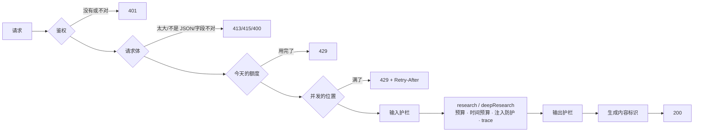

# 第 40 天：里程碑：研究助手服务

> 最后核对：2026-11-07

第 31–39 天给研究助手加了评估、追踪、降级、预算、注入防护、沙箱和护栏。它们现在都是一个个函数，只有你自己能在终端里调用。今天把它们组装成一个 **HTTP 服务**：别的程序、你的同事、第 44 天的网页，都能通过一个接口来用研究助手，而且每一道防线都还在。

```text
$ curl -s localhost:8787/v1/research \
    -H 'Authorization: Bearer dev-key' -H 'Content-Type: application/json' \
    -d '{"question": "潮汐协议 3.0 的默认端口是多少？"}'
{
  "id": "4f0c…",
  "status": "answered",
  "text": "3.0 的默认端口是 7443 [1]。\n\n来源：\n[1] 潮汐协议 3.0 发布说明 …\n\n本内容由人工智能生成，仅供参考，请注意甄别。",
  "sources": [{ "id": 1, "url": "https://tide.example/article.html", "title": "潮汐协议 3.0 发布说明" }],
  "toolCalls": [{ "name": "web_search", "arguments": { "query": "潮汐协议 3.0 默认端口" } }],
  "usage": { "inputTokens": 2310, "cachedTokens": 1024, "outputTokens": 96, "reasoningTokens": 0 },
  "cost": 0.0049,
  "traceId": "9b1e…"
}
```

学完今天，你会：

- 设计一个 Agent 服务的接口：同步等结果，还是先返回编号
- 给服务加上鉴权、请求校验、并发上限，用正确的状态码说清楚每一种错误
- 把第 34–39 天的追踪、预算、时间预算、注入防护、护栏和标识串进一次请求
- 区分「给调用方看的」和「只进日志的」，不把内部细节暴露出去
- 让第 31 天的评估集直接对着服务跑

## 服务要做哪些事

一次研究请求从进门到出门：



| 关卡 | 来自 | 失败时 |
|---|---|---|
| 鉴权 | 今天 | 401，带 `WWW-Authenticate: Bearer` |
| 请求体大小、格式、字段 | 今天、第 4 天的 zod | 413、415、400，说明哪个字段错在哪 |
| 用户今天的额度 | 第 36 天的 `createLedger` | 429 |
| 并发上限 | 今天 | 429，带 `Retry-After` |
| 护栏、兜底 | 第 39 天 | 200，`status` 是 blocked 或 fallback |
| 单次任务的预算 | 第 36 天的 `withBudget` | 研究中途停下，兜底 |
| 时间预算 | 第 35 天 | quick 到点取消；deep 优雅降级 |
| 注入防护、沙箱 | 第 37、38 天 | 在 `research()` 里面，默认开启 |
| 追踪 | 第 34 天 | 每次请求一棵 trace，`x-trace-id` 响应头 |

注意被护栏拦下、出错兜底时，HTTP 状态码仍然是 200：请求本身是合法的，服务也正常地处理了，只是答复是拒答或兜底。4xx 留给「请求有问题」，5xx 留给「服务自己出了意料之外的错」。调用方看 `status` 字段就知道是哪种答复。

## 同步还是异步

一次 quick 研究十几秒到一分钟，一次深度研究可能好几分钟。HTTP 请求等得了这么久吗？

| | 同步：`POST /v1/research` | 异步：`POST /v1/runs` + `GET /v1/runs/:id` |
|---|---|---|
| 调用方 | 发一个请求，等结果 | 先拿到编号（202），隔一会儿来查 |
| 连接断了 | 白跑了：服务发现断开就取消，不再花钱 | 不影响，回来再查 |
| 中间的代理、网关 | 很多默认 60 秒超时 | 每个请求都很快 |
| 适合 | quick 研究、内部调用、测试 | 深度研究、网页界面 |

今天两种都实现：同步的服务端在调用方断开时（`res.on('close')`）取消研究；异步的结果存在内存的 `Map` 里，重启就没了，也没法分给多台机器。第 44 天用 SSE 实时推送进度，第 45 天把异步运行换成真正的任务队列和数据库。

查询别人的运行编号时返回 404，而不是 403：403 等于告诉对方「这个编号存在，只是不是你的」。

## 鉴权：固定时间的比较

最简单的鉴权是给每个调用方发一个 API Key，请求时放在 `Authorization: Bearer <key>` 里。两个细节：

- **内存里只存哈希**。`hashApiKeys` 把 key 算成 sha256；日志、错误信息、内存转储里都不会出现明文
- **比较的时间不能透露信息**。`a === b` 遇到第一个不同的字符就返回，攻击者可以通过响应时间一位一位地猜。`timingSafeEqual` 比较的时间和内容无关；它要求两边一样长，所以先都算成哈希再比。每个 key 都比一遍、不提前退出，免得时间透露出是第几个 key

第 46 天换成真正的登录和多租户；这里的 `ServiceUser` 只有一个 `id`，用来分开工作目录、记账和查运行。

## 并发上限：拒绝，而不是排队

每个研究要占模型服务的限流额度、内存和打开的连接。`createLimiter(4)` 同时最多跑 4 个，第 5 个请求立刻得到 `429 Too Many Requests` 和 `Retry-After: 30`。

为什么不排队？排在后面的请求要等前面的跑完，一个研究就是一分钟，排第 10 个的多半在网关那里就超时了：它占着连接，最后也拿不到结果。尽早拒绝，调用方可以换个时间再来，或者走异步接口。真正的排队交给第 45 天的任务队列：任务存进 Redis，worker 按自己的节奏取。

## 给调用方看的、只进日志的

第 39 天说过：错误里可能有内网地址、数据库名、文件路径。今天把这条规矩贯彻到每一个出口：

| | 响应 | 日志 |
|---|---|---|
| 请求编号 `x-request-id` | ✓ | ✓ |
| trace 编号 `x-trace-id` | ✓ | ✓ |
| 护栏拦下的原因 | 只有事件的名字（`guardEvents`） | ✓ |
| 研究出错的原始信息 | ✗，只有兜底的答复 | ✓ `error` |
| 意料之外的异常 | ✗，「服务出错了」加请求编号 | ✓ |
| 用户的问题原文 | — | ✗，日志只记元数据 |

调用方拿着请求编号来问「为什么失败了」，你用它在日志里找到 `error`，再用 `traceId` 在 Langfuse 里看到每一步。`publicResult` 在交出去之前去掉 `error` 字段。

> 护栏事件里的 `reason` 会写出命中了什么（比如「打码了 1 处敏感信息（手机号）」）。研究助手面向的是自己的同事，这样方便排查；面向公众时，响应里只留 `guard` 和 `action`，`reason` 只进日志（第 39 天）。

## 对着服务跑评估

第 31 天的 `researchTarget` 直接调用 `research()`。服务上线以后，要评估的是服务本身：护栏是不是在、标识是不是加了、JSON 序列化有没有丢东西、默认配置是不是和你本地一样，任何一层出了问题，直接调函数都测不出来。

[eval/service.ts](exercise/eval/service.ts) 把 `POST /v1/research` 包成 target，评估集、评分器、第 33 天的回归对比和门禁都不用改：

```bash
SERVICE_URL=http://127.0.0.1:8787 SERVICE_KEY=dev-key node days/day40/exercise/eval/service.ts days/day40/data/eval/research.jsonl
```

部署到测试环境以后先跑一遍它，分数不低于基线再切流量（第 48、49 天）。

## 读懂练习代码

| 文件 | 内容 | 今天要做的 |
|---|---|---|
| [service.ts](exercise/service.ts) | 鉴权、请求体、并发、一次研究请求、路由和异步运行 | TODO 1–6 |
| [eval/service.ts](exercise/eval/service.ts) | 对着服务跑评估 | 读懂即可 |
| 其余文件 | 和第 39 天的参考答案一样 | 不用改 |

`service.ts` 只用 `node:http`，没有引入 Express、Fastify 或 Hono：今天关心的是一个 Agent 服务要做哪些事。换成框架时，这些事一件都不会少，只是写法不同。

## 常见误解

| 误解 | 实际上 |
|---|---|
| 被护栏拦下应该返回 4xx | 请求是合法的，服务正常处理了。4xx 留给请求本身的问题，看 `status` 字段区分答复 |
| 并发满了就排队，体验更好 | 排在后面的多半等到超时。尽早 429，长任务走异步 |
| 比较 API Key 用 `===` 就行 | 时间会泄露信息。先哈希，再用 `timingSafeEqual` |
| 出错时把错误信息返回，方便调用方排查 | 给请求编号，细节进日志 |
| 调用方断开了，研究跑完也无妨 | 一直在花钱。同步接口断开就取消 |
| 函数的测试和评估都过了，服务就没问题 | 序列化、默认配置、中间件都可能出错。评估要对着服务跑 |

## 常见错误

| 报错 | 原因 |
|---|---|
| 测试说 `bearer key-bob ` 应该认出 bob | 正则没有加 `i`，或者没有允许末尾的空格 |
| 测试说只存 sha256 | `hashApiKeys` 被改了，或者比较时用了明文 |
| 415 的测试失败 | 没有检查 Content-Type |
| 413 的测试超时或者返回 400 | 读完了才检查大小；要边读边累计 |
| 测试说「拼错的字段要报出来」 | 用了 `z.object` 而不是 `z.strictObject`，或者改了 schema |
| 测试说「交给模型的已经打码」 | 研究用的是原始的问题，不是 `runGuarded` 交给 handler 的文字 |
| 测试说回答要加上显式标识 | 只有 answered 的才加；或者忘了加 |
| `x-trace-id` 和 `traceId` 对不上 | 没有用 `withSpan` 包住整件事，取的是别的 span |
| 并发的测试说位置要还回去 | 出错时没有 release；`try/finally` |
| 测试说别人的运行也说没有 | 返回了 403，或者没有检查 userId |
| 测试说不把内部字段交出去 | 查询运行时把 `userId` 一起返回了 |

## 动手：把研究助手变成服务

按顺序做，每做完一步就运行一次 `npm run check 40`：

1. **TODO 1**：`authenticate`。
2. **TODO 2**：`readJsonBody`。HTTP 接口那组测试的一部分会先通过。
3. **TODO 3**：`parseResearchRequest`。
4. **TODO 4**：`createLimiter`。
5. **TODO 5**：`runResearchRequest`。研究请求和安全用例的测试会通过。
6. **TODO 6**：异步运行。全部测试通过。
7. **真的启动起来**（需真实模型）：`SERVICE_API_KEYS=dev-key:me node days/day40/exercise/service.ts`，用 curl 问一个问题；配好 `LANGFUSE_*`，用响应里的 `traceId` 在 Langfuse 里找到这次请求。
8. **对着服务跑评估**（需真实模型）：用上面 `eval/service.ts` 的命令跑一遍评估集，和第 33 天的基线比一比。

## 检查

```bash
npm run check 40
```

通过 HTTP 用真实模型跑一次研究（需真实模型）：

```bash
npm run check 40 -- --e2e
```

## 小实验

- 用 `ab` 或者 `autocannon` 同时发 10 个请求，看有几个 429；把 `maxConcurrent` 调大，看模型服务开始限流时会发生什么（第 35 天的降级链会不会生效）
- 同步请求发出去以后马上按 Ctrl+C 断开 curl，看日志里这次研究是不是被取消了、mock 或者真实模型少收到几次调用
- 给 `defaultGuards(createCheapModel())` 打开内容审核，比较一次请求的延迟和花费多了多少
- 把服务的日志接到 `jq`，统计每个用户今天的请求数和 fallback 的比例
- 把 `makeSetup` 里的工作目录改成所有用户共用一个，想想两个用户的记忆会不会串（第 46 天）

## 小结

- 一个 Agent 服务的骨架：鉴权 → 校验 → 额度 → 并发 → 护栏 → 研究 → 护栏 → 标识；每一关失败都有明确的状态码或 `status`
- 长任务有两种接法：同步等结果（断开就取消），或者先拿编号再查；网页和深度研究要用后者
- API Key 只存哈希、用固定时间比较；并发满了尽早 429，不排长队
- 给调用方的只有答复、请求编号和 trace 编号；错误的细节进日志
- 评估要对着服务跑，才测得到部署出来的那个东西

第四阶段到这里结束。研究助手有了评估、追踪、降级、预算、注入防护、沙箱、护栏，现在还是一个服务。

## 想一想

- 第 1–40 天的 Agent 循环、工具定义、模型适配、重试、追踪都是手写的。成熟的 SDK 替你做了哪些？哪些仍然要自己做？（第 41 天）
- 异步运行的结果存在内存里。进程重启、部署新版本、开到两台机器以后会怎样？（第 45 天）
- 每个用户的工作目录、记忆现在都在本机的文件里，靠目录名分开。上线给一百个人用，怎么保证互相看不到？（第 46 天）

## 延伸阅读

- [MDN：HTTP 响应状态码](https://developer.mozilla.org/zh-CN/docs/Web/HTTP/Status)：202、401、413、415、429 各自的含义
- [MDN：Retry-After](https://developer.mozilla.org/zh-CN/docs/Web/HTTP/Headers/Retry-After)：告诉调用方多久以后再来
- [Node.js：crypto.timingSafeEqual](https://nodejs.org/api/crypto.html#cryptotimingsafeequala-b)：固定时间的比较
- [Microsoft：Asynchronous Request-Reply pattern](https://learn.microsoft.com/azure/architecture/patterns/async-request-reply)：202 加轮询的长任务接口
- [OWASP：API Security Top 10](https://owasp.org/API-Security/)：越权访问对象（BOLA）、资源消耗不受限等风险
