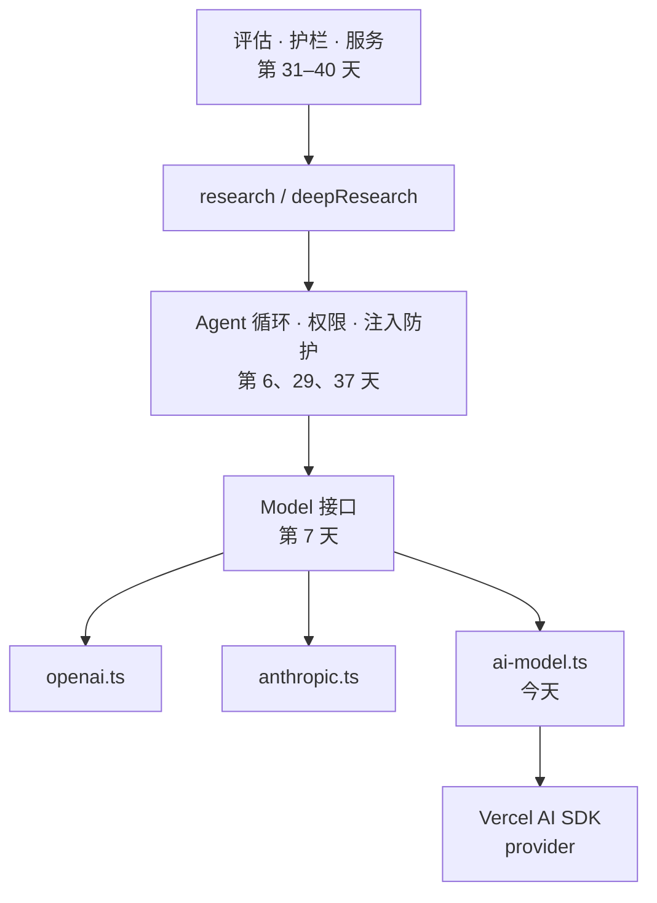

# 第 42 天：用 Vercel AI SDK 重构

> 最后核对：2026-11-07

第 41 天用 AI SDK 重写了一个几十行的 mini-agent。研究助手大得多：四十个文件，评估、追踪、护栏、注入防护……全部推倒重写不现实，也没必要。今天要回答的问题是：**把一个手写的 Agent 迁移到框架上，该从哪一层下手，才能让原有的测试和评估继续通过？**

答案是两步：

1. **先换最底下的模型层**。研究助手从第 7 天起只认 `Model` 接口。用 AI SDK 实现一个 `Model`，上面的循环、护栏、权限、注入防护、追踪、预算、评估一行都不用改
2. **再试着把循环也交给 AI SDK**。用 `ToolLoopAgent` 跑研究助手，看哪些能力跟着工具走、换了循环也还在，哪些长在循环里、要重新接

```text
$ MODEL_PROVIDER=ai-sdk node days/day42/exercise/research.ts "潮汐协议 3.0 的默认端口是多少？"
✓ web_search {"query":"潮汐协议 3.0 默认端口"}
3.0 的默认端口是 7443 [1]。

来源：
[1] 潮汐协议 3.0 发布说明 https://tide.example/article.html
```

学完今天，你会：

- 用「换最底层、保留接口」的办法迁移一个已有的 Agent
- 在 AI SDK 和自己的消息格式之间来回转换：思考内容、工具调用、工具结果
- 让 AI SDK 的错误继续走你自己的重试和故障转移，而不是两层都重试
- 用 `ToolLoopAgent`、`toolApproval` 和 `Output.object` 跑研究助手，并说清楚哪些防线留在了循环外面
- 用 AI SDK 的 DevTools 和 MCP 客户端（选读）

## 迁移从哪一层下手



手写的代码里，最容易被框架替代的是最底下那层：HTTP 请求、两种协议的格式、SSE 解析。它们也是最「无聊」、最容易出兼容问题的。而上面那几层是研究助手自己的业务：怎么查资料、怎么防注入、怎么评估。

所以第一步只换 `Model` 的实现。[ai-model.ts](exercise/ai-model.ts) 的 `createAISDKChatModel` 每次只调用一次模型：

- 工具只给描述和 JSON Schema，**不给 `execute`**。AI SDK 不会执行工具，只把模型的工具调用交回来
- `stopWhen: stepCountIs(1)`：只走一步，循环还是第 6 天的那个
- `maxRetries: 0`：重试归第 9 天的 `withRetry` 管

`providers.ts` 加了一个 `ai-sdk`，`MODEL_PROVIDER=ai-sdk` 就换上了。测试里有一条专门检查：同一个请求，`openai.ts` 和 `ai-model.ts` 发出去的 `messages` 一模一样。这就是迁移时最好用的回归测试：**对着同一个 mock 服务器，比较两种实现发出的请求**。

## 两种消息格式

我们的消息是 OpenAI 的写法：工具调用挂在 assistant 消息的 `tool_calls` 上，参数是 JSON 字符串；AI SDK 的消息是「部分」组成的数组：

| 我们的 | AI SDK 的 |
|---|---|
| `{ role: 'assistant', content, reasoning_content, tool_calls }` | `{ role: 'assistant', content: [reasoning 部分, text 部分, tool-call 部分…] }` |
| 工具调用的 `arguments` 是字符串 | `tool-call` 的 `input` 是对象 |
| `{ role: 'tool', tool_call_id, content }` | `{ role: 'tool', content: [{ type: 'tool-result', toolCallId, toolName, output }] }` |
| system 消息在 `messages` 里 | 推荐放在 `instructions`；放在 `messages` 里要 `allowSystemInMessages: true` |

两个细节：

- **工具结果要带工具名**。我们的 tool 消息只有 `tool_call_id`，要从前面 assistant 的工具调用里按 id 找回来
- **思考内容要回传**。`reasoning_content` 变成 reasoning 部分，openai-compatible 的 provider 会再把它写回 `reasoning_content` 字段（第 8 天讲过，有的模型要求原样传回）

回复方向反过来：`toolCalls` 的 `input` 序列化回字符串，`finishReason` 换回 OpenAI 的叫法（`tool-calls` → `tool_calls`）。不认识的停止原因用 `rawFinishReason` 的原值，第 6 天的护栏认得 GLM 的 `sensitive`。

叫错名字的工具呢？AI SDK 会把它标成 `invalid`，附上 `NoSuchToolError`。我们照样把它当作普通的工具调用交给循环，第 11 天的「你是不是想用 calculator？」比 AI SDK 的英文错误信息对模型更有用。同理，`jsonSchema()` 不带 `validate`，AI SDK 不替我们校验参数。

## 错误：一层重试就够了

AI SDK 的 `maxRetries` 默认是 2。如果外面还包着第 9 天的 `withRetry`（默认 3 次），一次 429 最多会变成 3 × 4 = 12 个请求，第 35 天的故障转移还要再乘一遍。**只留一层重试**：AI SDK 设成 0，错误转成 `ModelError`，交给我们的重试、冷却和故障转移，它们看得懂状态码和 `Retry-After`。

`toModelErrorFromAISDK` 把 `APICallError` 换成 `ModelError`：状态码、响应头原样，错误体里的 `code`、`type` 解析出来（第 9 天按 GLM 的错误码判断配额用完，就靠它）。

流式的时候要多注意一点：`streamText` 不会直接抛出接口错误，而是在 `fullStream` 里放一个 `type: 'error'` 的部分，最后再抛出一个笼统的 `NoOutputGeneratedError`。遍历时遇到 error 部分要自己抛出来，否则重试拿不到状态码。

## 把循环也交给 AI SDK

[ai-agent.ts](exercise/ai-agent.ts) 走得更远：`aiResearch` 用 `ToolLoopAgent` 跑研究助手。

```ts
const agent = new ToolLoopAgent({
  model,
  instructions: RESEARCH_PROMPT,
  tools: toResearchToolSet(tools, confirm),        // createResearchTools 组装的那一套
  toolApproval: approvalFromPolicy(tools, policy), // 第 29 天的权限策略
  stopWhen: ({ steps: current }) => used + current.length >= maxSteps,
});
```

对照一下，哪些能力还在、哪些要重新接：

| 能力 | 在哪里 | 换成 ToolLoopAgent 以后 |
|---|---|---|
| 注入防护、网络白名单、密钥、大结果写文件（第 16、37、38 天） | 包在工具里 | ✓ 还在：工具是同一套 |
| 来源登记、引用检查（第 20 天） | 工具登记来源，循环结束后检查 | ✓ 还在 |
| 权限策略（第 29 天） | 原来在 `runToolCall` 里 | 要重新接：换成 `toolApproval` |
| 工具参数的 zod 校验（第 11 天） | 原来在 `runToolCall` 里 | 要重新接：`executeChecked` |
| 重复调用、连续出错的护栏（第 6 天） | 长在循环里 | ✗ 没了，要用 `stopWhen` 自己写 |
| 每一步重新生成工具定义（第 28 天） | 长在循环里 | 要用 `prepareStep` 重新接 |
| 暂停、存盘、恢复（第 29 天） | 长在循环里 | 审批是数据，可以跨请求；但现场要自己存 |
| 追踪（第 34 天） | 包在模型和工具外面 | 部分还在；模型这层要换成 AI SDK 的 telemetry |

**跟着工具走的能力，换框架时最省心**。这也是第 37、38 天把防线写成「包装工具的函数」而不是写进循环的原因。

几个接线的细节：

- **注入防护要拿到真正的 confirm**。它遇到不明的网址会问用户；第 41 天图省事传了一个永远同意的 confirm，在这里会把防护变成摆设。`toResearchToolSet` 把用户的 confirm 传进去
- **权限策略换成 `toolApproval`**：allow → `not-applicable`，ask → `user-approval`（AI SDK 停下来交回审批请求），deny → `{ type: 'denied', reason }`（AI SDK 直接把拒绝交给模型）
- **步数要跨几次 generate 累计**。每处理一轮审批就要重新调用 `generate`，而停止条件只看得到这一次的步数。`stopWhen` 写成函数，加上之前用掉的

### 结构化输出

第 30 天的规划让模型输出 `{"steps": [...]}`，再用 `parseSteps` 解析。`planWithAISDK` 改用 `Output.object({ schema: PlanSchema })`：AI SDK 在请求里带上输出格式，回复由它解析、用 zod 校验，`r.output` 直接是对象；不合格时抛出 `NoObjectGeneratedError`，我们退回成「问题本身就是唯一的子问题」。

用兼容接口时有个差别：openai-compatible 的 provider 默认只发 `response_format: { type: "json_object" }`，schema 的约束靠 AI SDK 事后校验。确认模型支持 `json_schema`（第 4 天的差异表）以后，创建 provider 时加上 `supportsStructuredOutputs: true`，它才会发 `json_schema`。

## DevTools 和 MCP 客户端（选读）

- **DevTools**：`@ai-sdk/devtools` 是一个本地的调试工具，用网页查看每次请求、回复、工具调用和多步的过程。用 `registerTelemetry(DevToolsTelemetry())` 注册，具体用法见[文档](https://ai-sdk.dev/docs/ai-sdk-core/devtools)。它是实验性的，只在本地开发时用，**别在生产环境开**：它会记下完整的提示词和回复
- **MCP 客户端**：`@ai-sdk/mcp` 的 `createMCPClient` 连接 MCP 服务器，把它的工具直接变成 AI SDK 的工具。研究助手已经有第 13 天的 `mcp.ts`，转成我们的 `Tool` 以后同样能交给 `toResearchToolSet`，所以今天没有换

## 读懂练习代码

| 文件 | 内容 | 今天要做的 |
|---|---|---|
| [ai-model.ts](exercise/ai-model.ts) | 用 AI SDK 实现 `Model`：消息、工具、停止原因、错误、流式 | TODO 1–4 |
| [ai-agent.ts](exercise/ai-agent.ts) | 结构化输出的规划；`ToolLoopAgent` 跑研究助手 | TODO 5、6 |
| [providers.ts](exercise/providers.ts) | 加了 `ai-sdk` | 读懂即可 |
| [frameworks/](exercise/frameworks/) | 第 41 天的代码，今天复用 `createAISDKModel`、`fromAISDKUsage`、`executeChecked` | 不用改 |
| 其余文件 | 和第 41 天的参考答案一样 | 不用改 |

## 常见误解

| 误解 | 实际上 |
|---|---|
| 迁移到框架就要全部重写 | 先换最底层、保留接口，上面的代码和测试都不用动 |
| 框架的重试比自己写的好，两个都开更保险 | 两层重试会把请求数乘起来；只留一层 |
| 用了 AI SDK 的循环，第 6 天的护栏还在 | 长在循环里的东西换了循环就没了，要用 `stopWhen` 重新写 |
| 注入防护的 confirm 随便传一个就行 | 它是防线的一部分，永远同意等于没有防护 |
| `Output.object` 一定会让模型按 schema 输出 | 兼容接口默认只发 json_object，约束靠事后校验；不合格会抛错，要有退路 |
| DevTools 开着方便排查线上问题 | 它记录完整的提示词和回复，只能在本地用 |

## 常见错误

| 报错 | 原因 |
|---|---|
| `Invalid prompt: System messages are not allowed` | 没加 `allowSystemInMessages: true` |
| mock 返回 400「tool_call_id 对不上」 | tool 消息的 `toolCallId` 没对上，或者 assistant 的工具调用没转成 tool-call 部分 |
| 工具结果的 `toolName` 是 unknown | 没有从前面的工具调用里按 id 记下工具名 |
| 测试说「两种实现发出去的消息一样」，差在 reasoning_content | 没有把思考内容转成 reasoning 部分 |
| 测试说 Retry-After 没被读到，或者请求多了 | 没设 `maxRetries: 0`，或者错误没转成 `ModelError` |
| 流式出错时测试说应该是 ModelError，实际是 NoOutputGeneratedError | 遍历 `fullStream` 时没处理 error 部分 |
| 测试说参数应该是字符串 | 工具调用的 `input` 没有 `JSON.stringify` |
| `aiResearch` 的步数测试多调用了一次 | 停止条件没有加上之前用掉的步数 |
| 审批测试里文件被写了 | `toolApproval` 没接上，或者 ask 返回成了 not-applicable |

## 动手：把研究助手迁到 AI SDK

按顺序做，每做完一步就运行一次 `npm run check 42`：

1. **TODO 1**：`toModelMessages`。
2. **TODO 2**：工具、tool_choice、停止原因、回复的转换。
3. **TODO 3**：错误转换。转换的测试都通过。
4. **TODO 4**：`createAISDKChatModel` 的 `chat`。AI SDK 实现的 Model 那组测试通过，研究助手和注入防护的测试也跟着通过。
5. **TODO 5**：`planWithAISDK`。
6. **TODO 6**：`approvalFromPolicy` 和 `aiResearch`。全部测试通过。
7. **用真实模型跑评估**（需真实模型）：`MODEL_PROVIDER=ai-sdk`，用第 33 天的命令跑一遍评估集，和 `openai` 的基线比较。分数应该在方差范围内；不在，就比较两边的请求找差别。

## 检查

```bash
npm run check 42
```

真实模型下，研究助手换上 AI SDK 的模型、用 ToolLoopAgent 各跑一次（需真实模型）：

```bash
npm run check 42 -- --e2e
```

## 小实验

- 给 `createAISDKModel` 加上 `supportsStructuredOutputs: true`，看 `planWithAISDK` 的请求怎么变；换一个不支持 json_schema 的模型试试
- 在 `aiResearch` 的 `stopWhen` 里加上第 6 天的「同样的调用超过两次就停」，用 mock 让模型原地打转来测试
- 把 `maxRetries: 0` 去掉，用 mock 连续返回 3 次 503，数一数 mock 收到了几个请求
- 在 `ToolLoopAgent` 上加 `prepareStep`，第 5 步以后只留 `fetch_page` 和 `search_docs`，看看模型的行为有什么变化
- 本地装上 `@ai-sdk/devtools`，跑一次 `aiResearch`，在它的网页里看每一步

## 小结

- 迁移一个手写的 Agent：先换最底层、保留接口，用「对着同一个 mock 比较请求」做回归测试
- AI SDK 和我们的消息格式差在：部分数组、参数是对象、工具结果要带工具名、system 的位置
- 只留一层重试：AI SDK 设 `maxRetries: 0`，错误转成 `ModelError` 交给自己的重试和故障转移；流式的错误要从 `fullStream` 里取
- 把循环交给 `ToolLoopAgent`：跟着工具走的防线都还在，长在循环里的（护栏、权限、暂停）要重新接；注入防护要拿到真正的 confirm
- `Output.object` 做结构化输出，不合格会抛错，要有退路

## 想一想

- AI SDK 只替代了模型层，研究助手的运行时（工具、权限、子 Agent、上下文压缩）还是自己的。有没有现成的、完整的运行时可以直接拿来用？它的许可允许你怎么用？（第 43 天）
- `aiResearch` 每一步都会产生工具调用、工具结果和文字。要在网页上实时显示，服务端该推送什么？AI SDK 的 UI 消息流能不能直接用？（第 44 天）
- 一层重试、一层故障转移、一层预算……这些「包一层」的设计，在 AI SDK 里对应的是什么？（提示：`wrapLanguageModel` 和中间件）

## 延伸阅读

- [AI SDK：Generating Text](https://ai-sdk.dev/docs/ai-sdk-core/generating-text)：`generateText`、`streamText` 和 `fullStream`
- [AI SDK：Agents](https://ai-sdk.dev/docs/agents/overview)：`ToolLoopAgent`、停止条件、`prepareStep`
- [AI SDK：Tool Calling](https://ai-sdk.dev/docs/ai-sdk-core/tools-and-tool-calling)：工具审批和工具调用的错误
- [AI SDK：Generating Structured Data](https://ai-sdk.dev/docs/ai-sdk-core/generating-structured-data)：`Output.object` 和 `NoObjectGeneratedError`
- [AI SDK：Language Model Middleware](https://ai-sdk.dev/docs/ai-sdk-core/middleware)：用中间件给模型「包一层」
- [Martin Fowler：Strangler Fig Application](https://martinfowler.com/bliki/StranglerFigApplication.html)：一步步替换旧系统的思路
