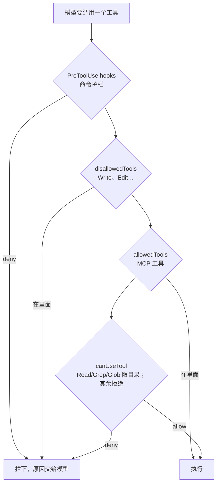

# 第 43 天：复用成熟的 Agent 运行时

> 最后核对：2026-11-07

第 42 天用 AI SDK 换掉了研究助手的模型层，运行时还是自己的：工具、权限、子 Agent、上下文压缩、会话，都是前 40 天一行行写的。今天换个思路：**有没有一整套现成的运行时，可以直接拿来用？**

Claude Agent SDK 就是这样一个东西：它把 Claude Code 的运行时当作一个库给你用。读写文件、执行命令、搜索代码、子 Agent、上下文压缩、会话、权限、hooks、skills 都是现成的。你做的事情从「实现」变成了「配置和扩展」。

今天用它做一个「潮汐文档专员」：能读一个文档目录，能用研究助手的搜索工具，**不能**改文件、不能乱执行命令，每一次工具调用都写进一份防篡改的审计日志。

```text
$ node days/day43/exercise/claude-agent.ts "潮汐协议 3.0 的默认端口是多少？"
3.0 的默认端口是 7443，出自 guide/config.md。

（completed，4 轮，工具：Grep、Read，审计日志：workspace/audit/specialist.jsonl）
{ ok: true, count: 7 }
```

学完今天，你会：

- 说清楚 Claude Agent SDK 提供了什么、它是怎么运行的、许可有什么限制
- 用 `allowedTools`、`disallowedTools`、`canUseTool` 和 hooks 组合出一个专用 Agent 的权限
- 用 hooks 实现审计日志，并用哈希链让它防篡改
- 把自己的工具通过进程内的 MCP 服务器交给它
- 判断一个场景该自建运行时还是复用

## 它是什么、怎么跑

```mermaid
flowchart LR
  A[你的程序<br/>query&#40;&#41;] -- 启动子进程 --> B[Claude Code 运行时<br/>随 SDK 安装的可执行文件]
  B -- 消息流 --> A
  B -- hooks / canUseTool 回调 --> A
  B -- 进程内 MCP --> T[你的工具]
  B -- Anthropic 协议 --> M[模型服务<br/>Anthropic 或兼容接口]
```



`query({ prompt, options })` 启动 Claude Code 的运行时（一个随 SDK 一起安装的可执行文件，按平台分包），返回一个异步迭代器，依次交回 assistant 消息、工具结果、系统消息，最后一条是 `result`：回答、轮数、估算的花费、会话编号。你在 `options` 里决定：

| 你决定的 | 选项 | 对应前 40 天的 |
|---|---|---|
| 能用哪些内置工具 | `allowedTools`、`disallowedTools`、`tools` | 第 5 天的工具清单 |
| 每次工具调用要不要放行 | `permissionMode`、`canUseTool` | 第 29 天的权限策略 |
| 在哪些时刻插入自己的逻辑 | `hooks` | 第 34 天的追踪、第 37 天的检查 |
| 额外的工具 | `mcpServers`（可以是进程内的） | 第 13、14 天的 MCP |
| 子 Agent | `agents` | 第 25 天 |
| 系统提示词 | `systemPrompt`（预设加追加，或者完全自定义） | 第 15 天 |
| 轮数、预算 | `maxTurns`、`maxBudgetUsd` | 第 6 天的步数、第 36 天的预算 |
| 接着之前的会话 | `resume`、`continue` | 第 19 天的会话恢复 |
| 读不读本机的配置 | `settingSources` | — |

**最后一项一定要设成 `[]`**。不设的时候，它会像命令行的 Claude Code 一样，读取用户目录和项目目录里的 `.claude` 配置：开发者本机装的插件、写的 hooks、允许的命令，都会混进你的专用 Agent。服务器上跑的东西，不能被谁的本机设置影响。

### 配合国产模型

运行时用 Anthropic 协议调用模型，地址和 Key 从环境变量读：`ANTHROPIC_BASE_URL`、`ANTHROPIC_API_KEY`（或 `ANTHROPIC_AUTH_TOKEN`），模型用 `model` 选项或 `ANTHROPIC_MODEL`。第 8 天配好的 Anthropic 兼容接口直接能用，多家国产模型服务也专门写了接入 Claude Code 的说明。

要注意的是**兼容不等于等价**（第 8 天）：

- Claude Code 的系统提示词和工具定义是为 Claude 模型写的，换了模型，工具用得好不好、会不会乱调用，要用评估说话（第 33 天）
- 它会在后台用一个小模型做一些辅助的事（比如给会话起标题），兼容接口要把它也映射到能用的模型，具体的环境变量以 Claude Code 的文档为准
- `total_cost_usd` 按 Anthropic 的价格估算，用别家的模型时只能参考，实际花费看第 36 天的账本

### 许可：不是开源软件

这是今天最重要的一节。打开 `node_modules/@anthropic-ai/claude-agent-sdk/LICENSE.md`：

> © Anthropic PBC. All rights reserved. Use is subject to the Legal Agreements …

它**不是** MIT、Apache 这样的开源许可，使用受 Anthropic 的商业条款约束。对比第 41 天的表：AI SDK 是 Apache-2.0，OpenAI Agents SDK 是 MIT，你可以读、改、分发它们的代码。Claude Agent SDK 你可以按条款使用，但不能想当然地 fork、改了再发布，也要确认你的产品形态（比如拿它做一个对外收费的服务、接别家的模型）是条款允许的。

**上线之前读条款**，拿不准就问法务。这和第 39 天的合规是同一类事：技术上能做，不等于被允许做。

## 权限：几层叠在一起

专员的权限由几层组成，越靠前的越先生效：



（具体的判断顺序以官方文档的 permissions 一节为准，上图是今天的配置实际的效果。）

- **`allowedTools` 只放信任的 MCP 工具**：在它里面的工具会直接放行，**不再调用 `canUseTool`**。所以这里既不能放 `Bash`，也不能把 `Read`、`Grep`、`Glob` 放进去——否则 `canUseTool` 里的目录白名单会被直接绕过，模型能读到 `docsRoot` 之外的文件（如 `/etc/passwd` 或 `.env`）
- **`disallowedTools` 去掉写文件的工具**：模型根本看不到它们
- **`canUseTool` 管读目录和其余工具**：[claude-agent.ts](exercise/claude-agent.ts) 的 `createPermissionGate` 按路径判断。Read、Grep、Glob 只能用在文档目录里，用 `relative()` 算相对路径，防住 `../../etc/passwd` 和 `/docs-evil` 这种前缀相同的目录（第 38 天的路径检查）
- **hooks 是最后一道保险**：`createCommandGuard` 是一个只匹配 Bash 的 PreToolUse hook，命中 `rm -rf`、`sudo`、`curl … | sh` 就返回 `permissionDecision: 'deny'`。就算以后有人把 Bash 加进了 allowedTools，它也还在

拒绝的时候，`message` 和 `permissionDecisionReason` 都会交给模型：和第 11 天一样，告诉它为什么、该怎么办（「告诉用户需要他自己执行」），不然它会换个写法再试。

## hooks 和审计日志

hooks 是运行时在固定的时刻回调你的函数：`UserPromptSubmit`、`PreToolUse`、`PostToolUse`、`PostToolUseFailure`、`SessionEnd`……每个 hook 拿到事件的数据，返回一个对象：`{}` 表示照常进行，也可以拦下、改参数、补充上下文。

审计日志就是在每个时刻写一条记录：谁（会话）、什么时候、调用了什么工具、参数是什么、结果多大、有没有被拦下。几个设计：

| 设计 | 为什么 |
|---|---|
| 参数打码、截断 | 日志也会泄露数据（第 34、39 天） |
| 结果只记长度 | 读文件的结果可能是整个文件，审计要的是「做了什么」 |
| 只追加的 JSONL | 好写、好查，一行一条 |
| 哈希链 | 防篡改：每条记下上一条的 hash，改了或删了中间任何一条，后面就接不上 |
| 写失败不让 Agent 停下，但要报出来 | 审计是旁路，不能变成故障点；但悄悄丢日志比报错更糟 |
| 排队写 | 并行的工具调用会同时触发 hook，序号和链不能乱 |

```json
{"seq":2,"time":"…","event":"PreToolUse","sessionId":"…","tool":"Read","toolUseId":"toolu_…","input":"{\"file_path\":\"guide/config.md\"}","prev":"9f3c…","hash":"a71e…"}
```

`verifyAuditLog` 从头检查：序号连续、`prev` 等于上一条的 `hash`、`hash` 算得对。哈希链能发现「改过」，防不住「整个文件被换掉」：真正的防篡改还要把日志实时送到别的地方（日志服务、只能追加的对象存储），或者定期把最后一条的 hash 记到另一个系统里。

hooks 和第 34 天的追踪是互补的：追踪是给你排查问题用的，可以采样、可以丢；审计是给合规和事后追责用的，一条都不能少。

## 进程内的 MCP 服务器

研究助手的 `web_search`、`fetch_page` 怎么交给它？Claude Agent SDK 支持**进程内的 MCP 服务器**：`createSdkMcpServer` 加 `tool()`，工具直接在你的进程里执行，不用另起一个服务。工具名会变成 `mcp__research__web_search`。

`tool()` 要的是 zod 的「形状」（object 的字段表），研究助手的工具用 zod object 定义，取 `.shape` 就行。处理函数照例交给 `executeChecked`：先校验参数，结果写成 MCP 的文字内容（第 14 天）。

## 自建还是复用

| | 自建（前 40 天的研究助手） | 复用（Claude Agent SDK） |
|---|---|---|
| 起步速度 | 慢 | 快：文件、命令、搜索、子 Agent 都是现成的 |
| 控制力 | 每一步都能改 | 只能在它留的口子（选项、hooks、MCP）里改 |
| 模型 | 任何一家 | Anthropic 协议；别家要兼容，效果要评估 |
| 部署 | 一个 Node 进程 | 要带上运行时的可执行文件，每个会话一个子进程 |
| 许可 | 你自己的 | 商业条款 |
| 适合 | 核心业务、对成本和行为要精细控制 | 「像 Claude Code 一样干活」的场景：代码库问答、文档整理、运维助手 |

经验是：**你的场景越像「一个工程师坐在终端前干活」，复用越划算**；越像「一条固定的业务流程」，越该自建，或者用第 21 天的固定流程。

### 把 Claude Code、Codex 当作组件调用（选读）

更进一步，可以直接调用命令行工具：`claude -p "问题" --output-format json`、`codex exec "任务"`。它们适合放在 CI 里做一次性的任务（比如自动修 lint、给 PR 写说明）。代价是更难控制：权限、日志、成本都要靠它们自己的配置，许可同样要看各自的条款。

## 读懂练习代码

| 文件 | 内容 | 今天要做的 |
|---|---|---|
| [claude-agent.ts](exercise/claude-agent.ts) | 审计日志、审计 hooks、命令护栏、权限、MCP 服务器、组装和运行 | TODO 1–6 |
| 其余文件 | 和第 42 天的参考答案一样 | 不用改 |

测试不会真的启动 Claude Code 的运行时：hooks 和 `canUseTool` 都是普通的函数，直接用假的事件调用；`runSpecialist` 的 `query` 可以换成一个假的异步生成器（第 7 天的依赖注入）。只有 e2e 测试会真的跑一次，要配好 Anthropic 兼容接口。

## 常见误解

| 误解 | 实际上 |
|---|---|
| 它是开源的 SDK，想怎么用都行 | 商业条款，不是开源许可；上线前读条款 |
| 不设 settingSources 也没关系 | 不设会读本机的 `.claude` 配置，开发者的设置会混进来 |
| 把 Bash 放进 allowedTools，再用 canUseTool 管 | 在 allowedTools 里的直接放行，canUseTool 不会被问到 |
| 审计日志就是普通的日志 | 不能采样、不能丢、要防篡改；参数要打码 |
| 哈希链能防住一切篡改 | 整个文件被换掉它就发现不了，还要送到别处 |
| 换上国产模型，效果和 Claude 一样 | 提示词和工具是为 Claude 写的，要评估 |
| `total_cost_usd` 就是实际花费 | 按 Anthropic 的价格估算，用兼容接口时只能参考 |

## 常见错误

| 报错 | 原因 |
|---|---|
| 测试说同时写的几条序号乱了 | 没有排队，几条同时读到了同一个 last |
| 一次写失败以后，后面的都写不进去 | queue 接在了失败的 Promise 后面，没有吞掉错误 |
| 测试说「内容和 hash 对不上」，但没改过 | 算 hash 时字段顺序不固定，或者把 hash 自己也算进去了 |
| 测试说删掉一条应该发现 | 没检查序号或 prev |
| 审计 hooks 的测试说应该返回 {} | 返回了 undefined，或者写日志出错时抛出了 |
| 测试说提示词要打码 | 没用 `redactInput` |
| 命令护栏的测试说 `ls -la` 应该放行 | 正则太宽，比如把 `-l` 当成了 `-rf` |
| 权限测试说 `/docs-evil/a.md` 不在里面 | 用 `startsWith` 判断路径 |
| buildSpecialistOptions 的测试说 settingSources 应该是 [] | 忘了设 |
| runSpecialist 的测试说 denials 应该是 ['Bash'] | 没有从 `permission_denials` 里取 `tool_name` |

## 动手：做一个带审计的专用 Agent

按顺序做，每做完一步就运行一次 `npm run check 43`：

1. **TODO 1**：审计日志的写入和检查。审计日志那组测试通过。
2. **TODO 2**：审计 hooks。
3. **TODO 3**：命令护栏。
4. **TODO 4**：`isInside` 和 `createPermissionGate`。
5. **TODO 5**：MCP 的处理函数和组装选项。
6. **TODO 6**：`runSpecialist`。全部测试通过。
7. **真的跑起来**（需要 Anthropic 兼容接口）：`node days/day43/exercise/claude-agent.ts "潮汐协议 3.0 的默认端口是多少？"`，再问一个「帮我把 faq.md 里的端口改成 8443」，看它怎么被拒绝；打开审计日志看每一条，手动改一个字，再用 `verifyAuditLog` 检查。

## 检查

```bash
npm run check 43
```

真的启动 Claude Agent SDK，在文档目录里找答案（需要 Anthropic 兼容接口）：

```bash
npm run check 43 -- --e2e
```

## 小实验

- 去掉 `settingSources: []`，在自己的 `~/.claude/settings.json` 里加一条允许 Bash 的规则，看专员的行为有什么变化（试完记得改回来）
- 加一个 `agents` 选项，定义一个只能用 Grep 的「检索员」子 Agent，看审计日志里子 Agent 的工具调用带不带 `agent_id`
- 写一个 PostToolUse hook，用第 37 天的 `scanForInjection` 检查 `WebFetch` 的结果，发现可疑的指令就用 `additionalContext` 提醒模型
- 把 `maxBudgetUsd` 设得很小，看 result 的 subtype 是什么
- 用同一个问题比较专员和第 20 天的研究助手：轮数、token、答案的质量

## 小结

- Claude Agent SDK 把 Claude Code 的运行时当作库：你通过选项、hooks、MCP 配置和扩展它；它在子进程里运行，用 Anthropic 协议调用模型
- 它是商业条款，不是开源许可；上线前读条款。`settingSources: []` 隔离本机配置
- 权限是几层叠起来的：allowedTools 只放无需按参数校验的 MCP 工具，disallowedTools 去掉写的，canUseTool 按路径和参数把关 Read/Grep/Glob 及其他工具，hooks 兜底
- 审计日志用 hooks 实现：参数打码、结果只记长度、只追加、哈希链、排队写、失败要报
- 场景越像「工程师在终端前干活」越适合复用，越像固定的业务流程越该自建

## 想一想

- 专员的每一步（读了哪个文件、调了哪个工具）都在消息流里。把这些消息实时推到网页上，用户就能看到 Agent 在做什么。推送用什么协议？前端怎么渲染一个「进行中」的工具调用？（第 44 天）
- 一次深度研究要跑好几分钟，用户关掉网页再打开，能不能接着看进度？（第 45 天）
- 审计日志现在写在本机的文件里。多台机器、多个用户以后，日志该放在哪里，怎么保证每个用户只能看到自己的？（第 46 天）

## 延伸阅读

- [Claude Agent SDK 概览](https://platform.claude.com/docs/en/agent-sdk/overview)：它能做什么、怎么安装
- [Claude Agent SDK：Permissions](https://platform.claude.com/docs/en/agent-sdk/permissions)：权限模式、规则和 canUseTool 的判断顺序
- [Claude Agent SDK：Hooks](https://platform.claude.com/docs/en/agent-sdk/hooks)：所有的事件和返回值
- [Claude Agent SDK：MCP](https://platform.claude.com/docs/en/agent-sdk/mcp)：进程内的 MCP 服务器
- [Claude Code：Legal and compliance](https://code.claude.com/docs/en/legal-and-compliance)：使用条款
- [Crosby & Wallach：Efficient Data Structures for Tamper-Evident Logging](https://www.usenix.org/legacy/event/sec09/tech/full_papers/crosby.pdf)：防篡改日志的经典论文
