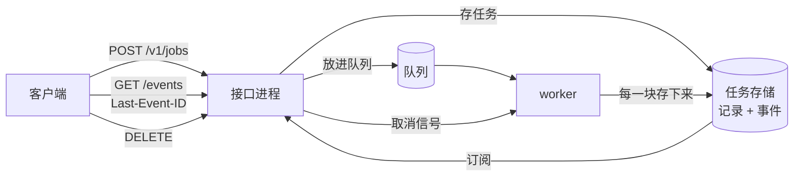
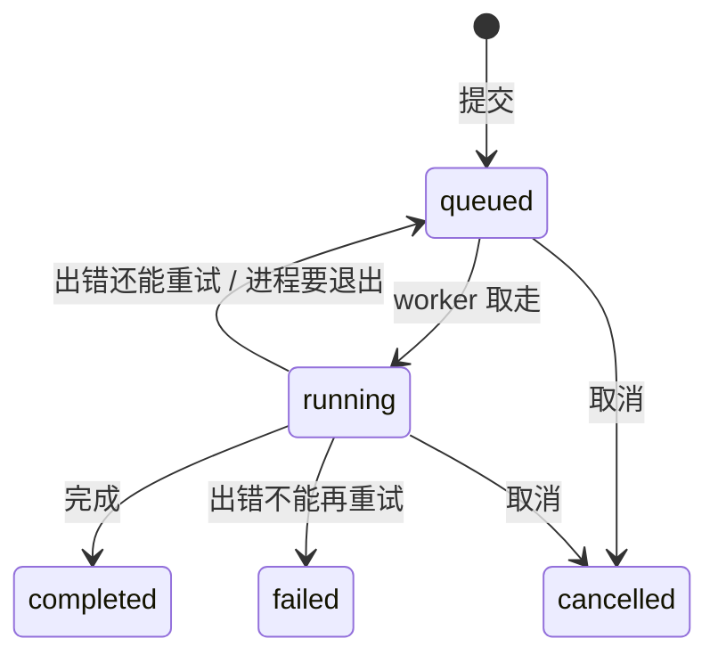

# 第 45 天：长任务与后台执行

> 最后核对：2026-11-07

第 44 天的网页有个毛病：研究跟着 HTTP 连接走。用户关掉网页，研究就取消了；网络抖一下，前面三分钟的调研全白费；服务器要发布新版本、重启一下，所有正在跑的研究一起没了。

今天把研究放进**后台**：提交的时候只把任务存下来、放进队列，马上返回一个编号；worker 从队列里取任务来跑，过程中的每一块都存下来；用户随时可以订阅进度，断线了带上最后收到的序号重连，只补发后面的；进程崩了，重启以后从检查点接着做。

```text
$ curl -s -X POST localhost:8789/v1/jobs -H 'Authorization: Bearer dev-key' \
    -H 'Content-Type: application/json' -d '{"question":"潮汐协议 3.0 值得升级吗？","mode":"deep"}'
{"id":"7c1e…","status":"queued"}

$ curl -sN localhost:8789/v1/jobs/7c1e…/events -H 'Authorization: Bearer dev-key' -H 'Last-Event-ID: 12'
id: 13
data: {"type":"data-progress","id":"subagent-1","data":{"stage":"subagent","index":1,…}}

id: 14
data: {"type":"data-progress","data":{"stage":"report"}}
…
data: [DONE]
```

学完今天，你会：

- 把长任务从请求里拆出来：提交、执行、观看、取消各走各的路
- 设计任务的状态机和事件日志，让断线重连只补发错过的部分
- 处理重试、取消和进程退出，知道每种结局该存什么
- 用检查点让崩溃以后接着做，而不是从头再来
- 用 BullMQ 和 Redis 把同样的设计扩展到多进程、多机器

## 从请求里拆出来



| | 第 44 天 | 今天 |
|---|---|---|
| 研究在哪里跑 | 处理请求的那个函数里 | worker 里，和请求无关 |
| 用户断开 | 取消研究 | 研究照跑，回来接着看 |
| 进度存在哪里 | 只在连接上，发完就没了 | 事件日志，每一块带序号 |
| 服务器重启 | 全没了 | 重启后恢复，深度研究从检查点接着做 |
| 取消 | 断开连接 | 明确的 DELETE 请求 |

## 任务的状态机



[worker.ts](exercise/worker.ts) 把 `streamResearch`（第 44 天）的每一块存进事件日志，但**结束的那几块**（`error`、`finish`、`abort`）先扣下，等知道结局再决定存什么：

| 结局 | 存的块 | 任务的状态 |
|---|---|---|
| 正常完成 | `finish` | completed，存下回答 |
| 用户取消 | `abort` | cancelled |
| 进程要退出了 | 什么都不存 | 改回 queued，重启后恢复 |
| 出错、还能重试 | 一块 `retry` 的进度 | 改回 queued，抛出错误让队列重试 |
| 出错、不能重试 | `error`（兜底的答复）和 `finish` | failed，错误只记在任务里 |

为什么要扣下？如果重试之前先存了 `error` 和 `finish`，正在看的用户会以为任务失败、结束了，其实一秒以后它又开始跑了。

还有一个顺序上的细节：**先存结束的块，后改状态**。订阅的一方补发完以后会看一眼任务的状态，看到「已经结束」，就能确定结束的块已经在日志里了，补齐就可以收尾。顺序反过来，它可能在两者之间读到「已结束、却没有结束的块」。

## 事件日志和断线续传

每个任务的事件日志是一个只追加的列表，每一块的序号从 1 开始递增。SSE 正好有现成的机制：

- 服务端每个事件带一行 `id: 序号`
- 浏览器的 `EventSource` 断线以后会自动重连，并把最后收到的 id 放进请求头 `Last-Event-ID`
- 服务端从这个序号之后补发

[jobs-server.ts](exercise/jobs-server.ts) 的 `streamJobEvents` 要做的事比看起来多：

1. **先订阅、再补发**。反过来的话，「读完日志、订阅生效之前」存进来的块就漏了
2. **所有的发送排成一条链**：补发在前，实时的在后，按序号去重
3. **补空档**：实时收到的块序号比已发的大不止一，说明中间有块没收到（比如 Redis 的订阅晚生效了），先从日志里补上
4. **补发完看一眼状态**：任务已经结束（或者在订阅之前就结束了），补齐剩下的块就收尾

这样，不管客户端什么时候来、断开多少次，看到的都是一条完整、有序、不重复的事件流。

> 浏览器的 `EventSource` 只能发 GET，也不能带 `Authorization` 头。要么用 Cookie 鉴权（第 46 天），要么像第 44 天那样用 `fetch` 读流，自己记下最后的序号、重连时带上。

事件日志会变大：一次研究的 `text-delta` 可能有几百块。实际的系统会定期**压实**：任务结束以后，把连续的 `text-delta` 合成一块，或者只保留最终的回答和工具调用。

## 重试、取消、退出

### 重试

[jobs.ts](exercise/jobs.ts) 的内存队列：worker 抛出错误、又没有被取消、次数还没用完，就按指数退避（1 秒、2 秒、4 秒……）放回队列。注意这是**任务级别**的重试，和第 9 天的**请求级别**重试是两层：

| | 第 9 天 `withRetry` | 今天的任务重试 |
|---|---|---|
| 重试什么 | 一次模型调用 | 整个任务 |
| 等多久 | 毫秒到秒 | 秒到分钟 |
| 适合 | 偶尔的 429、503 | 模型服务挂了几分钟、worker 所在的机器重启 |
| 代价 | 一次调用 | 整个任务从头（深度研究有检查点就只做没做完的） |

快速研究没有检查点，重试就是从头再来；所以 worker 每次重试前发一块 `retry` 的进度，界面上的时间线会清空重画（第 44 天的 `start` 块）。

### 取消

用户点取消时，任务可能还在排队，也可能正在跑：

- 在排队：直接从队列里拿掉，存一块 `abort`，改成 cancelled
- 在跑：记下 `cancelRequested`，再给 worker 的 `AbortController` 发信号。研究停下以后，worker 读到 `cancelRequested`，才知道这次中断是用户要的，而不是进程要退出

### 进程退出和恢复

部署新版本时，旧进程收到 SIGTERM。内存队列的 `close()` 给所有正在跑的任务发取消信号，worker 发现「中断了、但用户没要求取消」，就把任务改回 queued，什么块都不存。新进程启动时调用 `recoverJobs`：把 running 和 queued 的任务重新放进队列。

进程如果是**崩溃**（被 `kill -9`、机器断电），来不及改状态，任务停在 running。`recoverJobs` 同样会把它放回去：「还在 running」的任务，在一个刚启动的进程看来，只可能是上次没跑完的（单进程的前提下；多进程要靠租约，见下面的 BullMQ）。

恢复以后，深度研究打开同一个检查点文件（第 35 天）：计划、每个子 Agent 的结论都还在，只需要接着写报告。测试里有一条完整地模拟了这个过程：写报告写到一半时关掉队列，换一个新的队列恢复，检查新的请求里没有规划、没有调研。

## 多进程：BullMQ 和 Redis

内存的实现只能在一个进程里用：任务存储、事件、队列都在内存里。要多个 worker 进程、多台机器，就换成 [jobs-bullmq.ts](exercise/jobs-bullmq.ts)，**接口不变**，worker 和接口的代码一行都不用改：

| | 内存 | Redis + BullMQ |
|---|---|---|
| 任务记录 | Map | `research:job:<id>`（JSON），按状态分的集合 |
| 事件日志 | 数组 | Redis 列表，`RPUSH` 返回的长度就是序号（原子的，几个进程同时写也不会重号） |
| 实时推送 | 回调 | `PUBLISH` / `SUBSCRIBE` |
| 队列、重试、退避 | 自己写的 | BullMQ 的 `attempts` 和 `backoff` |
| 取消正在跑的任务 | `AbortController` | 发到一个频道，每个 worker 订阅，持有任务的那个调用 `worker.cancelJob`（处理函数收到 AbortSignal） |
| 崩溃恢复 | `recoverJobs` | BullMQ 的「停滞任务」检测：worker 持有任务时要不断续租，租约过期就被别的 worker 接走 |

要在本机试：

```bash
docker run -d --name redis -p 6379:6379 redis:7
```

```bash
REDIS_URL=redis://localhost:6379 npm run check 45 -- --solution
```

设了 `REDIS_URL` 时，测试会多跑一条 Redis + BullMQ 的流程；没设就跳过，CI 里也是这样。

BullMQ 还支持任务优先级、限速（每秒最多处理几个，用来配合模型服务的限流）、定时任务、父子任务（第 25 天的子 Agent 可以做成子任务，分到不同的 worker 上）。

### 持久化执行（选读）

今天的做法是「检查点 + 重试」：每一步做完存一次结果。更进一步的是**持久化执行**（durable execution）框架，比如 Temporal、Inngest、Restate：你把流程写成普通的代码，框架自动记录每一步的结果，崩溃以后重放代码、跳过已经完成的步骤。它们适合步骤很多、要跑几小时甚至几天、中间要等人审批的流程（第 29 天）。MCP 的 Tasks 扩展也在做类似的事：让一个工具调用可以变成一个能查询状态、能取消的长任务。

## 读懂练习代码

| 文件 | 内容 | 今天要做的 |
|---|---|---|
| [jobs.ts](exercise/jobs.ts) | 任务和事件的存储、内存队列、恢复 | TODO 1、3、4 |
| [worker.ts](exercise/worker.ts) | 执行一个研究任务 | TODO 2 |
| [jobs-server.ts](exercise/jobs-server.ts) | 提交、查询、订阅、取消的接口 | TODO 5 |
| [jobs-bullmq.ts](exercise/jobs-bullmq.ts) | Redis 和 BullMQ 的实现 | 读懂即可 |
| [ui-stream.ts](exercise/ui-stream.ts)、[timeline.ts](exercise/timeline.ts) | 可以带检查点；进度多了 retry | 读懂即可 |
| 其余文件 | 和第 44 天的参考答案一样 | 不用改 |

## 常见误解

| 误解 | 实际上 |
|---|---|
| 长任务把 HTTP 超时调大就行 | 连接会断、进程会重启，任务不能跟着连接走 |
| 进度推给客户端就够了，不用存 | 断线重连要补发，必须存下来、带序号 |
| 先补发历史，再订阅新的 | 两者之间存进来的会漏；要先订阅 |
| 重试时把错误也推给用户 | 用户会以为结束了；只推一块重试的进度 |
| 进程退出和用户取消是一回事 | 一个要恢复，一个要结束；靠 `cancelRequested` 区分 |
| 有了任务重试，就不需要第 9 天的重试了 | 两层管的事不一样：偶尔的 429 不该让整个任务重来 |
| BullMQ 会自动帮我取消正在跑的任务 | `cancelJob` 只能取消本进程的；跨进程要自己广播 |

## 常见错误

| 报错 | 原因 |
|---|---|
| 测试说外面改了不应该影响存着的 | 返回了存着的对象本身，不是副本 |
| 测试说取消订阅以后不再通知 | 返回的函数没有从集合里删掉 listener |
| 并发的测试说峰值应该是 2 | `pump` 没检查 running 的数量，或者没在任务结束时再 `pump` |
| 重试的测试说等待应该是 [1000, 2000] | 第一次失败就用了 `backoffMs(2)`，或者最后一次失败也等了 |
| 取消的测试说被取消的不应该重试 | catch 里没检查 `signal.aborted` |
| worker 的测试里出现了 error 块 | 重试之前没有扣下 `error` 和 `finish` |
| 测试说序号要连续 | `appendEvent` 没有排队，几次写交错了 |
| 恢复的测试说「不再规划」失败 | 没有给深度研究传检查点，或者检查点的文件名不是任务编号 |
| 恢复的测试说状态应该是 queued | 进程退出时（没有 cancelRequested）把任务改成了 cancelled |
| SSE 的测试一直不结束 | 结束的块发出以后没有 `end()`；或者任务早就结束了，补发完没检查状态 |
| 带 Last-Event-ID 的测试多了块 | 补发时用了 `>=` 而不是 `>` |

## 动手：把研究放进后台

按顺序做，每做完一步就运行一次 `npm run check 45`：

1. **TODO 1**：事件的存储和订阅。
2. **TODO 2**：worker。
3. **TODO 3**：内存队列。队列和 worker 的测试通过。
4. **TODO 4**：`recoverJobs`。
5. **TODO 5**：`streamJobEvents`。全部测试通过。
6. **用 Redis 跑一次**：照上面的命令起一个 Redis，设上 `REDIS_URL` 再跑一次 `npm run check 45`。
7. **真的提交一个深度研究**（需真实模型）：`SERVICE_API_KEYS=dev-key:me node days/day45/exercise/jobs-server.ts`，用 curl 提交、订阅；订阅到一半按 Ctrl+C，再带上最后的 id 重连；最后试试取消。

## 检查

```bash
npm run check 45
```

真实模型跑一个后台任务（需真实模型）：

```bash
npm run check 45 -- --e2e
```

## 小实验

- 提交一个深度研究，在子 Agent 调研的时候 `kill -9` 进程（内存版换成 Redis 版才能恢复），重启以后看它从哪里接着做
- 给 BullMQ 的 Worker 加上 `limiter: { max: 5, duration: 1000 }`，同时提交 20 个任务，看看模型服务的 429 少了多少
- 统计一次深度研究的事件日志有多少块、多大；写一个压实函数，把连续的 text-delta 合并，看能省多少
- 让 worker 每存一块就 `console.time`，看看 Redis 的 RPUSH 加 PUBLISH 给每一块增加了多少延迟
- 用两个终端各起一个 worker 进程（都连同一个 Redis），提交 10 个任务，看它们是怎么被分走的

## 小结

- 长任务不能跟着连接走：提交只存任务、放进队列，worker 在后台跑，客户端单独订阅进度
- 每一块存进只追加的事件日志，带递增的序号；SSE 的 `id` 和 `Last-Event-ID` 实现断线续传
- 订阅要先订阅、再补发，按序号去重、补空档；结束的块先存、状态后改
- worker 按结局决定存什么：完成、取消、退出、可重试、不可重试各不相同；任务重试和请求重试是两层
- 检查点让崩溃以后接着做；多进程时换成 Redis 和 BullMQ，接口不变

## 想一想

- 现在所有用户的任务都在一个存储里，靠 `userId` 字段区分，查询时由代码检查。如果哪里漏了一个检查呢？有没有办法让数据库自己保证 A 读不到 B 的数据？（第 46 天）
- 每个用户每天能提交多少任务、同时能跑几个？配额该在提交时检查，还是在 worker 取任务时检查？（第 46 天）
- 用户上传了一份 200 页的 PDF，要先解析、切分、建索引才能用来回答问题。这件事该同步做还是放进后台？（第 47 天）

## 延伸阅读

- [BullMQ 文档](https://docs.bullmq.io/)：Retrying failing jobs、Stalled jobs、Cancelling jobs、Rate limiting 几节
- [MDN：EventSource](https://developer.mozilla.org/zh-CN/docs/Web/API/EventSource)：自动重连和 Last-Event-ID
- [WHATWG：Server-sent events](https://html.spec.whatwg.org/multipage/server-sent-events.html)：`id` 字段和重连的规范
- [Temporal：What is durable execution?](https://temporal.io/blog/what-is-durable-execution)：持久化执行的思路
- [Redis：Pub/Sub](https://redis.io/docs/latest/develop/interact/pubsub/)：发布订阅的语义（消息不保存，订阅之前的收不到）
