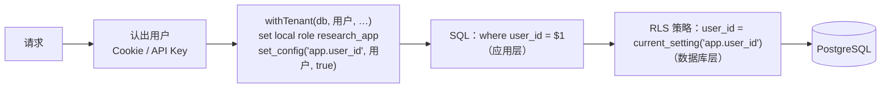

# 第 46 天：多用户与数据隔离

> 最后核对：2026-11-07

到第 45 天为止，研究助手的「用户」只是一个 API Key 对应的名字：记忆存在 `workspace/users/<名字>` 目录里，文档索引所有人共用一份，后台任务靠一个 `userId` 字段区分，查询时由代码检查。只要哪里漏了一个检查，A 就能看到 B 的数据。

对 Agent 来说，这个风险比普通的 Web 应用更大：**检索到的内容会进上下文，模型会把它原样说出来**。B 的一份内部文档如果出现在 A 的检索结果里，A 不需要任何攻击技巧，正常提问就能拿到。

今天给研究助手加上登录和多租户的数据模型：每个用户的记忆、文档、向量索引、会话、用量都放进 PostgreSQL，并且用**行级安全**（RLS）让数据库自己保证用户之间看不到彼此的数据。最后写一组跨用户越权的测试。

```text
alice > 内部集群的管理端口是多少？
✓ search_docs {"query":"内部集群 管理端口"}
管理端口是 9443 [1]。

bob > 内部集群的管理端口是多少？
✓ search_docs {"query":"内部集群 管理端口"}
本地文档里没有查到相关的内容。
```

学完今天，你会：

- 实现密码登录、签名的会话令牌和 API Key，知道每一样该怎么存、怎么比较
- 用「应用层过滤 + 数据库 RLS」两道防线隔离多租户数据，并让它默认拒绝
- 把记忆、RAG 索引、会话换成按用户隔离的实现，而不改研究助手的代码
- 给每个用户加上限流和每日配额
- 写跨用户越权的测试，并用一个检查防止「新表忘了开 RLS」

## 登录和鉴权

| | 怎么存 | 怎么比较 | 放在哪 |
|---|---|---|---|
| 密码 | scrypt 加盐哈希，参数写进哈希串 | 重新算一遍，固定时间比较 | 只在注册和登录时出现 |
| 会话令牌 | 不存：载荷 + HMAC 签名 | 重新算签名，固定时间比较，检查过期 | HttpOnly、Secure、SameSite=Lax 的 Cookie |
| API Key | sha256（第 40 天） | 按哈希查 | 程序调用时的 `Authorization: Bearer` |

[auth.ts](exercise/auth.ts) 里几个容易忽略的细节：

- **密码要慢哈希**。sha256 每秒能算几十亿次，泄露的哈希很快就能被暴力破解；scrypt 故意又慢又吃内存。参数（N、r、p）写进哈希串，以后调大参数，旧的哈希也能验证
- **登录时邮箱不存在也算一次哈希**。不然「邮箱不存在」立刻返回、「密码错误」要等一百毫秒，响应时间就透露了这个邮箱注册过没有
- **令牌不加密，只签名**。别人能看到载荷里的用户编号和过期时间，但改不了。所以载荷里不要放敏感信息
- **Cookie 的三个标记**：`HttpOnly` 让页面脚本读不到（第 44 天说过模型的输出可能带着脚本，就算有 XSS 也偷不走令牌）；`Secure` 只走 HTTPS；`SameSite=Lax` 挡住大部分跨站请求伪造

生产上也可以直接用现成的认证服务（OAuth、OIDC，比如企业的单点登录），但下面的数据隔离一样要做：认证只回答「你是谁」，隔离回答「你能看什么」。

## 两道防线



**第一道：应用层。**[tenant-store.ts](exercise/tenant-store.ts) 的每一条 SQL 都写明 `where user_id = $1`。这是大多数系统的做法，问题是它靠每个人每次都记得写。

**第二道：数据库层。**[db.ts](exercise/db.ts) 给每张带 `user_id` 的表开启 RLS：

```sql
alter table memories enable row level security;
alter table memories force row level security;   -- 表的所有者也要遵守
create policy tenant_isolation on memories
  using (user_id = current_setting('app.user_id', true))       -- 能看到哪些行
  with check (user_id = current_setting('app.user_id', true)); -- 能写入哪些行
```

应用用一个没有特权的角色（`research_app`）访问数据。每次访问之前，`withTenant` 开一个事务，切换到这个角色，设置当前用户：

- **漏写了 where**：数据库只返回当前用户的行
- **插入别人的 user_id**：`with check` 不通过，直接报错
- **修改别人的行**：`using` 让它看不到那一行，更新 0 行
- **忘了调用 withTenant**：`app.user_id` 是空的，一行都看不到。**默认拒绝**，而不是默认全部

两个要注意的地方：

- 用 `set local` 和 `set_config(..., true)`，只在事务里有效。连接池会把同一个连接交给下一个请求，会话级的 `set` 会让下一个请求带着上一个用户的身份
- 超级用户和有 `BYPASSRLS` 的角色不受 RLS 约束。迁移用管理员角色执行，应用平时绝不用它

### 唯一的例外

用 API Key 登录时，还不知道是谁，以应用角色查 `api_keys` 一行都查不到。办法是一个 `security definer` 的函数 `lookup_api_key`：它以函数所有者的身份执行，只能做「按哈希换回用户编号」这一件事，`search_path` 固定住防止被劫持。**让例外小到只能做一件事**，比给应用一个能绕过 RLS 的连接安全得多。

### 别的隔离方式

| 方式 | 隔离强度 | 成本 | 适合 |
|---|---|---|---|
| 共享表 + `user_id` + RLS（今天） | 中：一个数据库，靠策略 | 低 | 大多数 SaaS |
| 每个租户一个 schema | 较高 | 中：迁移要跑 N 遍 | 企业客户不多、要求较高 |
| 每个租户一个数据库 | 高 | 高 | 合规要求严格的大客户 |

研究助手是「个人用户」的场景，今天的租户就是用户。做企业版时，租户是公司，用户属于公司，策略换成 `org_id` 就行，结构一样。

## RAG 的隔离

向量检索是最容易出事的地方，因为它天然是「在一大堆数据里找最像的」：

- 第 17 天的向量库是所有文档一个索引。多用户以后，**每个用户只能在自己的块里找**，不能先在所有人的块里找 top-k、再过滤（过滤完可能一条不剩，更糟的是过滤写错了）
- 今天的 `createTenantRetriever` 实现了第 18 天的 `Retriever` 接口，每次只读这个用户的块（带着 RLS），再在应用里算相似度。数据量小时够用
- 线上用 pgvector：列类型换成 `vector(维数)`，`order by embedding <=> $1 limit k`，加上 `where user_id = $1`。RLS 照样生效。要注意过滤和近似索引（HNSW）一起用时的召回问题：用户多、每人的数据少时，可以按 `user_id` 分区，或者用 pgvector 的迭代扫描

记忆也一样：`createTenantMemoryStore` 实现了第 19 天的 `MemoryStore` 接口。研究助手的代码一行都不用改，只是 `makeSetup` 按用户创建这两个对象：

```ts
makeSetup: async (user) => ({
  workspace: await mkdtemp(...),
  docs: { root, retriever: createTenantRetriever(db, user.id, embedder) },
  memory: createTenantMemoryStore(db, user.id),
})
```

别的地方也要检查：第 16 天把大结果写进工作目录的文件、第 45 天的检查点、第 43 天的审计日志、第 34 天的 trace，都可能带着用户的数据。工作目录按用户分开，日志和 trace 里记用户编号、不记内容。

## 配额与限流

一个用户（或者一个被盗的 Key）不能把整个服务的模型额度用光：

| | 管什么 | 存在哪 | 超了 |
|---|---|---|---|
| 限流（令牌桶） | 短时间的速率，比如每分钟 10 次 | 内存（多机用 Redis） | 429 和 `Retry-After` |
| 每日配额 | 一天的次数和花费 | 数据库的 `usage_daily`，按用户隔离 | 429，告诉用户明天再来 |
| 并发（第 40 天） | 同时跑几个 | 内存 / 队列 | 429 或排队 |

[quota.ts](exercise/quota.ts) 的令牌桶：桶里最多 `capacity` 个令牌，每秒补 `refillPerSecond` 个，每个请求拿一个。它允许短时间的突发（攒满了可以连着用），长期的平均速率又不会超。记账用一条 `insert … on conflict do update set requests = requests + 1`：几个请求同时来，数据库保证不会少算。

### 平台 Key 与用户自带 Key（选读）

默认用平台的模型 Key，费用由你承担，配额由你控制。也可以让用户填自己的 Key（BYOK）：

- Key 要**加密存储**（比如 AES-256-GCM，主密钥放在 KMS 或者密钥管理服务里，不进数据库、不进代码仓库），只在调用模型的那一刻解密
- 永远不要把用户的 Key 放进上下文、日志、trace（第 38 天）
- 用户的 Key 出错（额度用完、被吊销）时，错误要清楚地告诉用户，而不是降级到平台的 Key 偷偷替他付钱

## 越权测试

[tests/tenancy.test.ts](tests/tenancy.test.ts) 是今天最重要的产出。OWASP 的 API 安全风险排第一的就是「对象级授权失效」（BOLA）：换一个编号就能看到别人的东西。测试要从攻击者的角度写：

- bob 列出、搜索、删除 alice 的记忆
- bob 用 alice 的内部文档里的原话去检索
- 模拟一个漏写了 where 的查询、一次冒充别人的插入、一次修改别人的行
- 没有设置用户的查询
- bob 用 alice 的会话编号保存会话（不能覆盖，也不能「悄悄什么都没做」）
- 研究助手本身：同一个问题，alice 查得到，bob 查不到

还有一条「元测试」：`findUnprotectedTables` 检查数据库里所有带 `user_id` 的表都开了 RLS。以后有人加了一张新表忘了开，测试会失败。这比靠代码评审记得住可靠得多。

设了 `DATABASE_URL` 时，测试还会在真正的 PostgreSQL 上跑一遍；本地可以这样起一个：

```bash
docker run -d --name pg -e POSTGRES_PASSWORD=pw -p 127.0.0.1:5432:5432 postgres:17-alpine
```

```bash
DATABASE_URL=postgres://postgres:pw@127.0.0.1:5432/postgres npm run check 46 -- --solution
```

## 读懂练习代码

| 文件 | 内容 | 今天要做的 |
|---|---|---|
| [auth.ts](exercise/auth.ts) | 密码、会话令牌、Cookie、注册登录、API Key | TODO 1 |
| [db.ts](exercise/db.ts) | 数据库接口、PGlite 和 pg、表结构、RLS、`withTenant`、检查 | TODO 2 |
| [tenant-store.ts](exercise/tenant-store.ts) | 按用户的记忆、文档和检索、会话 | TODO 3、4 |
| [quota.ts](exercise/quota.ts) | 令牌桶、每日配额 | TODO 5 |
| 其余文件 | 和第 45 天的参考答案一样 | 不用改 |

测试用 [PGlite](https://pglite.dev/)：编译成 WebAssembly 的 PostgreSQL，在进程里运行，不用装数据库。它是真正的 PostgreSQL，RLS、角色、`on conflict` 都和线上一样。它默认不带 pgvector，所以向量存成 `real[]`。今天用到的 `@electric-sql/pglite` 和 `pg` 已经写进根目录的 `package.json`。

## 常见误解

| 误解 | 实际上 |
|---|---|
| 每个查询都写了 where user_id，就够了 | 靠人记得写；RLS 是漏写时的保险 |
| 开了 RLS 就万事大吉 | 用超级用户或者有 BYPASSRLS 的角色连接，RLS 不生效；表的所有者要 force |
| 没设置当前用户时，查询应该返回全部 | 应该一行都没有：默认拒绝 |
| 用 `set` 设置当前用户就行 | 连接池会复用连接，要用 `set local` 或 `set_config(..., true)` |
| 向量检索先取 top-k 再按用户过滤 | 过滤完可能一条不剩，过滤写错就串数据；要在用户的数据里检索 |
| 密码用 sha256 加盐就够了 | 太快了，要用 scrypt、argon2 这类慢哈希 |
| 令牌是加密的，可以放敏感信息 | 只是签名，内容谁都能看 |
| 别人的会话编号冲突时，什么都不做就安全了 | 调用方以为保存成功了；要明确报错 |

## 常见错误

| 报错 | 原因 |
|---|---|
| 测试说错误的密码应该是 false | 没有用存下的盐；或者比较时用了 `===` 比较 Buffer |
| 测试说改了载荷应该不通过 | 只解析了载荷，没有验证签名 |
| 测试说过期了应该不通过 | `exp` 是秒，`now()` 是毫秒，没换算 |
| `findUnprotectedTables` 报出了表 | 没有 `force row level security`，或者没建策略 |
| 测试说角色应该是 research_app | `withTenant` 里没有 `set local role` |
| 测试说事务结束以后不应该漏出去 | 用了 `set app.user_id = …` 或者 `set_config` 的第三个参数是 false |
| 测试说「漏写了 where」应该是空的 | RLS 没开，或者测试时用的是超级用户（没切换角色） |
| `remember` 的测试说第二次应该是 updated | `xmax = 0` 判断反了 |
| 检索的测试说 bob 的结果里有 internal.md | `loadChunks` 没带用户，或者用了全局的向量库 |
| 令牌桶的测试说 retryAfterMs 应该是 500 | 补令牌时没按过去的时间算，或者没向上取整 |

## 动手：多租户的研究助手

按顺序做，每做完一步就运行一次 `npm run check 46`：

1. **TODO 1**：`verifyPassword` 和 `verifySessionToken`。
2. **TODO 2**：RLS 策略和 `withTenant`。表结构和 RLS 的测试通过。
3. **TODO 3**：记忆的 `remember`。
4. **TODO 4**：`createTenantRetriever`。越权的测试都通过。
5. **TODO 5**：令牌桶。全部测试通过。
6. **用真的 PostgreSQL 跑一次**：照上面的命令起一个数据库，设上 `DATABASE_URL` 再跑一次。
7. **自己当一次攻击者**：在测试里加三条你能想到的越权方式（比如 bob 用 alice 的文档编号直接删、搜索时传一个很大的 k、`addDocument` 的路径里带 `../`），看它们是不是都被挡住了。

## 检查

```bash
npm run check 46
```

真实模型下，bob 问 alice 文档里的内容（需真实模型）：

```bash
npm run check 46 -- --e2e
```

## 小实验

- 把 `withTenant` 里的 `set local role` 去掉，跑一遍越权测试，看哪几条会失败（PGlite 里默认是超级用户，RLS 不生效）
- 在 `migrate` 里故意不给 `chunks` 开 RLS，看 `findUnprotectedTables` 和检索的测试各自的报错
- 用 `explain analyze` 看带 RLS 的查询计划，策略是怎么被加进 where 里的；给 `chunks(user_id)` 加索引前后比较
- 用 pgvector 的镜像（`pgvector/pgvector:pg17`）起一个数据库，把 `embedding` 换成 `vector(256)`，检索改成在 SQL 里排序
- 实现 BYOK：用 `node:crypto` 的 AES-256-GCM 加密用户的 Key 存进一张新表（记得开 RLS），主密钥从环境变量读

## 小结

- 认证回答「你是谁」：密码用慢哈希，令牌只签名不加密、放 HttpOnly Cookie，API Key 只存哈希
- 隔离回答「你能看什么」：应用层 where 加数据库层 RLS，用无特权的角色、事务级的设置，没设用户就一行都看不到
- RAG 是最容易串数据的地方：只在当前用户的数据里检索；记忆、检索换成按用户的实现，研究助手的代码不用改
- 限流管速率，配额管总量；记账用一条原子的 SQL
- 越权测试从攻击者的角度写，再加一条检查保证每张租户表都开了 RLS

## 想一想

- 用户上传一份 PDF，解析、切块、算向量要好几十秒。上传接口该等它做完吗？文件本身存在哪里，怎么保证 A 下载不到 B 的文件？（第 47 天）
- 用户发来一张报错的截图，问「这是什么问题」。研究助手要怎么「看」它？（第 47 天）
- 数据库、Redis、对象存储、模型服务、worker……这些怎么部署到一台服务器上，密钥怎么管？（第 48 天）

## 延伸阅读

- [PostgreSQL：Row Security Policies](https://www.postgresql.org/docs/current/ddl-rowsecurity.html)：RLS 的语义、`force`、`BYPASSRLS`
- [PostgreSQL：CREATE FUNCTION 的 SECURITY DEFINER](https://www.postgresql.org/docs/current/sql-createfunction.html#SQL-CREATEFUNCTION-SECURITY)：为什么要固定 `search_path`
- [OWASP：API1:2023 Broken Object Level Authorization](https://owasp.org/API-Security/editions/2023/en/0xa1-broken-object-level-authorization/)：对象级授权失效
- [OWASP：Password Storage Cheat Sheet](https://cheatsheetseries.owasp.org/cheatsheets/Password_Storage_Cheat_Sheet.html)：scrypt、argon2 的参数建议
- [pgvector](https://github.com/pgvector/pgvector)：向量列、索引和过滤
- [PGlite](https://pglite.dev/)：在进程里运行的 PostgreSQL
