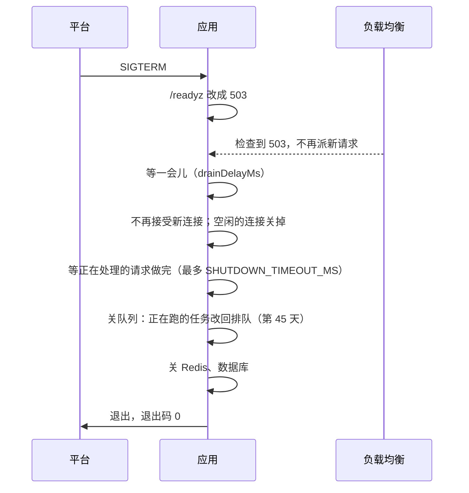
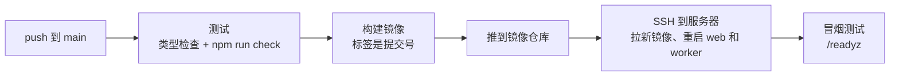

# 第 48 天：部署

> 最后核对：2026-11-07

研究助手现在有：Web 界面和接口（第 44 天）、后台 worker（第 45 天）、PostgreSQL（第 46 天）、Redis（第 45 天）、上传的文件（第 47 天），加上外面的模型服务。今天把它们部署到一台服务器上，并且让「发布新版本」变成一件推一下代码就自动完成、出了问题能回滚的事。

```text
$ docker compose -f days/day48/deploy/docker-compose.yml --env-file days/day48/deploy/.env.production up -d --build
 ✔ Container research-assistant-postgres-1  Healthy
 ✔ Container research-assistant-redis-1     Healthy
 ✔ Container research-assistant-web-1       Started
 ✔ Container research-assistant-worker-1    Started
 ✔ Container research-assistant-nginx-1     Started

$ curl -s localhost/readyz
{"status":"ready"}
```

学完今天，你会：

- 判断 Agent 应用该用 Serverless 还是常驻进程
- 写一个适合生产的 Dockerfile 和 docker compose 配置
- 启动时校验全部配置，管理好密钥，写结构化的日志
- 实现健康检查和优雅退出，让发布新版本时不丢请求、不丢任务
- 搭一条「测试 → 构建镜像 → 部署 → 冒烟测试」的自动发布流程，了解国内部署要注意什么

## Serverless 还是常驻进程

| | Serverless（函数计算、Vercel Functions…） | 常驻进程（云服务器、容器平台） |
|---|---|---|
| 一次请求最长多久 | 有上限，从几十秒到十几分钟不等 | 不限 |
| 流式连接、SSE | 支持程度不一，有时长上限 | 随便开 |
| 后台任务 | 要另外接队列和触发器 | worker 进程一直在 |
| 进程内的状态（连接池、缓存、内存队列） | 每次可能是新实例，状态不可靠 | 一直在 |
| 冷启动 | 有 | 无 |
| 没人用时 | 几乎不花钱 | 照样付服务器的钱 |
| 运维 | 平台管 | 自己管（或者用容器平台） |

研究助手一次深度研究要几分钟、要推 SSE、要后台 worker、要检查点和事件日志，**常驻进程更合适**。一个常见的组合是：网页的静态部分放在 CDN 或者 Serverless 上，接口、worker 放在常驻的容器里。

这门课用 Docker：开发、测试、生产跑的是同一个镜像，换一个云厂商也只是换一个跑容器的地方。

## 镜像

[deploy/Dockerfile](deploy/Dockerfile)：

```dockerfile
FROM node:24-slim AS deps
COPY package.json package-lock.json ./
RUN npm ci --omit=dev --ignore-scripts

FROM node:24-slim AS runtime
COPY --from=deps /app/node_modules ./node_modules
COPY ${APP_DIR} ./app
USER node
HEALTHCHECK … /healthz
CMD ["node", "app/server-main.ts"]
```

| 做法 | 为什么 |
|---|---|
| 两个阶段，先只拷 `package*.json` 装依赖 | 代码改了、依赖没变时，装依赖这一层走缓存，构建快很多 |
| `npm ci --omit=dev` | 不装 typescript、vitest；`ci` 严格按 lock 文件装，每次构建一样 |
| `--ignore-scripts` | 不执行依赖包的安装脚本（供应链攻击常用的入口，第 38 天） |
| 不需要编译 | Node 22.18 起直接运行 `.ts`，镜像里就是源代码 |
| `USER node` | 不用 root 运行：就算被攻破，权限也小得多 |
| `HEALTHCHECK` | 平台据此判断容器活着没有 |
| `CMD ["node", …]`（exec 形式） | 不经过 `sh -c` 或者 `npm start`，SIGTERM 才会直接送到 Node 进程，优雅退出才生效 |
| `.dockerignore` | `.env`、`node_modules`、工作目录不进构建上下文，密钥不会被打进镜像 |

镜像大约 1GB：生产依赖里有 Playwright（第 27 天）、Claude Agent SDK 带的运行时（第 43 天）这些大家伙。真正上线时，按需要裁剪依赖，或者把用浏览器、用 Claude Agent SDK 的部分拆成单独的服务和镜像。

## 配置和密钥

[config.ts](exercise/config.ts) 在启动时一次读完、校验完所有配置：

```text
配置有问题：
- OPENAI_MODEL：OPENAI_MODEL 不能是空的
- SESSION_SECRET：SESSION_SECRET 至少 32 个字符，用 openssl rand -base64 48 生成
- DATABASE_URL：生产环境必须配置数据库
```

- **一次列出所有问题**：而不是改一个、启动、再报下一个
- **启动时就失败**（fail fast）：而不是跑到第一个用户上传文件时才发现没配对象存储
- **生产环境的额外要求**：内存版的队列和 PGlite 重启就没了，生产上必须有数据库和 Redis
- **打印配置时打码**：`describeConfig` 把密钥换成「前 4 位…（N 位）」、网址里的密码换成 `***`，启动日志里能看到配置对不对，又不会泄露密钥

密钥放在哪里？

| 位置 | 适合 |
|---|---|
| `.env` 文件 | 本地开发；**不提交**（`.gitignore` 里有 `.env` 和 `.env.*`） |
| 服务器上的 `.env.production`，权限 600 | 单机部署 |
| CI 的 Secrets | 构建和部署流程用到的（镜像仓库的密码、SSH 私钥） |
| 云厂商的密钥管理服务、Kubernetes Secret | 多机、需要轮换和审计 |

不管放哪，都不要：写进代码、打进镜像、出现在日志和 trace 里（第 34、38 天）、放进模型的上下文。

## 日志

容器里的程序只往标准输出写，一行一条 JSON（[logger.ts](exercise/logger.ts)），收集和检索交给平台：

```json
{"time":"2026-11-07T11:18:09.471Z","level":"info","msg":"request","role":"web","method":"GET","path":"/v1/jobs/7c1e…","status":200,"ms":3}
```

一行一条 JSON，才能按字段过滤（「status 是 500 的」「role 是 worker 的」）。`redactFields` 在写之前清理字段：名字像密钥的整个隐藏，字符串里的手机号、身份证号打码（第 39 天），`Error` 只留名字和信息（不留可能带着请求体的整个对象）。

## 健康检查

| | `/healthz`（活着吗） | `/readyz`（能接活吗） |
|---|---|---|
| 检查什么 | 进程能响应 | 数据库、Redis 都通，而且没在退出 |
| 失败了平台做什么 | 重启容器 | 暂时不派请求过来 |
| 检查依赖吗 | **不检查** | 检查，每项带超时 |

为什么 `/healthz` 不检查数据库？数据库挂了，重启应用解决不了问题，反而会让所有实例同时重启、一起冷启动。依赖的问题交给 `/readyz`：它告诉负载均衡「先别派活给我」。

`/readyz` 的每项检查都有超时（默认 2 秒）：检查本身卡住了，也要按时回答「没就绪」。失败时只返回检查项的名字，不返回错误详情（里面有内网地址）。

## 优雅退出

部署新版本、缩容、机器维护时，平台先给容器发 SIGTERM，等一段时间（Docker 默认 10 秒）再发 SIGKILL。[server-main.ts](exercise/server-main.ts) 收到 SIGTERM 以后：



几个细节：

- **先让 `/readyz` 失败、等一会儿，再停止接受连接**：负载均衡发现实例不健康要几秒，这几秒里还会有请求过来
- **keep-alive 的连接要主动关**：请求做完以后连接变成空闲的，不关它，`server.close()` 就一直等着
- **有超时**：一个永远不结束的请求不能让退出卡住，到点就强制关闭
- **依赖按顺序关，一个出错不影响下一个**：先关队列（它还要往 Redis 和数据库写状态），最后关数据库
- **SSE 连接**：被关闭的客户端会带着 `Last-Event-ID` 重连到新的实例，从断开的地方接着看（第 45 天）。这就是为什么事件要存起来，而不是只在内存里推
- **compose 的 `stop_grace_period` 要比应用的超时长**：不然应用还在收尾，就被 SIGKILL 了

本机试一试：`docker compose up -d` 以后提交一个深度研究，在 worker 调研的时候 `docker compose restart worker`，看任务是不是被新的 worker 接着做完了。

## 单机部署

[deploy/docker-compose.yml](deploy/docker-compose.yml) 在一台云服务器上跑五个容器：

| 服务 | 作用 |
|---|---|
| `web` | 接口和网页（`ROLE=web`：只放任务、不执行） |
| `worker` | 后台研究任务（`ROLE=worker`），`--scale worker=3` 就有三个 |
| `postgres`、`redis` | 带健康检查和数据卷；`redis` 开了 AOF，重启以后队列里的任务还在 |
| `nginx` | 最前面：HTTPS、上传大小限制、SSE 不缓冲（[deploy/nginx.conf](deploy/nginx.conf)） |

`depends_on` 带 `condition: service_healthy`：数据库真的能连了，应用才启动。

```bash
cp days/day48/deploy/.env.production.example days/day48/deploy/.env.production
```

```bash
docker compose -f days/day48/deploy/docker-compose.yml --env-file days/day48/deploy/.env.production up -d --build
```

数据都在命名卷里（`pg-data`、`redis-data`、`app-data`），删掉容器不会丢。**备份**：定期 `pg_dump`，传到另一个地方（对象存储），并且真的试过恢复。

## 自动发布

[deploy/deploy.yml](deploy/deploy.yml) 是一个 GitHub Actions 的模板：



- **镜像标签用提交号，不用 `latest`**：出了问题，知道线上跑的是哪个版本；回滚就是把上一个提交号部署一次
- **测试不过不构建，构建不过不部署**
- **冒烟测试**：部署完立刻检查 `/readyz`，失败了这次发布就是红的，你会收到通知。第 40 天的 `eval/service.ts` 也可以放在这一步：对着刚部署的服务跑几条核心的评估用例
- `environment: production` 可以在 GitHub 上设置「要人点批准才能部署」

## 国内部署要考虑的

| 问题 | 怎么办 |
|---|---|
| 域名要备案 | 用国内的云服务器对外提供网站服务，域名要先做 ICP 备案，没备案的域名解析过来会被拦截。备案要几天到几周，提前做 |
| 拉不到 Docker Hub 的镜像 | 用云厂商的镜像加速，或者把基础镜像推到自己的镜像仓库（阿里云 ACR、腾讯云 TCR 等），Dockerfile 的 `FROM` 指向它 |
| `npm ci` 很慢 | 构建时用国内的 npm 镜像（比如 `npm config set registry https://registry.npmmirror.com`），或者在 CI 里缓存 |
| 海外的模型服务连不上、或者不合规 | 用国内的模型服务（第 8 天的兼容接口）；第 35 天的降级链里也只放能稳定访问的 |
| 面向公众提供生成式 AI 服务 | 第 39 天说的备案和登记、生成内容标识 |
| 数据出境 | 用户的数据（包括发给模型的内容）要留在境内，跨境要满足相关的规定 |
| GitHub Actions 访问国内服务器慢 | 用国内的 CI（云效、CODING 等），或者在服务器上跑一个自托管的 runner |

## 读懂练习代码

| 文件 | 内容 | 今天要做的 |
|---|---|---|
| [config.ts](exercise/config.ts) | 配置的校验和打码 | TODO 1 |
| [logger.ts](exercise/logger.ts) | 结构化日志、字段清理 | TODO 2 |
| [server-main.ts](exercise/server-main.ts) | 健康检查、路由、优雅退出、线上的组装 | TODO 3、4 |
| [jobs-bullmq.ts](exercise/jobs-bullmq.ts) | 加了 `worker: false`：web 角色只放任务、不执行 | 读懂即可 |
| [deploy/](deploy/) | Dockerfile、compose、nginx、生产配置的模板、自动发布的模板 | 读懂，按自己的情况改 |
| 其余文件 | 和第 47 天的参考答案一样 | 不用改 |

测试会检查 `deploy/` 里的几个关键点（多阶段、不用 root、健康检查、宽限期、SSE 不缓冲），防止以后改坏了。

## 常见误解

| 误解 | 实际上 |
|---|---|
| Agent 应用都适合放 Serverless | 长任务、SSE、后台 worker 都和它的时长上限、无状态冲突 |
| 健康检查里检查一下数据库更保险 | 依赖挂了重启也没用，所有实例会一起重启；依赖交给 readyz |
| `CMD npm start` 和 `CMD ["node", …]` 一样 | 前者 SIGTERM 送不到 Node，优雅退出不生效 |
| 收到 SIGTERM 马上 `process.exit()` | 正在处理的请求、正在跑的任务都丢了 |
| 镜像标签用 latest 方便 | 不知道线上是哪个版本，也没法回滚 |
| 配置错了运行时再报 | 启动时一次查完，越早越好 |
| `.env` 不提交就安全了 | 还要确认它没进镜像（.dockerignore）、没进日志 |

## 常见错误

| 报错 | 原因 |
|---|---|
| 配置的测试说要列出所有问题 | 遇到第一个问题就返回了；或者用了 `parse` 抛错 |
| 测试说空字符串当作没填 | 没有用 `preprocess` 把 `''` 变成 `undefined` |
| describeConfig 的测试说网址里的密码要隐藏 | 正则没处理 `//用户:密码@` |
| 日志的测试说 Cookie 要隐藏 | 字段名比较区分了大小写 |
| 测试说卡住的检查也要按时回答 | 检查没有加超时 |
| 测试说 `/v1/jobsx` 应该走 `/` | 前缀只用了 `startsWith(prefix)`，没按路径段匹配 |
| 退出的测试说请求还没做完，依赖不能先关 | 没等 `server.close()` 的回调就关了依赖 |
| 退出的测试说应该是 clean，实际是 forced | 请求做完以后，keep-alive 的连接没有关掉 |
| 测试说多次调用只执行一次 | 每次调用都新建了一个 Promise |

## 动手：部署研究助手

按顺序做，每做完一步就运行一次 `npm run check 48`：

1. **TODO 1**：`loadConfig` 和 `describeConfig`。
2. **TODO 2**：`redactFields`。
3. **TODO 3**：健康检查和路由。
4. **TODO 4**：优雅退出。全部测试通过。
5. **本机跑起来**：照上面的命令用 docker compose 启动，打开 http://localhost，问一个问题；`docker compose logs -f web` 看日志；`docker compose restart worker` 看任务怎么恢复。
6. **部署到服务器**（需要一台云服务器）：把 `deploy.yml` 复制到 `.github/workflows/`，配好变量和密钥，推一次代码，看它自动发布；再故意推一个让测试失败的提交，确认它不会被部署。

## 检查

```bash
npm run check 48
```

本机构建镜像：

```bash
docker build -f days/day48/deploy/Dockerfile -t research-assistant .
```

## 小实验

- 把 `CMD` 改成 `CMD npm start`（在 package.json 里加一个 start 脚本），`docker stop` 看看要等多久、日志里有没有 `shutting down`
- 把 `stop_grace_period` 改成 5 秒，提交一个慢的研究，`docker compose restart web`，看 SSE 客户端有什么表现
- 用 `docker image history` 看镜像每一层多大，试着把 Playwright 从这个镜像里拿掉
- 给 nginx 配上 HTTPS（自签证书或者 certbot），确认第 46 天的 `Secure` Cookie 能正常工作
- 写一个 `pg_dump` 的定时备份，再从备份恢复到一个新的数据库，跑一遍第 46 天的测试

## 小结

- 长任务、SSE、后台 worker 的 Agent 应用适合常驻进程；用 Docker 让开发、测试、生产跑同一个镜像
- 镜像：多阶段、只装生产依赖、不用 root、有健康检查、exec 形式启动；密钥不进镜像
- 配置启动时一次校验完，打印时打码；日志一行一条 JSON，字段先清理
- healthz 只管活着没有，readyz 管能不能接活；优雅退出：先摘流量、再排空、最后按顺序关依赖，有超时
- 自动发布：测试 → 按提交号构建镜像 → 部署 → 冒烟测试；国内部署要提前做备案、准备镜像源和模型接入

## 想一想

- 上线以后改了一版 prompt，怎么知道它是变好了还是变坏了？能不能先只给 10% 的用户用？（第 49 天）
- 错误率、成本、延迟突然升高，你怎么第一时间知道？（第 49 天）
- 用户点了「踩」的回答，怎么让它们变成评估集里的用例，下次改 prompt 时自动检查？（第 49 天）

## 延伸阅读

- [The Twelve-Factor App](https://12factor.net/zh_cn/)：配置放环境变量、日志当作事件流、快速启动和优雅退出
- [Docker：Building best practices](https://docs.docker.com/build/building/best-practices/)：多阶段构建、缓存、非 root 用户
- [Docker：Compose 的 depends_on 和 healthcheck](https://docs.docker.com/compose/how-tos/startup-order/)：按依赖的健康状况启动
- [Node.js：http.Server 的 close 和 closeIdleConnections](https://nodejs.org/api/http.html#serverclosecallback)：关闭服务器和连接
- [Kubernetes：Liveness, Readiness and Startup Probes](https://kubernetes.io/docs/concepts/configuration/liveness-readiness-startup-probes/)：两种检查的区别
- [nginx：proxy_buffering](https://nginx.org/en/docs/http/ngx_http_proxy_module.html#proxy_buffering)：为什么 SSE 要关掉缓冲
