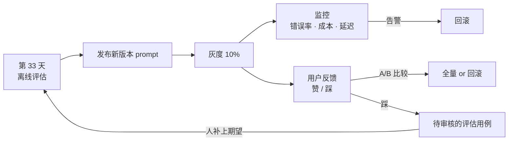

# 第 49 天：上线运营

> 最后核对：2026-11-07

第 48 天研究助手上线了。上线不是终点，而是另一种工作的开始：你改了一版 prompt，怎么知道它是变好了还是变坏了？凌晨三点模型服务开始大量报错，你怎么在用户发现之前知道？用户点了「踩」，这条信息去了哪里？

今天给研究助手加上运营的四件工具：**prompt 的版本管理**、**灰度发布和 A/B 测试**、**监控告警**、**用户反馈回流到评估集**。把它们串起来，就是一个 Agent 产品持续改进的闭环：



学完今天，你会：

- 给 prompt 做版本管理：内容寻址的版本号、标签、上线和回滚
- 用确定性的分桶做灰度和 A/B 测试，并用显著性检验判断结果
- 用滑动窗口算错误率、延迟和成本，写出不吵人的告警规则
- 把用户的差评变成评估用例，让评估集跟着真实的使用一起长大

## prompt 的版本管理

到第 48 天为止，研究助手的 system prompt 是代码里的一个常量（第 15 天的 `RESEARCH_PROMPT`）。改它要改代码、过 CI、重新部署；改坏了要再部署一次才能改回来；事后也说不清某个回答是哪一版 prompt 生成的。

[prompt-registry.ts](exercise/prompt-registry.ts) 把 prompt 当作**数据**来管理：

```ts
const v2 = await registry.publish('research', newPrompt, '结论先行');  // research@3f9a1c2e
await registry.setLabel('research', 'canary', v2.id);                  // 先给灰度的用户
await registry.setLabel('research', 'production', v2.id);              // 没问题，全量
await registry.rollback('research');                                    // 出问题了，退回上一版
```

| 设计 | 为什么 |
|---|---|
| 版本号是「名字@内容哈希的前 8 位」 | 内容一样就是同一版，重复发布不会多出一个版本；看到版本号就能找回内容 |
| 版本不可改 | 改了内容就是新的一版；已经发出的回答和它的版本永远对得上 |
| 标签指向版本（production、canary） | 上线、灰度、回滚都只是改一个指针，不用部署 |
| 每个标签记着历史 | 回滚就是退回上一个，不用记「上一版是什么来着」 |
| 每次回答记下版本号 | 反馈、评估、trace（第 34 天）都按版本号分组 |

今天的 `research()` 多了一个 `system` 参数，由注册表决定用哪一版。

**prompt 改了，评估先行**：发布一个新版本以前，先用第 33 天的流程在评估集上跑一遍，和当前的 production 比较。离线评估过了，才进入灰度。

模型、温度、工具的描述也可以这样管理，道理一样：凡是会影响回答、又想不部署就能改的东西，都应该有版本。

## 灰度和 A/B 测试

离线评估只能覆盖评估集里的问题。新版本要先给一小部分真实用户用，看真实的指标。

### 分桶

[rollout.ts](exercise/rollout.ts) 的 `bucket(用户, 实验名)`：用户编号加实验名算 sha256，取一个 0–99 的数。

- **确定性**：同一个用户在同一个实验里永远进同一个桶。今天用新版、明天用旧版，用户会困惑，统计也会乱
- **不同实验互相独立**：实验名参与哈希。如果所有实验都用「用户编号哈希 < 10」分组，那永远是同一批人在当小白鼠，几个实验的效果也会混在一起
- **不用随机数、不用存分组**：任何一台机器、任何时候算出来都一样

`canary('prompt-v2', 10, 稳定版, 新版)` 让 10% 的用户用新版。没问题就调到 50%、100%；有问题就调回 0。

### 比较

灰度一周以后，新版的好评率是 78%，旧版是 70%。新版更好吗？

样本少的时候，差几个百分点完全可能是运气。`compareRates` 做**两比例 z 检验**：

```text
合并比例 p = (成功A + 成功B) / (总数A + 总数B)
标准误 se = √(p(1−p)(1/nA + 1/nB))
z = (比例B − 比例A) / se，p 值 = 2 × (1 − Φ(|z|))
```

| A | B | 结论 |
|---|---|---|
| 9/10 | 2/10 | 样本不够（每组至少 100） |
| 700/1000 | 715/1000 | 没有显著差别（p ≈ 0.46） |
| 700/1000 | 780/1000 | B 更好（p < 0.001） |

几个容易犯的错：

- **偷看**：每天看一次结果，第一次看到「显著」就停下宣布胜利。这样看得越多，越容易把运气当成效果。事先定好样本量或者时长，到了再看
- **只看一个指标**：好评率高了，成本翻了一倍、延迟多了 30 秒，也不一定是好事。至少同时看质量、成本、延迟、错误率
- **好评率本身有偏差**：大部分用户不点赞也不点踩，点的人往往是特别满意或者特别不满的。它是一个有用的信号，不是全部

## 监控和告警

[metrics.ts](exercise/metrics.ts) 记下每次研究的结果（成功没有、多久、花了多少钱、哪个变体），在一个滑动窗口（默认 5 分钟）里算：

| 指标 | 说明 | 什么时候要告警 |
|---|---|---|
| 错误率 | 失败的比例（兜底、超时、异常） | 模型服务挂了、配额用完了、新版本有 bug |
| 延迟 p50、p95 | 一半的、95% 的研究在多久内完成 | 模型服务变慢、工具卡住、队列积压 |
| 每小时花费 | 窗口里的花费折算到每小时 | 有人在刷、Agent 进了死循环、换了个贵的模型没发现 |

为什么看 p95 而不是平均值？几个跑了十分钟的研究会把平均值拉得很高，但 p50 看不出来；p95 告诉你「最慢的那批用户」等了多久。

### 不吵人的告警

告警最大的问题不是漏报，而是**太吵**。半夜响了五次都是误报，第六次真出事时就没人看了。`evaluateAlerts` 的三个规矩：

- **样本太少不判断**：凌晨只有 2 个请求、错了 1 个，错误率 50% 不代表出事了（`minCount`，默认 20）
- **冷却**：告过一次以后，冷却期内（默认 15 分钟）不再重复发；过了冷却期还没好，再提醒一次
- **恢复了说一声**：发一条「已恢复」，值班的人知道可以去睡觉了

`sendWebhook` 把告警发到群机器人（企业微信、飞书、钉钉都是「POST 一段 JSON」）。发送失败只返回 false，**告警系统本身不能变成故障点**。

线上一般会把这些指标导出到 Prometheus、云监控或者 Langfuse（第 34 天），用它们的看板和告警。今天自己实现一遍，是为了弄清楚每个数字是怎么算出来的、阈值该怎么定。

## 反馈回流到评估集

第 31 天说过，评估集要从真实的任务里来。用户点了「踩」的回答，就是**最真实、而且已经知道答错了**的用例。

[feedback.ts](exercise/feedback.ts)：

```text
用户点踩 ──→ 存下反馈（问题、回答、来源、prompt 版本、变体、评论）
         └─→ 转成一条评估用例，追加到 data/eval/feedback-pending.jsonl（待审核）
                 │
                 └─ 人看过：补上 expected（应该有的事实、不该出现的内容、应该引用的来源）
                           挪进 research.jsonl ──→ 下次改 prompt，第 33 天的 CI 自动检查它
```

```json
{"id":"fb-3c1e9a0b7d","question":"潮汐协议 3.0 的默认端口是多少？","tags":["feedback","prompt:research@1a2b3c4d","variant:canary"],
 "expected":{"facts":[],"forbidden":[],"sources":[],…},
 "notes":"用户反馈：端口说错了，我的电话 138****5678\n当时的回答：默认端口是 8443 [1]。\n当时的来源：https://tide.example/forum.html\n待审核：补上 expected 以后挪进正式的评估集"}
```

几个设计：

- **为什么要人审核**：自动生成的用例没有期望（不知道正确答案是什么），评估什么都检查不出来。审核的人补上 `facts: ["7443"]`、`forbidden: ["8443"]`，这条用例才有用。第 31 天的 `validateDataset` 会提醒你哪些用例还没有期望
- **编号按问题哈希**：同一个问题被踩十次，只是同一条用例，不会把评估集刷满
- **带上 prompt 版本和变体**：审核的时候能看出是哪一版出的问题，A/B 测试也能按它统计
- **当时的来源也记下来**：上面这个例子里，回答引用了论坛（第 37 天的那个不可信来源），这本身就是线索
- **先脱敏**：评估集会进代码仓库、会被很多人看到。问题、回答、评论里的手机号、身份证号先打码（第 39 天）
- **反馈本身也是用户数据**：存进数据库时一样要按用户隔离（第 46 天）

好评也有用：被点赞的回答可以作为「不应该退步」的回归用例；也可以按变体统计好评率，交给 `compareRates`。

## 读懂练习代码

| 文件 | 内容 | 今天要做的 |
|---|---|---|
| [prompt-registry.ts](exercise/prompt-registry.ts) | prompt 的版本、标签、回滚 | TODO 1 |
| [rollout.ts](exercise/rollout.ts) | 分桶、选变体、灰度、比较两组 | TODO 2、6 |
| [metrics.ts](exercise/metrics.ts) | 滑动窗口的指标、告警、webhook | TODO 3、4 |
| [feedback.ts](exercise/feedback.ts) | 反馈、转成评估用例、追加到文件 | TODO 5 |
| [research.ts](exercise/research.ts) | 加了 `system` 参数 | 读懂即可 |
| [deploy/](deploy/) | 第 48 天的部署文件，路径换成了第 49 天 | 不用改 |
| 其余文件 | 和第 48 天的参考答案一样 | 不用改 |

## 常见误解

| 误解 | 实际上 |
|---|---|
| prompt 写在代码里，用 git 管版本就够了 | 改一次要部署一次，回滚也要部署；也对不上某个回答是哪一版生成的 |
| 灰度就是随机挑 10% 的请求 | 同一个用户会在两版之间跳来跳去；要按用户确定性地分桶 |
| 所有实验用同一套分桶 | 永远是同一批人当小白鼠，实验之间互相干扰 |
| 新版好评率高了 3 个点，就是更好 | 可能是运气；要看样本量和显著性 |
| 每天看一次 A/B 结果，显著了就停 | 偷看会让误判变多；事先定好样本量 |
| 告警阈值设得越敏感越安全 | 太吵的告警没人看；要有最少样本、冷却和恢复 |
| 差评自动加进评估集就行 | 没有期望的用例检查不出任何东西；要人审核补上期望 |

## 常见错误

| 报错 | 原因 |
|---|---|
| 测试说内容一样不重复记 | 版本号没有用内容哈希，或者没去掉首尾空白 |
| 测试说回滚只动这一个标签 | 所有标签共用了一个历史 |
| 测试说重新打开还在 | 改了以后没有 `save()` |
| 测试说两个实验的分组没有关联，但比例接近 1 | 哈希里没有带实验名 |
| 灰度比例的测试差得很远 | 桶的范围不是 0–99，或者累加权重时用了 `<=` |
| 指标的测试说 p95 应该是 1900 | 没有用 `percentile`，或者自己写的分位数算法不一样 |
| 测试说过期的不算 | 没有在 snapshot 之前 prune |
| 告警测试说冷却期内不应该再告 | 每次超过阈值都发 |
| 告警测试说恢复时要发一条 | 没记下「在告警中」的状态 |
| 反馈测试说电话要打码 | 评论没有 `maskPII` |
| appendCases 的测试说同样的编号跳过 | 只和文件里已有的比了，没和这一批里的比 |
| compareRates 的测试说 p 值应该小于 0.001 | 标准误用的不是合并比例，或者 z 没取绝对值 |

## 动手：给研究助手加上运营的工具

按顺序做，每做完一步就运行一次 `npm run check 49`：

1. **TODO 1**：prompt 的版本管理。
2. **TODO 2**：分桶和选变体。
3. **TODO 3**：滑动窗口的指标。
4. **TODO 4**：告警。
5. **TODO 5**：反馈转成评估用例。
6. **TODO 6**：比较两组。全部测试通过。
7. **走一遍闭环**（需真实模型）：用第 33 天的流程比较当前的 prompt 和你改的一版；在评估集上不比原来差，就发布成 canary；自己扮演几个用户提问、点踩；把待审核的用例补上期望，挪进 `research.jsonl`，再跑一次评估。

## 检查

```bash
npm run check 49
```

真实模型用新一版 prompt 回答（需真实模型）：

```bash
npm run check 49 -- --e2e
```

## 小实验

- 用 `compareRates` 算一算：好评率 70% 时，要检测出 3 个百分点的提升，每组大概要多少样本（不断加大 total 试试）
- 模拟「偷看」：两组其实一样好（都是 70%），每 50 个样本检验一次，看 20 次里有几次会误判成「显著」
- 把 `DEFAULT_RULES` 的阈值换成你自己的服务的数字：先跑一周，看错误率、p95 平时在什么范围，再定阈值
- 给第 48 天的 `server-main.ts` 加一个 `/metrics` 接口，按 Prometheus 的文本格式输出今天的指标
- 让研究助手的回答里带上 prompt 的版本号（放在响应头或者 data-answer 里），界面上的「赞 / 踩」按钮把它一起发回来

## 小结

- prompt 是数据：内容寻址的版本号，不可改；标签指向版本，上线、灰度、回滚只改指针；每个回答记下版本
- 灰度和 A/B 用确定性的分桶（用户加实验名的哈希）；比较时看样本量和显著性，不偷看，不只看一个指标
- 监控错误率、p95 延迟、每小时花费；告警要有最少样本、冷却和恢复，不能吵；发送失败不能变成故障
- 差评自动变成待审核的评估用例（脱敏、带版本），人补上期望后进正式的评估集
- 离线评估 → 灰度 → 监控和反馈 → 评估集，这个闭环让研究助手持续变好

## 想一想

- 第 41–49 天，研究助手有了框架、流式界面、后台任务、多用户、文件、部署和运营的工具。把它们组装成一个真正给人用的产品，还差什么？（第 50 天）
- 请三位真实用户试用，你最想观察他们的什么？他们的哪些反馈应该进评估集，哪些应该进产品的待办？（第 50 天）
- 如果让你从零开始做一个自己的 Agent 产品，这 49 天里哪些东西第一天就要有，哪些可以等到上线以后？（第 51 天）

## 延伸阅读

- [Langfuse：Prompt Management](https://langfuse.com/docs/prompt-management/overview)：prompt 的版本、标签和链接到 trace
- [Kohavi 等：Trustworthy Online Controlled Experiments](https://experimentguide.com/)：A/B 测试的经典著作，讲了偷看、样本量、指标选择
- [Evan Miller：How Not To Run an A/B Test](https://www.evanmiller.org/how-not-to-run-an-ab-test.html)：偷看为什么会让误判变多
- [Google SRE Book：Monitoring Distributed Systems](https://sre.google/sre-book/monitoring-distributed-systems/)：四个黄金信号和不吵人的告警
- [Hamel Husain：Your AI Product Needs Evals](https://hamel.dev/blog/posts/evals/)：从真实使用中持续构建评估集
