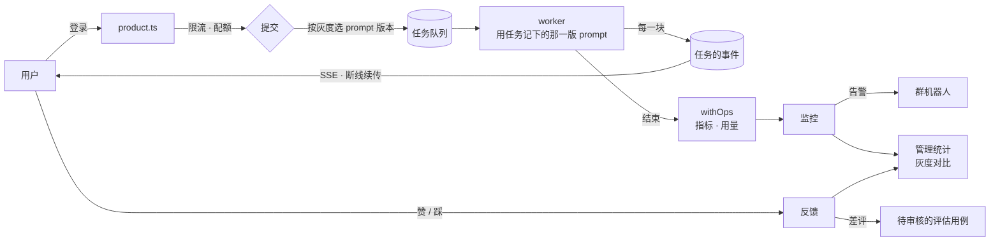

# 第 50 天：里程碑：研究助手上线

> 最后核对：2026-11-07

第 41–49 天，研究助手长出了一个产品需要的每一个部件：流式界面、后台任务、多用户、文件、部署、prompt 的版本、灰度、监控、反馈。但它们还各管各的：第 48 天的 `server-main.ts` 里，网页是第 44 天那个不用登录的版本；第 49 天的灰度和反馈只在测试里跑过。

今天把它们**接起来**，变成一个真的能交给别人用的产品，然后做这个阶段最重要的一件事：**请三位真实用户来用，看他们怎么用、在哪里卡住，把看到的东西记下来、分拣好**。



学完今天，你会：

- 把登录、配额、灰度、后台任务、反馈、监控装进同一条请求链路，并说清楚每一环为什么放在那里
- 让「这次回答用的哪一版 prompt」从提交一路跟到反馈和监控
- 部署上线，邀请试用，用结构化的试用记录把观察变成评估用例和产品待办

## 一次研究的旅程

| 环节 | 在哪里 | 来自 | 要点 |
|---|---|---|---|
| 认出用户 | `resolveUser` | 第 46 天 | 网页用 Cookie，程序用 API Key；带了错的 Key 不退回去看 Cookie |
| 限流 | `limiter.take` | 第 46 天 | 每人一个令牌桶，429 带 `Retry-After` |
| 每日配额 | `checkQuota` | 第 46 天 | 次数和花费，429 说清楚原因 |
| 选 prompt | `assignPrompt` | 第 49 天 | 按用户确定性分桶；版本号和变体**存进任务** |
| 排队 | `store.create` + `queue.enqueue` | 第 45 天 | 马上返回 202，不占着连接 |
| 执行 | `createResearchRunner` 的 `systemFor` | 第 45、49 天 | worker 按任务记下的版本取 prompt，而不是「当前的 production」 |
| 推送进度 | `/api/jobs/:id/events` | 第 44、45 天 | EventSource 断线自动重连，带 `Last-Event-ID` 续传 |
| 记账 | `withOps` | 第 49 天 | 任务**结束时**记指标和用量，重试几次都只记一次 |
| 反馈 | `/api/jobs/:id/feedback` | 第 49 天 | 回答、来源、版本、变体都从任务里取，不信前端传来的 |
| 告警 | `startAlertLoop` | 第 49 天 | 每分钟检查一次，发到群机器人 |
| 管理统计 | `/api/admin/stats` | 第 49 天 | 两个变体的指标和好评率，`compareRates` 给结论 |

## 几个组装时才会遇到的问题

### 版本要跟着任务走

最容易写错的地方：worker 执行时去查「现在 production 是哪一版」。任务排了 30 秒的队，这期间你把 production 回滚了，那这个任务用的就不是用户提交时分到的那一版。之后用户点了踩，反馈里记的版本和真正生成回答的版本对不上，A/B 的统计也就错了。

所以提交时就把 `promptVersion` 和 `variant` 存进任务记录（`jobs.ts` 加了这两个字段），worker 用 `systemFor(job)` 按版本号取内容，反馈也从任务里取版本号。**一个回答从生到死只认一个版本号**。

### 记账放在任务结束的地方

指标和用量在哪里记？有三个候选：

| 放在 | 问题 |
|---|---|
| 提交的时候 | 还不知道成没成功、花了多少钱 |
| worker 每次执行完 | 失败重试时会记两次；进程退出、任务改回排队时也会记 |
| **任务进入最终状态时** | 只记一次，用量是几次重试加起来的 |

`withOps` 包在 runner 外面，`try/finally` 里重新读一次任务：还没结束（`queued`）就什么都不记，等它真正结束。worker 把每次执行的 token 用量累加到任务的 `usage` 字段上（`ui-stream.ts` 加了 `onUsage`），所以最后算出来的成本包含了失败的那几次：**失败的尝试也花了钱**。

延迟从 `createdAt` 算起，包括排队的时间：用户关心的是「我等了多久」，不是「模型跑了多久」。用户自己取消的任务记用量（花了钱）但不进错误率：那不是服务的错。

### 用户不需要知道自己在实验组

`GET /api/jobs/:id` 去掉了 `promptVersion`、`variant`、`usage`。用户知道自己在「新版组」，会不自觉地更挑剔或者更宽容，好评率就不准了；用量和成本是内部的数字。管理统计的接口对非管理员返回 404 而不是 403，和第 40 天一样：不告诉别人这里有个后台。

### 指标在哪个进程

`withOps` 在执行任务的进程里记指标，指标存在那个进程的内存里。`ROLE=all` 单机部署时没问题；web 和 worker 分开部署以后，web 进程的 `/api/admin/stats` 看不到 worker 的指标。试用阶段一台机器足够，用户多了就把指标导出到 Prometheus 或者云监控（第 49 天的小实验）。prompt 的注册表也一样：它是一个文件，多台机器要换成数据库或者配置中心。**知道自己的方案在哪个规模会坏**，比一开始就上最复杂的方案重要。

## 上线

按第 48 天的流程部署，今天多了几个配置（[deploy/.env.production.example](deploy/.env.production.example)）：

| 配置 | 试用阶段建议 |
|---|---|
| `INVITE_CODES` | 配一个，只发给试用的人。不配的话谁都能注册，账单就不受你控制了 |
| `DAILY_MAX_REQUESTS`、`DAILY_MAX_COST` | 先给小一点（比如 30 次、1 元），试用者真用完了再调 |
| `OPENAI_PRICE` | 填上，不然成本和花费告警都是 0 |
| `ALERT_WEBHOOK_URL` | 建一个只有你自己的群，先让告警发到你手机上 |
| `ADMIN_EMAILS` | 你自己的邮箱。注册以后重启一次 |
| `CANARY_PERCENT` | 先是 0。试用期间别同时做 A/B：三个人的数据什么都说明不了 |

第一次启动时，`server-main.ts` 把代码里的 `RESEARCH_PROMPT` 发布成第一版并打上 production。以后改 prompt 走注册表，不改代码。

部署完以后自己先走一遍：注册 → 问一个快速问题 → 问一个深度研究 → 中途刷新页面（进度应该接着显示）→ 点踩写评论 → 看 `feedback-pending.jsonl` 里有没有这一条 → 用管理员账号看 `/api/admin/stats`。再用第 40 天的 `eval/service.ts` 对着线上跑一遍评估集，分数不低于本地。

## 邀请三位真实用户

为什么是三位？一位只能代表他自己；五位以上，前三位已经发现的问题会反复出现，新信息越来越少。试用的目标不是统计，而是**发现你自己想不到的问题**。

**找谁**：真的有研究需求的人：做竞品分析的产品经理、查资料写报告的同事、写论文的朋友。不要找只会说「挺好的」的人，也不要只找工程师。

**怎么试**：

1. 给邀请码，让他用**自己真的要查的问题**，不要给他题目
2. 能当面或者视频就当面：请他边用边说出自己在想什么（出声思维）
3. 你只看、只记，**不解释、不帮忙**。他卡住的地方，就是产品要改的地方
4. 最后问三个问题：最有用的是什么？最想改的是什么？下周还会用吗，用来做什么？

**记什么**：每看到一件事记一条（[pilot.ts](exercise/pilot.ts) 的格式，JSONL 一行一条）：

```json
{"user":"P1","date":"2026-11-08","task":"查竞品的定价","kind":"ux","topic":"看不出在干什么","observation":"深度研究跑了 3 分钟，中途关掉了页面","severity":3}
{"user":"P1","date":"2026-11-08","task":"查端口","kind":"wrong-answer","topic":"端口","observation":"回答说 8443，实际是 7443","quote":"这个我们文档里写着呢","question":"潮汐协议 3.0 的默认端口是多少？"}
```

| kind | 去哪里 |
|---|---|
| `wrong-answer` | 评估集（待审核）：和第 49 天的差评一样，人补上期望再挪进 `research.jsonl` |
| `bug` | 待办，修 |
| `ux` | 待办：看不懂、找不到、等太久 |
| `feature` | 待办，但先看是不是好几个人都提 |
| `praise` | 记下来：哪些是做对了的，改版时别改坏 |

`observation` 写**事实**（停在哪里、点了什么、等了多久），不写解读（「他觉得太慢」）。同一件事用同一个 `topic`，`triagePilot` 按它合并，按「几个人遇到 × 有多严重」排序。`renderPilotReport` 生成一页试用报告。

用户的原话、问题里可能有手机号、公司名，进报告和评估集之前打码。笔记里只写 P1、P2，不写真名。

## 读懂练习代码

| 文件 | 内容 | 今天要做的 |
|---|---|---|
| [product.ts](exercise/product.ts) | 认用户、选 prompt、提交、反馈、记账、管理统计、告警循环、路由 | TODO 1–6 |
| [pilot.ts](exercise/pilot.ts) | 试用记录的格式、分拣、报告 | TODO 7 |
| [jobs.ts](exercise/jobs.ts)、[worker.ts](exercise/worker.ts)、[ui-stream.ts](exercise/ui-stream.ts) | 任务记下版本、变体和用量；worker 按版本取 prompt、累加用量 | 读懂即可 |
| [feedback.ts](exercise/feedback.ts) | 加了存在文件里的 `createFileFeedbackStore` | 读懂即可 |
| [config.ts](exercise/config.ts)、[server-main.ts](exercise/server-main.ts) | 运营的配置；线上的组装换成了 product.ts | 读懂即可 |
| [public/](exercise/public/) | 登录、提交任务、EventSource 续传、赞和踩 | 读懂即可 |
| 其余文件 | 和第 49 天的参考答案一样 | 不用改 |

## 常见误解

| 误解 | 实际上 |
|---|---|
| worker 执行时用当前的 production 就行 | 排队期间可能换过版本；提交时定下的版本要跟着任务走 |
| 指标在 worker 每次执行完记 | 重试会重复记；在任务进入最终状态时记一次 |
| 失败的任务没有成本 | 失败前的每次模型调用都花了钱，要算进用户的用量 |
| 把实验分组告诉用户更透明 | 会影响用户的评价；分组是内部的 |
| 前端把回答和版本号一起传回来，反馈省得再查 | 前端传来的都能伪造；从任务记录里取 |
| 找 30 个人试用更有说服力 | 试用是为了发现问题，不是统计；三五个人就能发现大部分 |
| 试用时在旁边解释怎么用 | 你不能跟着每个用户；他卡住的地方就是要改的地方 |

## 常见错误

| 报错 | 原因 |
|---|---|
| 测试说「带了不对的 Key 就是认不出」 | Authorization 认不出时退回去看了 Cookie |
| 测试说「分桶要用 EXPERIMENT 这个实验名」 | `canary()` 的第一个参数写成了别的名字 |
| 测试说「用 canary 那一版 prompt」 | 创建任务时没带 `promptVersion`，worker 用了默认的 prompt |
| 限流测试的 `retry-after` 是 `10000` | 没有把毫秒换成秒 |
| 配额的测试期望 429，实际是 202 | `withOps` 没有调用 `recordUsage`，用量没记进去 |
| 测试说「还没结束的不记」 | 没有检查 `FINAL_STATUSES`，排队等重试的也记了 |
| 测试说「失败和取消都花了钱」 | runner 抛错以后没有记账：要用 `try/finally` |
| 测试说「来源从任务存下的 source-url 块里找」 | 来源取错了，或者用了请求体里的东西 |
| 反馈测试的 tags 少了 variant | 组装 `Feedback` 时没带 `variant` |
| triage 测试的待办顺序不对 | 分数没算人数（同一个人说两次只算一个人），或者 bug 没有加 1 |

## 动手：上线

按顺序做，每做完一步就运行一次 `npm run check 50`：

1. **TODO 1**：`resolveUser`。认出用户的测试通过。
2. **TODO 2**：`assignPrompt`。
3. **TODO 3**：提交研究。
4. **TODO 5**：`withOps`。记账和整个产品的大部分测试通过（TODO 4 先跳过，它要用到完成的任务）。
5. **TODO 4**：反馈。
6. **TODO 6**：管理统计。
7. **TODO 7**：试用记录的分拣。全部测试通过。
8. **本机跑起来**（需真实模型）：`ROLE=all PROMPTS_FILE=./workspace/prompts.json FEEDBACK_DIR=./workspace/feedback OBJECT_DIR=./workspace/objects node days/day50/exercise/server-main.ts`，打开 `http://localhost:8080`，按上面「上线」一节自己走一遍。
9. **部署上线**：用第 48 天的 `deploy/`（路径已经换成第 50 天），配好今天新加的配置。
10. **邀请三位用户试用**：记下试用笔记，生成试用报告，把 wrong-answer 的用例补上期望、挪进评估集，跑一遍评估。

## 检查

```bash
npm run check 50
```

通过产品的接口用真实模型跑一次研究（需真实模型）：

```bash
npm run check 50 -- --e2e
```

第 8–10 步没有自动测试，对照这几条自查：

- [ ] 线上的地址能打开，只有拿到邀请码的人能注册
- [ ] 刷新页面、断网再连上，进度接着显示
- [ ] 点踩以后，`feedback-pending.jsonl` 里多了一条脱敏的用例
- [ ] 故意把 `OPENAI_API_KEY` 改错重启，几分钟内群里收到错误率的告警；改回来以后收到「已恢复」
- [ ] 三位试用者各自完成了至少一个自己的任务，有一页试用报告
- [ ] 至少一条试用中发现的错误回答，补上期望进了评估集

## 小实验

- 让一位试用者用手机打开。界面哪里不好用？SSE 在手机切到后台再回来时会怎样？
- 把 `limiter` 调到每 20 秒一个，自己连续提问，看界面上的报错是不是能看懂
- 在 `withOps` 里多记一个指标：每个任务调用了几次工具。深度研究和快速回答差多少？
- 发布一版新的 prompt 打上 canary，`CANARY_PERCENT=50`，用两个账号分别提问，在 `/api/admin/stats` 里看两组的指标
- 把试用报告里排第一的待办修掉，请同一位试用者再用一次，看他还会不会卡在同一个地方

## 小结

- 组装不是把部件放在一起：版本跟着任务走、在任务结束时记一次账、内部字段不外露，这些规矩只有接起来才会遇到
- 失败的尝试也要算钱；延迟从用户提交算起；用户自己取消的不算服务的错
- 每个方案都有它会坏的规模：内存里的指标、文件里的注册表适合一台机器，知道什么时候该换
- 上线以后请三位真实用户试用：看他们自己的任务，只观察不解释，记事实不记解读
- 试用的发现分两路：答错的进评估集，用起来别扭的进待办；做对了的也记下来

第五阶段到这里结束。研究助手从第 1 天的 60 行，长成了一个有登录、后台任务、实时进度、灰度、监控和反馈闭环的 Web 应用。

## 想一想

- 试用者最常卡住的地方，是模型的问题、工具的问题，还是界面的问题？你的评估集能发现哪一类？
- 如果让你从零开始做一个自己的 Agent 产品，这 50 天里哪些东西第一天就要有，哪些可以等到上线以后？（第 51 天）
- 研究助手的评估集是在第 31 天写的，那时它已经能用了。如果在写第一行代码之前先写评估集，会有什么不一样？（第 51 天）

## 延伸阅读

- [Nielsen Norman Group：Why You Only Need to Test with 5 Users](https://www.nngroup.com/articles/why-you-only-need-to-test-with-5-users/)：少量用户就能发现大部分可用性问题
- [Nielsen Norman Group：Thinking Aloud](https://www.nngroup.com/articles/thinking-aloud-the-1-usability-tool/)：出声思维的做法和注意事项
- [Rob Fitzpatrick：The Mom Test](https://www.momtestbook.com/)：怎么问用户才能听到真话，而不是客气话
- [MDN：EventSource](https://developer.mozilla.org/zh-CN/docs/Web/API/EventSource)：自动重连和 Last-Event-ID
- [Google SRE Workbook：Implementing SLOs](https://sre.google/workbook/implementing-slos/)：上线以后怎么定「够好」的标准
