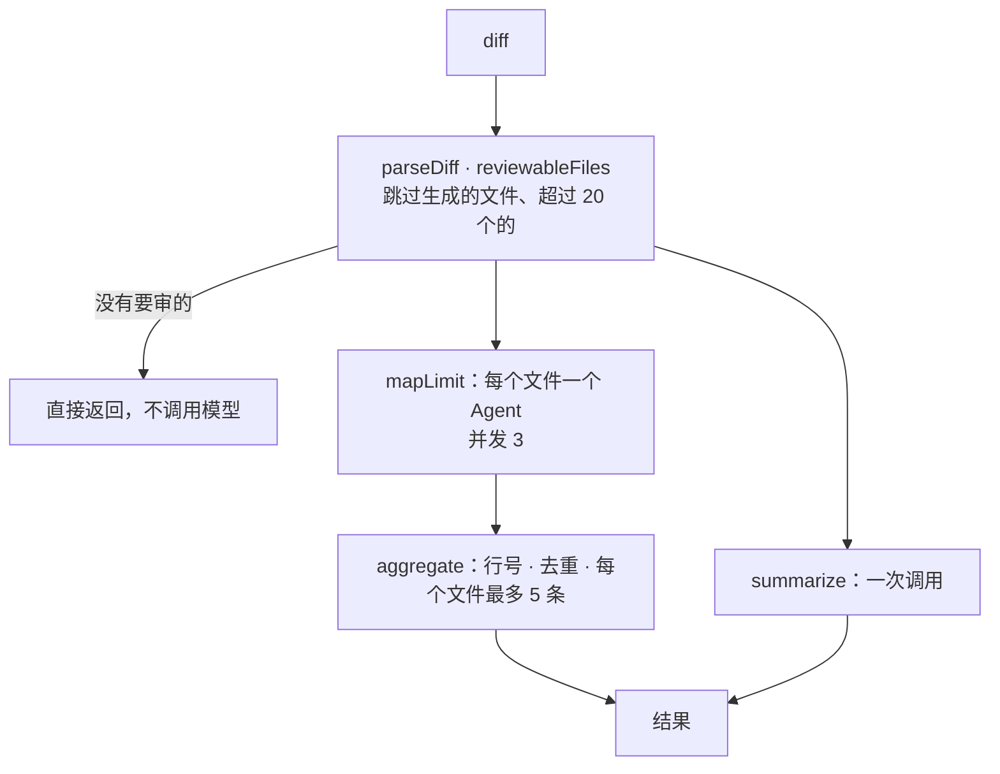

# 第 54 天：核心实现（下）：接入编排

> 最后核对：2026-11-07

第 53 天，工具都有了，每一个都测扎实了。今天把它们接起来：按第 52 天的设计，外面是固定的流程，中间嵌着 Agent；然后在第 51 天的评估集上跑一遍，看看第一版能过几条，没过的差在哪。

今天的目标不是分数高，而是**端到端跑通**：每条用例都能跑出结果，要么过，要么说得清为什么没过。分数是第 55 天的事。

学完今天，你会：

- 把设计文档里的流程变成代码：哪些步骤并行、哪些用代码检查、出错时怎么降级
- 用 mock 模型的 `match` 测试并行的 Agent
- 写一个逐条判断「过没过」的评估运行器，失败的用例说清楚差在哪
- 用真实模型跑第一遍评估，读懂失败的用例

## 流程

[review.ts](exercise/review.ts) 的 `review()`：



几个设计，都能在第 52 天的设计文档里找到理由：

**每个文件一个 Agent**。`reviewFile` 给每个文件建一份草稿和一套工具，第一条消息是这个文件带行号的 diff。Agent 只需要关心这一个文件，需要别的上下文时自己用 `read_file`、`search_code` 去取。上下文小，步数少，还能并行（第 25 天）。

**总结和审查同时做**。总结只需要 diff，不需要审查的结果，用 `Promise.all` 和 `mapLimit` 一起跑，整个 PR 的延迟就是最慢的那个文件，而不是两者相加。

**能不调用模型，就不调用**。只改了 lock 文件、空的 PR，直接返回。评估集里的 `lockfile-only` 和 `empty-diff` 就是为了测这个：花一分钱都算错。

**一个文件出错，不拖垮整个 PR**。`reviewFile` 把异常变成 `status: 'error'` 的结果；整个 PR 的状态是 `partial`，总评里写明哪些文件没审完（第 35 天的优雅降级）。对用户来说，「审了 4 个文件，第 5 个没审完」比「审查失败」有用得多。

## 汇总：能用代码检查的，不交给模型

每个 Agent 的草稿已经检查过行号，为什么 `aggregate` 还要再查一遍？

- **草稿是每个 Agent 一份的**。两个 Agent 可能都看到了同一个问题：审 `format.ts` 的 Agent 用 `read_diff` 看了 `search.ts`，也评论了那个注入。只有汇总时才看得到重复
- **以后评论可能有别的来源**：MCP 客户端、重试时上一次的结果。出口只有一个，检查就放在出口
- **限量**：每个文件最多 5 条，按严重程度留。一个话多的审查机器人几天就会被关掉（第 51 天的精确率）

三条规则都是确定的、可以用单元测试测扎实的。第 24 天说过：**能客观检查的，不要让模型自检**。

## 用 mock 测并行的 Agent

三个文件的 Agent 同时在跑，请求到达 mock 模型的顺序是不确定的。第 22 天起，mock 的回复可以带 `match`：只回复**第一条 user 消息**里包含这段文字的请求。

所以 `fileTask` 的第一行固定是「审查这个文件：路径」，`summaryTask` 固定是「总结这个 PR」：

```ts
llm
  .reply({ match: '审查这个文件：src/routes/search.ts', toolCalls: [{ name: 'add_comment', arguments: {…} }] })
  .reply({ match: '审查这个文件：src/routes/search.ts', content: '发现 1 个问题。' })
  .reply({ match: '总结这个 PR', content: '加了按标题搜索待办的接口。' });
```

同一个 Agent 的每一步，第一条 user 消息都一样，所以一个 Agent 的多步回复按顺序对上。**为了可测试，让 prompt 有一个稳定的开头**：这不只是测试的需要，稳定的前缀也更容易命中缓存。

## 评估：逐条判断过没过

[eval/run.ts](exercise/eval/run.ts) 在评估集上跑 review-bot：

| 任务 | 怎么跑 | 怎么判断 |
|---|---|---|
| review | 完整的 `review()` | 每个应该发现的问题都有评论对得上；没有多余的评论；该跳过的跳过了 |
| summary | 只调用 `summarize`，省钱 | 应该提到的都提到了 |
| 两种 | | 不该出现的（比如 `LGTM`）没有出现 |

「对得上」（`matchesIssue`）：同一个文件、行号差 2 行以内、评论里至少出现一个关键词。为什么不要求 `kind` 一样？把密码写进日志，说它是 security 还是 privacy 都对；评估要测的是「发现了没有、说对了没有」，不是分类。

`checkCase` 很严格：有一条多余的评论就算没过。这是故意的：今天要看清每一条失败。第 55 天会换成汇总的精确率、召回率，允许偶尔多说一句。

失败的用例，`problems` 要能直接告诉你下一步看哪里：

```text
❌ missing-auth              18234ms  漏了 src/routes/admin.ts:6 的问题（security）
❌ clean-rename               9120ms  多余的评论 src/utils/format.ts:3：建议给 formatDate 加上时区参数，否则在
✅ sql-injection             15002ms
```

## 第一遍真实的评估

```bash
node days/day54/exercise/eval/cli.ts
```

第一遍一般会看到这几类失败，记下来，第 55 天逐个处理：

| 现象 | 常见的原因 |
|---|---|
| 漏了删掉的代码造成的问题（`missing-auth`） | 模型只看加的行；prompt 没有提醒「删掉的检查也是问题」 |
| 只改名的 PR 也提了建议（`clean-rename`） | prompt 说了「不评风格」，但模型觉得「顺手提一下」有帮助 |
| 评论落在别的行，草稿拒绝了好几次 | 模型数错了行号；或者 diff 太长被截断 |
| 总结只是复述了标题 | 标题信息少（`feat: health`），模型没去看代码 |

跑之前先估一下钱：14 条 review 用例，每条平均 2 个文件、每个文件 3–4 步，加上 5 条总结。按第 52 天的估算，一遍大概一两毛钱。`--ids`、`--tags` 可以只跑几条。

## 读懂练习代码

| 文件 | 内容 | 今天要做的 |
|---|---|---|
| [review.ts](exercise/review.ts) | 审一个文件、汇总、写总结、审一个 PR、总评 | TODO 1–3 |
| [prompts.ts](exercise/prompts.ts) | 审查和总结的 prompt、第一条消息的格式 | 读懂即可，第 55 天会改它 |
| [eval/run.ts](exercise/eval/run.ts) | 读评估集、判断过没过、跑一组用例 | TODO 4 |
| [eval/cli.ts](exercise/eval/cli.ts) | 用真实模型跑评估 | 读懂即可 |
| `core/`、`diff.ts`、`repo.ts`、`tools.ts`、`mcp-server.ts` | 和第 53 天的参考答案一样 | 不用改 |

## 常见误解

| 误解 | 实际上 |
|---|---|
| 一个 Agent 审整个 PR 最简单 | 上下文和步数随 PR 变大而失控；按文件拆开更快、更便宜、更好测 |
| 每个 Agent 的草稿检查过了，汇总不用再查 | 重复只有汇总时才看得到；出口只有一个，检查就放在出口 |
| 一个文件出错，整个 PR 就失败 | 返回部分结果，写明哪些没审完 |
| 只改 lock 文件也交给模型看看 | 规则能判断的，一分钱都不要花 |
| 测试并行的 Agent 只能靠运气 | 给 prompt 一个稳定的开头，mock 用 `match` 对上 |
| 第一遍评估分数低，说明方向错了 | 第一遍的目标是跑通、看清失败；分数是下一天的事 |

## 常见错误

| 报错 | 原因 |
|---|---|
| 测试说 system 里没有仓库的约定 | 没用 `reviewSystem(conventions)`，直接传了 `REVIEW_PROMPT` |
| 测试说只有草稿这一种写操作，但评论没加进去 | 没传 `policy: REVIEW_POLICY`：可写的工具没人确认，不会执行 |
| 「模型服务出错」的测试抛了异常 | `reviewFile` 没有 try/catch |
| 汇总的测试留下了 `search.ts:9` | 没检查行号在不在 `commentableLines` 里 |
| 汇总的测试留下了两条第 7 行 | 去重只比了一模一样的行号；要相差不超过 1、同一类 |
| 上限的测试留下了 1、2、3 | 没按严重程度排；或者排序把一样严重的顺序打乱了 |
| 「不调用模型」的测试收到了请求 | 没有要审的文件时也调用了 `summarize` |
| concurrency 的测试太快了 | `mapLimit` 的并发上限没用上 options 里的值 |
| `checkCase` 的问题顺序不对 | 先查漏的，再查多余的，再查跳过的，最后查 forbidden |

## 动手

1. **TODO 1**：`reviewFile`。
2. **TODO 2**：`aggregate`。
3. **TODO 3**：`review`。
4. **TODO 4**：`checkCase`。全部测试通过。
5. **第一遍真实的评估**（需真实模型）：`node days/day54/exercise/eval/cli.ts`。把每条失败的用例按上面那张表归类，记在一个文件里，第 55 天要用。
6. **你的项目**：按你的设计文档接上编排，写出你自己的 `checkCase` 和评估运行器，在你的评估集上跑通第一遍。核心用例（你在第 51 天觉得第一版就该过的那几条）要过。

## 检查

```bash
npm run check 54
```

用真实模型跑三条核心用例（需真实模型）：

```bash
npm run check 54 -- --e2e
```

毕业项目对照这几条自查：

- [ ] 设计文档里的流程都变成了代码，每一步交给谁和文档一致
- [ ] 出错时有降级：一部分失败，其余照常
- [ ] 评估运行器能在整个评估集上跑完，每条用例要么过、要么说清楚差在哪
- [ ] 核心用例通过
- [ ] 记下了第一遍评估的结果和失败的原因

## 小实验

- 把 `concurrency` 改成 1 和 5，用真实模型跑 `multi-file`，比较总时间
- 去掉 `aggregate` 的去重，跑 `multi-file`，看会不会有重复的评论
- 把 `fileTask` 里的行号去掉（直接给原始的 diff），看模型的评论有几次被草稿拒绝
- 给仓库加一个 `REVIEW.md`，写一条「金额一律用整数分」，跑 `injection-in-comment`，看模型会不会提到它

## 小结

- 外面是固定的流程，中间嵌着 Agent：每个文件一个 Agent 并行审，总结同时写，结果用代码汇总
- 能不调用模型就不调用；一个文件出错不拖垮整个 PR
- 检查放在出口：行号、去重、限量都是确定的规则，用代码做
- 给 prompt 一个稳定的开头，并行的 Agent 也能用 mock 测
- 评估先逐条判断过没过，让每条失败都说得清原因

## 想一想

- 第一遍评估里失败最多的是哪一类？要改 prompt、改工具，还是改流程？（第 55 天）
- 改了 prompt，怎么知道没有把原来能过的用例改坏？（第 55 天）
- 你在开发集上调了十轮，测试集的分数会跟着涨吗？（第 55 天）

## 延伸阅读

- [Anthropic：How we built our multi-agent research system](https://www.anthropic.com/engineering/multi-agent-research-system)：拆任务、并行的子 Agent、汇总
- [Anthropic：Building effective agents](https://www.anthropic.com/engineering/building-effective-agents)：Parallelization 和 Orchestrator-workers 两种模式
- [GitHub Docs：About pull request reviews](https://docs.github.com/en/pull-requests/collaborating-with-pull-requests/reviewing-changes-in-pull-requests/about-pull-request-reviews)：总评和行内评论
- [Hamel Husain：A Field Guide to Rapidly Improving AI Products](https://hamel.dev/blog/posts/field-guide/)：先看数据、逐条看失败
