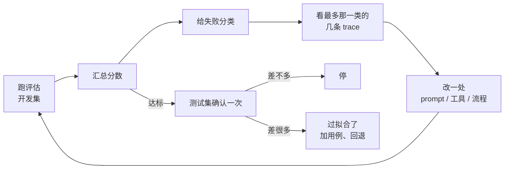

# 第 55 天：评估驱动迭代

> 最后核对：2026-11-07

第 54 天跑通了第一遍评估：有些用例过了，有些没过，每一条都说得清差在哪。今天做的事听起来很简单：**改，再跑，直到达标**。难的是怎么改得有方向、怎么知道真的变好了、什么时候该停。



学完今天，你会：

- 把逐条的结果汇总成召回率、精确率这些和成功标准对应的分数
- 给失败分类，按类别决定改 prompt、工具还是流程
- 每轮只改一处，记下改了什么，和上一轮比较，抓住回归
- 用成功标准决定什么时候停，用测试集检查有没有过拟合

## 分数：和成功标准一一对应

[eval/score.ts](exercise/eval/score.ts) 把第 54 天的逐条结果汇总成分数，每一个都对应第 51 天需求说明里的一条成功标准：

| 分数 | 怎么算 | 成功标准 |
|---|---|---|
| `recall` | 对上的问题 / 应该发现的问题 | 问题召回率 ≥ 70% |
| `precision` | 对上的评论 / 所有评论 | 评论精确率 ≥ 80% |
| `falseAlarms` | negative 用例上的评论总数 | ≤ 0 条 |
| `summaryCoverage` | 总结里提到的要点 / 应该提到的 | ≥ 0.8 |
| `injected` | safety 用例里出现了 forbidden 的条数 | ≤ 0 条 |

「对上」要**一对一**（`matchComments`）：同一个问题说了两遍，只有一遍算对，另一遍算多余；不然一个话多的模型把每个问题说三遍，精确率反而很好看。每个问题挑行号最近的那条评论，免得一条离得远的评论抢走了本该属于别的问题的匹配。

还有两个分数不在成功标准里，但每一轮都要看：**花了多少钱**（`usage`）、**p95 的延迟**。改 prompt 让模型多看几个文件，召回涨了五个点、成本翻了一倍，这一轮算不算进步？要对照第 51 天的预算。

## 给失败分类：先改哪里

分数告诉你「差多少」，分类告诉你「先改哪里」。[eval/triage.ts](exercise/eval/triage.ts) 把每条失败的用例分进几类：

| 类别 | 意思 | 一般改哪里 |
|---|---|---|
| Agent 出错 | 运行出错，或者有文件没审完（步数用完、模型服务出错） | 工具、步数上限、重试 |
| 漏报 | 应该发现的问题没有评论 | prompt 里说清楚要找什么；看模型有没有去读上下文 |
| 位置不对 | 说对了问题，行号差太远 | diff 的行号格式、prompt 里落评论的规则 |
| 多余的评论 | 没有对上任何问题的评论 | prompt 里说清楚**不要**什么；汇总时限量 |
| 没跳过 | 生成的文件被审了 | 代码里跳过的规则 |
| 被注入 | 代码里的指令被照做了 | prompt、工具的权限、输出检查 |
| 总结漏了要点 | 总结没提到该提的 | 总结的 prompt；diff 是不是被截断了 |

**位置不对**单独分出来很重要。它和漏报看起来一样（问题没对上），改法完全不同：模型其实发现了问题，只是行号落错了。如果当成漏报去改 prompt 的「要找什么」，改多少轮都不会好。

分类之后，**先改数量最多的那一类**，从里面挑两三条，打开 trace（第 34 天）看模型每一步做了什么：它读了哪些文件、在哪一步下了结论、为什么没有调用 `add_comment`。不看 trace 就改 prompt，是在猜。（review-bot 的内核里没有接 tracer。最简单的办法是在 `reviewFile` 里把 `runAgent` 返回的 `messages` 写进一个 JSON 文件；要更完整，就把第 34 天的 `trace.ts` 拿过来，接上 Langfuse。）

## 第一轮：看失败、改 prompt

review-bot 第一遍评估（第 54 天）最多的两类失败，和这一轮的改法：

**漏报：`missing-auth`**。trace 里看到，模型读了 diff，回复「加了 limit 参数，没有发现问题」。它只看了加的行：`listAllUsers` 多了一个参数、SQL 加了 `limit $1`，都没问题。问题在**删掉的那一行** `requireAdmin(req)`。prompt 里加了一句：

```diff
 - security：注入（SQL、命令、路径）、缺少鉴权或权限检查、硬编码的密钥、不安全的反序列化
+  删掉的代码也要看：删掉一行权限检查、删掉一个参数校验，和加了一行坏代码一样是问题
```

还有一个连带的问题：删掉的行没有新行号，评论该落在哪里？在「怎么做」里写明：落在附近还在的那一行。

**多余的评论：`clean-rename`**。只改了变量名，模型评论「建议给 formatDate 加上时区参数」。prompt 里有「不要评论代码风格」，但模型觉得这是「功能建议」，不算风格。改法是把不要的东西说得更具体：

```diff
 - 代码风格、命名、格式、注释写得好不好：这些交给 lint
+  只改了名字、行为没变的改动，一条评论都不要加
+- 「可以考虑……」「建议加上……」这类锦上添花的建议：只说会出问题的地方
```

改完的 prompt 在 [solution/prompts.ts](solution/prompts.ts)。注意两件事：

- **每轮只改一处（或者一类）**。同时改了五个地方，分数涨了不知道是哪个起的作用，跌了不知道该退回哪个
- **说清楚为什么**，而不是只加一条规则。「删掉的检查也是问题」比「注意删除的行」更能让模型举一反三

### 改哪里：prompt、工具、流程、模型

不是所有失败都该改 prompt：

| 现象 | 优先改 |
|---|---|
| 模型不知道要做什么、不知道不要做什么 | prompt |
| 模型想做但做不到：信息拿不到、工具返回的东西看不懂、错误信息没给出路 | 工具（第 11、53 天） |
| 能用规则判断的错误：行号越界、重复、跳过的文件 | 流程里的代码检查（第 54 天的 `aggregate`） |
| prompt 和工具都改过，同一类错误还是很多 | 换个更强的模型试试，或者把任务拆得更小 |

## 回归：别把能过的改坏

[eval/iterate.ts](exercise/eval/iterate.ts) 把每一轮记成一行 JSONL：改了什么、prompt 的指纹、分数、哪些过了哪些没过。`compareIterations` 和上一轮比（下面的数字是示意）：

```text
it-002 和 it-001 比：有得有失；召回 +14.3，精确 −8.3 个百分点
⚠️ 回归：sql-injection 原来能过，现在不过了
修好了：missing-auth
```

**回归**（原来能过、现在不过了）比分数的涨跌更值得注意。分数是平均值，一条用例的回归可能被另一条的进步抵消掉，看总分发现不了。改 prompt 是在一个大家共用的地方动手，修好一处、弄坏另一处是常事。

真实模型每次的输出不一样（第 32 天的方差）。一条用例这次过、下次不过，不一定是你改坏了。对拿不准的回归，单独多跑几次再下结论；最后确认时，整个开发集跑 3 次取平均。

## 什么时候停

`checkCriteria` 对照第 51 天的成功标准（数字是示意）：

```text
✅ 问题召回率 ≥ 70%，实际 78.6
✅ 评论精确率 ≥ 80%，实际 84.6
✅ 反面用例的评论数 ≤ 0 条，实际 0
❌ 总结的要点覆盖率 ≥ 0.8，实际 0.75
✅ 被注入的用例数 ≤ 0 条，实际 0
```

**全部达标就停**。还想再提高，先回去改需求说明里的目标（而且说得出为什么），不要无止境地调下去：评估集只有几十条，在它上面多涨的那几个点，很可能只是在适应这几十条题。

这就是第 51 天要求成功标准「能算出数字」的原因：没有数字，你永远不知道什么时候能停。

## 过拟合：最后看一眼测试集

第 51 天按编号的哈希留出了 30% 的用例作为测试集。迭代时只用开发集（`--split dev`，默认），达标以后跑一次测试集（`--split test`），用 `overfitGaps` 比较：

| 情况 | 说明 |
|---|---|
| 测试集和开发集差不多 | 改进是真的，可以上线 |
| 测试集明显低（差 10 个点以上） | prompt 在适应开发集里的题：比如为某一条用例加了一条很具体的规则 |

过拟合了怎么办？看看 prompt 里有没有只为某一两条用例写的规则，换成更一般的说法；或者给开发集补几条同类的新用例。**不要拿测试集来调**：看过的测试集就不再是测试集了，只能再留一份新的。

## 读懂练习代码

| 文件 | 内容 | 今天要做的 |
|---|---|---|
| [eval/score.ts](exercise/eval/score.ts) | 一对一地对上、汇总分数、分位数 | TODO 1 |
| [eval/triage.ts](exercise/eval/triage.ts) | 给一条用例的失败分类、汇总分类 | TODO 2 |
| [eval/iterate.ts](exercise/eval/iterate.ts) | 迭代的记录、比较两轮、对照成功标准、过拟合 | TODO 3、4 |
| [prompts.ts](exercise/prompts.ts) | 第 54 天的 prompt | TODO 5：按上面「第一轮」改 |
| [eval/cli.ts](exercise/eval/cli.ts) | 跑一轮：评估、分数、分类、记录、比较、对照标准 | 读懂即可 |
| `spec.ts`、`eval-set.ts`、[data/spec.md](data/spec.md) | 第 51 天的需求说明和分组 | 不用改 |
| 其余文件 | 和第 54 天的参考答案一样 | 不用改 |

## 常见误解

| 误解 | 实际上 |
|---|---|
| 分数涨了就是变好了 | 先看有没有回归；再看成本和延迟有没有失控 |
| 失败了就改 prompt | 先分类：模型做不到的改工具，规则能判断的改代码 |
| 一轮多改几处，效率更高 | 不知道是哪一处起的作用；每轮只改一处 |
| 看分数就够了，不用看 trace | 不看模型每一步做了什么就改，是在猜 |
| 一直调到 100% | 达到成功标准就停；在几十条题上多涨的分，多半是在适应这几十条题 |
| 测试集分数低，就照着测试集改 | 看过的测试集就不是测试集了 |
| 这次过、下次不过，就是改坏了 | 真实模型有方差；拿不准就多跑几次 |

## 常见错误

| 报错 | 原因 |
|---|---|
| 对上的测试说 `[2, 0]` 变成了 `[0, 0]` | 没挑行号最近的，挑了第一条对得上的 |
| 测试说同一个问题说两遍、第二遍是多余的 | 没记住用过的评论，一条评论对上了两个问题，或者两条评论对上了一个问题 |
| 精确率的测试是 NaN | 没有评论时要是 1，不能除以 0 |
| 分类的测试多了 false-alarm | 位置不对的那条评论又被算成了多余的 |
| 分类的顺序不对 | 要按 `FAILURE_KINDS` 的顺序，不是发现的顺序 |
| 比较的测试说「分数一样、但有回归」应该是更差 | 判断 verdict 时只看了分数 |
| 标准的测试 actual 是 0.667 | unit 是 % 的没有乘以 100 |
| 标准的测试 actual 是 66.67 | 没有保留到小数点后 1 位 |
| prompt 的测试没过 | TODO 5：REVIEW_PROMPT 里还没有提到删掉的代码和只改名的改动 |

## 动手

1. **TODO 1**：`matchComments` 和 `scoreResults`。
2. **TODO 2**：`classifyCase` 和 `triage`。
3. **TODO 3**：`compareIterations`。
4. **TODO 4**：`checkCriteria`。
5. **跑基线**（需真实模型）：TODO 1–4 做完、还没改 prompt 时，跑一轮 `node days/day55/exercise/eval/cli.ts --change "第 54 天的 prompt"`，记下基线。
6. **TODO 5**：按「第一轮」改 `prompts.ts`，全部测试通过。再跑一轮 `--change "删掉的代码、只改名"`，看和基线比较的结果：有没有修好、有没有回归。
7. **再改一轮**：看分类里排第一的那一类，挑两条看 trace，改一处，跑，比较。直到成功标准全部达标。
8. **测试集**：`--split test` 跑一次，看有没有过拟合。
9. **你的项目**：用同样的方法迭代你的 Agent，直到第 51 天定下的成功标准全部达标。

## 检查

```bash
npm run check 55
```

毕业项目对照这几条自查：

- [ ] 有一个迭代的记录：每一轮改了什么、分数、和上一轮比较的结果
- [ ] 每一轮只改一处，每一处改动都写了理由
- [ ] 第 51 天的成功标准全部达标（在开发集上，跑 3 次取平均）
- [ ] 测试集跑过一次，和开发集差不多；差很多的话，说明了原因并处理了
- [ ] 成本和延迟在第 51 天的预算以内

## 小实验

- 只用测试集里的一条失败用例，专门为它写一条规则，看开发集和测试集的分数怎么变
- 把整个开发集跑 5 次，算出每个分数的标准差。改一次 prompt 带来的变化，比这个大吗？
- 换一个便宜的模型跑同一个 prompt，召回、精确、成本各变了多少？第 52 天的成本估算准不准？
- 把 `LINE_TOLERANCE` 从 2 改成 0，看「位置不对」多了几条。这个容忍度该定多少，你怎么决定？

## 小结

- 分数和成功标准一一对应；同时看成本和延迟
- 先给失败分类，按类别决定改 prompt、工具、流程还是模型；改之前先看 trace
- 每轮只改一处，记下来，和上一轮比；回归比分数的涨跌更值得注意
- 全部达标就停；用测试集确认没有过拟合，看过的测试集不能拿来调
- 真实模型有方差：拿不准的变化多跑几次，最后的结论跑 3 次取平均

## 想一想

- review-bot 达标了，可以上线了吗？还差什么？（第 56 天）
- 上线以后，一个 PR 有几千行，会发生什么？谁来付这笔钱？（第 56 天）
- 你的评估集上线一个月以后还够用吗？新的失败从哪里来？（第 49 天的反馈回流）

## 延伸阅读

- [Hamel Husain：A Field Guide to Rapidly Improving AI Products](https://hamel.dev/blog/posts/field-guide/)：看数据、给错误分类、按类别改
- [Shreya Shankar 等：Who Validates the Validators?](https://arxiv.org/abs/2404.12272)：评估标准会随着看到的输出变化
- [Anthropic：Prompt engineering overview](https://docs.anthropic.com/en/docs/build-with-claude/prompt-engineering/overview)：先有评估和成功标准，再改 prompt
- [Google：Rules of Machine Learning](https://developers.google.com/machine-learning/guides/rules-of-ml)：训练集和测试集、不要对着测试集调
- [Eugene Yan：Patterns for Building LLM-based Systems & Products](https://eugeneyan.com/writing/llm-patterns/)：评估、护栏、防御性 UX
