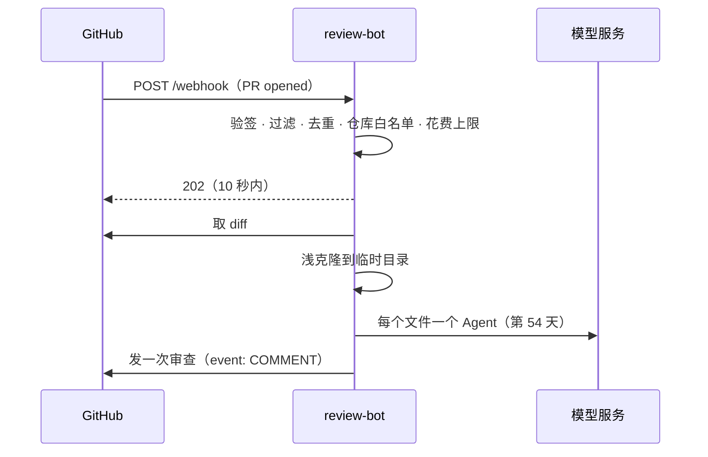

# 第 56 天：上线

> 最后核对：2026-11-07

第 55 天，review-bot 在评估集上达标了。今天让它真的接到 PR：GitHub 上一有人提交，它就去审，几分钟后在 PR 里留下评论。

研究助手在第 48–50 天已经上过一次线：Docker、健康检查、优雅退出、监控告警、灰度。那些都还适用，今天不重复。今天讲的是毕业项目上线时**最容易被忽略的三件事**：

1. **入口的安全**：一个公开的地址，谁都能往里 POST。怎么确认是 GitHub 发的？怎么不被重复触发、不被自己触发？
2. **钱包的上限**：一个几千行的 PR、一个死循环、一个刷接口的人，一夜之间能花掉一个月的预算。模型服务的账单不会替你停
3. **上线前的检查清单**：密钥有没有提交进仓库？配置有没有列全？哪些事必须人来确认？

学完今天，你会：

- 接一个 webhook：校验签名、过滤事件、去重、马上返回、后台处理
- 给整个产品加上按天、按月的花费上限：先降级、再停下
- 用代码检查提交里的密钥和 `.env.example`，用清单确认不能自动检查的事
- 把毕业项目部署上线，接到第一个真实的请求

## review-bot 上线的样子



[app.ts](exercise/app.ts) 只有两个地址：`POST /webhook` 和 `GET /healthz`。几个要点：

**马上返回 202，审查放到后台**。GitHub 等 webhook 的响应只等 10 秒，审一个 PR 要几分钟。超时了 GitHub 会当作失败，过一会儿重发：同一个 PR 会被审两遍。第 40 天讲过同步和异步的取舍，这里只能异步。

**机器人只留评论**。[github.ts](exercise/github.ts) 发的审查永远是 `event: 'COMMENT'`，不批准、不要求修改（第 51 天的「不做」）。权限也只给到这一步：GitHub App 的 Pull requests 读写、Contents 只读，没有 Administration、Workflows。

**检出代码要小心**。PR 里的代码是不可信的（第 53 天）：浅克隆到临时目录；`core.symlinks=false` 让软链接检出成普通的文本文件，从根上堵住软链接的攻击；令牌放在请求头里，不拼进网址（网址会出现在 git 的错误信息和进程列表里）；用完删掉。

## 入口的安全：签名、过滤、去重

[webhook.ts](exercise/webhook.ts) 的三道关：

### 签名

在 GitHub 上配置 webhook 时填一个密钥。GitHub 每次发事件，用它对**请求体的原始字节**算 HMAC-SHA256，放在 `X-Hub-Signature-256: sha256=…` 里。你用同一个密钥算一遍，对得上才是 GitHub 发的。

两个坑：

- **一定要对原始的字节算**。先 `JSON.parse` 再 `JSON.stringify`，空格、键的顺序、中文的转义一变，签名就对不上了。所以 `app.ts` 先读出原始的 Buffer、验签，通过了才解析 JSON
- **用固定时间的比较**（第 40 天的 `timingSafeEqual`）

没通过验签的请求，**连 JSON 都不解析**：解析器本身也可能有漏洞，攻击面越小越好。

### 过滤

不是每个 PR 事件都要审：

| 事件 | 处理吗 | 为什么 |
|---|---|---|
| opened、reopened、synchronize（推了新提交）、ready_for_review | 审 | |
| closed、labeled、edited…… | 不审 | 代码没变 |
| 草稿 PR | 不审 | 作者还没写完，审了也是浪费 |
| 机器人触发的（`sender.type` 是 Bot） | 不处理 | 两个机器人互相触发，会无限循环 |

### 去重

GitHub 收不到 2xx、或者网络抖了一下，会重发同一个事件，`X-GitHub-Delivery` 一样。`createDeliveryDedup` 记住 24 小时内处理过的编号。它只在一个进程的内存里，多台机器、重启以后要换成 Redis 的 `SET key NX EX 86400`（第 45 天）。

去重也是第 35 天说的**幂等**：同一个请求来两次，效果和一次一样。任何会被重试的入口都要想这件事。

## 钱包的上限

到第 56 天为止，我们有三层花费控制，各管各的：

| 层 | 管什么 | 到了怎么办 | 来自 |
|---|---|---|---|
| 单次任务的预算 | 一次研究、一个 PR 最多花多少 | 停下这次任务，返回部分结果 | 第 36 天 |
| 用户的配额 | 一个用户每天最多几次、花多少 | 这个用户 429 | 第 46 天 |
| **整个产品的上限** | 你一天、一个月最多花多少 | 先降级，再停 | 今天 |

前两层都挡不住「所有用户加起来」：一百个用户每人都没超配额，加起来也可能超出你能承受的。[spend-guard.ts](exercise/spend-guard.ts)：

```text
已花 / 上限（当天和当月取大的那个）
  < 80%   normal    用主力模型
  ≥ 80%   degraded  换成便宜的模型（CHEAP_MODEL）
  ≥ 100%  stopped   不再调用模型；webhook 直接回「花费到了上限」
```

`guardedModel` 把它包成一个 `Model`：Agent、评估、总结都不用改，每次调用前看一眼状态，调用后按**实际用的那个模型**的单价记账。花了多少存在文件里，重启以后还在；换了一天、换了一个月自动清零（按 UTC，跨时区部署时想清楚「一天」从什么时候开始）。

降级也要告警：到 80% 时群里应该收到一条（第 49 天的告警规则，指标换成「今天已花 / 上限」）。用户会发现质量变差了，你要先知道为什么。

**模型服务那边也设一个上限**。大部分模型服务的控制台能设每月的消费上限或者余额提醒。代码里的上限防的是你的 bug，平台上的上限防的是代码里的上限本身有 bug。

## 上线前的检查清单

[preflight.ts](exercise/preflight.ts) 把能自动检查的写成代码，每次发布前跑一遍，也可以放进 CI：

```bash
node days/day56/exercise/preflight.ts /path/to/your/project
```

```text
❌ 提交里没有密钥：src/config.ts:4（assigned-secret，mk_l…）
✅ .env.example 列全了配置，没有真的密钥：没有问题
✅ 设了花费上限：每天 2 元，每月 40 元
☐ GitHub App 只有最小的权限：Contents 只读、Pull requests 读写、Metadata 只读；不要 Administration、Workflows
☐ 评估达标：第 55 天的成功标准在开发集上全部达标，测试集确认过一次
☐ 告警能收到：故意弄错一次模型的 Key，群里几分钟内收到告警（第 49、50 天）
☐ 能回滚：知道怎么退回上一个镜像（第 48 天）、上一版 prompt（第 49 天）
☐ 说清楚数据去了哪里：代码会发给哪家模型服务、存多久；README 里写明
```

**密钥扫描**只扫 git 跟踪的文件（`git ls-files`）：本机的 `.env` 本来就不提交，扫它只会制造噪音。规则很朴素：几种常见密钥的格式，加上「名字像密钥的变量被赋了一个长字符串」，排除 `your-xxx`、`changeme` 这类占位符。明知是假的（比如测试用的），在那一行写上 `preflight-ignore`，显式地标出来。

密钥一旦提交过，**删掉那一行不够**：它还在 git 的历史里，推到 GitHub 的那一刻就可能被扫走了。正确的做法是立刻去服务商那里作废这个密钥，再换一个新的。

**`.env.example`** 检查三件事：代码要的配置都列了（新人照着它就能跑起来）；没有多余的（多半是改名以后忘了删）；名字像密钥的都没填真值（它会被提交）。

更完整的扫描用 [gitleaks](https://github.com/gitleaks/gitleaks)，GitHub 的 Secret scanning 和 push protection 也建议打开。

**不能自动检查的**，列出来让人确认。其中「说清楚数据去了哪里」对毕业项目特别重要：review-bot 会把别人的代码发给模型服务。用哪家、会不会被拿去训练、存多久，要写进 README。在国内面向公众提供服务，还要考虑第 39 天讲的备案和生成内容标识。

## 上线步骤

以 review-bot 为例，你的项目照着改：

1. **建一个 GitHub App**：权限按上面的清单；订阅 Pull request 事件；webhook 的地址先空着，密钥用 `openssl rand -hex 32` 生成
2. **部署**：用第 48 天的 Docker 方式，运行 `app.ts`。配置：`GITHUB_TOKEN`、`WEBHOOK_SECRET`、`OPENAI_*`、`CHEAP_MODEL`、`OPENAI_PRICE`、`SPEND_DAILY`、`SPEND_MONTHLY`、`ALLOWED_REPOS`
3. **跑一遍清单**：`preflight.ts` 全部通过，人工的逐条确认
4. **填上 webhook 的地址**，把 App 装到**一个测试仓库**上（`ALLOWED_REPOS` 先只放它）
5. **提一个已知有问题的 PR**：比如评估集里的 `sql-injection`。几分钟内应该看到评论
6. **看日志和花费**：`review.posted` 的用时、实际花了多少，和第 52 天的估算对照
7. 没问题再装到真正的仓库上

## 读懂练习代码

| 文件 | 内容 | 今天要做的 |
|---|---|---|
| [webhook.ts](exercise/webhook.ts) | 签名、事件过滤、去重 | TODO 1、2 |
| [spend-guard.ts](exercise/spend-guard.ts) | 按天、按月的花费上限；带上限的模型 | TODO 3、4 |
| [preflight.ts](exercise/preflight.ts) | 密钥扫描、`.env.example`、上线清单 | TODO 5、6 |
| [app.ts](exercise/app.ts) | webhook 服务：串起上面的一切，后台审查 | 读懂即可 |
| [github.ts](exercise/github.ts) | 取 diff、发审查 | 读懂即可 |
| `core/`、`diff.ts`、`repo.ts`、`tools.ts`、`prompts.ts`、`review.ts` | 和第 55 天的参考答案一样 | 不用改 |

## 常见误解

| 误解 | 实际上 |
|---|---|
| webhook 的地址没人知道，不用验签 | 地址会出现在日志、配置里；扫描器也会找。必须验签 |
| 解析成 JSON 再验签也一样 | 重新序列化的字节和原来的不一样，签名对不上 |
| 收到事件就审，审完再返回 | GitHub 只等 10 秒；超时会重发，同一个 PR 被审两遍 |
| 每个用户都有配额，总花费就不会失控 | 配额管不住「所有人加起来」；要有整个产品的上限 |
| 到了上限直接停 | 先降级到便宜的模型，还能用；到 100% 再停，并且告警 |
| 提交了密钥，删掉那一行就行 | 它在 git 历史里，可能已经被扫走了；要立刻作废、换新的 |
| 安全检查都能写成代码 | 权限、回滚、隐私说明要人来确认；清单把它们列出来 |

## 常见错误

| 报错 | 原因 |
|---|---|
| 签名的测试说「重新序列化以后签名就对不上了」应该是 false | 算签名之前把请求体解析又序列化了；或者 verifySignature 总是返回 true |
| 签名的测试抛了 RangeError | 长度不同时直接调用了 `timingSafeEqual`，要先比长度 |
| 过滤的测试说草稿 PR 应该不审 | 没看 `pull_request.draft` |
| 去重的测试说「a 最早，被挤掉了」 | 超过上限时删的不是最早的；或者过期以后重新记时没有先删掉（Map 的顺序没变） |
| 花费的测试说换了一天要清零 | 没有在 status 和 record 之前检查日期 |
| 花费的测试说同时记几笔一笔都不丢，结果少了 | 写文件没有排队，后写的覆盖了先写的；或者写之前读了旧的文件 |
| 带上限的模型记账多了 | 降级以后还按主力模型的单价记 |
| 密钥扫描报了占位符 | assigned-secret 规则没有排除 `PLACEHOLDER` |
| 密钥扫描同一行报了两条 | 一行命中一条规则以后要停下 |
| `.env.example` 的测试说 OPENAI_MODEL 不该算填了密钥 | 没有按名字（`SECRET_NAME`）筛 |

## 动手

1. **TODO 1**：`verifySignature`。
2. **TODO 2**：`parsePullRequestEvent` 和 `createDeliveryDedup`。
3. **TODO 3**：`openSpendGuard`。
4. **TODO 4**：`guardedModel`。
5. **TODO 5**：`scanSecrets`。
6. **TODO 6**：`checkEnvExample`。全部测试通过。
7. **在本机发一个假的 webhook**：用 `sign()` 算签名，`curl` 给本机跑着的 `app.ts` 发一个 `pull_request` 事件（`GITHUB_TOKEN` 可以先用一个只读的令牌，看它取 diff、跑审查；发审查那一步会因为权限失败，日志里看得到）。
8. **你的项目上线**：按「上线步骤」部署你的毕业项目。它不一定是 webhook，但这三件事都要有：入口的安全、整个产品的花费上限、跑过一遍检查清单。

## 检查

```bash
npm run check 56
```

毕业项目对照这几条自查：

- [ ] 部署好了，有一个线上的地址；接到了至少一个真实的请求，结果符合预期
- [ ] 入口有鉴权或者验签；会被重试的入口做了幂等
- [ ] 有整个产品的花费上限（代码里一层，模型服务的控制台一层），到 80% 有告警
- [ ] `preflight` 在你的仓库上全部通过；人工的几项逐条确认过
- [ ] README 里写明了数据会发给谁、存多久

## 小实验

- 把 `SPEND_DAILY` 设成 0.01，提一个 PR，看降级和停下时日志和 PR 上分别是什么样子
- 给一个 PR 连推三次提交，看会审几次。要不要在推新提交时取消正在审的旧提交？怎么做？
- 用 `preflight.ts` 扫一遍这门课的仓库，看它报了哪些（示例仓库里那个 `mailApiKey` 应该被报出来）
- 打开你仓库的 GitHub Secret scanning 和 push protection，故意提交一个假的令牌试试

## 小结

- webhook 的入口：对原始字节验签、过滤不该处理的事件（草稿、机器人）、按投递编号去重、马上返回 202
- 机器人只留评论；权限最小；检出不可信的代码时关掉软链接、令牌不进网址
- 三层花费控制：单次任务、用户配额、整个产品；整个产品的上限先降级再停，模型服务的控制台再设一层
- 上线前跑一遍清单：密钥、`.env.example`、花费上限自动检查；权限、告警、回滚、隐私人来确认
- 提交过的密钥要作废，不是删掉那一行

## 想一想

- 别人要怎么才能用上你的 review-bot？README 里要写什么？（第 57 天）
- 一个陌生人打开你的仓库，30 秒内能看懂它是干什么的吗？（第 57 天）
- 你的项目要发布到 npm 吗？版本号怎么定？（第 57 天）

## 延伸阅读

- [GitHub Docs：Validating webhook deliveries](https://docs.github.com/en/webhooks/using-webhooks/validating-webhook-deliveries)：签名的算法和注意事项
- [GitHub Docs：Best practices for using webhooks](https://docs.github.com/en/webhooks/using-webhooks/best-practices-for-using-webhooks)：10 秒内响应、按投递编号去重
- [GitHub Docs：Choosing permissions for a GitHub App](https://docs.github.com/en/apps/creating-github-apps/registering-a-github-app/choosing-permissions-for-a-github-app)：最小权限
- [GitHub Docs：About secret scanning](https://docs.github.com/en/code-security/secret-scanning/introduction/about-secret-scanning)：Secret scanning 和 push protection
- [gitleaks](https://github.com/gitleaks/gitleaks)：更完整的密钥扫描
- [OWASP：Top 10 for LLM Applications](https://genai.owasp.org/llm-top-10/)：上线前对照一遍（Unbounded Consumption、Excessive Agency……）
