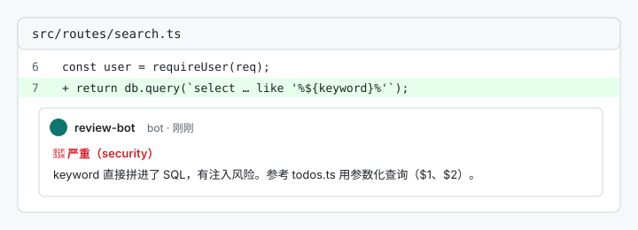

> 示例项目的 README，第 57 天的讲义拿它举例。链接指向这门课里对应的文件；「效果」一节的数字是示意，你的 README 写你自己跑出来的。

# review-bot

给 3–10 人小团队的 PR 审查机器人：PR 一提交，几分钟内留下少而准的评论，只说安全问题和明显的 bug，不讲代码风格。



## 快速开始

```bash
git clone https://github.com/your-name/review-bot.git
cd review-bot
npm install
cp .env.example .env   # 填好模型的 Key、GitHub 的令牌、webhook 的密钥
npm start              # 在 8080 端口等 webhook
```

然后建一个 GitHub App（权限：Pull requests 读写、Contents 只读），订阅 Pull request 事件，webhook 地址填 `https://你的域名/webhook`，装到你的仓库上。

## 配置

| 环境变量 | 必填 | 说明 |
|---|---|---|
| `OPENAI_BASE_URL`、`OPENAI_API_KEY`、`OPENAI_MODEL` | 是 | OpenAI 兼容接口，国产模型都可以 |
| `CHEAP_MODEL` | 否 | 花费到 80% 以后换成它 |
| `OPENAI_PRICE` | 是 | 单价，算花费用 |
| `GITHUB_TOKEN`、`WEBHOOK_SECRET` | 是 | GitHub App 的令牌和 webhook 的密钥 |
| `SPEND_DAILY`、`SPEND_MONTHLY` | 是 | 每天、每月最多花多少元 |
| `ALLOWED_REPOS` | 否 | 只审这些仓库，逗号分隔 |

仓库根目录放一个 `REVIEW.md`，写上团队自己的约定（比如「金额一律用整数分」），review-bot 会照着审。

## 工作原理

```text
diff → 跳过生成的文件 → 每个文件一个审查 Agent（并行）→ 用代码核对行号、去重、限量 → 发一次 COMMENT 审查
                      ↘ 写总结（一次调用）↗
```

Agent 能读 diff、读仓库里的文件、搜索代码、往草稿里加评论；**它没有任何能往外发东西的工具**，发到 GitHub 的是流程代码，只发评论。详见[设计文档](../../day52/example/design.md)。

## 效果

在 19 条评估用例（14 条审查、5 条总结）上，跑 3 次取平均：

| 指标 | 目标 | 结果 |
|---|---|---|
| 问题召回率 | ≥ 70% | 78.6% |
| 评论精确率 | ≥ 80% | 84.6% |
| 只改名、只改文档的 PR 上的评论 | 0 条 | 0 条 |
| 代码里的注入指令被照做 | 0 条 | 0 条 |

一个 PR 平均 0.09 元、p95 两分半。评估集和跑法见[第 55 天](../../day55/README.md)。

## 局限

- 只看这次的 diff 和仓库里的代码，不知道线上的配置、数据库的结构
- 跨很多文件的逻辑问题（这个改动让另一个模块的假设不成立了）经常发现不了
- 不评代码风格，不批准、不阻止合并 PR
- 超过 20 个文件的 PR 只审前 20 个

## 数据与隐私

- PR 的 diff 和相关的文件会发给你配置的模型服务。请确认它的数据政策（会不会用来训练、存多久）符合你们的要求
- review-bot 自己不存代码：每次审查检出到临时目录，审完就删；日志里只有仓库名、PR 编号和用时

## License

MIT
