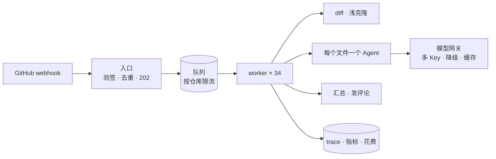

# 第 58 天：Agent 系统设计

> 最后核对：2026-11-08

毕业项目上线了。接下来两天换一个角度：**把你这 57 天做过的东西讲给别人听**。今天是系统设计题，明天是面试的问答和项目讲述。

Agent 方向的系统设计题，和传统的「设计一个短链服务」很不一样：瓶颈常常不在数据库，而在**模型服务的限流、单次任务的成本和几分钟的延迟**；正确性不靠单元测试，而靠**评估**；最大的安全风险是**提示注入**。这些你都亲手做过。今天把它们组织成一套答题的方法，做三道常见的题。

学完今天，你会：

- 用固定的五步回答一道 Agent 系统设计题
- 用利特尔法则、RPM 和 TPM 估算并发、限流、worker 数量和每月花费
- 找出关键路径，知道缩短哪一步才能降延迟
- 完成两道设计题：客服 Agent、深度研究系统（第三道代码审查机器人，讲义里给出参考）

## 五步

[templates/system-design.md](templates/system-design.md) 是答题的模板。45 分钟大致这样分：

| 步骤 | 时间 | 要点 |
|---|---|---|
| 澄清需求 | 5 分钟 | 用户、任务、成功的标准、规模、约束。**别急着画图** |
| 估算 | 5 分钟 | 峰值、并发、限流、成本、延迟。数字不用精确，量级对、假设说清楚 |
| 整体设计 | 15 分钟 | 一张图：入口、队列、Workflow 还是 Agent、工具、存储 |
| 深挖 | 15 分钟 | 挑两三个：上下文、评估、可靠性、安全、成本 |
| 取舍 | 5 分钟 | 每个选择换来了什么、付出了什么 |

澄清需求时最值得问的几个问题：错了的代价有多大（客服答错和审查漏报，后果完全不同）？能等多久（实时对话还是后台任务）？数据能不能发给外部模型？有没有现成的数据可以做评估集？

## 估算

[estimate.ts](exercise/estimate.ts) 把常用的几笔算术写成了函数。

### 峰值和并发

```text
峰值每秒任务数 = 每天的任务数 ÷ (活跃的小时数 × 3600) × 峰值倍数
同时在跑的任务 = 峰值每秒任务数 × 每个任务的平均耗时（秒）      ← 利特尔法则 L = λW
```

利特尔法则是 Agent 系统估算里最有用的一个公式。Agent 任务一跑就是几十秒到几分钟，**同时在跑的任务数**决定了要多少 worker、多少内存、多少数据库连接、多少打开的 SSE 连接。每秒只来 5 个任务，每个跑 2 分钟，同时就有 600 个在跑。

### 模型服务的限流

模型服务按 Key（或者账号）限流，两个维度：

| 限制 | 意思 | 怎么算 |
|---|---|---|
| RPM | 每分钟多少次请求 | 峰值每秒任务数 × 60 × 每个任务调用几次 |
| TPM | 每分钟多少个 token | 峰值每秒任务数 × 60 × 每个任务多少 token |

Agent 每一步都重发全部历史（第 52 天），token 用得很凶，**大多数时候先撞上的是 TPM**。`capacityPlan` 算出两个比例，按 70% 的余量算要几个 Key 的额度。应对的办法：找模型服务提额、多个 Key 或者多家模型分摊（第 35 天的降级链）、减少 token（压缩工具结果、缓存）、削峰（队列，第 45 天）。

### 成本和延迟

每月花费 = 每天的任务数 × 每个任务的花费 × 30。每个任务的花费用第 52 天的 `estimateCost`。

延迟看**关键路径**：`latency` 把按顺序的步骤加起来，并行的那一步取最慢的。想降延迟，只有缩短关键路径上的步骤才有用：review-bot 的总结和审查是并行的，把总结换成更快的模型，总时间一秒都不会少。

## 题一：代码审查机器人（参考答案）

> 设计一个代码审查机器人，给一万个仓库用，每天大约十万个 PR。

**澄清**：只审 diff 还是整个仓库？能不能把代码发给外部模型？误报的代价：太吵会被关掉，所以精确率比召回率重要（第 51 天）。要在几分钟内出结果。

**估算**（`capacityPlan`，假设工作时间 10 小时、峰值 2 倍、每个 PR 跑 2 分钟、调用 12 次模型、6 万 token）：

```text
峰值 5.56 个任务/秒，同时在跑 667 个
峰值每分钟 4,000 次调用（一个 Key 的 40%）、20,000,000 个 token（400%）
先撞上 TPM：要 6 个 Key 的额度，34 个 worker
```

每个 PR 0.09 元，一个月约 27 万元。这个数字本身就是一个值得讨论的点：要不要对小改动用便宜的模型？要不要按仓库收费？

**整体设计**：第 56 天的 review-bot，加上横向扩展需要的东西：



**深挖**：

- **公平性**：一个仓库一次推了 500 个 PR，不能把别人都堵住。队列按仓库分组、每个仓库有并发上限（第 46 天的配额思路）
- **同一个 PR 连推几次**：新提交来了，取消还在审的旧提交（第 45 天的取消）
- **模型网关**：多个 Key 轮流用、按 TPM 余量分配、挂了降级（第 35 天）
- **评估**：离线评估集加上线上的「评论被点 👎 / 被标为已解决」回流（第 49 天）
- **安全**：PR 里的代码是不可信的；Agent 没有外传工具；检出时关掉软链接（第 52、53、56 天）

**取舍**：按文件拆 Agent 换来了并行和可控的成本，付出的是看不到跨文件的问题；只发评论、不阻止合并，换来了团队愿意装它，付出的是严重问题也可能被忽略。

## 题二：客服 Agent（你来做）

> 一个电商平台的客服 Agent：回答订单、退换货、物流的问题，能查订单、能发起退款；每天五万个会话，高峰在晚上。

几个提示：

- 对话是**实时**的：延迟要求和后台任务完全不同。流式输出（第 3、44 天）、第一个字多久出来
- 退款是**不可逆**的：权限分级、人工确认、金额上限（第 29 天）；致命三要素（第 37、52 天）
- 知识库检索（第 17、18 天）；答不了要转人工，转人工的比例本身是一个指标
- 多租户：每个用户只能查自己的订单（第 46 天）
- 估算：晚上的峰值倍数会更大；每个会话几轮、每轮几次调用

## 题三：深度研究系统（你来做）

> 一个深度研究产品：用户提一个问题，系统花 5–20 分钟调研，产出一份带引用的报告；每天一万个任务。

几个提示：

- 一个任务要跑很久：后台任务、进度推送、断线续传、崩溃恢复（第 45 天）
- 计划、并行子 Agent、引用核查（第 23–25、30 天）；子 Agent 的 token 成本会成倍放大
- 抓网页：缓存、限流、被封、恶意网页里的注入（第 12、27、37 天）
- 成本：一个任务可能要几元钱，按用户设预算（第 36 天）；同一个问题能不能复用结果
- 评估：报告的质量怎么评（第 32 天的评审模型和人工标注）

## 读懂练习代码

| 文件 | 内容 | 今天要做的 |
|---|---|---|
| [estimate.ts](exercise/estimate.ts) | 峰值、并发、容量规划、每月花费、延迟和关键路径 | TODO 1–3 |
| [templates/system-design.md](templates/system-design.md) | 答题的模板 | 用它写两道题 |

## 常见误解

| 误解 | 实际上 |
|---|---|
| 先画架构图 | 先澄清需求和规模；不同的规模，设计完全不同 |
| 瓶颈在数据库 | Agent 系统的瓶颈常常是模型服务的 TPM |
| 每秒 5 个任务不算多 | 每个跑 2 分钟，同时就有 600 个在跑 |
| 平均延迟够快就行 | 看 p95 和关键路径；缩短不在关键路径上的步骤没用 |
| 估算要精确 | 量级对、假设说清楚就行 |
| 设计题只考架构 | 评估、安全、成本这些「Agent 特有」的深挖，最能拉开差距 |

## 常见错误

| 报错 | 原因 |
|---|---|
| 峰值的测试差了 3600 倍 | 小时没换成秒 |
| 并发的测试差了 60 倍 | 平均耗时用了分钟 |
| keysNeeded 少了 | 没有除以余量，或者向下取整了 |
| bottleneck 的测试说应该是 tpm | 一样大时算 tpm；或者比较时用了绝对值而不是比例 |
| 关键路径的名字不对 | 并行的一步列了全部的名字；要列最慢的那个 |

## 动手

1. **TODO 1**：`peakRate` 和 `concurrency`。
2. **TODO 2**：`capacityPlan`。
3. **TODO 3**：`latency`。全部测试通过。
4. **做题二和题三**：用模板写，每道题限时 45 分钟。估算用 `estimate.ts` 算，把假设写在表里。
5. **讲一遍**：找一位同学或者朋友扮演面试官，讲其中一道题，请他随时打断追问。记下你答不上来的问题。
6. **用你的毕业项目出一道题**：「如果你的产品有一万个用户，要改什么？」用同样的五步回答。

## 检查

```bash
npm run check 58
```

对照这几条自查：

- [ ] 两道题都按五步写完，每道题都有估算的表格和一张图
- [ ] 每个估算都写了假设
- [ ] 深挖至少讲到了评估、安全、成本里的两个
- [ ] 每个设计都写了取舍：换来了什么、付出了什么
- [ ] 讲过一遍，记下了答不上来的问题

## 小实验

- 把题一的每个 PR 的 token 从 6 万降到 3 万（压缩工具结果、缓存），要几个 Key？每月省多少钱？
- 算一下你的毕业项目：现在的用户量，离撞上一个 Key 的 TPM 还有多远？
- 把 review-bot 的关键路径画出来，用真实的 trace 数字（第 34 天）填上，看哪一步最值得优化

## 小结

- 五步：澄清、估算、整体设计、深挖、取舍；先问清楚再画图
- 利特尔法则算同时在跑的任务；RPM 和 TPM 算限流，Agent 多半先撞 TPM
- 成本 = 任务数 × 单次花费；延迟看关键路径
- Agent 设计题拉开差距的是评估、安全、成本这些你亲手做过的东西

## 想一想

- 面试官问「你的 Agent 和直接调一次模型有什么区别」，你怎么回答？（第 59 天）
- 你的毕业项目里，最值得讲的一个技术决定是什么？（第 59 天）

## 延伸阅读

- [Little's law](https://en.wikipedia.org/wiki/Little%27s_law)：利特尔法则
- [OpenAI：Rate limits](https://platform.openai.com/docs/guides/rate-limits)：RPM、TPM 和应对办法；各家国产模型的限流规则见各自的文档
- [Anthropic：How we built our multi-agent research system](https://www.anthropic.com/engineering/multi-agent-research-system)：深度研究系统的设计和成本
- [Alex Xu：System Design Interview](https://bytebytego.com/)：传统系统设计题的答题框架
